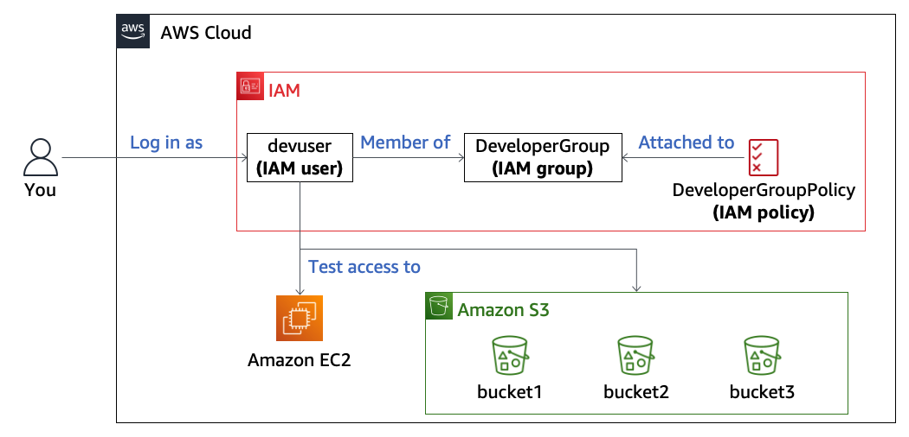
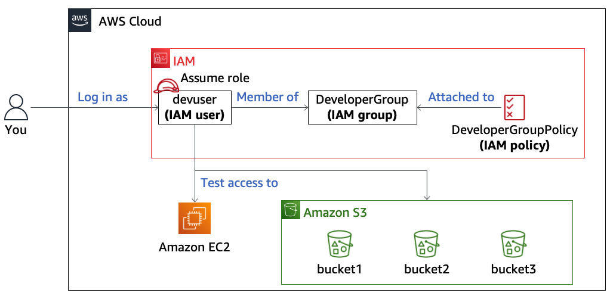
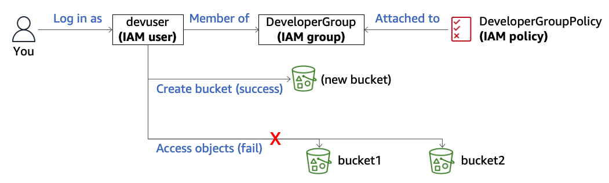
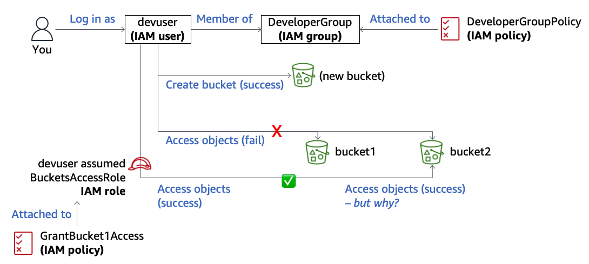
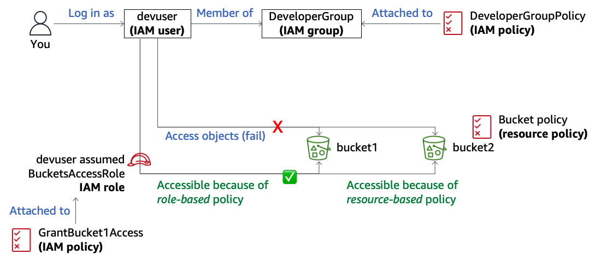

# Лабораторна робота 3.1: використання політик на основі ресурсів для захисту бакета S3 (Lab 3.1: Using Resource-Based Policies to Secure an S3 Bucket)

## Огляд і цілі лабораторної роботи

У цій лабораторній роботі ви дізнаєтеся, як налаштовувати дозволи за допомогою політик на основі ідентичності та політик на основі ресурсів AWS Identity and Access Management (IAM), як-от політики бакетів Amazon Simple Storage Service (Amazon S3). Ви також дізнаєтеся, як політики IAM і політики ресурсів визначають дозволи на доступ.

Після завершення цієї лабораторної роботи ви зможете:

- Розпізнавати, як використовувати політики IAM на основі ідентичності та політики на основі ресурсів для визначення детального контролю доступу до сервісів і ресурсів AWS.

- Описувати, як користувач IAM може прийняти роль IAM (assume), щоб отримати інші дозволи на доступ до акаунта AWS.

- Пояснювати, як політики бакетів S3 та політики IAM на основі ідентичності, призначені користувачам і ролям IAM, впливають на те, що користувачі можуть бачити чи змінювати в різних сервісах AWS в AWS Management Console.

## Тривалість

Для виконання цієї лабораторної роботи потрібно приблизно **60 хвилин**.

## Обмеження сервісів AWS

У цьому лабораторному середовищі доступ до сервісів AWS і дій сервісів може бути обмежений тими, що потрібні для виконання інструкцій лабораторної роботи. Ви можете стикнутися з помилками, якщо спробуєте отримати доступ до інших сервісів чи виконати дії, окрім описаних у цій лабораторній роботі.

## Сценарій

Наведена нижче діаграма показує архітектуру, яку було створено для вас в AWS на *початку* лабораторної роботи.

Текст зі схеми

Log in as (Увійти як)

You (Ви)

devuser (IAM user) (devuser (користувач IAM))

Member of (Член групи)

DeveloperGroup (IAM group) (DeveloperGroup (група IAM))

Attached to (Прикріплена до)

DeveloperGroupPolicy (IAM policy) (DeveloperGroupPolicy (політика IAM))

Test access to (Перевірка доступу до)

Amazon EC2

Amazon S3

bucket1

bucket2

bucket3

AWS Cloud

IAM

Лабораторне середовище має три попередньо налаштовані бакети Amazon S3: *bucket1*, *bucket2* і *bucket3*. Середовище також має попередньо налаштовану роль IAM, що дозволяє доступ до певних бакетів та їхніх об’єктів, коли роль прийнято. Ви аналізуватимете різні політики, щоб краще зрозуміти, як вони контролюють ваш рівень доступу.

Наприкінці цієї лабораторної роботи ви створите архітектуру, показану на наведеній нижче діаграмі.

Текст зі схеми

Log in as (Увійти як)

You (Ви)

Assume role (Прийняти роль)

devuser (IAM user) (devuser (користувач IAM))

Member of (Член групи)

DeveloperGroup (IAM group) (DeveloperGroup (група IAM))

Attached to (Прикріплена до)

DeveloperGroupPolicy (IAM policy) (DeveloperGroupPolicy (політика IAM))

Test access to (Перевірка доступу до)

Amazon EC2

Amazon S3

bucket1

bucket2

bucket3

AWS Cloud

IAM

## Завдання 1: доступ до консолі як користувач IAM

1.  У верхній частині цих інструкцій оберіть **Start Lab**.

    - Розпочнеться лабораторний сеанс.

    - Угорі сторінки відображається таймер, що показує час, який залишився в сеансі.  
      > **Порада:** щоб у будь-який момент продовжити тривалість сеансу, знову оберіть **Start Lab**, перш ніж таймер досягне 00:00.

2.  Перш ніж продовжити, зачекайте, доки значок-коло праворуч від посилання AWS у верхньому лівому куті стане зеленим. Коли лабораторне середовище буде готове, також відобразиться панель AWS Details.  
    > **Попередження:** НЕ обирайте посилання AWS для підключення до консолі в цій лабораторній роботі. Ви отримаєте доступ до консолі інакше, ніж у більшості лабораторних робіт.

3.  Увійдіть як користувач IAM з іменем *devuser*:

    - Оберіть посилання **AWS Details** угорі сторінки.

    - Скопіюйте значення **IAMUserLoginURL** і завантажте його в новій вкладці браузера.

    - У полі **IAM user name** введіть devuser

    - У полі **Password** введіть значення **IAMUserPassword** з панелі AWS Details на сторінці інструкцій лабораторної роботи.

    - Оберіть **Sign in**.  
      > Відобразиться AWS Management Console.  
      > **Попередження:** щоб уникнути проблем, НЕ змінюйте регіон під час цієї лабораторної роботи, якщо не вказано інше.

4.  Розташуйте вкладку AWS Management Console так, щоб вона відображалася поруч із цими інструкціями. Ідеально, якщо ви зможете бачити обидві вкладки браузера одночасно, щоб легше виконувати кроки лабораторної роботи.

## Завдання 2: спроба доступу на читання до сервісів AWS

Тепер, коли ви увійшли в консоль як користувач IAM з іменем *devuser*, ви дослідите рівень доступу до кількох сервісів AWS, зокрема Amazon Elastic Compute Cloud (Amazon EC2), Amazon S3 та IAM.

5.  Відкрийте консоль Amazon EC2:

    - У меню **Services** оберіть **Compute** \> **EC2**.

    - В лівій панелі навігації оберіть **EC2 Dashboard**.  
      > Відображається багато повідомлень про помилки API. Це очікувано.

6.  Спробуйте виконати кілька дій у консолі Amazon EC2:

    - В лівій панелі навігації оберіть **Instances**.  
      > У списку Instances відображається повідомлення *You are not authorized to perform this operation* (Ви не маєте повноважень виконувати цю операцію).

    - Оберіть **Launch instances**

    - Прокрутіть униз і відкрийте випадаючий список Key pair name.  
      > Відображається повідомлення *You are not authorized to perform this operation* (Ви не маєте повноважень виконувати цю операцію).  
      > Зверніть увагу, що Key pair name — це *обов’язкове* налаштування, яке потрібно вказати, якщо ви хочете запустити екземпляр. Це лише одна з багатьох ознак того, що з дозволами, наданими вам як користувачу devuser, ви не зможете запустити екземпляр EC2.

    - На панелі Summary праворуч оберіть **Cancel**.

7.  Щоб дослідити, до чого ви маєте доступ у консолі Amazon S3, у меню **Services** оберіть **Storage** \> **S3**.  
    > Відображаються три бакети. Назви бакетів унікальні, але назва одного бакета містить *bucket1*, іншого — *bucket2*, а третього — *bucket3*.  
    > У списку бакетів зверніть увагу, що в стовпці **Access** для всіх трьох бакетів відображається повідомлення Insufficient permissions (Недостатньо дозволів). Це очікувано.

## Завдання 3: аналіз політики на основі ідентичності, застосованої до користувача IAM

Ви спостерігали, як користувач IAM *devuser* не може отримати доступ до певної інформації та дій як у консолі Amazon S3, так і в консолі Amazon EC2. У цьому завданні ви розглянете подробиці політики IAM, що застосовується до *devuser*, щоб зрозуміти, чому ви не можете виконувати ці дії.

8.  Відкрийте консоль IAM і перегляньте налаштування членства користувача та груп:

    - У меню **Services** оберіть **Security, Identity, & Compliance** \> **IAM**.  
      > На сторінці панелі IAM зверніть увагу, що ви не маєте дозволів на перегляд певних частин сторінки. Обидва повідомлення стверджують *User: arn:aws:iam:::user/devuser is not authorized to perform: iam:GetAccountSummary on resource: \** (Користувач: arn:aws:iam:::user/devuser не авторизований виконувати: iam:GetAccountSummary для ресурсу: \*). Це очікувано.

    - В лівій панелі навігації оберіть **User groups**.

    - Оберіть назву групи **DeveloperGroup**.  
      > На вкладці **Users** зверніть увагу, що *devuser* є членом цієї групи IAM.

    - Оберіть вкладку **Permissions**.  
      > Зверніть увагу, що до цієї групи IAM прикріплено політику IAM з назвою DeveloperGroupPolicy.  
      > **Примітка:** коли політику прикріплено до групи, вона застосовується до будь-яких користувачів IAM, що є членами групи. Тому ця політика наразі керує вашим доступом до консолі, оскільки ви увійшли як *devuser*, що є членом цієї групи IAM.

9.  Перегляньте подробиці політики IAM:

    - У нижній частині сторінки оберіть значок «плюс» ліворуч від **DeveloperGroupPolicy**, щоб відобразити подробиці політики.

    - Перегляньте подробиці політики у форматі JSON і пригадайте рівень доступу, який ви мали до Amazon EC2 та Amazon S3 у попередньому завданні.

      - Зверніть увагу, що політика не дозволяє жодних дій Amazon EC2.

      - Зверніть увагу на дії IAM, які дозволяє політика. Коли ви відкривали панель IAM, ви побачили повідомлення, що вказувало, що у вас немає авторизації *iam:GetAccountSummary*. Цю дію не дозволено в цьому документі політики. Однак надано багато дозволів IAM на читання. Наприклад, ви можете переглядати подробиці цієї політики.

      - Зверніть увагу на дії Amazon S3, які дозволяє політика. Дій, пов’язаних з об’єктами, не надано, але деякі дії, пов’язані з бакетами, дозволено.

10. Збережіть політику у файл на вашому комп’ютері:

    - Щоб скопіювати політику у форматі JSON в буфер обміну, оберіть **Copy**.

    - Відкрийте текстовий редактор на вашому локальному комп’ютері та вставте політику, яку ви щойно скопіювали.

    - Збережіть документ політики як DeveloperGroupPolicy.json у розташуванні на вашому комп’ютері, яке ви запам’ятаєте.

## Завдання 4: спроба доступу на запис до сервісів AWS

Будь-яка дія, яку ви намагаєтеся виконати під час взаємодії із сервісом AWS, — це виклик API, незалежно від того, чи ви використовуєте консоль, інтерфейс командного рядка AWS (AWS CLI) чи набори для розробки програмного забезпечення AWS (SDK). Усі спроби викликів API записуються в журнали подій AWS CloudTrail.

У цьому завданні ви спробуєте виконати два виклики API, що потребують доступу *на запис* в Amazon S3. Перша дія — створити бакет S3, а друга — завантажити об’єкт до цього бакета. Після спроби виконати ці два завдання ви знову проаналізуєте політику, прикріплену до групи IAM, щоб зрозуміти, чому ви могли чи не могли виконати певні виклики API.

11. Спробуйте створити бакет S3:

    - Перейдіть до консолі Amazon S3.  
      > **Порада:** скористайтеся меню **Services** або знайдіть S3 у полі пошуку праворуч від меню.

    - Оберіть **Create bucket**

    - У полі **Bucket name** введіть ваші ініціали, за якими йде випадкове чотиризначне число; наприклад, *zba1234*.  
      > **Примітка:** за замовчуванням нові бакети, точки доступу та об’єкти не дозволяють публічного доступу. Докладніший розгляд цього виходить за межі цієї лабораторної роботи, але важливо про це знати.

    - У полі **AWS Region** оберіть **US East (N. Virginia) us-east-1**.

    - Перегляньте налаштування, а потім оберіть **Create bucket** унизу сторінки.  
      > Ви успішно створили бакет S3.

12. Відкрийте бакет і спробуйте завантажити об’єкт:

    - Оберіть назву бакета, який ви щойно створили.

    - Оберіть **Upload**, а потім **Add files**.

    - Перейдіть до файлу **DeveloperGroupPolicy.json**, який ви зберегли раніше, і оберіть його.

    - Оберіть **Upload**.  
      > Відображається повідомлення *Upload failed* (Завантаження не вдалося).

    - На вкладці **Files and folders** у нижній частині сторінки в стовпці **Error** оберіть посилання **Access Denied**.  
      > Повідомлення стверджує *You don't have permissions to upload files and folders* (Ви не маєте дозволів на завантаження файлів і папок).

    - Оберіть **Close**.

    - У навігаційному ланцюжку (breadcrumbs) у верхньому лівому куті сторінки оберіть **Amazon S3**.

13. Перегляньте подробиці політики для доступу до Amazon S3:

    - Поверніться до текстового редактора, де ви скопіювали документ DeveloperGroupPolicy.json.

    - Перегляньте подробиці політики, щоб зрозуміти, чому ви могли створити бакет S3, але не могли завантажувати до нього об’єкти.  
      > **Порада:** документ *Service Authorization Reference* надає перелік дій, які підтримує кожен сервіс AWS. Інформацію про дії Amazon S3 див. на сторінці [документації IAM](https://docs.aws.amazon.com/iam/): відкрийте її, а потім відкрийте документ *Service Authorization Reference*. В лівій панелі навігації розгорніть **Actions, resources, and condition keys**, а потім оберіть **Amazon S3**. У розділі **Actions defined by Amazon S3** таблиця перелічує кожну можливу дію Amazon S3, яку можна надати чи заборонити, разом з описом дії.

## Завдання 5: прийняття ролі IAM і перегляд політики на основі ресурсів

У цьому завданні ви спробуєте отримати доступ до *bucket1* і *bucket2*, увійшовши як користувач IAM *devuser*. Ви також спробуєте отримати доступ до бакетів за допомогою ролі, що була попередньо налаштована як частина налаштування лабораторної роботи.

14. Спробуйте завантажити об’єкт із бакетів, створених під час налаштування лабораторної роботи:

    - У консолі Amazon S3 оберіть назву бакета, що містить **bucket1**.

    - Виберіть **Image2.jpg**, а потім оберіть **Download**.  
      > З’являється сторінка помилки AccessDenied.

    - Щоб повернутися до консолі Amazon S3, натисніть кнопку «назад» вашого браузера.

    - У навігаційному ланцюжку (breadcrumbs) у верхньому лівому куті сторінки оберіть **Amazon S3**.

    - Спробуйте завантажити файл **Image1.jpg** із *bucket2*.  
      > Ви отримуєте ту саму помилку.

    - Щоб повернутися до консолі Amazon S3, натисніть кнопку «назад» вашого браузера.  
      > **Аналіз:** як показано на наведеній нижче діаграмі, з дозволами, наданими через членство в *DeveloperGroup*, ви змогли створити новий бакет. Однак ви не можете отримати доступ до об’єктів у *bucket1* чи *bucket2*.

Текст зі схеми

Log in as (Увійти як)

You (Ви)

devuser (IAM user) (devuser (користувач IAM))

Member of (Член групи)

DeveloperGroup (IAM group) (DeveloperGroup (група IAM))

Attached to (Прикріплена до)

DeveloperGroupPolicy (IAM policy) (DeveloperGroupPolicy (політика IAM))

Create bucket (success) (Створення бакета (успішно))

(new bucket) ((новий бакет))

Access objects (fail) (Доступ до об’єктів (невдало))

bucket1

bucket2

- У навігаційному ланцюжку (breadcrumbs) у верхньому лівому куті сторінки оберіть **Amazon S3**.

15. Прийміть роль IAM *BucketsAccessRole* у консолі:

    - У верхньому правому куті сторінки оберіть **devuser**, а потім оберіть **Switch role**.

    - Якщо з’являється сторінка Switch role, оберіть **Switch Role.**

    - Налаштуйте таке:

      - **Account:** введіть значення **AccountID** з панелі AWS Details на сторінці інструкцій лабораторної роботи.

      - **Role:** введіть BucketsAccessRole

      - **Display Name:** залиште це поле порожнім.

      - Оберіть **Switch Role**  
        > Ви успішно прийняли роль IAM з назвою *BucketsAccessRole*, яку було попередньо налаштовано для цієї лабораторної роботи.  
        > **Порада:** про те, що ви перейшли в роль, можна дізнатися за верхнім правим кутом консолі. Зверніть увагу, що **BucketsAccessRole** відображається там, де раніше відображався **devuser**.

16. Знову спробуйте завантажити об’єкт з Amazon S3:

    - У консолі Amazon S3 оберіть назву бакета, що містить **bucket1**.

    - Виберіть **Image2.jpg**, а потім оберіть **Download**.

    - Відкрийте файл, щоб переконатися, що файл завантажено.  
      > **Аналіз:** завантаження було успішним, що означає, що політика чи політики, застосовані до *BucketsAccessRole*, дозволяють дію *s3:GetObject* для *bucket1*.

17. Перевірте доступ до IAM із *BucketsAccessRole*:

    - Перейдіть до консолі IAM.  
      > **Примітка:** змінивши роль, ви змінили дозволи на взаємодію з різними сервісами AWS. Під час навігації консоллю IAM ви побачите нові повідомлення про помилки, що вказують, що ви не авторизовані.

    - В лівій панелі навігації оберіть **User groups**.  
      > **Аналіз:** відображається повідомлення про помилку. Ви більше не маєте дозволів на перегляд сторінки груп користувачів IAM, оскільки до *BucketsAccessRole* не застосовано дію *iam:ListGroups*.

18. Знову прийміть роль *devuser* і перевірте доступ до сторінки груп користувачів:

    - У верхньому правому куті сторінки оберіть **BucketsAccessRole**, а потім оберіть **Switch back**.

    - В лівій панелі навігації знову оберіть **User groups**.  
      > **Аналіз:** тепер, коли ви скасували прийняття *BucketsAccessRole*, ви маєте дозволи, призначені користувачу IAM *devuser* (через членство цього користувача в *DeveloperGroup*). Ви знову можете переглядати сторінку груп користувачів.

19. Проаналізуйте політику IAM, пов’язану з *BucketsAccessRole*:

    - В лівій панелі навігації оберіть **Roles**.

    - Знайдіть BucketsAccessRole і оберіть назву ролі, коли вона з’явиться.

    - Оберіть стрілку ліворуч від **ListAllBucketsPolicy**.

    - Ця політика надає ту саму дію *s3:ListAllMyBuckets* для кожного ресурсу. Цей дозвіл дає змогу бачити всі бакети S3, коли ви приймаєте *BucketsAccessRole*.  
      > Оберіть стрілку ліворуч від **GrantBucket1Access**.  
      > **Аналіз:** ця політика дозволяє дії *s3:GetObject*, *s3:ListObjects* і *s3:ListBucket*. Зверніть увагу, що ця політика *не* надає доступу *s3:PutObject*. Дозволені дії надаються лише для конкретних ресурсів — *bucket1* і всіх об’єктів у *bucket1* (як показує **/\***). Зірочка (\*) — це символ підстановки (wildcard), що вказує, що він відповідає будь-якому значенню.  
      > Завдяки цій політиці, коли ви прийняли *BucketsAccessRole*, ви могли бачити й завантажувати об’єкти з *bucket1*.

20. Збережіть копію політики *GrantBucket1Access* на вашому комп’ютері:

    - Помістіть курсор на початок рядка 1 у подробицях політики й виділіть усі рядки коду (до рядка 17).

    - Скопіюйте політику у форматі JSON в буфер обміну.

    - Відкрийте новий текстовий файл на вашому комп’ютері та вставте політику, яку ви щойно скопіювали.

    - Збережіть документ політики як GrantBucket1Access.json у розташуванні на вашому комп’ютері, яке ви запам’ятаєте.

21. Завершіть аналіз подробиць *BucketsAccessRole*:

    - Прокрутіть сторінку назад угору й оберіть вкладку **Trust relationships**.  
      > Зверніть увагу, що користувач IAM *devuser* у цьому акаунті AWS перелічений як довірена сутність, що може приймати цю роль.  
      > Зверніть увагу, що номер акаунта, який відображається у верхньому правому куті консолі (після **devuser**), збігається з номером акаунта в списку **Trusted entities** (без дефісів).  
      > **Примітка:** AWS Security Token Service (AWS STS) надаватиме тимчасові облікові дані будь-якій довіреній сутності, що запитує прийняти роль. Ця політика довіри (trust policy) довіряє користувачу IAM у тому самому акаунті. Однак політику довіри можна налаштувати так, щоб вона довіряла одному чи кільком принципалам, навіть в інших акаунтах AWS. Приклади інших принципалів — сервіси AWS, ролі IAM і користувачі IAM.

22. Прийміть *BucketsAccessRole* і спробуйте завантажити зображення до *bucket2*:

    - Щоб знову прийняти *BucketsAccessRole*, у верхньому правому куті сторінки оберіть **devuser**.

    - У розділі **Role history** оберіть **BucketsAccessRole**.

    - Перейдіть до консолі Amazon S3.

    - Оберіть назву бакета, що містить **bucket2**.  
      > Зверніть увагу, що в цьому бакеті ще немає файлу Image2.jpg.

    - Оберіть **Upload**, а потім **Add files**.

    - Перейдіть до файлу **Image2.jpg**, який ви раніше завантажили з *bucket1*, і оберіть його.

    - Оберіть **Upload**.  
      > Файл успішно завантажено.

    - Оберіть **Close**.  
      > **Аналіз:** після прийняття *BucketsAccessRole* ви успішно отримали доступ до *bucket1* для завантаження об’єкта. Потім ви завантажили той самий об’єкт до *bucket2*.  
      > Після перевірки політик, прикріплених до *BucketsAccessRole*, ви знаєте, що дозволи Amazon S3, надані цій ролі, були обмежені *bucket1*, як показано на наведеній нижче діаграмі.

Текст зі схеми

Log in as (Увійти як)

You (Ви)

devuser (IAM user) (devuser (користувач IAM))

Member of (Член групи)

DeveloperGroup (IAM group) (DeveloperGroup (група IAM))

Attached to (Прикріплена до)

DeveloperGroupPolicy (IAM policy) (DeveloperGroupPolicy (політика IAM))

Create bucket (success) (Створення бакета (успішно))

(new bucket) ((новий бакет))

Access objects (fail) (Доступ до об’єктів (невдало))

bucket1

bucket2

devuser assumed BucketsAccessRole IAM role (devuser прийняв роль IAM BucketsAccessRole)

Access objects (success) (Доступ до об’єктів (успішно))

Access objects (success) – but why? (Доступ до об’єктів (успішно) — але чому?)

Attached to (Прикріплена до)

GrantBucket1Access (IAM policy) (GrantBucket1Access (політика IAM))

- Тож як вам щойно вдалося завантажити об’єкт до *bucket2*? Причина стане зрозумілою в наступному завданні.

## Завдання 6: розуміння політик на основі ресурсів

У цьому завданні ви перевірите політику бакета, пов’язану з *bucket2*.

23. Перегляньте подробиці політики бакета, застосованої до *bucket2*:

    - На сторінці подробиць *bucket2* оберіть вкладку **Permissions**.

    - У розділі **Bucket policy** перегляньте політику, застосовану до *bucket2*.  
      > Політика має дві інструкції (statements).  
      > Ідентифікатор першої інструкції (SID) — *S3Write*. Принципал — роль IAM *BucketsAccessRole*, яку ви прийняли. Цій ролі дозволено викликати дії *s3:GetObject* і *s3:PutObject* для ресурсу, яким є *bucket2*.  
      > Другий SID — *ListBucket*. Принципал — *BucketsAccessRole*. Цій ролі дозволено викликати дію *s3:ListBucket* для ресурсу, яким є *bucket2*.  
      > **Аналіз:** тепер ви маєте краще розуміти, як політики на основі ресурсів (як-от політики бакетів S3) і політики на основі ролей (політики, пов’язані з ролями IAM) можуть взаємодіяти та використовуватися разом.  
      > У цій лабораторній роботі *політики на основі ролей*, прикріплені до ролі IAM *BucketsAccessRole*, надали доступ *s3:GetObject* і *s3:ListBucket* до *bucket1* та об’єктів у ньому. Ці політики на основі ролей не дозволяли явно доступу до *bucket2*; однак вони також не забороняли його явно.  
      > Наведена нижче діаграма показує, як політики, застосовані до користувача IAM, ролі IAM і бакета, визначили, які дії ви могли виконувати.

Текст зі схеми

Log in as (Увійти як)

You (Ви)

devuser (IAM user) (devuser (користувач IAM))

Member of (Член групи)

DeveloperGroup (IAM group) (DeveloperGroup (група IAM))

Attached to (Прикріплена до)

DeveloperGroupPolicy (IAM policy) (DeveloperGroupPolicy (політика IAM))

Bucket policy (resource policy) (Політика бакета (політика ресурсу))

Access objects (fail) (Доступ до об’єктів (невдало))

bucket1

bucket2

devuser assumed BucketsAccessRole IAM role (devuser прийняв роль IAM BucketsAccessRole)

Accessible because of role-based policy (Доступно завдяки політиці на основі ролі)

Accessible because of resource-based policy (Доступно завдяки політиці на основі ресурсу)

Attached to (Прикріплена до)

GrantBucket1Access (IAM policy) (GrantBucket1Access (політика IAM))

Потім, усе ще приймаючи *BucketsAccessRole*, ви спробували завантажити об’єкт до *bucket2* і змогли це зробити. Це здавалося дивним з огляду на політики IAM, які ви переглядали. Однак після перегляду *політики на основі ресурсів* (у цьому випадку політики бакета), прикріпленої до бакета, ваш доступ набув сенсу. Ця політика бакета надає доступ, зокрема дію *s3:PutObject*, до *bucket2* принципалу *BucketsAccessRole*.

## Завдання-виклик

Ваша мета в цьому завданні-виклику — знайти спосіб завантажити файл Image2.jpg до *bucket3*.

24. Спробуйте завантажити файл як *devuser* без прийнятої ролі:

    - Скасуйте прийняття *BucketsAccessRole*.

    - Спробуйте завантажити Image2.jpg, який ви раніше в цій лабораторній роботі завантажили з *bucket1*, до *bucket3*.  
      > Завантаження не вдається.

    - Перевірте, чи пов’язано з *bucket3* політику бакета. Можливо, це дасть підказку про те, як виконати це завдання.  
      > Ви не можете переглянути політику бакета.

25. Прийміть *BucketsAccessRole* і спробуйте дії з попереднього кроку:

    - Чи можете ви завантажити файл до *bucket3*?

    - Чи можете ви тепер переглянути політику бакета? Перегляньте подробиці політики бакета. Чи маєте ви ідею, як завантажити Image2.jpg до *bucket3*?

    - Чи зрозуміли ви, як завантажити файл? Якщо так, вітаємо!

## Надсилання вашої роботи

26. Щоб записати ваш прогрес, оберіть **Submit** угорі цих інструкцій.

27. Коли з’явиться запит, оберіть **Yes**.  
    > Через пару хвилин з’являється панель оцінок і показує, скільки балів ви отримали за кожне завдання. Якщо результати не відображаються через пару хвилин, оберіть **Grades** угорі цих інструкцій.  
    > **Порада:** ви можете надсилати свою роботу кілька разів. Після того як ви змінили свою роботу, знову оберіть **Submit**. Для цієї лабораторної роботи записується ваше останнє надсилання.

28. Щоб знайти детальний відгук про вашу роботу, оберіть **Submission Report**.

## Лабораторну роботу завершено

Вітаємо! Ви завершили лабораторну роботу.

29. Угорі цієї сторінки оберіть **End Lab**, а потім оберіть **Yes**, щоб підтвердити, що ви хочете завершити лабораторну роботу.  
    > Панель повідомлень вказує, що лабораторну роботу завершується.

30. Щоб закрити панель, оберіть **Close** у верхньому правому куті.

© 2022, Amazon Web Services, Inc. та її афілійовані особи. Усі права захищені. Цей твір не можна відтворювати чи розповсюджувати, повністю чи частково, без попереднього письмового дозволу Amazon Web Services, Inc. Комерційне копіювання, надання в позичку чи продаж заборонено.
