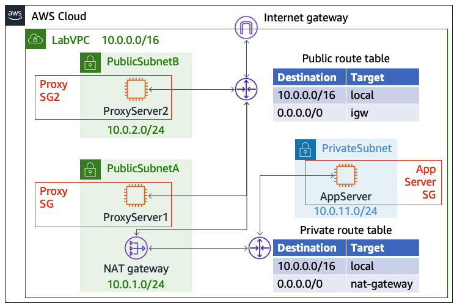
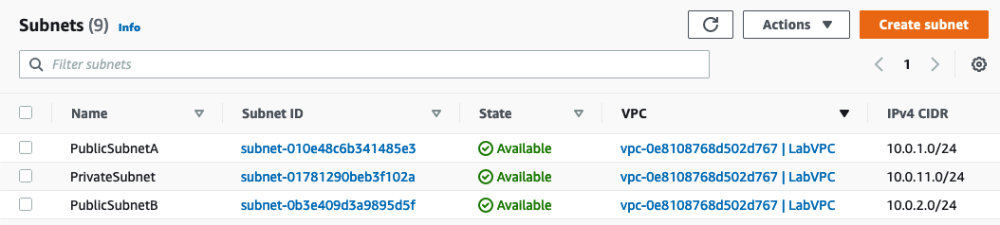
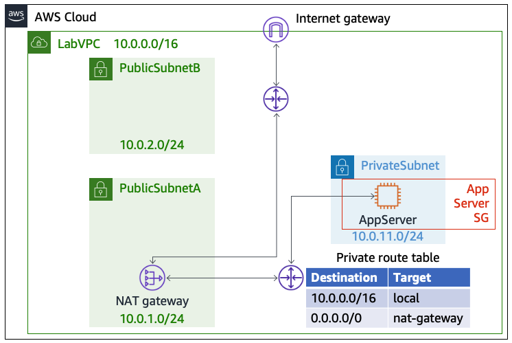
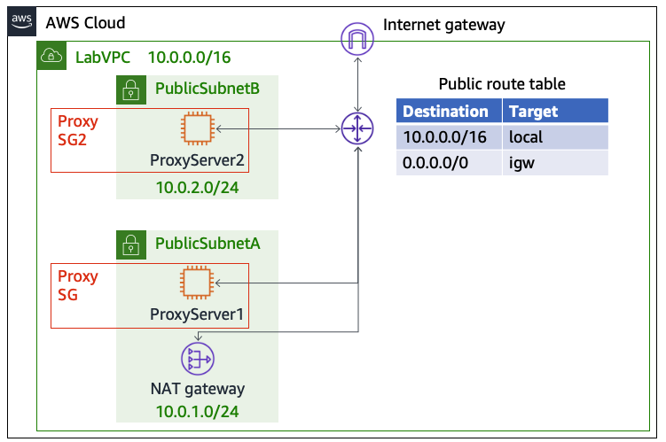
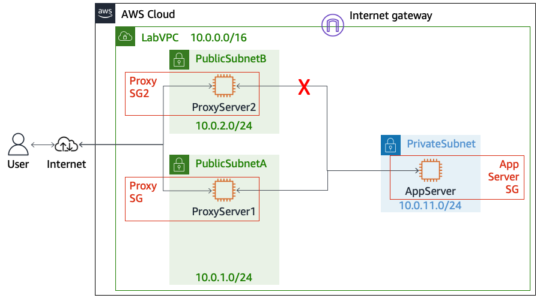
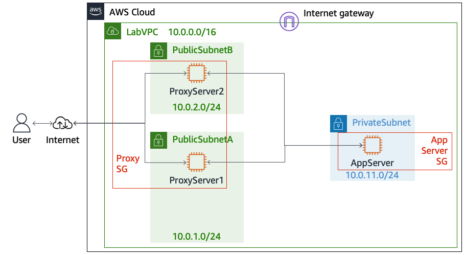
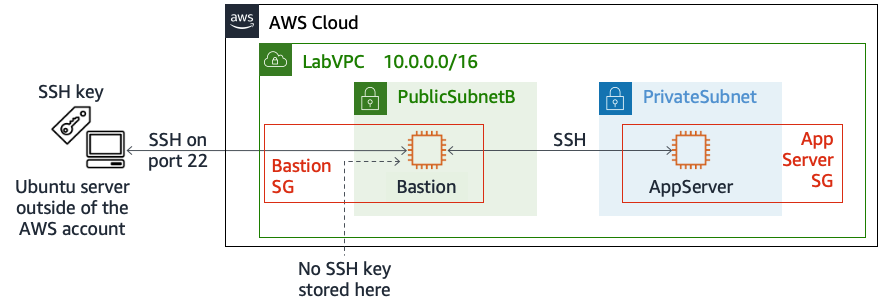
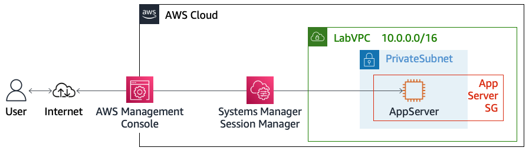

# Лабораторна робота 4.1: захист ресурсів VPC за допомогою груп безпеки (Lab 4.1: Securing VPC Resources by Using Security Groups)

## Огляд і цілі лабораторної роботи

Групи безпеки — це віртуальні брандмауери, що прикріплюються до екземплярів Amazon Elastic Compute Cloud (Amazon EC2). Правила груп безпеки визначають, який трафік дозволено входити в екземпляр чи виходити з нього. У цій лабораторній роботі вам доручено налаштувати правила доступу для екземплярів EC2.

Після завершення цієї лабораторної роботи ви зможете:

- Перевіряти групи безпеки, щоб визначити, який трафік дозволено.

- Змінювати, які групи безпеки застосовано до екземплярів EC2.

- Створювати нові групи безпеки.

- Оновлювати вхідні правила груп безпеки відповідно до принципу найменших привілеїв.

- Розуміти, як групи безпеки можуть посилатися на інші групи безпеки.

- Налаштовувати список контролю доступу до мережі (мережевий ACL), щоб блокувати трафік на певному порту TCP.

- Підключатися до екземпляра в приватній підмережі за допомогою SSH.

- Підключатися до екземпляра в приватній підмережі за допомогою AWS Systems Manager Session Manager.

## Тривалість

Для виконання цієї лабораторної роботи потрібно приблизно **90 хвилин**.

## Обмеження сервісів AWS

У цьому лабораторному середовищі доступ до сервісів AWS і дій сервісів може бути обмежений тими, що потрібні для виконання інструкцій лабораторної роботи. Ви можете стикнутися з помилками, якщо спробуєте отримати доступ до інших сервісів чи виконати дії, окрім описаних у цій лабораторній роботі.

## Сценарій

Лабораторне середовище містить повністю функціональну віртуальну приватну хмару (VPC) із кількома підмережами, таблицями маршрутизації, інтернет-шлюзом, NAT-шлюзом і кількома групами безпеки. Крім того, у різні підмережі запущено три екземпляри EC2 Linux: два — у публічні підмережі й один — у приватну. Екземпляри в публічних підмережах налаштовано як проксі-сервери для пересилання трафіку до сервера застосунку в приватній підмережі. Ви підключатиметеся до проксі-екземплярів за допомогою вебпереглядача, щоб перевіряти підключення до приватного сервера застосунку й переконатися, як групи безпеки обмежують доступ.

Наведена нижче діаграма показує архітектуру, яку було створено для вас в акаунті AWS на початку лабораторної роботи.



<details>
<summary>Текст зі схеми</summary>

AWS Cloud

Internet gateway (Інтернет-шлюз)

LabVPC 10.0.0.0/16

PublicSubnetB

Proxy SG2 (SG проксі 2)

ProxyServer2

10.0.2.0/24

PublicSubnetA

Proxy SG (SG проксі)

ProxyServer1

NAT gateway (NAT-шлюз)

10.0.1.0/24

PrivateSubnet

App Server SG (SG сервера застосунку)

AppServer

10.0.11.0/24

Public route table (Публічна таблиця маршрутизації)

Destination (Призначення)

Target (Ціль)

10.0.0.0/16

local

0.0.0.0/0

igw

Private route table (Приватна таблиця маршрутизації)

Destination (Призначення)

Target (Ціль)

10.0.0.0/16

local

0.0.0.0/0

nat-gateway

</details>

## Доступ до AWS Management Console

1.  У верхній частині цих інструкцій оберіть **Start Lab**.

    - Розпочнеться лабораторний сеанс.

    - Угорі сторінки відображається таймер, що показує час, який залишився в сеансі.  
      > **Порада:** щоб у будь-який момент продовжити тривалість сеансу, знову оберіть **Start Lab**, перш ніж таймер досягне 00:00.

    - Перш ніж продовжити, зачекайте, доки значок-коло праворуч від посилання AWS у верхньому лівому куті стане зеленим. Коли лабораторне середовище буде готове, також відобразиться панель AWS Details.

2.  Щоб підключитися до AWS Management Console, оберіть посилання **AWS** у верхньому лівому куті над вікном терміналу.

    - Відкриється нова вкладка браузера й підключить вас до консолі.  
      > **Порада:** якщо нова вкладка браузера не відкривається, угорі браузера зазвичай з’являється банер чи значок із повідомленням, що ваш браузер перешкоджає сайту відкривати спливні вікна. Оберіть банер чи значок, а потім оберіть **Allow pop-ups**.

## Завдання 1: аналіз налаштувань ресурсів VPC і приватної підмережі

У цьому першому завданні ви дослідите ресурси, налаштовані в LabVPC, щоб ознайомитися з її поточними мережевими налаштуваннями.

3.  В AWS Management Console у полі пошуку праворуч від **Services** знайдіть і оберіть **VPC**, щоб відкрити консоль Amazon Virtual Private Cloud (Amazon VPC).

4.  Проаналізуйте LabVPC і підмережі, налаштовані в ній.

    - В панелі навігації оберіть **Your VPCs**.  
      > В регіоні AWS, який ви зараз переглядаєте, є дві VPC. Одна — VPC за замовчуванням із діапазоном CIDR 172.31.0.0/16. Інша має назву **LabVPC** і діапазон CIDR 10.0.0.0/16. У цій лабораторній роботі ви використовуватимете LabVPC.

    - В панелі навігації оберіть **Subnets**.

    - У списку підмереж оберіть заголовок стовпця **VPC**, щоб упорядкувати підмережі за VPC, як показано на наведеному нижче зображенні.



<details>
<summary>Текст зі схеми</summary>

Subnets (9) (Підмережі (9))

Filter subnets (Фільтр підмереж)

Actions (Дії)

Create subnet (Створити підмережу)

Name (Ім’я)

Subnet ID (Ідентифікатор підмережі)

State (Стан)

VPC

IPv4 CIDR

PublicSubnetA

subnet-010e48c6b341485e3

Available (Доступна)

vpc-0e8108768d502d767 | LabVPC

10.0.1.0/24

PrivateSubnet

subnet-01781290beb3f102a

Available (Доступна)

vpc-0e8108768d502d767 | LabVPC

10.0.11.0/24

PublicSubnetB

subnet-0b3e409d3a9895d5f

Available (Доступна)

vpc-0e8108768d502d767 | LabVPC

10.0.2.0/24

</details>

      > Зверніть увагу, що в LabVPC визначено три підмережі. Їхні назви — **PrivateSubnet**, **PublicSubnetA** і **PublicSubnetB**, і кожна має унікальний діапазон CIDR приватних адрес IPv4.

5.  Проаналізуйте подробиці маршрутизації, що застосовуються до екземплярів EC2 у PrivateSubnet, і змініть назву таблиці маршрутизації.

    - Поставте прапорець для **PrivateSubnet**, а потім у нижній панелі оберіть вкладку **Route table**.

    - Над списком маршрутів оберіть посилання на таблицю маршрутизації, пов’язану з цією підмережею.

    - Оберіть вкладку **Routes**.  
      > Зверніть увагу, що всі IP-адреси в діапазоні CIDR LabVPC (10.0.0.0/16) маршрутизуватимуться до локальних цілей усередині VPC. Увесь інший трафік (0.0.0.0/0) маршрутизуватиметься до NAT-шлюзу.  
      > **Примітка:** якби трафік 0.0.0.0/0 для цієї підмережі натомість маршрутизувався до інтернет-шлюзу, ви б знали, що це *публічна* підмережа з прямим доступом до інтернету. *Натомість* вона маршрутизує мережевий трафік до NAT-шлюзу.

    - Оберіть вкладку **Tags**, а потім оберіть **Manage tags**.

    - Змініть назву таблиці маршрутизації з **changeme** на Private і оберіть **Save**.

    - Оберіть вкладку **Routes**, а потім оберіть посилання **nat-xxxxxx**, що є ціллю для нелокального трафіку.  
      > На вкладці **Details** зверніть увагу, що цей NAT-шлюз працює в PublicSubnetA. Тому будь-який трафік до інтернету, ініційований екземплярами в PrivateSubnet, маршрутизуватиметься до NAT-шлюзу в PublicSubnetA.  
      > **Детальний аналіз:** NAT-шлюз забезпечує вихідний доступ до інтернету для екземплярів у приватній підмережі. Однак відповіді на такі запити від комп’ютерів в інтернеті не знатимуть IP-адреси сервера в приватній підмережі, що робить запит. Натомість інтернет-шлюз маршрутизуватиме отримані відповіді назад до NAT-шлюзу, а NAT-шлюз маршрутизуватиме відповіді до сервера, що робив запит. Таким чином, сервери в приватній підмережі не підключені безпосередньо до інтернету, а їхні IP-адреси невідомі комп’ютерам в інтернеті. Однак сервери в приватній підмережі все одно можуть обмінюватися даними з інтернетом, і відповіді маршрутизуються назад до них. Наведена нижче діаграма показує цю архітектуру.



<details>
<summary>Текст зі схеми</summary>

AWS Cloud

Internet gateway (Інтернет-шлюз)

LabVPC 10.0.0.0/16

PublicSubnetB

10.0.2.0/24

PublicSubnetA

NAT gateway (NAT-шлюз)

10.0.1.0/24

PrivateSubnet

App Server SG (SG сервера застосунку)

AppServer

10.0.11.0/24

Private route table (Приватна таблиця маршрутизації)

Destination (Призначення)

Target (Ціль)

10.0.0.0/16

local

0.0.0.0/0

nat-gateway

</details>

6.  Перегляньте подробиці екземпляра EC2 AppServer, що перебуває в PrivateSubnet, і пов’язаної з ним групи безпеки.

    - У консолі в полі пошуку праворуч від **Services** знайдіть і оберіть **EC2**.

    - **Важливо:** *клацніть правою кнопкою миші* сервіс **EC2** у результатах, щоб відкрити консоль Amazon EC2 у *новій вкладці браузера*.  
      > **Порада:** тримайте вкладки браузера з консолями Amazon VPC і Amazon EC2 відкритими протягом усієї цієї лабораторної роботи. Ви використовуватимете обидві на наступних кроках.

    - У консолі Amazon EC2 в панелі навігації оберіть **Instances**.

      - Виберіть екземпляр **AppServer** і на вкладці **Details**:

        - Зверніть увагу, що цей екземпляр працює в PrivateSubnet.

        - Також зверніть увагу, що він має *приватну* адресу IPv4, але не має *публічної* адреси IPv4.  
          > **Примітка**: *приватна* адреса IPv4 — це IP-адреса, недоступна через інтернет. Приватні адреси IPv4 можна використовувати для обміну даними між екземплярами в тій самій VPC.

    - Оберіть вкладку **Security**, а потім оберіть посилання на групу безпеки, пов’язану з цим екземпляром. Назва групи безпеки містить **AppServerSG**.

    - Оберіть вкладку **Inbound rules** і зверніть увагу, що визначено одне правило. Трафік HTTP через порт TCP 80 з джерелом 0.0.0.0/0 (будь-де) дозволено.  
      > **Порада:** можливо, потрібно прокрутити таблицю вхідних правил праворуч, щоб побачити всі ці подробиці.  
      > **Примітка:**

      - Це означає, що будь-який екземпляр, до якого прикріплено групу безпеки AppServerSG, може отримувати з’єднання *від* будь-якого комп’ютера, що намагається обмінюватися з ним даними на порту TCP 80.

      - За замовчуванням, коли ви створюєте групу безпеки, вона не має вхідних правил, що означає, що вхідний мережевий трафік не дозволено. Однак ця група безпеки має одне визначене вхідне правило.

      - Групи безпеки є *станними (stateful)*. Це означає, що якщо екземпляр надсилає запит, трафік відповіді на цей запит дозволено входити незалежно від вхідних правил групи безпеки.

    - Оберіть вкладку **Outbound rules**.  
      > Зверніть увагу, що весь вихідний трафік дозволено. Це налаштування груп безпеки за замовчуванням.

Тепер, коли ви проаналізували налаштування приватної підмережі, ви розглянете ті самі подробиці для публічних підмереж.

## Завдання 2: аналіз налаштувань ресурсів публічної підмережі

У цьому завданні ви проаналізуєте налаштування мережі, маршрутизації та безпеки в публічних підмережах VPC.

7.  У консолі Amazon VPC проаналізуйте подробиці маршрутизації, що впливають на екземпляри EC2 у PublicSubnetA.

    - Поверніться до вкладки браузера, де відкрито консоль Amazon VPC.

    - В панелі навігації оберіть **Subnets**, а потім виберіть **PublicSubnetA**.  
      > **Примітка:** за потреби зніміть прапорець для PrivateSubnet. Якщо у списку вибрано більше одного елемента, вкладка **Details** та інші вкладки не відображатимуться нижче. Пам’ятайте про це протягом усієї лабораторної роботи.

    - Оберіть вкладку **Route table**.  
      > Зверніть увагу, що ця таблиця маршрутизації публічної підмережі маршрутизує трафік 0.0.0.0/0 до інтернет-шлюзу.  
      > **Примітка:** ця підмережа називається *публічною*, тому що її налаштовано на маршрутизацію нелокального трафіку до інтернет-шлюзу.

    - Оберіть посилання **igw-xxxxx**, що є ціллю для нелокального трафіку.  
      > На вкладці **Details** зверніть увагу, що цей інтернет-шлюз пов’язано з LabVPC.

8.  Перегляньте подробиці екземпляра ProxyServer1, що працює в PublicSubnetA, і пов’язаної з ним групи безпеки.

    - Поверніться до вкладки браузера, де відкрито консоль Amazon EC2.

    - В панелі навігації оберіть **Instances**.

    - Виберіть екземпляр **ProxyServer1**, а потім оберіть вкладку **Details**.  
      > Зверніть увагу, що на відміну від екземпляра AppServer, що працює в *приватній* підмережі, цей сервер працює в *публічній* підмережі й має *публічну* адресу IPv4.

    - Оберіть вкладку **Security**.  
      > Зверніть увагу, що з цим екземпляром EC2 пов’язано групу безпеки з **ProxySG** у назві. Як видно в розділі **Inbound rules**, ця група безпеки дозволяє вхідний трафік на порту TCP 80 з будь-якого джерела.

9.  Перегляньте подробиці екземпляра ProxyServer2, що працює в PublicSubnetB, і пов’язаної з ним групи безпеки.

    - Виберіть екземпляр **ProxyServer2**.  
      > Зверніть увагу, що цей сервер працює в PublicSubnetB і має *публічну* адресу IPv4.

    - Оберіть вкладку **Security**. Зверніть увагу, що з цим екземпляром EC2 пов’язано групу безпеки з **ProxySG2** у назві.

10. Додайте нове вхідне правило до групи безпеки ProxySG2.

    - Оберіть посилання на групу безпеки **ProxySG2**.

    - Оберіть вкладку **Inbound rules**, а потім оберіть **Edit inbound rules**.

    - Оберіть **Add rule** і налаштуйте так:

      - **Type:** оберіть **HTTP**.

      - **Source:** оберіть **Anywhere-IPv4**.

    - Оберіть **Save rules**.  
      > **Примітка:** кожну групу безпеки можна налаштувати по-різному, навіть якщо ви щойно налаштували вхідне правило для ProxySG2 так, щоб воно відповідало правилу в ProxySG. Це означає, що ви можете незалежно налаштовувати, як можна отримати доступ до кожного екземпляра чи групи екземплярів.  
      > Наведена нижче діаграма показує оновлену маршрутизацію підмереж. ProxyServer1 пов’язано з ProxySG, а ProxyServer2 — з ProxySG2. Однак обидві групи безпеки тепер мають однакові вхідні правила.



<details>
<summary>Текст зі схеми</summary>

AWS Cloud

Internet gateway (Інтернет-шлюз)

LabVPC 10.0.0.0/16

PublicSubnetB

Proxy SG2 (SG проксі 2)

ProxyServer2

10.0.2.0/24

PublicSubnetA

Proxy SG (SG проксі)

ProxyServer1

NAT gateway (NAT-шлюз)

10.0.1.0/24

Public route table (Публічна таблиця маршрутизації)

Destination (Призначення)

Target (Ціль)

10.0.0.0/16

local

0.0.0.0/0

igw

</details>

**Примітка:** коли ви пов’язуєте групу безпеки з екземпляром, ви фактично призначаєте її еластичному мережевому інтерфейсу екземпляра. Багато екземплярів EC2 мають один мережевий інтерфейс, але екземпляр може мати кілька мережевих інтерфейсів. Можна прикріпити іншу групу безпеки до кожного мережевого інтерфейсу екземпляра для різної поведінки доступу залежно від мережевого з’єднання.

У наступному завданні ви перевірите підключення до вебсторінки, що працює на AppServer. Пізніше в цій лабораторній роботі ви змінюватимете правила груп безпеки та те, до яких екземплярів їх прикріплено.

## Завдання 3: перевірка підключення HTTP з публічних екземплярів EC2

У цьому завданні ви підключаєтеся до різних екземплярів, виділених як частина вашого лабораторного середовища. Наразі всі три групи безпеки налаштовано на дозвіл з’єднань через порт TCP 80 з усіх джерел трафіку.

Проксі-сервери розташовано в *публічних* підмережах, доступних з інтернету. Сервер застосунку розташовано в *приватній* підмережі, і він доступний лише з серверів, розташованих усередині VPC, у публічній чи приватній підмережі. Щоб підключитися до вебсервера екземпляра AppServer, ви спершу підключитеся до одного з проксі-серверів, обидва з яких налаштовано на пересилання трафіку TCP на порту 80 до AppServer.

11. Зверніться до публічної IP-адреси ProxyServer1, щоб перевірити завантаження вебсторінки, що розміщена на AppServer.

    - У консолі Amazon EC2 в панелі навігації оберіть **Instances**, а потім виберіть екземпляр **ProxyServer1**.

    - На вкладці **Details** нижче скопіюйте **Public IPv4 address** і вставте її в нову вкладку браузера.  
      > Вебсайт, що завантажується, насправді розміщено на *сервері застосунку*. Ви можете отримати до нього доступ, тому що ProxyServer1 налаштовано на пересилання всього трафіку TCP на порту 80 до AppServer, а і група безпеки ProxySG, і група безпеки AppServerSG налаштовані на дозвіл вхідного трафіку.

12. Скористайтеся тим самим методом із попереднього кроку, щоб перевірити завантаження вебсторінки, звернувшись до публічної адреси IPv4 ProxyServer2.  
    > Вебсайт, що завантажується, той самий, який ви відкривали, звертаючись до публічної IP-адреси ProxyServer1. Це підтверджує, що і ProxyServer1, і ProxyServer2 мають доступ до вебсервера, що працює на екземплярі AppServer.

13. Закрийте обидві вкладки, де відкрито вебсайт сервера застосунку.  
    > **Примітка:** тримайте вкладки консолей Amazon VPC і Amazon EC2 відкритими для використання на наступних кроках.  
    > У наступному завданні ви оновите групу безпеки AppServer, щоб обмежити доступ до AppServer.

## Завдання 4: обмеження доступу HTTP за IP-адресою

У цьому завданні ви оновите групу безпеки AppServerSG, щоб вона дозволяла доступ лише з однієї внутрішньої IP-адреси, як показано на наведеній нижче діаграмі. Після оновлення ви знову протестуєте доступ.



<details>
<summary>Текст зі схеми</summary>

AWS Cloud

Internet gateway (Інтернет-шлюз)

LabVPC 10.0.0.0/16

PublicSubnetB

Proxy SG2 (SG проксі 2)

ProxyServer2

10.0.2.0/24

PublicSubnetA

Proxy SG (SG проксі)

ProxyServer1

10.0.1.0/24

PrivateSubnet

App Server SG (SG сервера застосунку)

AppServer

10.0.11.0/24

User (Користувач)

Internet (Інтернет)

</details>

14. Скопіюйте *приватну* адресу IPv4 ProxyServer1, яка знадобиться для виконання наступного кроку.

    - Це значення можна знайти в консолі Amazon EC2. Однак для зручності ви можете отримати доступ до цього та інших значень середовища, потрібних вам у цій лабораторній роботі, обравши посилання **AWS Details** над цими інструкціями.

    - Скопіюйте адресу **ProxyServer1PrivateIP** в буфер обміну.  
      > **Примітка:** IP-адреса починається з *10.0.1*.

15. Змініть вхідні правила групи безпеки AppServerSG.

    - У консолі Amazon EC2 в панелі навігації оберіть **Security Groups**.  
      > **Примітка:** до груп безпеки можна отримати доступ і з консолі Amazon VPC, і з консолі Amazon EC2.

    - Виберіть групу безпеки **AppServerSG**.

    - Оберіть вкладку **Inbound rules**, а потім оберіть **Edit inbound rules**.

    - Змініть правило **HTTP** так:

      - У полі **Source** видаліть 0.0.0.0/0, обравши значок **X**.

      - Потім вставте значення ProxyServer1PrivateIP з інструкцій лабораторної роботи в поле **Source**.

      - Після вставлення додайте /32 у кінець IP-адреси.

    - Оберіть **Save rules**.  
      > Тепер ви оновили групу безпеки, прикріплену до сервера застосунку, так, що вона *дозволятиме лише* трафік TCP на порту 80 від **ProxyServer1**.

16. Знову перевірте доступ до вебсайту, завантаживши публічну IP-адресу ProxyServer1 у вкладці браузера.

    - Оберіть посилання **AWS Details** над цими інструкціями, скопіюйте значення **ProxyServer1PublicIP**, а потім вставте його в нову вкладку браузера.  
      > **Примітка:** якщо ви залишили вкладку браузера відкритою після попередньої перевірки, виконайте примусове оновлення (hard refresh) вкладки браузера, щоб переконатися, що вебсайт не завантажується з локального кешу.  
      > Вебсайт, що завантажується, знову є сервером застосунку.  
      > Ви все ще можете отримати доступ до вебсторінки сервера застосунку з ProxyServer1, тому що сервер усе ще пересилає трафік, а група безпеки AppServerSG розпізнає джерело запиту як ProxyServer1.

17. Знову перевірте доступ до вебсайту за допомогою публічної IP-адреси ProxyServer2.

    - Оберіть посилання **AWS Details** над цими інструкціями, скопіюйте значення **ProxyServer2PublicIP**, а потім вставте його в нову вкладку браузера.  
      > Вебсайт не завантажується. Якщо почекати достатньо довго (це не обов’язково), приблизно через 2 хвилини ваш браузер відобразить помилку *connection timeout* (тайм-аут з’єднання). Це очікувано, тому що група безпеки AppServer дозволяє трафік лише з IP-адреси, призначеної ProxyServer1, і відхиляє трафік з будь-якого іншого джерела.  
      > **Примітка:** якщо вебсайт завантажується, виконайте примусове оновлення вкладки браузера, щоб переконатися, що вебсайт не завантажується з локального кешу.

18. Закрийте обидві вкладки, де відкрито вебсайт сервера застосунку.  
    > **Примітка:** тримайте вкладки консолей Amazon VPC і Amazon EC2 відкритими для використання на наступних кроках.

У цьому завданні ви змінили групу безпеки так, щоб вона дозволяла вхідний доступ лише з однієї вихідної IP-адреси. У наступному завданні ви зміните групу безпеки AppServerSG так, щоб дозволити трафік з будь-якого екземпляра EC2 у LabVPC, до якого прикріплено певну групу безпеки.

## Завдання 5: масштабування обмеженого доступу HTTP за допомогою посилання на групу безпеки

Ви вирішили перетворити ProxyServer2 на ще один проксі-хост, щоб створити надлишковість. Який найпростіший спосіб надати цьому серверу та будь-яким додатковим майбутнім серверам ті самі дозволи доступу, що наразі призначені ProxyServer1?

Можна використати IP-адресу як джерело в групі безпеки, як показано в попередньому завданні. Однак вам довелося б жорстко прописати IP-адресу кожного екземпляра, що діятиме як проксі-сервер, у вхідних правилах групи безпеки. Найпростіший і найбезпечніший спосіб розгорнути ті самі дозволи доступу для кількох хостів — послатися на назву групи безпеки як на вхідне джерело замість окремих IP-адрес.

До цього моменту лабораторна робота зосереджувалася на групі безпеки, пов’язаній із *сервером застосунку*. Тепер ви розглянете групу безпеки, призначену хосту ProxyServer2. Ви можете послатися на *групу безпеки* ProxySG як на вхідне джерело для з’єднань HTTP до сервера застосунку. Це означає, що будь-який екземпляр, якому призначено групу безпеки ProxySG, отримає дозволи надсилати трафік HTTP через порт 80 до сервера застосунку.

Наведена нижче діаграма відображає, як групи безпеки та маршрутизацію підмереж буде налаштовано після завершення цього завдання.



<details>
<summary>Текст зі схеми</summary>

AWS Cloud

Internet gateway (Інтернет-шлюз)

LabVPC 10.0.0.0/16

PublicSubnetB

ProxyServer2

10.0.2.0/24

PublicSubnetA

Proxy SG (SG проксі)

ProxyServer1

10.0.1.0/24

PrivateSubnet

App Server SG (SG сервера застосунку)

AppServer

10.0.11.0/24

User (Користувач)

Internet (Інтернет)

</details>

19. Змініть вхідні правила AppServerSG ще раз так, щоб дозволеним джерелом для трафіку HTTP була група безпеки ProxySG замість внутрішньої IP-адреси ProxyServer1.

    - У консолі Amazon EC2 оберіть **Security Groups**.

    - Виберіть групу **AppServerSG**.

    - Оберіть вкладку **Inbound rules**, а потім оберіть **Edit inbound rules**.

    - Видаліть наявне вхідне правило, яке ви змінили раніше.

    - Оберіть **Add rule** і налаштуйте так:

      - **Type:** оберіть **HTTP**.

      - **Source:** оберіть **Custom**.

      - У полі **Source** введіть sg

      - Коли з’явиться випадаючий список наявних груп безпеки, оберіть групу безпеки **ProxySG**.

    - Оберіть **Save rules**.  
      > Тепер ви оновили групу безпеки, прикріплену до сервера застосунку, так, що вона *дозволятиме лише* трафік від екземплярів із прикріпленою ProxySG.

20. Змініть, яка група безпеки прикріплена до екземпляра ProxyServer2.

    - Усе ще в консолі Amazon EC2 в панелі навігації оберіть **Instances**.

    - Виберіть екземпляр **ProxyServer2**.

    - Оберіть меню **Actions** у верхньому правому куті, а потім оберіть **Security** \> **Change security groups**.

    - Вилучіть групу безпеки **ProxySG2**.

    - У полі пошуку знайдіть і оберіть групу безпеки **ProxySG**.

    - Оберіть **Add security group**, а потім оберіть **Save**.  
      > Тепер, коли ви оновили конфігурацію, перевірте, які хости можуть отримати доступ до екземпляра сервера застосунку.

21. Перевірте доступ до вебсайту з ProxyServer1.

    - Оберіть посилання **AWS Details** над цими інструкціями, скопіюйте значення **ProxyServer1PublicIP**, а потім вставте його в нову вкладку браузера.  
      > Вебсайт завантажується.

22. Перевірте доступ до вебсайту з ProxyServer2, що тепер перебуває в тій самій групі безпеки, що й ProxyServer1.

    - Оберіть посилання **AWS Details** над цими інструкціями, скопіюйте значення **ProxyServer2PublicIP**, а потім вставте його в нову вкладку браузера.  
      > Вебсайт завантажується.  
      > **Примітка:** якщо вебсайт не завантажується, виконайте примусове оновлення вкладки браузера.

23. Закрийте обидві вкладки, де відкрито вебсайт сервера застосунку.  
    > **Примітка:** тримайте вкладки консолей Amazon VPC і Amazon EC2 відкритими для використання на наступних кроках.

У цьому завданні ви оновили групу безпеки AppServerSG, щоб дозволити трафік з будь-яких екземплярів, пов’язаних із групою безпеки ProxySG. Потім ви змінили групу безпеки, прикріплену до екземпляра ProxyServer2, на ProxySG, яка також прикріплена до екземпляра ProxyServer1. Тому обидва проксі-сервери тепер можуть підключатися до сервера застосунку, і вам не потрібно підтримувати список схвалених вихідних IP-адрес у налаштуваннях групи безпеки.

## Завдання 6: обмеження доступу HTTP за допомогою мережевого ACL

Групи безпеки — не єдиний метод, який можна використовувати для захисту доступу до мережевих портів. У цьому завданні ви дослідите, як використовувати мережеві ACL для контролю доступу до екземплярів EC2 у VPC.

24. Додайте нове вхідне правило до мережевого ACL LabVPC, що забороняє весь вхідний трафік на порту 80.

    - Поверніться до вкладки браузера, де відкрито консоль Amazon VPC.

    - В панелі навігації оберіть **Network ACLs**.

    - Виберіть мережевий ACL, пов’язаний із LabVPC.

    - Оберіть вкладку **Inbound rules**, а потім оберіть **Edit inbound rules**.

    - Оберіть **Add new rule** і налаштуйте так:

      - **Rule number:** введіть 99

      - **Type:** оберіть **HTTP**.

      - **Allow/Deny:** оберіть **Deny**.

      - Оберіть **Save changes**.

25. Перевірте доступ до вебсайту з ProxyServer1.

    - Оберіть посилання **AWS Details** над цими інструкціями, скопіюйте значення **ProxyServer1PublicIP**, а потім вставте його в нову вкладку браузера.  
      > Через кілька миттєвостей з’єднання завершується тайм-аутом.  
      > **Примітка:** якщо вебсайт завантажується, виконайте примусове оновлення вкладки браузера.  
      > **Аналіз:** правило мережевого ACL, яке ви створили, блокує всі спроби з’єднання на порту 80 з будь-яким екземпляром EC2, що працює у VPC. Група безпеки ProxySG дозволяє вхідний трафік на порту 80, але з’єднання не вдається, тому що і мережевий ACL, і група безпеки мають його дозволяти.

    - Закрийте вкладку, де ви намагалися завантажити вебсайт сервера застосунку.

26. Додайте ще одне правило до мережевого ACL.

    - У консолі Amazon VPC, з усе ще вибраним мережевим ACL LabVPC, оберіть **Edit inbound rules**.

    - Оберіть **Add new rule** і налаштуйте, як описано:

      - **Rule number:** введіть 98

      - **Type:** оберіть **HTTP**.

      - **Allow/Deny:** оберіть **Allow**.

      - Оберіть **Save changes**.

27. Знову перевірте доступ до вебсайту з ProxyServer1.

    - Оберіть посилання **AWS Details** над цими інструкціями, скопіюйте значення **ProxyServer1PublicIP**, а потім вставте його в нову вкладку браузера.  
      > Вебсайт завантажується.  
      > **Аналіз:** усі правила, визначені в мережевому ACL, мають *номер правила*. Правила оцінюються по порядку, починаючи з правила з найменшим номером. Коли правило збігається з трафіком, воно застосовується незалежно від будь-якого правила з вищим номером, що може йому суперечити.

    - Закрийте вкладку, де ви завантажували вебсайт сервера застосунку.

## Завдання 7: підключення до AppServer за допомогою бастіонного хоста та SSH

У цьому наступному завданні ви почнете дослідження того, як можна підключитися до терміналу AppServer. У цьому завданні ви використаєте ключ SSH для підключення до сервера в PublicSubnetB за допомогою SSH через порт TCP 22. Потім, за допомогою пересилання портів SSH, ви зможете підключитися до AppServer, що працює в приватній підмережі.

28. Перейменуйте екземпляр EC2 ProxyServer2.

    - У консолі Amazon EC2 оберіть **Instances**, а потім виберіть екземпляр **ProxyServer2**.

    - У стовпці **Name** наведіть курсор на **ProxyServer2**, а потім оберіть значок редагування, що з’явиться.

    - Перейменуйте сервер на Bastion і оберіть **Save**.  
      > **Примітка:** *бастіонний хост (bastion host)*, також званий *jump-сервером (jump server)*, — це сервер, що забезпечує доступ до приватної мережі із зовнішньої мережі, як-от інтернет. У реальному сценарії ви б запустили новий екземпляр EC2 із посиленою безпекою, що діє як бастіонний хост. Однак для демонстрації в цій лабораторній роботі ви перепрофілюєте ProxyServer2 на бастіонний хост.

29. Створіть нову групу безпеки з відкритим портом 22 для бастіонного хоста.

    - В панелі навігації оберіть **Security Groups**.

    - Оберіть **Create security group** і налаштуйте так:

      - **Security group name:** введіть BastionSG

      - **Description:** введіть BastionSG

      - **VPC:** вилучіть наразі вибрану VPC, обравши значок **X**. Потім оберіть **LabVPC**.

      - У розділі **Inbound rules** оберіть **Add rule** і налаштуйте так:

        - **Type:** оберіть **SSH**.

        - **Source:** оберіть **Anywhere-IPv4**.

      - Унизу сторінки оберіть **Create security group**.

30. Оновіть налаштування екземпляра бастіонного хоста, щоб використовувати групу безпеки BastionSG.

    - В панелі навігації оберіть **Instances**.

    - Виберіть екземпляр **Bastion**.

    - Оберіть **Actions** \> **Security** \> **Change security groups**.

    - Вилучіть групу безпеки **ProxySG**.

    - У полі пошуку знайдіть і оберіть групу безпеки **BastionSG**.

    - Оберіть **Add security group**, а потім оберіть **Save**.

31. Змініть вхідні правила групи безпеки AppServerSG, щоб дозволити трафік від бастіонного хоста.

    - Оберіть посилання **AWS Details** над цими інструкціями й скопіюйте значення **BastionPrivateIP**.

    - У консолі Amazon EC2 в панелі навігації оберіть **Security Groups**.

    - Виберіть групу безпеки **AppServerSG**.

    - Оберіть вкладку **Inbound rules**, а потім оберіть **Edit inbound rules**.

    - Оберіть **Add rule** і налаштуйте так:

      - **Type:** оберіть **SSH**.

      - **Source:** оберіть **Custom**.

      - Потім вставте значення BastionPrivateIP з інструкцій лабораторної роботи в поле **Source**.

      - Після вставлення додайте /32 у кінець IP-адреси.

    - Оберіть **Save rules**.  
      > Тепер ви оновили групу безпеки, прикріплену до сервера застосунку, так, що вона дозволятиме з’єднання SSH на порту 22 від бастіонного хоста.

32. Підключіться до бастіонного хоста за допомогою SSH.

    - На панелі терміналу поруч із цими інструкціями виконайте такі дві команди.

```bash
exec ssh-agent bash

ssh-add ~/.ssh/labsuser.pem
```

- **Примітка:** перша команда активує інструмент ssh-agent на цій машині Ubuntu, що існує поза лабораторним акаунтом AWS. Друга команда додає ключ SSH до агента. І бастіонний хост, і AppServer прийматимуть ключ SSH labsuser.pem для запитів на з’єднання SSH.

- Далі, щоб підключитися до бастіонного екземпляра, виконайте таку команду. Замініть *\<BastionPublicIP\>* значенням **BastionPublicIP**, яке можна знайти, обравши посилання **AWS Details** над цими інструкціями.

```bash
ssh -i ~/.ssh/labsuser.pem -A ec2-user@<BastionPublicIP>
```

- Коли з’явиться запитання, чи справді ви хочете підключитися, введіть yes  
  > **Порада:** зверніть увагу, що командний рядок тепер має вигляд \[ec2-user@bastion\], що вказує, що ви тепер підключені до бастіонного екземпляра.

33. Підключіться до AppServer через SSH, переславши автентифіковане з’єднання.

    - Виконайте таку команду. Замініть *\<AppServerPrivateIP\>* значенням **AppServerPrivateIP**, яке можна знайти, обравши посилання **AWS Details** над цими інструкціями.

```bash
ssh ec2-user@<AppServerPrivateIP>
```

- Коли з’явиться запитання, чи справді ви хочете підключитися, введіть yes  
  > Тепер ви підключені до AppServer.  
  > **Порада:** зверніть увагу, що командний рядок тепер має вигляд \[ec2-user@appserver\], що вказує, що ви тепер підключені до екземпляра AppServer.

- Щоб створити файл, що доведе, що ви підключилися до екземпляра AppServer, виконайте таку команду. (Наявність цього файлу буде перевірено під час надсилання лабораторної роботи.)

```bash
touch newfile.txt
```

- **Детальний аналіз:** ви змогли підключитися до сервера в приватній підмережі, тому що, коли ви виконували команду ssh з сервера Ubuntu поза акаунтом, ви включили в команду -A. Це дає змогу переслати з’єднання автентифікованого агента.  
  > Ключ SSH labsuser.pem не зберігається на бастіонному хості, але сеанс SSH, який ви успішно відкрили із зовнішнього сервера до бастіонного хоста, включав його. Налаштування SSH сервера AppServer налаштовано так, щоб приймати той самий ключ SSH labsuser.pem.  
  > Крім того, з’єднання з AppServer було встановлено *через бастіонний хост*, який ви налаштували у вхідних правилах групи безпеки AppServerSG як прийнятне джерело для з’єднань SSH. Тому з’єднання було успішним. Важливо, що за такого підходу ви уникли зберігання ключа SSH на бастіонному хості, що не є хорошою практикою безпеки.  
  > Наведена нижче діаграма показує конфігурацію, яку ви щойно налаштували й використали.



<details>
<summary>Текст зі схеми</summary>

AWS Cloud

LabVPC 10.0.0.0/16

SSH key (Ключ SSH)

SSH on port 22 (SSH на порту 22)

Ubuntu server outside of the AWS account (Сервер Ubuntu поза акаунтом AWS)

PublicSubnetB

Bastion SG (SG бастіона)

Bastion

SSH

PrivateSubnet

App Server SG (SG сервера застосунку)

AppServer

No SSH key stored here (Тут не зберігається ключ SSH)

</details>

34. У терміналі, щоб відключитися від AppServer, виконайте команду exit.  
    > **Порада:** зверніть увагу, що командний рядок тепер має вигляд \[ec2-user@bastion\], що вказує, що ви розірвали з’єднання з AppServer і знову перебуваєте на бастіонному екземплярі.

35. Щоб відключитися від бастіонного сервера, виконайте команду exit.  
    > Зверніть увагу, що командний рядок тепер показує, що ви підключені до терміналу Ubuntu (на що вказує @runweb у рядку). Сервер Ubuntu існує поза акаунтом AWS.

Чи можна підключитися до екземпляра EC2 у VPC, навіть до екземпляра в приватній підмережі, не відкриваючи порт SSH? У наступному завданні ви дослідите, як використовувати Systems Manager Session Manager для доступу до екземплярів у приватних підмережах без потреби використовувати бастіонний хост.

## Завдання 8: пряме підключення до хоста в приватній підмережі за допомогою Session Manager

Що робити, якщо потрібно змінити налаштування конфігурації вашого сервера застосунку? Вам довелося б підключитися до одного із серверів у *публічній* підмережі (часто званого бастіонним хостом чи jump box) і використати його для підключення до сервера в *приватній* підмережі.

Оскільки ваші екземпляри розташовано в хмарі AWS, можна використовувати Systems Manager Session Manager для підключення безпосередньо до екземпляра *без* відкриття порту 22 для SSH і без попереднього підключення через інший сервер у публічній підмережі. Щоб це працювало, на цільовий хост має бути встановлено агент Session Manager. Екземпляри Amazon Linux EC2 уже мають встановлений агент Session Manager. Підключитися за допомогою Session Manager можна за допомогою URL-адреси через браузер, як ви робили в цій лабораторній роботі, або через інтерфейс командного рядка AWS (AWS CLI).

Використання бастіонного хоста — найкраща практика в мережі VPC, але використання Session Manager може бути альтернативою налаштуванню й підтримці бастіонного хоста. Використовуючи Session Manager, AWS бере на себе важку роботу із захисту з’єднання та керування захищеною, надлишковою конфігурацією бастіонного хоста. Це також дає вам змогу використовувати AWS Identity and Access Management (IAM) для надання доступу користувачам і створює журнал, придатний до аудиту, коли його інтегровано з AWS CloudTrail і Amazon CloudWatch.

У цьому завданні ви безпосередньо підключитеся до екземпляра застосунку, який недоступний з інтернету. Ви використовуватимете Session Manager, як показано на наведеній нижче діаграмі.



<details>
<summary>Текст зі схеми</summary>

AWS Cloud

LabVPC 10.0.0.0/16

PrivateSubnet

App Server SG (SG сервера застосунку)

AppServer

User (Користувач)

Internet (Інтернет)

AWS Management Console

Systems Manager Session Manager

</details>

36. Підключіться до AppServer за допомогою SSM Session Manager.

    - У вкладці браузера, де відкрито консоль Amazon EC2, оберіть **Instances**.

    - Виберіть **AppServer** і оберіть **Connect** у верхньому правому куті.

    - Оберіть вкладку **Session Manager**, а потім оберіть **Connect**.  
      > Відкривається нова вкладка браузера, і ви підключені до терміналу AppServer із командним рядком sh-4.2.  
      > Тепер ви підключені до сеансу SSH на сервері застосунку без використання бастіонного хоста. Пам’ятайте також, що правило мережевого ACL, що блокує трафік на порту 22, усе ще налаштоване.

37. Щоб змінити вебсайт, розміщений на цьому сервері, виконайте таку команду:

```bash
sudo sed -i 's/instance!/instance! Session manager was used to edit this file./g' /var/www/html/index.html
```

38. Знову перевірте доступ до вебсторінки, розміщеної на AppServer, за допомогою публічної IP-адреси ProxyServer1.

    - Оберіть посилання **AWS Details** над цими інструкціями, скопіюйте значення **ProxyServer1PublicIP**, а потім вставте його в нову вкладку браузера.  
      > Вебсайт сервера застосунку завантажується. Зверніть увагу, що вебсайт сервера застосунку тепер містить напис *Session manager was used to edit this file*.  
      > **Примітка:** за потреби виконайте примусове оновлення вкладки браузера, щоб переконатися, що вебсайт не завантажується з локального кешу.

Вітаємо! Ви успішно підключилися до екземпляра, розташованого в приватній підмережі, і безпечно змінили файл на цьому екземплярі. За такого підходу можна уникнути багатьох докладних кроків конфігурації, що були потрібні для підключення через бастіонний хост.

## Надсилання вашої роботи

39. Щоб записати ваш прогрес, оберіть **Submit** угорі цих інструкцій.

40. Коли з’явиться запит, оберіть **Yes**.  
    > Через пару хвилин з’являється панель оцінок і показує, скільки балів ви отримали за кожне завдання. Якщо результати не відображаються через пару хвилин, оберіть **Grades** угорі цих інструкцій.  
    > **Порада:** ви можете надсилати свою роботу кілька разів. Після того як ви змінили свою роботу, знову оберіть **Submit**. Для цієї лабораторної роботи записується ваше останнє надсилання.

41. Щоб знайти детальний відгук про вашу роботу, оберіть **Submission Report**.

## Лабораторну роботу завершено

Вітаємо! Ви завершили лабораторну роботу.

42. Угорі цієї сторінки оберіть **End Lab**, а потім оберіть **Yes**, щоб підтвердити, що ви хочете завершити лабораторну роботу.  
    > Панель повідомлень вказує, що лабораторну роботу завершується.

43. Щоб закрити панель, оберіть **Close** у верхньому правому куті.

© 2022, Amazon Web Services, Inc. та її афілійовані особи. Усі права захищені. Цей твір не можна відтворювати чи розповсюджувати, повністю чи частково, без попереднього письмового дозволу Amazon Web Services, Inc. Комерційне копіювання, надання в позичку чи продаж заборонено.
