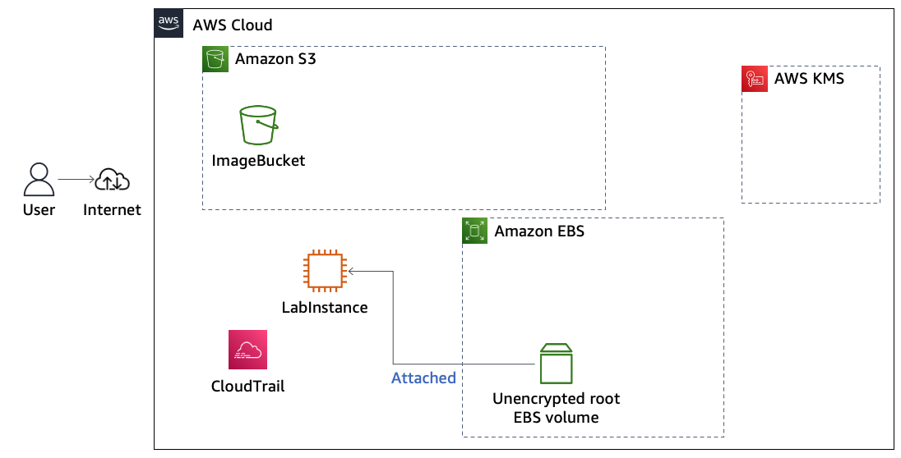
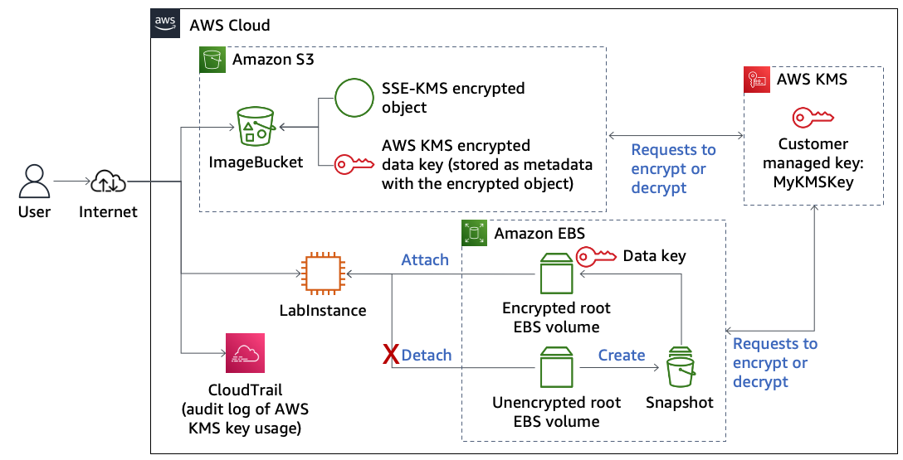
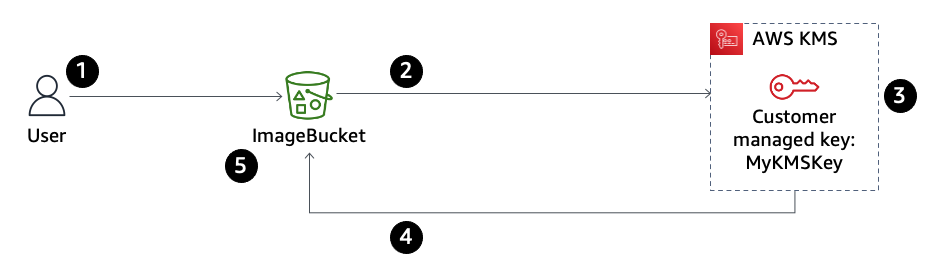
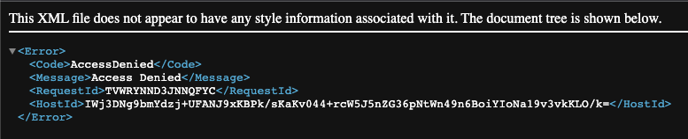
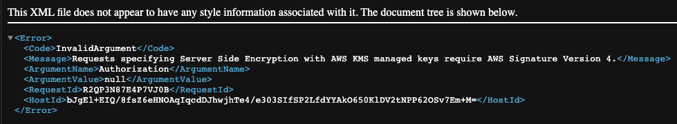
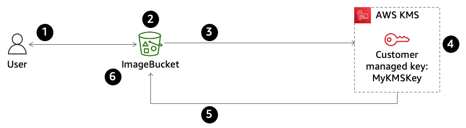
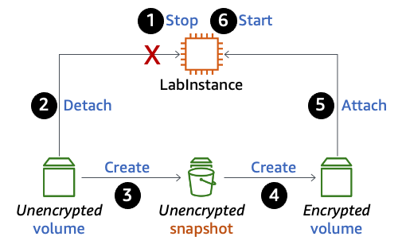
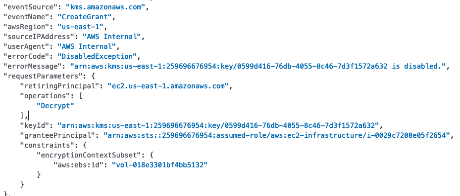

# Лабораторна робота 5.1: шифрування даних у стані спокою за допомогою AWS KMS (Lab 5.1: Encrypting Data at Rest by Using AWS KMS)

## Огляд і цілі лабораторної роботи

У цій лабораторній роботі ви використаєте AWS Key Management Service (AWS KMS) для шифрування даних у стані спокою. Ви створите ключ AWS KMS, використаєте його для шифрування об’єктів, що зберігаються в Amazon Simple Storage Service (Amazon S3), і для шифрування томів Amazon Elastic Block Store (Amazon EBS). Ви також побачите, як AWS CloudTrail надає журнал аудиту використання ключа AWS KMS і як вимкнення ключа впливає на доступ до даних.

Після завершення цієї лабораторної роботи ви зможете:

- Створювати ключ AWS KMS, яким керує клієнт (customer managed key), для шифрування й розшифрування даних у стані спокою.

- Зберігати зашифрований об’єкт у бакеті S3 за допомогою ключа шифрування.

- Пробувати публічний і підписаний доступ до зашифрованого об’єкта S3.

- Відстежувати використання ключа шифрування за допомогою історії подій CloudTrail.

- Шифрувати кореневий том наявного екземпляра Amazon Elastic Compute Cloud (Amazon EC2).

- Вимикати та знову вмикати ключ AWS KMS і спостерігати наслідки для доступу до даних.

## Тривалість

Для виконання цієї лабораторної роботи потрібно приблизно **75 хвилин**.

## Обмеження сервісів AWS

У цьому лабораторному середовищі доступ до сервісів AWS і дій сервісів може бути обмежений тими, що потрібні для виконання інструкцій лабораторної роботи. Ви можете стикнутися з помилками, якщо спробуєте отримати доступ до інших сервісів чи виконати дії, окрім описаних у цій лабораторній роботі.

## Сценарій

Наведена нижче діаграма показує архітектуру, яку було створено для вас в AWS на *початку* лабораторної роботи. Ресурси хмари AWS включають порожній бакет S3 з назвою ImageBucket і екземпляр EC2 з назвою LabInstance, до якого прикріплено незашифрований кореневий том EBS.



<details>
<summary>Текст зі схеми</summary>

AWS Cloud

Amazon S3

ImageBucket

AWS KMS

User (Користувач)

Internet (Інтернет)

LabInstance

Amazon EBS

Attached (Прикріплено)

CloudTrail

Unencrypted root EBS volume (Незашифрований кореневий том EBS)

</details>

Наприкінці цієї лабораторної роботи ви створите архітектуру, показану на наведеній нижче діаграмі. Ця діаграма також показує деякі дії, які ви виконуватимете, і обмін даними між сервісами Amazon S3, Amazon EBS, AWS KMS і CloudTrail під час лабораторної роботи.



<details>
<summary>Текст зі схеми</summary>

AWS Cloud

Amazon S3

SSE-KMS encrypted object (Об’єкт, зашифрований SSE-KMS)

AWS KMS encrypted data key (stored as metadata with the encrypted object) (Ключ даних, зашифрований AWS KMS (зберігається як метадані разом із зашифрованим об’єктом))

ImageBucket

Requests to encrypt or decrypt (Запити на шифрування чи розшифрування)

AWS KMS

Customer managed key: MyKMSKey (Ключ, яким керує клієнт: MyKMSKey)

User (Користувач)

Internet (Інтернет)

Amazon EBS

Data key (Ключ даних)

Encrypted root EBS volume (Зашифрований кореневий том EBS)

Attach (Прикріпити)

LabInstance

Detach (Від’єднати)

Create (Створити)

Unencrypted root EBS volume (Незашифрований кореневий том EBS)

Snapshot (Знімок)

Requests to encrypt or decrypt (Запити на шифрування чи розшифрування)

CloudTrail (audit log of AWS KMS key usage) (CloudTrail (журнал аудиту використання ключа AWS KMS))

</details>

**Опис діаграми:** користувач підключається до ресурсів хмари AWS через інтернет. ImageBucket містить об’єкт, зашифрований за допомогою серверного шифрування з AWS KMS, відомого як SSE-KMS. Бакет також містить зашифрований ключ даних, що зберігається як метадані разом із зашифрованим об’єктом. Незашифрований кореневий том EBS від’єднано від LabInstance. З цього тому створено знімок, і цей знімок використано для створення зашифрованого кореневого тому EBS. Зашифрований том прикріплено до LabInstance. Запити на шифрування чи розшифрування об’єктів S3 і томів EBS надсилаються до AWS KMS, де зберігається ключ, яким керує клієнт, з назвою MyKMSKey. CloudTrail журналює використання ключа AWS KMS як події. **Кінець опису.**

## Доступ до AWS Management Console

1.  У верхній частині цих інструкцій оберіть **Start Lab**.

    - Розпочнеться лабораторний сеанс.

    - Угорі сторінки відображається таймер, що показує час, який залишився в сеансі.  
      > **Порада:** щоб у будь-який момент продовжити тривалість сеансу, знову оберіть **Start Lab**, перш ніж таймер досягне 0:00.

    - Перш ніж продовжити, зачекайте, доки значок-коло праворуч від посилання AWS у верхньому лівому куті стане зеленим. Коли лабораторне середовище буде готове, також відобразиться панель AWS Details.

2.  Щоб підключитися до AWS Management Console, оберіть посилання **AWS** у верхньому лівому куті над вікном терміналу.

    - Відкриється нова вкладка браузера й підключить вас до консолі.  
      > **Порада:** якщо нова вкладка браузера не відкривається, угорі браузера зазвичай з’являється банер чи значок із повідомленням, що ваш браузер перешкоджає сайту відкривати спливні вікна. Оберіть банер чи значок, а потім оберіть **Allow pop-ups**.

## Завдання 1: створення ключа AWS KMS

У цьому завданні ви створите ключ AWS KMS, яким керує клієнт. *Ключ AWS KMS*, який ви створите, використовуватиметься пізніше в лабораторній роботі для генерування, шифрування та розшифрування *ключів даних (data keys)*. Ключі даних передаватимуться іншим сервісам AWS, зокрема Amazon S3 і Amazon EC2. Ключі даних використовуватимуться для шифрування фактичних даних, що зберігаються в бакеті S3 та на томах EBS.

3.  Створіть ключ AWS KMS, яким керує клієнт.

    - В AWS Management Console у полі пошуку праворуч від **Services** знайдіть KMS і оберіть **Key Management Service**, щоб відкрити консоль AWS KMS.

    - В панелі навігації оберіть **Customer managed keys**.  
      > **Порада:** щоб відкрити панель навігації, оберіть значок меню у верхньому лівому куті.

    - Оберіть **Create key**.

    - Для **Key type** оберіть **Symmetric**.  
      > **Примітка:** симетричні ключі ніколи не залишають AWS KMS у незашифрованому вигляді. Ключ, який ви створите, буде 256-бітним секретним ключем.

    - Оберіть **Next**.

    - Для **Alias** введіть MyKMSKey

    - Оберіть **Next**.

    - Для **Key administrators** знайдіть і оберіть роль voclabs.  
      > **Примітка:** *адміністратори ключа (key administrators)* — це користувачі чи ролі, що *керуватимуть доступом до* ключа шифрування. Наразі ви увійшли в консоль із роллю voclabs. Ця роль користувача відображається у верхньому правому куті консолі, ліворуч від регіону AWS.

    - Оберіть **Next**.

    - На сторінці **Define key usage permissions** знайдіть і знову оберіть роль voclabs.  
      > **Примітка:** *користувачі ключа (key users)* — це користувачі чи ролі, що можуть *використовувати ключ* для шифрування й розшифрування даних.

    - Оберіть **Next**.

    - У нижній частині сторінки **Review** оберіть **Finish**.  
      > Ваш ключ відображається у списку ключів, якими керує клієнт.  
      > **Примітка:** якщо ви намагалися виконати цю лабораторну роботу протягом останніх 7 днів, у цьому списку ви можете побачити старіший ключ чи старіші ключі зі статусом *Pending deletion* (Очікує видалення). Мінімальний час, що має минути між запитом на планування видалення ключа та фактичним його видаленням, — 7 днів.

У цьому завданні ви створили ключ AWS KMS, який використаєте в наступному завданні.

## Завдання 2: зберігання зашифрованого об’єкта в бакеті S3

У цьому завданні ви завантажите файл зображення до бакета S3. Ви зашифруєте файл за допомогою ключа шифрування, створеного в попередньому завданні.

4.  Щоб завантажити файл з назвою clock.png на ваш комп’ютер, оберіть таке посилання: [Download](https://aws-tc-largeobjects.s3.us-west-2.amazonaws.com/CUR-TF-100-ACSECF-1-DEV/lab-5.1-kms/s3/clock.png).

5.  Знайдіть бакет S3 і проаналізуйте його налаштування шифрування.

    - У полі пошуку праворуч від **Services** знайдіть і оберіть **S3**, щоб відкрити консоль Amazon S3.

    - В панелі навігації оберіть **Buckets**.

    - Оберіть посилання на назву бакета, що містить **imagebucket**.

    - Оберіть вкладку **Properties**.

    - У розділі **Default encryption** зверніть увагу, що налаштування наразі ввімкнено.  
      > Коли це налаштування ввімкнено, нові об’єкти, що зберігаються в бакеті, шифруються автоматично. Це налаштування ввімкнено за замовчуванням.

6.  Завантажте файл до бакета й збережіть його як зашифрований об’єкт.

    - Угорі сторінки оберіть вкладку **Objects**.

    - Оберіть **Upload**.

    - Оберіть **Add files**.

    - Перейдіть до файлу **clock.png** на вашому комп’ютері й виберіть його.

    - Розгорніть розділ **Properties** і налаштуйте таке:

      - У розділі **Server-side encryption settings** оберіть **Specify an encryption key**.

      - **Encryption key type:** оберіть **AWS Key Management Service key (SSE-KMS)**.

      - **AWS KMS key:** виберіть **Choose from your AWS KMS keys**.

      - Випадаюче меню **AWS KMS key**: оберіть **MyKMSKey**.

    - Унизу сторінки оберіть **Upload**.

    - Після завершення завантаження оберіть **Close** у верхньому правому куті.  
      > Зверніть увагу, що clock.png тепер указано як об’єкт у бакеті.  
      > Наведені нижче діаграма й опис пояснюють, що відбулося, коли ви завантажили файл до Amazon S3.



<details>
<summary>Текст зі схеми</summary>

User (Користувач)

ImageBucket

AWS KMS

Customer managed key: MyKMSKey (Ключ, яким керує клієнт: MyKMSKey)

1

2

3

4

5

</details>

| **Крок (Step)** | **Пояснення (Explanation)** |
|---|---|
| 1 | Користувач запросив завантажити файл і зберегти його як зашифрований об’єкт у ImageBucket. |
| 2 | Amazon S3 запросив в AWS KMS ключ даних для шифрування файлу. |
| 3 | AWS KMS згенерував ключ даних у відкритому вигляді та зашифрував ключ даних за допомогою ключа, яким керує клієнт, MyKMSKey. |
| 4 | AWS KMS надіслав обидві копії ключа даних в Amazon S3. |
| 5 | Amazon S3 зашифрував об’єкт за допомогою ключа даних у відкритому вигляді, зберіг об’єкт, а потім видалив ключ даних у відкритому вигляді. Зашифрований ключ зберігається в метаданих об’єкта. |

7.  Проаналізуйте налаштування шифрування об’єкта.

    - Оберіть посилання на об’єкт **clock.png**.

    - На вкладці **Properties** знайдіть розділ **Server-side encryption settings**.  
      > Зверніть увагу, що серверне шифрування за допомогою SSE-KMS увімкнено для цього об’єкта.

У цьому завданні ви проаналізували налаштування шифрування бакета. Потім ви завантажили об’єкт до бакета. Хоча налаштування бакета не шифрують автоматично завантажувані вами об’єкти, ви мали *можливість* зашифрувати об’єкт, який завантажували.

## Завдання 3: спроба публічного доступу до зашифрованого об’єкта

У цьому завданні ви спробуєте отримати доступ до зашифрованого об’єкта за допомогою URL-адреси об’єкта S3. Ця URL-адреса — це метод доступу до об’єкта S3 з публічного інтернету.

8.  Спробуйте відкрити зображення за допомогою URL-адреси об’єкта S3.

    - У розділі **Object overview** угорі сторінки скопіюйте **Object URL** у буфер обміну.  
      > **Примітка:** зверніть увагу, що URL-адреса має такий формат: *https://.s3.amazonaws.com/*.

    - Вставте URL-адресу об’єкта в нову вкладку браузера й спробуйте завантажити сторінку.  
      > Ви отримуєте таку помилку *Access Denied* (Доступ заборонено).



<details>
<summary>Текст зі схеми</summary>

This XML file does not appear to have any style information associated with it. The document tree is shown below. (Цей XML-файл, схоже, не має пов’язаної інформації про стилі. Нижче показано дерево документа.)

```xml
<Error>
  <Code>AccessDenied</Code>
  <Message>Access Denied</Message>
  <RequestId>TVWRYNND3JNNQFYC</RequestId>
  <HostId>IWj3DNg9bmYdzj+UFANJ9xKBPk/sKaKv044+rcW5J5nZG36pNtWn49n6BoiYIoNal9v3vkKLO/k=</HostId>
</Error>
```

</details>

**Примітка:** URL-адреса об’єкта S3 — це один із методів надання публічного доступу з інтернету до об’єкта S3. Однак за замовчуванням, коли ви створюєте бакет S3, публічний доступ до об’єктів не дозволено. Налаштування безпеки за замовчуванням *Block all public access* (Блокувати весь публічний доступ) застосовано до цього бакета та всіх об’єктів, що зберігаються в ньому.

- Тримайте вкладку браузера відкритою, тому що ви повернетеся до цієї сторінки за мить. Поверніться до вкладки браузера, де відкрито консоль Amazon S3.

9.  Змініть дозволи публічного доступу для *бакета*.

    - У навігаційному ланцюжку (breadcrumbs) у верхньому лівому куті сторінки оберіть назву бакета, що містить **imagebucket**.

    - Оберіть вкладку **Permissions**.

    - У розділі **Block public access** оберіть **Edit**.

    - Зніміть прапорець **Block *all* public access**.

    - Оберіть **Save changes**.

    - Коли з’явиться запит, введіть confirm і оберіть **Confirm**.

10. Змініть налаштування доступу для *об’єкта*.

    - Оберіть посилання на назву бакета, що містить **imagebucket**, і оберіть вкладку **Permissions**.

    - У розділі **Object Ownership** оберіть edit. Оберіть **ACLs enabled**.

    - Поставте прапорець підтвердження. Залиште вибраним **Bucket owner preferred** і оберіть **Save changes**.

    - Оберіть вкладку **Objects**, а потім виберіть **clock.png**.

    - Оберіть **Actions** \> **Make public using ACL**.

    - Оберіть **Make public**.  
      > Відображається банер, що вказує, що налаштування публічного доступу успішно змінено.

    - Оберіть **Close**.

11. Знову перевірте доступ до об’єкта за допомогою URL-адреси об’єкта S3.

    - Поверніться до вкладки браузера, яку ви відкривали раніше й намагалися завантажити URL-адресу об’єкта S3.

    - Оновіть сторінку.  
      > Тепер ви бачите іншу помилку. Замість помилки Access Denied, яку ви бачили раніше, ви тепер бачите таку помилку *Invalid Argument* (Недійсний аргумент).



<details>
<summary>Текст зі схеми</summary>

This XML file does not appear to have any style information associated with it. The document tree is shown below. (Цей XML-файл, схоже, не має пов’язаної інформації про стилі. Нижче показано дерево документа.)

```xml
<Error>
  <Code>InvalidArgument</Code>
  <Message>Requests specifying Server Side Encryption with AWS KMS managed keys require AWS Signature Version 4.</Message>
  <ArgumentName>Authorization</ArgumentName>
  <ArgumentValue>null</ArgumentValue>
  <RequestId>R2QP3N87E4P7VJ0B</RequestId>
  <HostId>bJgEl+EIQ/8fsZ6eHNOAqIqcdDJhwjhTe4/e303SIfSP2LfdYYAkO650KlDV2tNPP62OSv7Em+M=</HostId>
</Error>
```

</details>

**Аналіз:** *доступ* до об’єкта тепер надано публічному інтернету (через URL-адресу об’єкта); однак, оскільки зображення зашифровано, ви все одно не можете його переглянути.  
Це добре, тому що це демонструє одну з важливих причин, чому ви можете обрати шифрування даних. У випадках, коли доступ до даних може бути випадково наданий комусь, хто не повинен мати доступу, ця особа не зможе прочитати дані, якщо вона *також* не має доступу до ключа шифрування. Ключ шифрування потрібен для розшифрування даних і повернення їх у зрозумілий людині вигляд.  
Повідомлення про помилку вказує: *Requests specifying Server Side Encryption with AWS KMS managed keys require AWS Signature Version 4* (Запити, що вказують серверне шифрування з ключами, керованими AWS KMS, потребують AWS Signature Version 4). Signature Version 4 — це процес додавання інформації автентифікації до запитів AWS.

- Закрийте вкладку браузера, де ви завантажували URL-адресу об’єкта S3.

У цьому завданні ви побачили, що зашифрований об’єкт, збережений в Amazon S3, спершу не був доступний через інтернет. Потім ви виявили, що навіть коли ви зробили об’єкт доступним для інтернету, ви не змогли успішно отримати до нього доступ. Це сталося тому, що запити, які вказують SSE-KMS, потребують AWS Signature Version 4, а ви не підписали запит.

## Завдання 4: спроба підписаного доступу до зашифрованого об’єкта

У цьому завданні ви намагаєтеся розшифрувати зашифрований об’єкт у консолі Amazon S3 як автентифікований користувач.

12. Відкрийте збережений зашифрований об’єкт.

    - У консолі Amazon S3 переконайтеся, що ви перебуваєте на вкладці **Objects** для бакета з **imagebucket** у назві.

    - Виберіть **clock.png**, а потім оберіть **Open**.  
      > Таке зображення відкривається в новій вкладці чи вікні.


13. Проаналізуйте URL-адресу, що була використана для успішного розшифрування об’єкта.

    - Зверніть увагу на URL-адресу у вкладці браузера, де відкрито зображення. Формат подібний до наведеного нижче (де значення ... містять інформацію про облікові дані).

https://c46588a730572l1728517t1w501832962033-imagebucket-gmnhbh84muj.s3.us-east-1.amazonaws.com/clock.png?response-content-disposition=inline&X-Amz-...&X-Amz-...&X-Amz-...&X-Amz-...&X-Amz-...&X-Amz-...&X-Amz-...

- Закрийте вкладку браузера, де завантажено зображення, і поверніться до консолі Amazon S3.  
  > Наведені нижче діаграма й опис пояснюють, що відбулося, коли ви запросили відкрити збережений зашифрований об’єкт.



<details>
<summary>Текст зі схеми</summary>

User (Користувач)

ImageBucket

AWS KMS

Customer managed key: MyKMSKey (Ключ, яким керує клієнт: MyKMSKey)

1

2

3

4

5

6

</details>

| **Крок (Step)** | **Пояснення (Explanation)** |
|---|---|
| 1 | Ви запросили відкрити об’єкт. |
| 2 | Далі Amazon S3 помітив, що запитуваний об’єкт зашифровано. Оскільки ви були автентифіковані в акаунті AWS під час використання консолі Amazon S3, інформацію автентифікації Signature Version 4 було автоматично включено в запит. |
| 3 | Потім Amazon S3 надіслав в AWS KMS зашифровану копію *ключа даних*, яким було зашифровано об’єкт. |
| 4 | Потім AWS KMS *розшифрував ключ даних* за допомогою *ключа AWS KMS* MyKMSKey (який ніколи не залишає сервіс AWS KMS). |
| 5 | Потім AWS KMS надіслав *ключ даних у відкритому вигляді* назад в Amazon S3. |
| 6 | Нарешті Amazon S3 розшифрував шифротекст об’єкта даних, дозволив вам відкрити об’єкт і видалив копію ключа даних у відкритому вигляді. |

## Завдання 5: моніторинг активності AWS KMS за допомогою CloudTrail

У цьому завданні ви отримаєте доступ до історії подій CloudTrail, щоб знайти події, пов’язані з вашими операціями шифрування. Функціональність журналу аудиту CloudTrail — важлива функція безпеки, і добре відстежувати, як ключі AWS KMS використовуються у вашому акаунті.

14. Відкрийте історію подій CloudTrail.

    - У полі пошуку праворуч від **Services** знайдіть і оберіть **CloudTrail**, щоб відкрити консоль CloudTrail.

    - В панелі навігації оберіть **Event history**.  
      > **Порада:** щоб відкрити панель навігації, оберіть значок меню у верхньому лівому куті.  
      > **Примітка:** CloudTrail надає журнал аудиту викликів API, зроблених в акаунті AWS. Історія подій надає доступ до подій за останні 90 днів активності акаунта.

    - Зверніть увагу на стовпець з назвою **Event source**.  
      > Кожного разу, коли відбувається виклик API до сервісу AWS у вибраному вами регіоні, якщо цей сервіс повідомляє про такі події в CloudTrail, подія та сервіс AWS, що повідомив про подію, перелічуються.

15. Відфільтруйте історію подій, щоб відображати лише події, про які повідомив сервіс AWS KMS.

    - Оберіть випадаюче меню ліворуч, що наразі відображає **Read-only**, і оберіть **Event source**.

    - У полі пошуку *Enter an event source* знайдіть kms і оберіть **kms.amazonaws.com**.

16. Проаналізуйте подію GenerateDataKey.

    - Оберіть посилання на назву події **GenerateDataKey**.

    - У розділі **Event record** перегляньте подробиці події. Слід звернути увагу на такі поля:

      - **eventName:** дія API AWS KMS, яку було викликано, — *GenerateDataKey*.

      - **requestParameters** \> **keyId:** ARN ключа AWS KMS, що згенерував ключ даних.

      - **requestParameters** \> **encryptionContext** \> **aws:s3:arn:** для чого Amazon S3 запитував ключ даних.

      - **userIdentity** \> **principalId:** ідентичність користувача чи ролі, що зробили запит.

    - **Аналіз:** ця подія була згенерована, коли ви запросили завантажити файл clock.png до Amazon S3. Ваша дія змусила AWS KMS згенерувати новий ключ даних. Якщо ви перейдете до консолі AWS KMS і подивитеся на ідентифікатор ключа AWS KMS, який ви створили в завданні 1, ви побачите, що він збігається з keyId у записі події. Зверніть увагу також на **encryptionContext**, що визначає, для чого Amazon S3 запитував ключ даних. Значення *aws:s3:arn* — це ARN бакета з *imagebucket* у назві, а не назва об’єкта в ньому. Amazon S3 запитав один ключ даних для бакета, а не окремий ключ даних для кожного об’єкта, тому що завантаження використало *S3 Bucket Key*. Це налаштування за замовчуванням, і воно зменшує кількість запитів, які Amazon S3 надсилає до AWS KMS.

17. Проаналізуйте подію Decrypt.

    - У навігаційному ланцюжку (breadcrumbs) угорі сторінки оберіть **Event history**.  
      > **Примітка:** події все ще мають бути відфільтровані за джерелом подій *kms.amazonaws.com*.

    - Оберіть посилання на назву події **Decrypt**.

    - Як і раніше, перегляньте подробиці в розділі **Event record**.  
      > **Аналіз:** ця подія була згенерована, коли ви успішно відкрили файл clock.png з консолі Amazon S3. Зверніть увагу, що запис знову детально показує, хто зробив запит, і що **encryptionContext** знову визначає бакет, до даних якого застосовується *ключ даних* у відкритому вигляді. Подія Decrypt не включає поля keyId; натомість ключ AWS KMS, що розшифрував ключ даних, перелічено в розділі **resources** запису події.  
      > CloudTrail журналює всю активність API AWS KMS. Оцінюючи ці записи журналу, ви можете визначити минуле використання певного ключа AWS KMS. Якщо ви хочете мати змогу аналізувати події, що відбулися понад 90 днів тому, можна створити трейл CloudTrail (trail).

## Завдання 6: шифрування кореневого тому наявного екземпляра EC2

У цьому завданні ви зашифруєте кореневий том наявного екземпляра EC2.

Щоб зашифрувати незашифрований том, потрібно виконати кілька кроків. Наведені нижче діаграма й опис пояснюють ці кроки.



<details>
<summary>Текст зі схеми</summary>

Stop (Зупинити)

LabInstance

Start (Запустити)

Detach (Від’єднати)

Attach (Прикріпити)

Create (Створити)

Unencrypted volume (Незашифрований том)

Unencrypted snapshot (Незашифрований знімок)

Encrypted volume (Зашифрований том)

1

2

3

4

5

6

</details>

| **Крок (Step)** | **Пояснення (Explanation)** |
|---|---|
| 1 | Зупиніть екземпляр. |
| 2 | Від’єднайте том. |
| 3 | Створіть знімок незашифрованого кореневого тому. |
| 4 | Створіть новий зашифрований том із цього знімка. |
| 5 | Підставте зашифрований том як новий кореневий том екземпляра. |
| 6 | І нарешті, запустіть екземпляр. |

18. Перегляньте поточні налаштування сховища наявного екземпляра EC2.

    - У полі пошуку праворуч від **Services** знайдіть і оберіть **EC2**, щоб відкрити консоль Amazon EC2.

    - В панелі навігації оберіть **Instances**.

    - Оберіть посилання на ідентифікатор екземпляра **LabInstance**.

    - Оберіть вкладку **Storage**.

    - У розділі **Block devices** зверніть увагу, що прикріплений том вказує, що він *не* зашифрований. Це кореневий том, що містить інсталяцію гостьової ОС.  
      > **Примітка:** можна зашифрувати том, прикріплений до екземпляра EC2, коли ви вперше створюєте екземпляр. Також можна зашифрувати том, прикріплений до наявного екземпляра EC2, зокрема кореневий том, але це потребує кількох додаткових кроків. Ви виконаєте ці кроки в цьому завданні.

19. Зупиніть екземпляр.

    - У навігаційному ланцюжку (breadcrumbs) угорі сторінки оберіть **Instances**.

    - Виберіть **LabInstance** і оберіть **Instance state** \> **Stop instance**.

    - Щоб підтвердити дію, оберіть **Stop**.

20. Створіть *знімок (snapshot)* кореневого тому EBS наявного екземпляра EC2.

    - Оберіть вкладку **Storage**.

    - У розділі **Block devices** оберіть посилання на **Volume ID**.

    - Знову оберіть посилання на **Volume ID**.

    - Зверніть увагу на зону доступності, де існує том (наприклад, us-east-1a чи us-east-1b).  
      > **Важливо:** ця інформація знадобиться вам за мить.

    - Оберіть **Actions** \> **Create snapshot**.

    - Оберіть **Add tag** і додайте тег з такою інформацією:

      - **Key:** введіть Name

      - **Value:** введіть Unencrypted Root Volume

    - Оберіть **Create snapshot**.

21. Створіть *зашифрований* том із *незашифрованого* знімка.

    - В панелі навігації в розділі **Elastic Block Store** оберіть **Snapshots**.

    - Оберіть посилання на ідентифікатор знімка **Unencrypted Root Volume**, який ви щойно створили.

    - Зачекайте, доки **Snapshot status** покаже *Completed*.

    - Зверніть увагу, що статус шифрування знімка — *Not encrypted*.

    - Оберіть **Actions** \> **Create volume from snapshot** і налаштуйте таке:

      - **Availability Zone:** оберіть зону доступності, де існує наявний том.

      - Поставте прапорець **Encrypt this volume**.

      - **KMS key:** оберіть **MyKMSKey**.

    - Оберіть **Create volume**.

22. Позначте томи.

    - В панелі навігації в розділі **Elastic Block Store** оберіть **Volumes**.

    - Зверніть увагу, що тепер перелічено два томи.

    - Для тому зі **Volume state** *In-use* змініть назву тому:

      - Наведіть курсор на поле **Name** і оберіть значок олівця з папером.

      - У полі **Edit Name** введіть Old unencrypted root volume

      - Оберіть **Save**.

    - Виконайте ті самі кроки, щоб змінити назву тому зі **Volume state** *Available* на New encrypted root volume

23. Замініть кореневий том, який використовує екземпляр EC2.

    - Виберіть **Old unencrypted root volume**, а потім оберіть **Actions** \> **Detach volume**.

    - Щоб підтвердити, оберіть **Detach**.

    - Виберіть **New encrypted root volume**, а потім оберіть **Actions** \> **Attach volume** і налаштуйте таке:

      - **Instance:** оберіть **(LabInstance) (stopped)**.

      - **Device name:** введіть /dev/xvda  
        > **Примітка:** це назва пристрою, де наявний екземпляр очікує знайти кореневий том.

    - Оберіть **Attach volume**.

24. Зверніть увагу, що кореневий том тепер зашифровано.

    - Поверніться до екрана **Instances** і виберіть **LabInstance**.

    - Оберіть вкладку **Storage** і зверніть увагу, що прикріплений том тепер зашифровано й він має ідентифікатор ключа AWS KMS.  
      > **Примітка:** можливо, потрібно оновити сторінку, щоб побачити найновішу інформацію про прикріплений том.  
      > **Важливо:** поки не запускайте екземпляр. Ви зробите це в наступному завданні.

У цьому завданні ви зашифрували кореневий том наявного екземпляра, тож дані на ньому тепер безпечніші.

## Завдання 7: вимкнення ключа шифрування та спостереження наслідків

У цьому завданні ви тимчасово вимкнете ключ AWS KMS, який раніше використовували для шифрування об’єкта в Amazon S3 і шифрування тому EBS. Потім ви спостерігатимете наслідки вимкнення ключа для доступу до зашифрованих даних.

25. Вимкніть ключ AWS KMS, який ви використовували для шифрування об’єкта S3 і тому EBS.

    - Перейдіть до консолі AWS KMS.

    - В панелі навігації оберіть **Customer managed keys**.

    - Виберіть **MyKMSKey**, а потім оберіть **Key actions** \> **Disable**.

    - Щоб підтвердити дію, поставте прапорець *Confirm that you want to disable this key*, а потім оберіть **Disable key**.

26. Спробуйте запустити екземпляр EC2.

    - Перейдіть до консолі Amazon EC2.

    - Виберіть **LabInstance**, а потім оберіть **Instance state** \> **Start instance**.

    - Скористайтеся значком оновлення, щоб відстежувати **Instance state**.  
      > Запуск швидко завершиться невдачею, і стан екземпляра зміниться з *Pending* знову на *Stopped*.

27. Спробуйте отримати доступ до об’єкта S3 за допомогою URL-адреси об’єкта.

    - Перейдіть до консолі Amazon S3.

    - В панелі навігації оберіть **Buckets**.

    - Оберіть посилання на назву бакета, що містить **imagebucket**.

    - Виберіть **clock.png**, а потім оберіть **Open**.  
      > Зображення не відкривається, і відображається помилка KMS.DisabledException, хоча цей підхід до розшифрування об’єкта був успішним для вас раніше в лабораторній роботі.

28. Проаналізуйте історію подій CloudTrail.

    - Перейдіть до консолі CloudTrail.

    - В панелі навігації оберіть **Event history**.

    - Оберіть посилання на назву події **DisableKey**.

    - Перегляньте подробиці події.  
      > Подробиці показують, що ви вимкнули ключ AWS KMS кілька хвилин тому.

    - Перегляньте подію **StartInstances**, що відбулася одразу після події **DisableKey**.  
      > Запит на запуск екземпляра був успішним. Однак, як ви переконалися, екземпляр так і не досяг стану *Running*.

    - Перегляньте подію **CreateGrant**, що відбулася одразу після події **StartInstances**. Запис події подібний до наведеного нижче



<details>
<summary>Текст зі схеми</summary>

```json
"eventSource": "kms.amazonaws.com",
"eventName": "CreateGrant",
"awsRegion": "us-east-1",
"sourceIPAddress": "AWS Internal",
"userAgent": "AWS Internal",
"errorCode": "DisabledException",
"errorMessage": "arn:aws:kms:us-east-1:259696676954:key/0599d416-76db-4055-8c46-7d3f1572a632 is disabled.",
"requestParameters": {
    "retiringPrincipal": "ec2.us-east-1.amazonaws.com",
    "operations": [
        "Decrypt"
    ],
    "keyId": "arn:aws:kms:us-east-1:259696676954:key/0599d416-76db-4055-8c46-7d3f1572a632",
    "granteePrincipal": "arn:aws:sts::259696676954:assumed-role/aws:ec2-infrastructure/i-0029c7208e05f2654",
    "constraints": {
        "encryptionContextSubset": {
            "aws:ebs:id": "vol-018e3301bf4bb5132"
        }
    }
}
```

</details>

Зверніть увагу, що подробиці події виявляють помилку. Процес запуску екземпляра EC2 помітив, що кореневий том зашифровано за допомогою MyKMSKey, тому Amazon EC2 звернувся до AWS KMS, щоб отримати ключ даних у відкритому вигляді, аби розшифрувати том. Але AWS KMS відхилив запит, тому що ключ AWS KMS, використаний для шифрування ключа даних, яким було зашифровано том EBS, було вимкнено. Екземпляр не може запуститися, тому що файли на кореневому томі, потрібні гостьовій ОС для запуску, не вдалося розшифрувати.

29. Поверніться до консолі AWS KMS і знову ввімкніть ключ AWS KMS, яким керує клієнт, MyKMSKey.

30. Поверніться до консолі Amazon EC2 і знову запустіть LabInstance.  
    > Тепер екземпляр успішно запускається.  
    > **Важливо:** перш ніж надсилати вашу роботу, зачекайте, доки **Instance state** відобразить *Running*.

## Надсилання вашої роботи

31. Щоб записати ваш прогрес, оберіть **Submit** угорі цих інструкцій.

32. Коли з’явиться запит, оберіть **Yes**.  
    > Через пару хвилин з’являється панель оцінок і показує, скільки балів ви отримали за кожне завдання. Якщо результати не відображаються через пару хвилин, оберіть **Grades** угорі цих інструкцій.  
    > **Порада:** ви можете надсилати свою роботу кілька разів. Після того як ви змінили свою роботу, знову оберіть **Submit**. Для цієї лабораторної роботи записується ваше останнє надсилання.

33. Щоб знайти детальний відгук про вашу роботу, оберіть **Submission Report**.

## Лабораторну роботу завершено

Вітаємо! Ви завершили лабораторну роботу.

34. Угорі цієї сторінки оберіть **End Lab**, а потім оберіть **Yes**, щоб підтвердити, що ви хочете завершити лабораторну роботу.  
    > Панель повідомлень вказує, що лабораторну роботу завершується.

35. Щоб закрити панель, оберіть **Close** у верхньому правому куті.

© 2022, Amazon Web Services, Inc. та її афілійовані особи. Усі права захищені. Цей твір не можна відтворювати чи розповсюджувати, повністю чи частково, без попереднього письмового дозволу Amazon Web Services, Inc. Комерційне копіювання, надання в позичку чи продаж заборонено.
