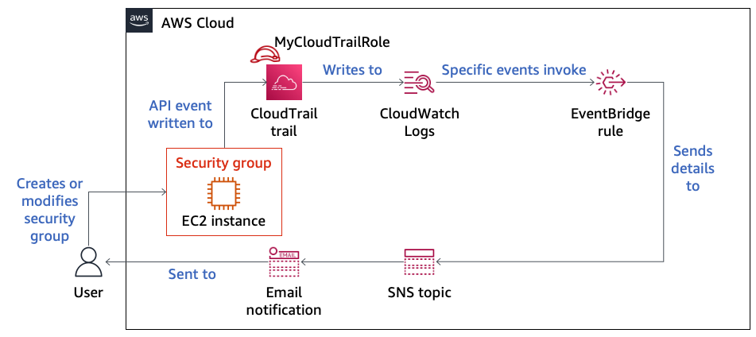
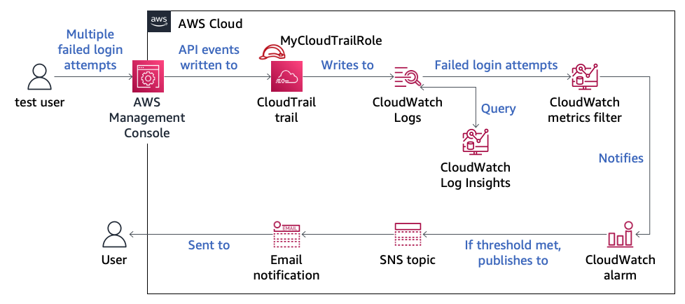
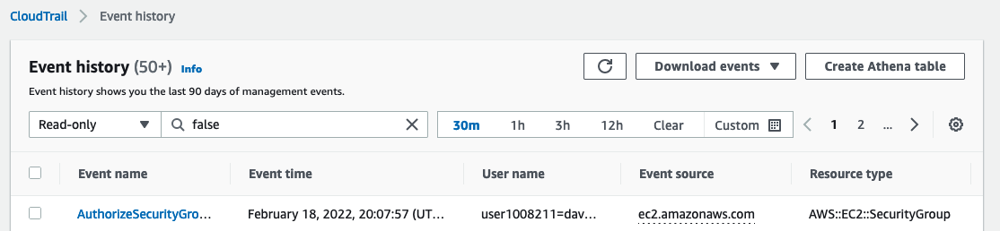
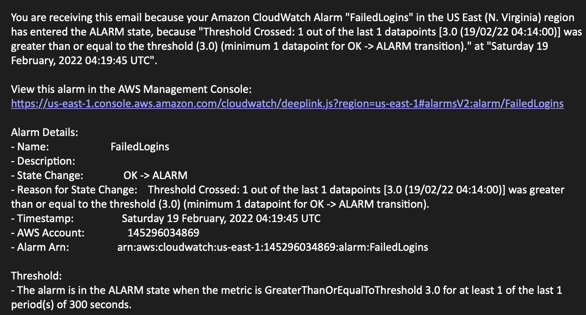
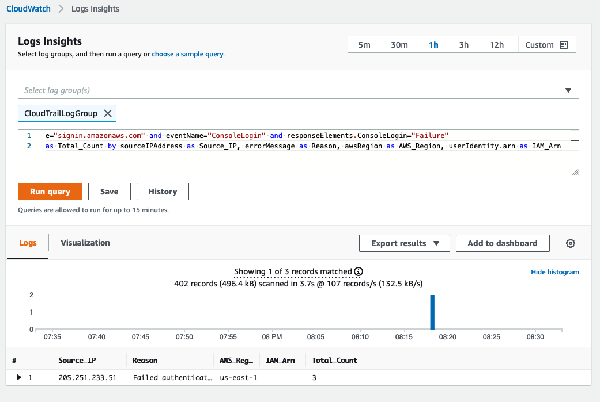

# Лабораторна робота 6.1: моніторинг і сповіщення за допомогою CloudTrail і CloudWatch (Lab 6.1: Monitoring and Alerting with CloudTrail and CloudWatch)

## Огляд і цілі лабораторної роботи

У цій лабораторній роботі ви налаштуєте журналювання та моніторинг в акаунті AWS. Ви дізнаєтеся, як створити трейл AWS CloudTrail (trail), що буде журналом аудиту викликів API, зроблених в акаунті. Потім ви створите тему Amazon Simple Notification Service (Amazon SNS). Підписавши свою електронну пошту на тему, ви отримуватимете сповіщення, коли відбуваються певні події. Далі ви визначите правило Amazon EventBridge. Правило помічатиме кожного разу, коли хтось змінює групу безпеки, і надсилатиме вам електронне сповіщення про інцидент. Нарешті, ви створите сигнал Amazon CloudWatch (alarm), що помічатиме, коли відбувається кілька невдалих спроб входу в AWS Management Console.

Після завершення цієї лабораторної роботи ви зможете:

- Аналізувати подробиці подій в історії подій CloudTrail.

- Створювати трейл CloudTrail з увімкненим журналюванням у CloudWatch.

- Створювати тему SNS та підписку електронною поштою на неї.

- Налаштовувати правило EventBridge для моніторингу змін ресурсів в акаунті AWS.

- Створювати фільтри метрик CloudWatch (metric filters) і сигнали CloudWatch.

- Виконувати запити до журналів CloudTrail за допомогою CloudWatch Logs Insights.

## Тривалість

Для виконання цієї лабораторної роботи потрібно приблизно **75 хвилин**.

## Обмеження сервісів AWS

У цьому лабораторному середовищі доступ до сервісів AWS і дій сервісів може бути обмежений тими, що потрібні для виконання інструкцій лабораторної роботи. Ви можете стикнутися з помилками, якщо спробуєте отримати доступ до інших сервісів чи виконати дії, окрім описаних у цій лабораторній роботі.

## Сценарій

Лабораторна робота починається з екземпляра Amazon Elastic Compute Cloud (Amazon EC2), пов’язаного з групою безпеки. В одному із завдань лабораторної роботи ви перевірите, чи успішно зміна групи безпеки викликає правило й надсилає вам електронне сповіщення. Також лабораторна робота починається з попередньо налаштованим трейлом CloudTrail, що записує в CloudWatch Logs. Лабораторна робота також включає попередньо налаштованого користувача AWS Identity and Access Management (IAM), якого ви використаєте для перевірки сповіщень про невдалі спроби входу в консоль.

До кінця завдання 3 ви створите та налаштуєте більше ресурсів в акаунті. Середовище виглядатиме як на наведеній нижче діаграмі архітектури:



<details>
<summary>Текст зі схеми</summary>

AWS Cloud

MyCloudTrailRole

CloudTrail trail (Трейл CloudTrail)

Writes to (Записує в)

CloudWatch Logs

Specific events invoke (Певні події викликають)

EventBridge rule (Правило EventBridge)

API event written to (Подія API записується в)

Security group (Група безпеки)

EC2 instance (Екземпляр EC2)

Creates or modifies security group (Створює чи змінює групу безпеки)

User (Користувач)

Email notification (Електронне сповіщення)

Sent to (Надсилається)

SNS topic (Тема SNS)

Sends details to (Надсилає подробиці в)

</details>

До кінця завдання 5 ви створите архітектуру, показану на наведеній нижче діаграмі:



<details>
<summary>Текст зі схеми</summary>

AWS Cloud

MyCloudTrailRole

test user (користувач test)

Multiple failed login attempts (Кілька невдалих спроб входу)

AWS Management Console

API events written to (Події API записуються в)

CloudTrail trail (Трейл CloudTrail)

Writes to (Записує в)

CloudWatch Logs

Failed login attempts (Невдалі спроби входу)

CloudWatch metrics filter (Фільтр метрик CloudWatch)

Query (Запит)

CloudWatch Log Insights

Notifies (Сповіщає)

CloudWatch alarm (Сигнал CloudWatch)

If threshold met, publishes to (Якщо досягнуто порогу, публікує в)

SNS topic (Тема SNS)

Email notification (Електронне сповіщення)

Sent to (Надсилається)

User (Користувач)

</details>

## Доступ до AWS Management Console

1.  У верхній частині цих інструкцій оберіть **Start Lab**.

    - Розпочнеться лабораторний сеанс.

    - Угорі сторінки відображається таймер, що показує час, який залишився в сеансі.  
      > **Порада:** щоб у будь-який момент продовжити тривалість сеансу, знову оберіть **Start Lab**, перш ніж таймер досягне 0:00.

    - Перш ніж продовжити, зачекайте, доки значок-коло праворуч від посилання AWS у верхньому лівому куті стане зеленим. Коли лабораторне середовище буде готове, також відобразиться панель AWS Details.

2.  Щоб підключитися до AWS Management Console, оберіть посилання **AWS** у верхньому лівому куті над вікном терміналу.

    - Відкриється нова вкладка браузера й підключить вас до консолі.  
      > **Порада:** якщо нова вкладка браузера не відкривається, угорі браузера зазвичай з’являється банер чи значок із повідомленням, що ваш браузер перешкоджає сайту відкривати спливні вікна. Оберіть банер чи значок, а потім оберіть **Allow pop-ups**.

## Завдання 1: створення трейла CloudTrail з увімкненим CloudWatch Logs

У цьому завданні ви проаналізуєте тип інформації про події, доступної в історії подій CloudTrail. Ви також створите трейл CloudTrail з увімкненим журналюванням у CloudWatch.

3.  Проаналізуйте інформацію, доступну в історії подій CloudTrail.

    - У консолі в полі пошуку праворуч від **Services** знайдіть і оберіть **CloudTrail**, щоб відкрити консоль CloudTrail.

    - В панелі навігації оберіть **Event history**.

    - У випадаючому меню **Read-only** під заголовком розділу **Event history** оберіть **Event source**.

    - У полі пошуку праворуч від **Event source** почніть вводити cloudformation.amazonaws.com і оберіть його, коли він з’явиться.  
      > Події в історії подій відфільтровано так, що відображаються лише події журналу аудиту, де джерелом події був AWS CloudFormation.

    - Оберіть найновішу подію **CreateStack**.  
      > Відображається запис події з вибраної події.  
      > **Аналіз:** подія CreateStack відбулася, коли ви розпочали цю лабораторну роботу. Стек створив ресурси в акаунті. Зверніть увагу, що запис включає такі подробиці, як userIdentity особи, що зробила виклик API, eventTime і awsRegion. Також надано інші важливі подробиці запису аудиту.  
      > **Примітка:** історія подій існує за замовчуванням у кожному регіоні. Історія показує події *за останні 90 днів* для регіону, який ви переглядаєте. Цей вигляд обмежений подіями керування (management events) із викликами API створення, зміни та видалення і активністю акаунта. Щоб зберігати запис активності акаунта, що виходить за межі 90 днів, зокрема всі події керування з можливістю включити події даних і активність лише на читання, потрібно налаштувати *трейл* CloudTrail. Ви зробите це на наступному кроці.

4.  Створіть трейл CloudTrail з увімкненим CloudWatch Logs.

    - В панелі навігації оберіть **Trails**.

    - Оберіть **Create trail**.

    - На сторінці **Choose trail attributes** налаштуйте таке:

      - **Trail name:** введіть MyLabCloudTrail

      - **Storage location:** оберіть **Create a new S3 bucket** і прийміть назву бакета за замовчуванням, що включає **aws-cloudtrail-logs**.

      - **Log file SSE-KMS encryption:** зніміть прапорець (щоб вимкнути цей параметр).

      - **CloudWatch Logs:** виберіть **Enabled**.

      - **Log group:** оберіть **New** і прийміть назву групи журналів за замовчуванням.

      - **IAM Role:** оберіть **Existing**.

      - **Role name:** оберіть **LabCloudTrailRole**.

      - Залиште інші атрибути трейла за замовчуванням і оберіть **Next**.

    - На сторінці **Choose log events** налаштуйте таке:

      - **Event type:** залиште вибраним **Management events** і не вибирайте **Data events** чи **Insights events**.

      - **API activity:** залиште вибраними **Read** і **Write**.

      - Оберіть **Next**.

    - Прокрутіть униз до кінця сторінки.  
      > **Важливо:** саме тут ви б завершили процес створення трейла. Однак користувач, під яким ви увійшли, не має потрібних дозволів для створення CloudTrail з увімкненим CloudWatch Logs. Це зумовлено обмеженнями безпеки, накладеними на акаунти AWS, що використовуються для лабораторних робіт.

    - Натомість оберіть **Cancel**.

5.  Проаналізуйте наявний трейл CloudTrail.  
    > Зверніть увагу, що трейл з назвою *LabCloudTrail* уже існує. Його налаштовано з тими самими параметрами, які ви обрали на попередньому кроці, за винятком незначних відмінностей, як-от назва бакета Amazon Simple Storage Service (Amazon S3) і назва групи журналів.  
    > Цей трейл CloudTrail з увімкненим журналюванням у CloudWatch — важлива складова рішень моніторингу й сповіщення, які ви будуватимете в решті цієї лабораторної роботи.

Вітаємо! У цьому завданні ви дізналися, як отримати доступ до подробиць подій в історії подій CloudTrail і як створити трейл CloudTrail.

## Завдання 2: створення теми SNS і підписка на неї

Amazon SNS — це повністю керований сервіс обміну повідомленнями для обміну даними і між застосунками (A2A), і між застосунком і людиною (A2P). Функціональність A2P дає змогу надсилати повідомлення користувачам у великому масштабі через SMS, мобільні push-сповіщення та електронну пошту.

У цьому завданні ви створите тему SNS і підпишете свою адресу електронної пошти на тему. Тема використовуватиметься в наступних завданнях для доставки вам електронних сповіщень про важливу активність в акаунті AWS.

6.  Створіть тему SNS.

    - У полі пошуку праворуч від **Services** знайдіть і оберіть **Simple Notification Service**, щоб відкрити консоль Amazon SNS.

    - Щоб відкрити панель навігації, оберіть значок меню у верхньому лівому куті.

    - В панелі навігації оберіть **Topics**.

    - Оберіть **Create topic** і налаштуйте таке:

      - **Type:** оберіть **Standard**.

      - **Name:** введіть MySNSTopic

      - Розгорніть розділ **Access policy - *optional***.

      - **Specify who can publish messages to the topic:** оберіть **Everyone**.

      - **Specify who can subscribe to this topic:** оберіть **Everyone**.

      - Унизу сторінки оберіть **Create topic**.

7.  Щоб створити підписку електронною поштою на тему SNS, оберіть **Create subscription** і налаштуйте таке:

    - **Topic ARN:** зверніть увагу, що Amazon Resource Number (ARN) теми, яку ви щойно створили, уже заповнено.

    - **Protocol:** оберіть **Email**.

    - **Endpoint:** введіть адресу електронної пошти, на яку ви можете отримувати листи під час цієї лабораторної роботи.

    - Прокрутіть до кінця сторінки й оберіть **Create subscription**.

8.  Перевірте електронну пошту й підтвердьте підписку.

    - Перевірте електронну пошту на наявність листа від AWS Notifications.

    - У тексті листа оберіть посилання **Confirm subscription**.

    - Відкривається вебсторінка й відображає повідомлення, що підписку успішно підтверджено.

У цьому завданні ви успішно створили тему SNS і підписку електронною поштою на тему. Ви використаєте цю конфігурацію в наступних завданнях.

## Завдання 3: створення правила EventBridge для моніторингу груп безпеки

У цьому завданні ви створите правило EventBridge. Правило помічатиме кожного разу, коли вносяться зміни до вхідних правил нової чи наявної групи безпеки в тому самому регіоні вашого акаунта AWS. Щоразу, коли виконуються умови правила, правило публікуватиме повідомлення в темі SNS, яку ви створили.

9.  Створіть правило для моніторингу змін груп безпеки EC2.

    - У консолі в полі пошуку праворуч від **Services** знайдіть і оберіть **Amazon EventBridge**, щоб відкрити консоль EventBridge.

    - В панелі навігації оберіть **Event buses**.

    - У розділі **Default event bus** оберіть **default**.  
      > **Примітка:** правила належать шині подій, тому вони перелічені на сторінці шини, для якої вони маршрутизують події. Ця лабораторна робота використовує шину подій за замовчуванням, яка отримує події, що їх випускають сервіси AWS у вашому акаунті.

    - На сторінці шини подій за замовчуванням оберіть **Rules**, а потім оберіть **Create rule**.

    - Якщо з’являється сторінка вибору конструктора правил, оберіть **Advanced Builder**.  
      > **Примітка:** Advanced Builder визначає шаблон події в редакторі JSON, що використовується на наступних кроках. Enhanced Builder — це натомість полотно «перетягни й відпусти».

    - На екрані **Define rule detail** введіть такі подробиці:

      - Name: MonitorSecurityGroups

      - Event bus: **default**

      - Rule type: **Rule with an event pattern**.

    - Оберіть **Next**

    - На екрані **Build event pattern** введіть такі подробиці:

      - Event source: **AWS events or EventBridge partner events**

      - Залиште налаштування за замовчуванням для Sample event - optional

      - Для **Creation method** оберіть **Custom pattern (JSON editor)**

      - Скопіюйте та вставте такий код у поле *Enter the event JSON*

```json
{
 "source": ["aws.ec2"],
 "detail-type": ["AWS API Call via CloudTrail"],
 "detail": {
   "eventSource": ["ec2.amazonaws.com"],
   "eventName": ["AuthorizeSecurityGroupIngress", "ModifyNetworkInterfaceAttribute"]
 }
}
```

- Оберіть **Next**.  
  > **Важливо:** щоб записувати події зі значенням detail-type AWS API Call via CloudTrail, потрібен трейл CloudTrail з увімкненим журналюванням. Трейл, створений для вас, виконує цю необхідну умову.

- У розділі **Select targets** налаштуйте таке для Target 1:

  - **Target types:** AWS service

  - **Select a target**: оберіть **SNS topic**.

  - **Topic:** оберіть **MySNSTopic**.

  - **Permissions:** **зніміть прапорець** **Use execution role (recommended)**

  - Розгорніть **Additional settings**

  - Для **Configure target input** оберіть **Input transformer**.

  - Оберіть **Configure input transformer**.

  - Прокрутіть униз до розділу *Target input transformer*.

  - У полі **Input path** (перше поле) скопіюйте та вставте такий код:

```json
{"name":"$.detail.requestParameters.groupId","source":"$.detail.eventName","time":"$.time","value":"$.detail"}
```

- У полі **Template** (друге поле) скопіюйте та вставте такий текст:

```text
"The <source> API call was made against the <name> security group on <time> with the following details:"
" <value> "
```

- **Аналіз**: *Input path*, який ви встановлюєте, визначає чотири змінні: name, source, time і value. Для кожної змінної значення встановлюється посиланням на дані, що містяться в структурі JSON подій CloudTrail, які відповідають *шаблону події (event pattern)*, що ви також визначили. *Input template*, який ви встановлюєте, визначав інформацію, що передаватиметься цілі, якою в цьому випадку є тема SNS. Зверніть увагу, що шаблон включає назви чотирьох змінних, визначених у Input path.

- Оберіть **Confirm**, а потім оберіть **Next**.

- На екрані *Configure tags* оберіть **Next**.

- На екрані *Review and create* прокрутіть до низу й оберіть **Create rule**.

\<!--GRADING TASK 3: verify a EventBridge rule named MonitoringRule was created.--\>

10. Щоб протестувати правило EventBridge, змініть групу безпеки, пов’язану з екземпляром EC2.

    - У полі пошуку праворуч від **Services** знайдіть і оберіть **EC2**, щоб відкрити консоль Amazon EC2.

    - В панелі навігації оберіть **Instances**.

    - Поставте прапорець для **LabInstance**  
      > Цей екземпляр було створено для вас, коли ви розпочали лабораторну роботу.

    - У нижній панелі оберіть вкладку **Security**.

    - У розділі **Security groups** оберіть посилання на назву групи безпеки, що містить **LabSecurityGroup**.  
      > Відображаються подробиці цієї групи безпеки.

    - На вкладці **Inbound rules** оберіть **Edit inbound rules**.

    - Оберіть **Add rule** і налаштуйте таке:

      - **Type:** оберіть **SSH**.

      - **Source:** оберіть **Anywhere-IPv4**.

      - Оберіть **Save rules**.

11. Перевірте історію подій CloudTrail.

    - Перейдіть до консолі CloudTrail.

    - В панелі навігації оберіть **Event history**.  
      > Зверніть увагу на найновіші записи, що з’являються. Одна подія має виглядати подібно до тієї, що на наведеному нижче скриншоті.



<details>
<summary>Текст зі схеми</summary>

CloudTrail > Event history

Event history (50+) Info

Event history shows you the last 90 days of management events. (Історія подій показує останні 90 днів подій керування.)

Download events (Завантажити події)

Create Athena table (Створити таблицю Athena)

Read-only (Лише читання)

false

30m

1h

3h

12h

Clear (Очистити)

Custom (Власний)

Event name (Назва події)

Event time (Час події)

User name (Ім’я користувача)

Event source (Джерело події)

Resource type (Тип ресурсу)

AuthorizeSecurityGro…

February 18, 2022, 20:07:57 (UT…

user1008211=dav…

ec2.amazonaws.com

AWS::EC2::SecurityGroup

</details>

**Примітка:** якщо подія AuthorizeSecurityGroupIngress ще не з’явилася, можливо, потрібно почекати хвилину-дві й оновити історію. Щоб оновити історію, оберіть значок оновлення.

- Оберіть посилання **AuthorizeSecurityGroupIngress**. *У розділі Event record переконайтеся, що fromPort і toPort показують 22, а не 80*  
  > У розділі **Event record** зверніть увагу, що подробиці цієї події збігаються з деякими подробицями, які ви встановили в правилі EventBridge, створеному щойно. Зокрема, пари «ім’я-значення» "eventSource": "ec2.amazonaws.com" і "eventName": "AuthorizeSecurityGroupIngress" у події відповідають шаблону події, який ви визначили в правилі. Тому ця подія має призвести до публікації повідомлення в темі SNS, яку ви створили.

12. Перевірте вхідні листи на адресі електронної пошти, яку ви підписали на тему SNS.  
    > Ви маєте отримати лист від AWS Notifications, що вказує, що було зроблено виклик API AuthorizeSecurityGroupIngress. Виклик API відбувся, коли ви змінили групу безпеки.  
    > **Примітка:** пригадайте, що ви підписали свою адресу електронної пошти на тему SNS, тому ви й отримали лист.

У цьому завданні ви успішно створили правило EventBridge для моніторингу змін груп безпеки Amazon EC2 у регіоні. Ви також перевірили, що зміна групи безпеки викликає правило, яке потім публікує повідомлення в темі SNS. Нарешті, ви переконалися, що отримали лист із подробицями про подію, тому що ви раніше підписали свою електронну пошту на тему.

## Завдання 4: створення сигналу CloudWatch на основі фільтра метрик

Досі в цій лабораторній роботі ви використовували CloudTrail та EventBridge, щоб отримувати сповіщення щоразу, коли хтось змінює вхідні правила групи безпеки в одному з регіонів вашого акаунта. У цьому завданні ви використаєте інший сервіс, CloudWatch, щоб отримувати сповіщення, коли користувачу не вдається увійти в AWS Management Console певну кількість разів.

13. Створіть фільтр метрик CloudWatch.

    - У полі пошуку праворуч від **Services** знайдіть і оберіть **CloudWatch**, щоб відкрити консоль CloudWatch.

    - В панелі навігації розгорніть **Logs**, а потім оберіть **Log management**.

    - Поставте прапорець для **CloudTrailLogGroup**.  
      > **Примітка:** пригадайте, що коли ви створювали трейл CloudTrail, ви налаштували його на створення цієї групи журналів.

    - Оберіть **Actions** \> **Create metric filter** і налаштуйте таке:

      - **Filter pattern:** скопіюйте та вставте такий код:

```text
{ ($.eventName = ConsoleLogin) && ($.errorMessage = "Failed authentication") }
```

- Оберіть **Next**.

- **Filter name:** введіть ConsoleLoginErrors

- **Metric namespace:** введіть CloudTrailMetrics

- **Metric name:** введіть ConsoleLoginFailureCount

- **Metric value:** введіть 1

- Унизу сторінки оберіть **Next**.

- Оберіть **Create metric filter**.

14. Створіть сигнал CloudWatch на основі фільтра метрик.

    - На вкладці **Metric filters** поставте прапорець праворуч від фільтра метрик **ConsoleLoginErrors**, який ви щойно створили.

    - Оберіть **Create alarm**.  
      > Відкривається нова вкладка браузера.

    - На сторінці **Specify metric and conditions** у розділі **Conditions** налаштуйте такі подробиці сигналу:

      - **Whenever ConsoleLoginFailureCount is:** оберіть **Greater/Equal**.

      - **than...:** введіть 3  
        > Перегляньте налаштування. Цей сигнал спрацьовуватиме щоразу, коли сума метрики ConsoleLoginFailureCount, яку ви визначили, більша або дорівнює 3 протягом будь-якого 5-хвилинного періоду.

      - Оберіть **Next**.

    - На сторінці **Configure actions** налаштуйте таке:

      - **Select an SNS topic:** оберіть **Select an existing topic**.

      - **Send a notification to...:** оберіть **MySNSTopic**.

      - Оберіть **Next**.

    - На сторінці **Add name and description** налаштуйте таке:

      - **Alarm name:** введіть FailedLogins

      - Оберіть **Next**.

    - Прокрутіть до низу сторінки й оберіть **Create alarm**.

15. Протестуйте сигнал CloudWatch, спробувавши увійти в консоль із неправильними обліковими даними щонайменше три рази.

    - У полі пошуку праворуч від **Services** знайдіть і оберіть **IAM**, щоб відкрити консоль IAM.

    - В панелі навігації оберіть **Users**.

    - Оберіть посилання на ім’я користувача **test**.

    - Оберіть вкладку **Security credentials**, а потім скопіюйте **Console sign-in link**.

    - Вставте скопійоване посилання в нову вкладку браузера, щоб завантажити сторінку входу в консоль.

    - Введіть облікові дані, зокрема **неправильний** пароль, і спробуйте увійти. *Повторіть це щонайменше три рази*:

      - **IAM user name:** введіть test

      - **Password:** test

      - Оберіть **Sign in**.  
        > **Примітка:** щоразу, коли ви намагаєтеся увійти, ви бачитимете повідомлення, що ваша інформація автентифікації неправильна. Це очікувано!

16. Відновіть свій доступ до акаунта AWS.

    - Закрийте всі вкладки браузера, де відкрито AWS Management Console.

    - На сторінці інструкцій лабораторної роботи оберіть посилання **AWS** над цими інструкціями, щоб знову увійти як користувач voclabs.  
      > **Важливо:** ваші спроби входу в консоль як користувач test очистили попередню інформацію автентифікації з кешу вашого браузера. Тому вам потрібно повторно автентифікуватися, щоб отримати доступ до консолі.

17. Побудуйте графік метрики, яку ви створили.

    - Перейдіть до консолі CloudWatch.

    - В панелі навігації розгорніть **Metrics**, а потім оберіть **All metrics**.

    - У розділі **Metrics** у розділі **Custom namespaces** оберіть **CloudTrailMetrics**.  
      > **Примітка:** якщо CloudTrailMetrics ще не з’являється, зачекайте, доки буде отримано сповіщення SNS.

    - Оберіть **Metrics with no dimensions**.

    - Оберіть **ConsoleLoginFailureCount**.  
      > В області графіка вгорі сторінки має з’явитися маленька синя крапка. Крапка вказує, що було виявлено невдалу спробу входу.

18. Перевірте статус і подробиці сигналу в консолі CloudWatch.

    - В панелі навігації розгорніть **Alarms**, а потім оберіть **All alarms**.  
      > **State** сигналу FailedLogins має бути *In alarm*.  
      > **Примітка:** якщо сигнал не показує цього стану, зачекайте хвилину-дві. Щоб оновити сторінку, оберіть значок оновлення.  
      > **Порада:** щоб дізнатися, чи спрацьовував сигнал нещодавно, оберіть посилання на назву сигналу **FailedLogins**, а потім оберіть вкладку **History**.

19. Перевірте вхідні листи на адресі електронної пошти, яку ви підписали на тему SNS.  
    > Ви маєте отримати повідомлення про кілька невдалих спроб входу із вмістом, подібним до наведеного нижче зображення.

    

    <details>
    <summary>Текст зі схеми</summary>

```text
You are receiving this email because your Amazon CloudWatch Alarm "FailedLogins" in the US East (N. Virginia) region has entered the ALARM state, because "Threshold Crossed: 1 out of the last 1 datapoints [3.0 (19/02/22 04:14:00)] was greater than or equal to the threshold (3.0) (minimum 1 datapoint for OK -> ALARM transition)." at "Saturday 19 February, 2022 04:19:45 UTC".

View this alarm in the AWS Management Console:
https://us-east-1.console.aws.amazon.com/cloudwatch/deeplink.js?region=us-east-1#alarmsV2:alarm/FailedLogins

Alarm Details:
- Name:                       FailedLogins
- Description:
- State Change:               OK -> ALARM
- Reason for State Change:    Threshold Crossed: 1 out of the last 1 datapoints [3.0 (19/02/22 04:14:00)] was greater than or equal to the threshold (3.0) (minimum 1 datapoint for OK -> ALARM transition).
- Timestamp:                  Saturday 19 February, 2022 04:19:45 UTC
- AWS Account:                145296034869
- Alarm Arn:                  arn:aws:cloudwatch:us-east-1:145296034869:alarm:FailedLogins

Threshold:
- The alarm is in the ALARM state when the metric is GreaterThanOrEqualToThreshold 3.0 for at least 1 of the last 1 period(s) of 300 seconds.
```

    </details>

## Завдання 5: виконання запитів до журналів CloudTrail за допомогою CloudWatch Logs Insights

У цьому останньому завданні лабораторної роботи ви використаєте CloudWatch Logs Insights для виконання запитів до журналів CloudTrail.

CloudWatch Logs Insights дає змогу інтерактивно шукати й аналізувати ваші дані журналів в Amazon CloudWatch Logs. Ви можете виконувати запити, що допоможуть ефективніше й результативніше реагувати на операційні проблеми.

20. Виконайте запит CloudWatch Logs Insights.

    - У консолі CloudWatch в панелі навігації оберіть **Logs Insights**.

    - У випадаючому меню **Selection criteria** під заголовком розділу **Logs Insights** виберіть **CloudTrailLogGroup**.

    - Видаліть наявний вміст із поля запиту, а потім скопіюйте та вставте такий код у поле запиту:

```text
filter eventSource="signin.amazonaws.com" and eventName="ConsoleLogin" and responseElements.ConsoleLogin="Failure"
| stats count(*) as Total_Count by sourceIPAddress as Source_IP, errorMessage as Reason, awsRegion as AWS_Region, userIdentity.arn as IAM_Arn
```

- Оберіть **Run query**.  
  > Результат має виглядати подібно до наведеного нижче графіка:



<details>
<summary>Текст зі схеми</summary>

CloudWatch > Logs Insights

Logs Insights

Select log groups, and then run a query or choose a sample query. (Виберіть групи журналів, а потім виконайте запит або оберіть зразок запиту.)

5m

30m

1h

3h

12h

Custom (Власний)

Select log group(s) (Виберіть групу(и) журналів)

CloudTrailLogGroup

Run query (Виконати запит)

Save (Зберегти)

History (Історія)

Queries are allowed to run for up to 15 minutes. (Запити можуть виконуватися до 15 хвилин.)

Logs (Журнали)

Visualization (Візуалізація)

Export results (Експортувати результати)

Add to dashboard (Додати на панель)

Hide histogram (Сховати гістограму)

Showing 1 of 3 records matched (Показано 1 із 3 записів, що збіглися)

402 records (496.4 kB) scanned in 3.7s @ 107 records/s (132.5 kB/s) (Проскановано 402 записи (496,4 кБ) за 3,7 с зі швидкістю 107 записів/с (132,5 кБ/с))

#

Source_IP

Reason

AWS_Reg…

IAM_Arn

Total_Count

1

205.251.233.51

Failed authenticat…

us-east-1

3

</details>

Вітаємо! У цьому завданні ви успішно виконали запит до журналів CloudTrail за допомогою CloudWatch Logs Insights.

## Надсилання вашої роботи

21. Щоб записати ваш прогрес, оберіть **Submit** угорі цих інструкцій.

22. Коли з’явиться запит, оберіть **Yes**.  
    > Через пару хвилин з’являється панель оцінок і показує, скільки балів ви отримали за кожне завдання. Якщо результати не відображаються через пару хвилин, оберіть **Grades** угорі цих інструкцій.  
    > **Порада:** ви можете надсилати свою роботу кілька разів. Після того як ви змінили свою роботу, знову оберіть **Submit**. Для цієї лабораторної роботи записується ваше останнє надсилання.

23. Щоб знайти детальний відгук про вашу роботу, оберіть **Submission Report**.

## Лабораторну роботу завершено

Вітаємо! Ви завершили лабораторну роботу.

24. Угорі цієї сторінки оберіть **End Lab**, а потім оберіть **Yes**, щоб підтвердити, що ви хочете завершити лабораторну роботу.  
    > Панель повідомлень вказує, що лабораторну роботу завершується.

25. Щоб закрити панель, оберіть **Close** у верхньому правому куті.

© 2022, Amazon Web Services, Inc. та її афілійовані особи. Усі права захищені. Цей твір не можна відтворювати чи розповсюджувати, повністю чи частково, без попереднього письмового дозволу Amazon Web Services, Inc. Комерційне копіювання, надання в позичку чи продаж заборонено.
