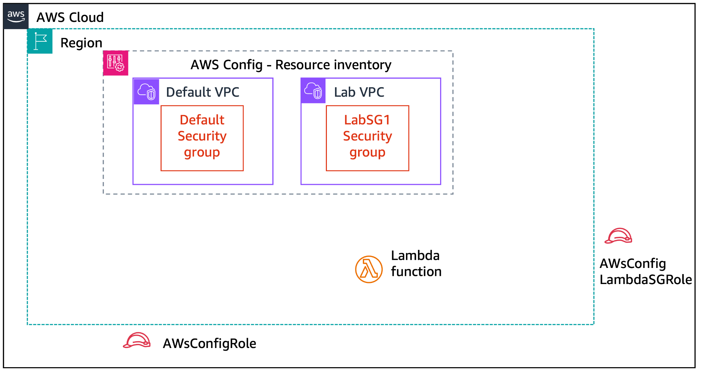
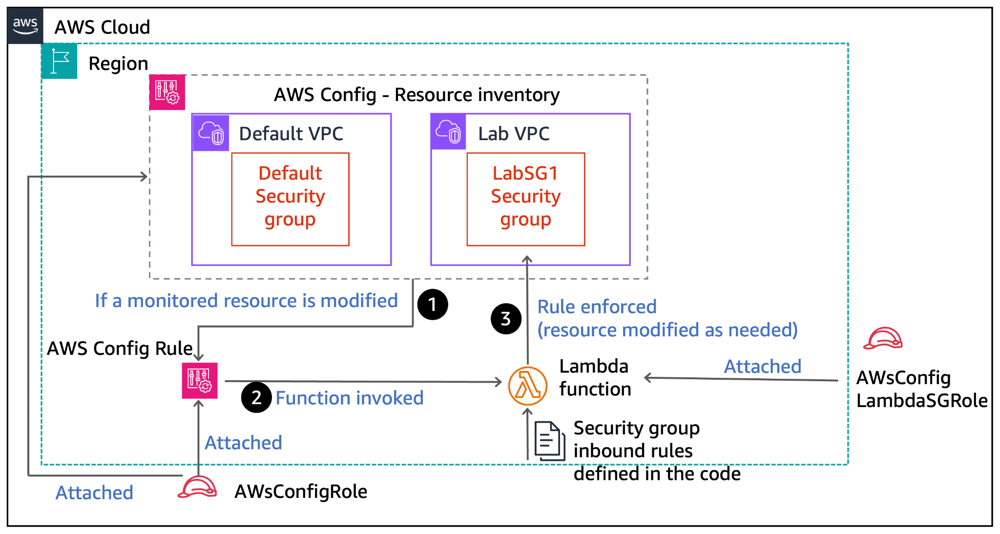
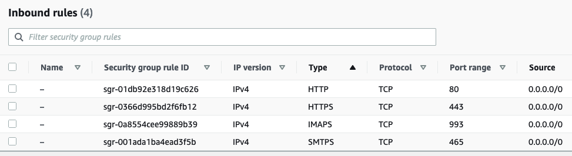
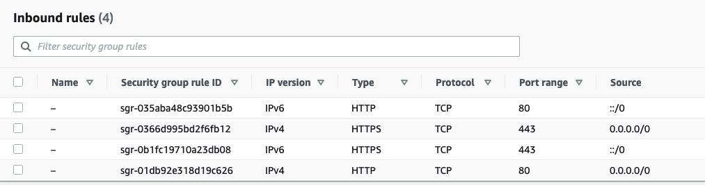

# Лабораторна робота 7.1: усунення інциденту за допомогою AWS Config і Lambda (Lab 7.1: Remediating an Incident by Using AWS Config and Lambda)

## Огляд і цілі лабораторної роботи

У цій лабораторній роботі ви дізнаєтеся, як використовувати сервіс AWS Config для моніторингу змін певних ресурсів у вашому акаунті AWS. Ви дізнаєтеся, як за допомогою сервісу виявляти зміни, що можуть становити проблему безпеки, наприклад, коли користувач змінює групу безпеки Amazon Elastic Compute Cloud (Amazon EC2). Крім того, ви отримаєте практичний досвід інтеграції AWS Config з AWS Lambda для автоматичного усунення певних інцидентів безпеки.

Після завершення цієї лабораторної роботи ви зможете:

- Пояснювати, як використовувати ролі AWS Identity and Access Management (IAM), щоб надати сервісам AWS доступ до інших сервісів AWS.

- Вмикати AWS Config для моніторингу ресурсів в акаунті AWS.

- Створювати та вмикати користувацьке правило AWS Config, що використовує попередньо створену функцію Lambda.

- Перевіряти поведінку правила AWS Config, щоб переконатися, що воно працює як задумано.

- Аналізувати журнали Amazon CloudWatch для аудиту того, коли викликаються правила AWS Config.

## Тривалість

Для виконання цієї лабораторної роботи потрібно приблизно **75 хвилин**.

## Обмеження сервісів AWS

У цьому лабораторному середовищі доступ до сервісів AWS і дій сервісів може бути обмежений тими, що потрібні для виконання інструкцій лабораторної роботи. Ви можете стикнутися з помилками, якщо спробуєте отримати доступ до інших сервісів чи виконати дії, окрім описаних у цій лабораторній роботі.

## Сценарій

Під час цієї лабораторної роботи ваша відповідальність — відстежувати налаштування груп безпеки Amazon EC2 в акаунті AWS. Ви визначите, які вхідні порти мають і не мають бути відкриті в групі безпеки. Ви налаштуєте рішення для автоматичного усунення інциденту, коли хтось змінює вхідні правила групи безпеки так, що вони більше не відповідають бажаній конфігурації.

Коли ви розпочнете лабораторну роботу, ваш акаунт AWS міститиме дві ролі IAM і функцію Lambda. Він також міститиме VPC за замовчуванням із групою безпеки за замовчуванням і користувацьку VPC з назвою *Lab VPC*, у якій є група безпеки з назвою *LabSG1*.

Наведена нижче діаграма показує архітектуру, яку було створено для вас в AWS на *початку* лабораторної роботи.



<details>
<summary>Текст зі схеми</summary>

AWS Cloud

Region (Регіон)

AWS Config - Resource inventory (AWS Config — інвентар ресурсів)

Default VPC (VPC за замовчуванням)

Default Security group (Група безпеки за замовчуванням)

Lab VPC

LabSG1 Security group (Група безпеки LabSG1)

Lambda function (Функція Lambda)

AWsConfig LambdaSGRole

AWsConfigRole

</details>

Під час лабораторної роботи ви налаштуєте сервіс AWS Config для створення інвентаря певних ресурсів в одному регіоні вашого акаунта AWS. Потім ви створите правило AWS Config.

Наприкінці цієї лабораторної роботи ви створите архітектуру, показану на наведеній нижче діаграмі.



<details>
<summary>Текст зі схеми</summary>

AWS Cloud

Region (Регіон)

AWS Config - Resource inventory (AWS Config — інвентар ресурсів)

Default VPC (VPC за замовчуванням)

Default Security group (Група безпеки за замовчуванням)

Lab VPC

LabSG1 Security group (Група безпеки LabSG1)

If a monitored resource is modified (Якщо відстежуваний ресурс змінено)

AWS Config Rule (Правило AWS Config)

Function invoked (Функцію викликано)

Attached (Прикріплено)

Rule enforced (resource modified as needed) (Правило застосовано (ресурс змінено за потреби))

Lambda function (Функція Lambda)

Security group inbound rules defined in the code (Вхідні правила групи безпеки, визначені в коді)

AWsConfig LambdaSGRole

AWsConfigRole

1

2

3

</details>

Після того як ви побудуєте рішення, інцидент безпеки буде усунено через кроки, описані в наведеній нижче таблиці.

| **Крок (Step)** | **Пояснення (Explanation)** |
|---|---|
| 1 | Правило AWS Config відстежуватиме будь-які зміни груп безпеки, що відстежуються в інвентарі ресурсів AWS Config. |
| 2 | Коли правило помічає, що до групи безпеки було внесено зміни, воно викликає функцію Lambda. |
| 3 | Функція усуне ситуацію, оновивши бажану конфігурацію вхідних правил для групи безпеки. |

## Доступ до AWS Management Console

1.  У верхній частині цих інструкцій оберіть **Start Lab**.

    - Розпочнеться лабораторний сеанс.

    - Угорі сторінки відображається таймер, що показує час, який залишився в сеансі.  
      > **Порада:** щоб у будь-який момент продовжити тривалість сеансу, знову оберіть **Start Lab**, перш ніж таймер досягне 0:00.

    - Перш ніж продовжити, зачекайте, доки значок-коло праворуч від посилання AWS у верхньому лівому куті стане зеленим. Коли лабораторне середовище буде готове, також відобразиться панель AWS Details.

2.  Щоб підключитися до AWS Management Console, оберіть посилання **AWS** у верхньому лівому куті над вікном терміналу.

    - Відкриється нова вкладка браузера й підключить вас до консолі.  
      > **Порада:** якщо нова вкладка браузера не відкривається, угорі браузера зазвичай з’являється банер чи значок із повідомленням, що ваш браузер перешкоджає сайту відкривати спливні вікна. Оберіть банер чи значок, а потім оберіть **Allow pop-ups**.

## Завдання 1: перевірка й оновлення ролей IAM

У цьому завданні ви проаналізуєте дві ролі IAM, що були попередньо виділені для вас у лабораторному середовищі. Ви також оновите дозволи однієї з ролей. AWS Config і Lambda використовуватимуть ці ролі пізніше в лабораторній роботі.

3.  У консолі IAM перегляньте дозволи, надані ролі *AwsConfigLambdaSGRole*.

    - У полі пошуку праворуч від **Services** знайдіть і оберіть **IAM**.

    - В панелі навігації оберіть **Roles**.

    - Оберіть посилання **AwsConfigLambdaSGRole**.

    - На вкладці **Permissions** розгорніть **awsconfig_lambda_ec2_sg_role_policy**.  
      > Відображається такий документ політики IAM. Політику відформатовано в JavaScript Object Notation (JSON).

```json
{
"Version":"2012-10-17",
"Statement":[
 {
    "Action":[
      "logs:CreateLogGroup",
      "logs:CreateLogStream",
      "logs:PutLogEvents"
    ],
    "Resource":"arn:aws:logs:*:*:*",
    "Effect":"Allow"
 },
 {
   "Action":[
      "config:PutEvaluations",
      "ec2:DescribeSecurityGroups",
      "ec2:AuthorizeSecurityGroupIngress",
      "ec2:RevokeSecurityGroupIngress"
   ],
   "Resource":"*",
   "Effect":"Allow"
 }
]
}
```

- **Аналіз:** це користувацька роль, створена для вас. Пізніше в цій лабораторній роботі ви прикріпите цю роль до функції Lambda, яку ви створите. Ця роль визначає дозволи, які матиме функція Lambda під час виконання. Політика дозволить функції Lambda додавати чи вилучати вхідні правила груп безпеки Amazon EC2. Політика також дозволить функції Lambda створювати й записувати події в журнали CloudWatch.  
  > У вашому акаунті також було створено другу користувацьку роль IAM. Ви розглянете цю роль і змінете її на наступних кроках.

4.  Оновіть дозволи, надані ролі IAM **AwsConfigRole**.

    - В панелі навігації оберіть **Roles**.

    - Оберіть посилання **AwsConfigRole**.

    - На вкладці **Permissions** розгорніть політику **S3Access**, яку вже прикріплено до цієї ролі.  
      > Наразі ця роль надає дозволи на отримання списків контролю доступу (ACL) бакетів Amazon Simple Storage Service (Amazon S3) та завантаження об’єктів до бакета S3, якщо виконано певні умови. Ці дозволи дадуть AWS Config змогу записувати файли журналів CloudWatch в Amazon S3.

    - Угорі вкладки оберіть **Add permissions** \> **Attach policies**.

    - Щоб знайти політики, пов’язані з AWS Config, у полі **Search** знайдіть Config і натисніть Enter.

    - Виберіть політику **AWS_ConfigRole**.

    - Оберіть **Add permissions**, що розташовано в нижньому правому куті.

    - За бажанням розгорніть **AWS_ConfigRole**, щоб переглянути подробиці політики.  
      > Політика надає доступ на читання (здебільшого дії Get, List і Describe) до багатьох сервісів AWS.  
      > **Аналіз:** ви надасте AWS Config можливість використовувати цю роль, коли налаштовуватимете AWS Config у наступному завданні. Роль визначає дозволи, які матиме AWS Config під час моніторингу одного з регіонів акаунта AWS.

У цьому завданні ви проаналізували дозволи, надані ролі IAM, яку функція Lambda використовуватиме пізніше в лабораторній роботі. Ви також оновили й проаналізували дозволи, надані ролі IAM, яку AWS Config використовуватиме в наступному завданні.

## Завдання 2: налаштування AWS Config для моніторингу ресурсів

У цьому завданні ви налаштуєте AWS Config для моніторингу певних ресурсів у регіоні в акаунті AWS.

5.  Налаштуйте AWS Config.

    - У полі пошуку праворуч від **Services** знайдіть і оберіть **Config**.

    - Оберіть **Get started** і налаштуйте такі параметри:

      - У розділі **Recording strategy**. Оберіть **Specific resource types**.

      - **Resource type:** оберіть **AWS EC2 SecurityGroup**. Для **Frequency** оберіть **Continuous**.

      - **IAM role for AWS Config** Оберіть **Choose a role from your account**.

      - **Existing roles:** оберіть **AwsConfigRole**.  
        > **Примітка:** пригадайте, що AwsConfigRole була другою роллю, яку ви аналізували в попередньому завданні.

      - У розділі **Delivery channel** зверніть увагу, що AWS Config за замовчуванням зберігатиме результати в бакеті S3. Залиште налаштування за замовчуванням і оберіть **Next**.

      - На сторінці **AWS Managed Rules** оберіть **Next** унизу сторінки.

      - Перегляньте подробиці налаштування AWS Config, а потім оберіть **Confirm**.  
        > Ненадовго з’являється банер, а потім відображається панель AWS Config Dashboard.

6.  Щоб переглянути інвентар ресурсів, створений AWS Config, в панелі навігації оберіть **Resources**.  
    > Відображається сторінка **Resource Inventory** і перелічує ресурси Amazon EC2 у вашому акаунті.  
    > **Примітка:** якщо у списку ресурсів відображається повідомлення, що ваші ресурси виявляються, зачекайте кілька хвилин. AWS Config може потребувати кількох хвилин, щоб визначити всі ваші ресурси.  
    > **Аналіз:** пригадайте, що ви налаштували AWS Config на інвентаризацію ресурсів типу *EC2 Security Group*. Групи безпеки Amazon EC2, попередньо виділені в регіоні, де ви налаштували AWS Config, включено в інвентар. Однак зверніть увагу, що в інвентарі з’являються також багато інших типів ресурсів. AWS Config відстежує ресурси, пов’язані з ресурсами, що вас насамперед цікавлять, тому що пов’язані ресурси можуть впливати на поведінку основних ресурсів. Лабораторне середовище, у якому ви працюєте, включає багато таких пов’язаних ресурсів (як-от інтернет-шлюзи та мережеві ACL).

У цьому завданні ви налаштували сервіс AWS Config в одному регіоні в акаунті AWS для моніторингу певних ресурсів, що вас цікавлять. Потім ви побачили, як AWS Config створив інвентар ресурсів.

## Завдання 3: зміна групи безпеки, яку відстежує AWS Config

У цьому завданні ви налаштуєте нові параметри вхідних правил в одній із груп безпеки, перелічених в інвентарі ресурсів AWS Config. Мета — ефективно змоделювати інцидент безпеки. Деякі параметри вхідних правил, які ви визначите в цьому завданні, не збігатимуться з бажаними параметрами, що ви визначите в пізнішому завданні.

7.  Знайдіть групу безпеки в *Lab VPC*.

    - У полі пошуку праворуч від **Services** знайдіть і оберіть **VPC**.

    - В панелі навігації оберіть поле **Filter by VPC** і оберіть **Lab VPC**.

    - В панелі навігації оберіть **Security groups**.  
      > У цій VPC визначено принаймні дві групи безпеки.

    - Виберіть групу безпеки **LabSG1**.

8.  Додайте вхідні правила до групи безпеки, щоб дозволити мережевий трафік HTTP, HTTPS, SMTPS та IMAPS.

    - Оберіть вкладку **Inbound rules**, а потім оберіть **Edit inbound rules**.  
      > Зверніть увагу, що одне вхідне правило для з’єднань HTTP уже визначено.

    - Для наявного правила змініть **Source** на **Anywhere-IPv4**.

    - Оберіть **Add rule** і налаштуйте таке:

      - **Type:** оберіть **HTTPS**.

      - **Source:** оберіть **Anywhere-IPv4**.

    - Знову оберіть **Add rule** і налаштуйте таке:

      - **Type:** оберіть **SMTPS**.

      - **Source:** оберіть **Anywhere-IPv4**.

    - Знову оберіть **Add rule** і налаштуйте таке:

      - **Type:** оберіть **IMAPS**.

      - **Source:** оберіть **Anywhere-IPv4**.

    - Оберіть **Save rules**.  
      > Вхідні правила тепер мають виглядати як правила на наведеному нижче скриншоті (хоча ваші ідентифікатори правил групи безпеки відрізнятимуться).



<details>
<summary>Текст зі схеми</summary>

Inbound rules (4) (Вхідні правила (4))

Filter security group rules (Фільтр правил групи безпеки)

| Name (Ім’я) | Security group rule ID (Ідентифікатор правила групи безпеки) | IP version (Версія IP) | Type (Тип) | Protocol (Протокол) | Port range (Діапазон портів) | Source (Джерело) |
|---|---|---|---|---|---|---|
| – | sgr-01db92e318d19c626 | IPv4 | HTTP | TCP | 80 | 0.0.0.0/0 |
| – | sgr-0366d995bd2f6fb12 | IPv4 | HTTPS | TCP | 443 | 0.0.0.0/0 |
| – | sgr-0a8554cee99889b39 | IPv4 | IMAPS | TCP | 993 | 0.0.0.0/0 |
| – | sgr-001ada1ba4ead3f5b | IPv4 | SMTPS | TCP | 465 | 0.0.0.0/0 |

</details>

У цьому завданні ви знайшли групу безпеки в *Lab VPC* і визначили в ній три нові вхідні правила. Пізніше в цій лабораторній роботі ви побачите, що ці зміни виявляються як інцидент безпеки й усуваються.

## Завдання 4: створення правила AWS Config, що викликає функцію Lambda

У цьому завданні ви налаштовуєте правило AWS Config для виклику попередньо створеної функції Lambda. Правило й функція працюватимуть разом, щоб гарантувати, що відстежувані групи безпеки Amazon EC2 мають лише бажані вхідні правила.

9.  Перейдіть до розділу **i AWS Details** і скопіюйте значення *LambdaFunctionARN* у буфер обміну.  
    > Note: ви використаєте цей ARN на наступних кроках.

10. Створіть нове правило AWS Config, що викликатиме функцію Lambda щоразу, коли відстежувані групи безпеки Amazon EC2 змінюються.

    - Перейдіть до консолі AWS Config.

    - В панелі навігації оберіть **Rules**.  
      > Наразі в AWS Config не визначено жодних правил.

    - Оберіть **Add rule**.

    - Для **Select rule type** оберіть **Create custom Lambda rule**.

    - Оберіть **Next**.

    - На сторінці **Configure rule** налаштуйте таке:

      - **AWS Lambda function ARN:** вставте ARN функції Lambda, який ви скопіювали.

      - **Name:** введіть EC2SecurityGroup

      - **Description:** введіть Restrict inbound ports to HTTP and HTTPS

      - **Trigger type:** виберіть **When configuration changes**.

      - **Scope of changes:** оберіть **Resources**.

      - **Resource type:** оберіть **AWS EC2 SecurityGroup**.  
        > *AWS EC2 SecurityGroup* з’являється в області ресурсів.

      - У розділі **Parameters** додайте параметр з такими налаштуваннями:

        - **Key:** debug

        - **Value:** true

      - **Примітка:** будь-які параметри, що ви визначите тут, це правило AWS Config передаватиме функції Lambda EC2SecurityGroup.

    - Оберіть **Next**, а потім оберіть **Save**.

11. Перегляньте подробиці правила AWS Config *EC2SecurityGroup*.

    - Оберіть посилання **EC2SecurityGroup**.

    - У розділі **Resources in scope** оберіть випадаюче меню **Noncompliant** і оберіть **All**.  
      > У розділі **Rule details** зверніть увагу на поле **Last successful evaluation**. Спершу це поле відображає *Not available*; однак через кілька хвилин відобразиться часова позначка.  
      > **Примітка:** початкове оцінювання може тривати кілька хвилин. Те саме оцінювання відбуватиметься також, коли в майбутньому змінюватиметься будь-яка група безпеки в межах області дії.  
      > Зверніть увагу на ресурси груп безпеки Amazon EC2, перелічені як такі, що входять в область дії.  
      > Поки відбувається початкове оцінювання, значення **Compliance** буде *No results available*. Через кілька хвилин значення для кожного ресурсу групи безпеки зміниться на *Compliant*. Зачекайте, доки побачите, що він відповідає вимогам (compliant).  
      > Зверніть увагу, що в стовпці **Annotation** відображається *Permissions were modified*.

У цьому завданні ви налаштували правило AWS Config для виклику попередньо створеної функції Lambda. Правило й функція працюватимуть разом для моніторингу та усунення будь-яких небажаних змін вхідних правил відстежуваних груп безпеки Amazon EC2.

## Завдання 5: повторний перегляд конфігурації групи безпеки

Тепер, коли початкове оцінювання відповідності AWS Config відбулося, ви повторно розглянете групу безпеки *LabSG1*. Ви побачите, чи було помічено зміни, що становили інцидент безпеки (зміни, які ви внесли у вхідні правила), і чи їх було потім усунено.

12. Проаналізуйте вхідні правила, визначені для групи безпеки *LabSG1*.

    - Перейдіть до консолі VPC.

    - В панелі навігації оберіть поле **Filter by VPC** і оберіть **Lab VPC**.

    - В панелі навігації оберіть **Security groups**.

    - Виберіть групу безпеки **LabSG1**.  
      > На вкладці **Inbound rules** зверніть увагу, що дозволено лише трафік HTTP і HTTPS.  
      > Вхідні правила тепер мають виглядати як правила на наведеному нижче скриншоті (хоча ваші ідентифікатори правил групи безпеки відрізнятимуться).



<details>
<summary>Текст зі схеми</summary>

Inbound rules (4) (Вхідні правила (4))

Filter security group rules (Фільтр правил групи безпеки)

| Name (Ім’я) | Security group rule ID (Ідентифікатор правила групи безпеки) | IP version (Версія IP) | Type (Тип) | Protocol (Протокол) | Port range (Діапазон портів) | Source (Джерело) |
|---|---|---|---|---|---|---|
| – | sgr-035aba48c93901b5b | IPv6 | HTTP | TCP | 80 | ::/0 |
| – | sgr-0366d995bd2f6fb12 | IPv4 | HTTPS | TCP | 443 | 0.0.0.0/0 |
| – | sgr-0b1fc19710a23db08 | IPv6 | HTTPS | TCP | 443 | ::/0 |
| – | sgr-01db92e318d19c626 | IPv4 | HTTP | TCP | 80 | 0.0.0.0/0 |

</details>

**Аналіз:** пригадайте, що ви визначили вхідні правила для SMTPS та IMAPS, а також HTTP і HTTPS у цій групі безпеки. Однак правил для SMTPS та IMAPS більше не існує. Також пригадайте, що ви встановили версію IP для всіх правил лише на IPv4, але тепер правила HTTP і HTTPS визначено для IPv4 та IPv6.  
Підсумовуючи, ви змінили вхідні правила цієї групи безпеки так, щоб вони виглядали як на наведеному нижче скриншоті. Однак їх було суттєво змінено, і вони виглядають як на попередньому скриншоті.  


<details>
<summary>Текст зі схеми</summary>

Inbound rules (4) (Вхідні правила (4))

Filter security group rules (Фільтр правил групи безпеки)

| Name (Ім’я) | Security group rule ID (Ідентифікатор правила групи безпеки) | IP version (Версія IP) | Type (Тип) | Protocol (Протокол) | Port range (Діапазон портів) | Source (Джерело) |
|---|---|---|---|---|---|---|
| – | sgr-01db92e318d19c626 | IPv4 | HTTP | TCP | 80 | 0.0.0.0/0 |
| – | sgr-0366d995bd2f6fb12 | IPv4 | HTTPS | TCP | 443 | 0.0.0.0/0 |
| – | sgr-0a8554cee99889b39 | IPv4 | IMAPS | TCP | 993 | 0.0.0.0/0 |
| – | sgr-001ada1ba4ead3f5b | IPv4 | SMTPS | TCP | 465 | 0.0.0.0/0 |

</details>

13. Проаналізуйте код функції Lambda.

    - Перейдіть до консолі Lambda.

    - В панелі навігації оберіть **Functions**.

    - Оберіть посилання на функцію **awsconfig_lambda_security_group**.

    - У розділі **Code source** відкрийте файл **awsconfig_lambda_security_group.py**, який ви імпортували.  
      > Зверніть увагу на такі подробиці:

      - У рядку 2 функція імпортує boto3 — AWS SDK для Python.

      - У рядку 9 визначено **REQUIRED_PERMISSIONS**. Цей масив включає бажані дозволи IP для вхідного трафіку (ingress) для ресурсів груп безпеки Amazon EC2, що входять в область дії правила AWS Config, яке ви визначили.

      - Необхідні дозволи визначено у форматі, якого вимагає виклик API **describe_security_groups()**. Цей виклик викликається в рядку 117.  
        > Докладніше про цей виклик API див. у [документації AWS SDK для Python](https://boto3.amazonaws.com/v1/documentation/api/latest/reference/services/ec2.html#EC2.Client.describe_security_group_rules).

      - У рядку 129 функція перевіряє, чи включено параметр **debug** у правило AWS Config. Пригадайте, що це був параметр, який ви налаштували, коли визначали правило AWS Config у завданні 4. Якщо debug встановлено на true, код функції Lambda виводитиме додаткову налагоджувальну інформацію під час виконання. Приклади цього можна побачити в усьому коді Lambda.

У цьому завданні ви переглянули логіку функції Lambda для виявлення й вилучення додаткових дозволів для SMTPS (порт TCP 465) та IMAPS (порт TCP 993) у групі безпеки.

**Аналіз:** інцидент безпеки (коли ви змінили вхідні правила) стався *до* того, як ви створили правило AWS Config і функцію Lambda для усунення таких інцидентів. Під час початкової перевірки правила AWS Config виявив інцидент безпеки.

Якби ви змінили групу безпеки знову, було б ініційовано оцінювання відповідності AWS Config. Оцінювання викликало б функцію Lambda, а ваші зміни було б скасовано, щоб вхідні правила знову відповідали бажаним параметрам. Групи безпеки за замовчуванням відстежуються подібним чином, і їхні параметри було б усунено, якби їх змінили.

## Завдання 6: використання журналів CloudWatch для перевірки

У цьому завданні ви проаналізуєте журнали CloudWatch і відфільтруєте записи журналу, щоб знайти докази усунення.

14. Знайдіть журнали, що показують докази змін, які правило AWS Config та пов’язана з ним функція Lambda внесли в групу безпеки.

    - У полі пошуку праворуч від **Services** знайдіть і оберіть **CloudWatch**.

    - В панелі навігації розгорніть **Logs**, а потім оберіть **Log groups**.

    - Оберіть посилання на групу журналів **awsconfig_lambda_security_group**.  
      > У списку потоків журналів видно один чи кілька записів потоків журналу.

    - Оберіть **Search all**.

    - У полі пошуку **Filter events** введіть revoking for і натисніть Enter.

    - Розгорніть кожну подію журналу й перегляньте вміст.  
      > Кожна подія надає подробиці про дію, яку виконала функція Lambda. В одній із подій ви маєте знайти подробиці, що показують, що вхідні правила, які ви вручну додали для SMTPS (порт TCP 465) та IMAPS (порт TCP 993), було вилучено.  
      > Інші відфільтровані події журналювали зміни інших двох груп безпеки, що існують у вашому акаунті. Ці групи безпеки також перебувають в інвентарі ресурсів, який відстежує ваше правило AWS Config.

У цьому завданні ви побачили докази в журналах CloudWatch, що AWS Config викликав функцію Lambda для автоматичного скасування змін, внесених у групу безпеки.

## Надсилання вашої роботи

15. Щоб записати ваш прогрес, оберіть **Submit** угорі цих інструкцій.

16. Коли з’явиться запит, оберіть **Yes**.  
    > Через пару хвилин з’являється панель оцінок і показує, скільки балів ви отримали за кожне завдання. Якщо результати не відображаються через пару хвилин, оберіть **Grades** угорі цих інструкцій.  
    > **Порада:** ви можете надсилати свою роботу кілька разів. Після того як ви змінили свою роботу, знову оберіть **Submit**. Для цієї лабораторної роботи записується ваше останнє надсилання.

17. Щоб знайти детальний відгук про вашу роботу, оберіть **Submission Report**.

## Лабораторну роботу завершено

Вітаємо! Ви завершили лабораторну роботу.

18. Угорі цієї сторінки оберіть **End Lab**, а потім оберіть **Yes**, щоб підтвердити, що ви хочете завершити лабораторну роботу.

Панель повідомлень вказує, що лабораторну роботу завершується.

19. Щоб закрити панель, оберіть **Close** у верхньому правому куті.

© 2022, Amazon Web Services, Inc. та її афілійовані особи. Усі права захищені. Цей твір не можна відтворювати чи розповсюджувати, повністю чи частково, без попереднього письмового дозволу Amazon Web Services, Inc. Комерційне копіювання, надання в позичку чи продаж заборонено.
