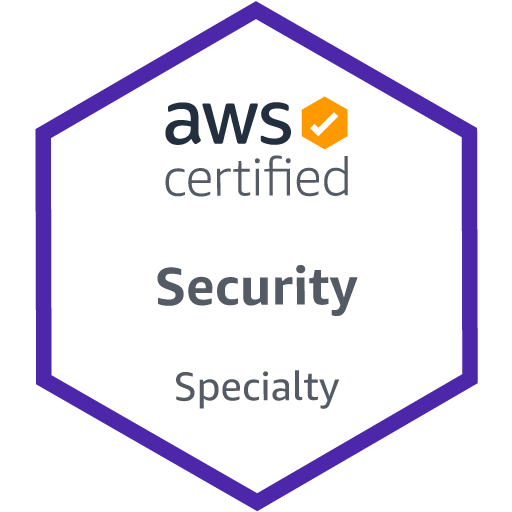

## Слайд 1: Welcome

AWS Academy Cloud Security Foundations

> **Нотатки:**
>
> Welcome to the AWS Academy Cloud Security Foundations course. This module provides an introduction to the course.

---

## Слайд 2: Module overview

**Sections**

- Course prerequisites and objectives
- Course overview
- AWS Certified Security – Specialty certification

**Activity**

- AWS Documentation Scavenger Hunt

> **Нотатки:**
>
> This module includes the following sections:  
> Course prerequisites and objectives  
> Course overview  
> AWS Certified Security – Specialty certification  
>
> This module also includes an AWS Documentation Scavenger Hunt activity.

---

## Слайд 3: Course prerequisites and objectives

Welcome

> **Нотатки:**
>
> This section provides information about the prerequisites and objectives of this course.

---

## Слайд 4: Course prerequisites

- Completed the AWS Academy Cloud Foundations course or have equivalent experience
- Working knowledge of distributed systems
- Working knowledge of general networking concepts
- Working knowledge of multi-tier architectures
- Familiarity with cloud computing concepts

> **Нотатки:**
>
> This course requires a strong foundation in IT concepts and skills. To ensure success in this course, you should have the following:  
> Completed the AWS Academy Cloud Foundations course or have equivalent experience  
> Working knowledge of distributed systems  
> Working knowledge of general networking concepts  
> Working knowledge of multi-tier architectures  
> Familiarity with cloud computing concepts  
>
> Working knowledge implies that you are able to work with a subject successfully, though you might not have an in-depth understanding of how it works. Familiarity implies that you have been exposed to and have a basic understanding of concepts.

---

## Слайд 5: Course objectives

After completing this course, you should be able to do the following:

- Identify security benefits and responsibilities of using the Amazon Web Services (AWS) Cloud.
- Use the identity and access management features of AWS.
- Describe how to secure network access to AWS resources.
- Explain the available methods for encrypting data at rest and data in transit.
- Determine which AWS services can be used for monitoring and incident response.

> **Нотатки:**
>
> After completing this course, you should be able to do the following:  
> Identify security benefits and responsibilities of using the Amazon Web Services (AWS) Cloud.  
> Use the identity and access management features of AWS.  
> Describe how to secure network access to AWS resources.  
> Explain the available methods for encrypting data at rest and data in transit.  
> Determine which AWS services can be used for monitoring and incident response.

---

## Слайд 6: Course overview

Welcome

> **Нотатки:**
>
> This section provides an overview of the modules in this course.

---

## Слайд 7: Course outline

- Module 1: Welcome
- Module 2: Introduction to Security on AWS
- Module 3: Securing Access to Cloud Resources
- Module 4: Securing Your Infrastructure
- Module 5: Protecting Data in Your Application
- Module 6: Logging and Monitoring
- Module 7: Responding to and Managing an Incident
- Module 8: Bridging to Certification

> **Нотатки:**
>
> To achieve the course objectives, the course consists of the modules that are listed on the slide.

---

## Слайд 8: Course modalities

**Slides**

- All modules

**Activities**

- Module 1: AWS Documentation Scavenger Hunt
- Module 2: Shared Responsibility Model
- Module 6: Reading a Log File

**Demonstrations**

- Module 3: Amazon S3 Cross-Account Resource-Based Policy
- Module 6: Security Hub

**Labs**

- Module 3: Using Resource-Based Policies to Secure an S3 Bucket
- Module 4: Securing VPC Resources by Using Security Groups
- Module 5: Encrypting Data at Rest by Using AWS KMS
- Module 6: Monitoring and Alerting with CloudTrail and CloudWatch
- Module 7: Remediating an Incident by Using AWS Config and Lambda

> **Нотатки:**
>
> This course is presented by using a combination of slides, activities, demonstrations, and hands-on labs. Slides are the primary delivery method and are available for every module. The remaining modalities are distributed as shown on the slide.

---

## Слайд 9: Learning assessments

**Knowledge checks**

- Provided for modules 2 through 7
- Drawn from the slides and student guide notes

**Course assessment**

- 25 randomized questions
- Drawn from the slides and student guide notes

> **Нотатки:**
>
> You can assess your progress throughout this course by completing the knowledge checks and the course assessment that are included with the course materials. Both the knowledge checks and the course assessment questions are drawn from material found in the slides and student guide notes.

---

## Слайд 10: AWS Certified Security – Specialty certification

Welcome

> **Нотатки:**
>
> This section provides information about the AWS Certified Security – Specialty certification.

---

## Слайд 11: Preparing for certification

- This course is not intended to fully prepare you for the AWS Certified Security – Specialty certification exam.
- Review the Exam Guide for information regarding the certification.
- The **Bridging to Certification** module will provide you with additional exam preparation resources.

> **Нотатки:**
>
> While this course will introduce you to many aspects of security in AWS, the course will not fully prepare you for the AWS Certified Security – Specialty certification exam. For additional information regarding the certification, see the Exam Guide at https://d1.awsstatic.com/training-and-certification/docs-security-spec/AWS-Certified-Security-Specialty_Exam-Guide.pdf.  
>
> The Bridging to Certification module will provide additional information about the certification and exam preparation resources.

---

## Слайд 12: Recommended knowledge and experience

- 5 years of IT security experience in designing and implementing security solutions
- 2 or more years of hands-on experience in securing AWS workloads
- Security-specific AWS knowledge

> **Нотатки:**
>
> Prior to attempting the AWS Certified Security – Specialty exam, we recommend that you have at least 5 years of IT security experience in designing and implementing security solutions, as well as 2 or more years of hands-on experience in securing AWS workloads.  
>
> For additional information about the exam, see https://aws.amazon.com/certification/certified-security-specialty/.

---

## Слайд 13: Course scenario

> **Нотатки:**
>
> A video is available to describe the fictional scenario that the modules in this course are built around. The scenario provides a way to explore topics of cloud-computing security in the context of relatable business needs. This scenario is intended to provide an example of real-world applicability of the technical concepts that you will learn in this course.  
>
> You can find this video within this module's section of the course materials. If you are not able to locate this video, reach out to your educator for assistance.

---

## Слайд 14: Activity: AWS Documentation Scavenger Hunt

> **Нотатки:**
>
> You will now complete the AWS Documentation Scavenger Hunt. The purpose of this brief activity is to acclimate you to locating information in the AWS documentation, which will support your learning experience throughout the course.  
>
> We recommend bookmarking the AWS documentation site at https://docs.aws.amazon.com for future use.

---

## Слайд 15: AWS Documentation Scavenger Hunt

- Where can you find a link to the *AWS CloudTrail User Guide*?
- Where would you find information about managing accounts in the *AWS Security Hub User Guide*?
- Which section of the website has quick start guides for security, identity, and compliance?
- Where can you find links to learn how active AWS customers are using AWS within their organizations?
- How might you navigate to the technical guide titled *AWS Security Incident Response Guide*?

[https://docs.aws.amazon.com](https://docs.aws.amazon.com/)

> **Нотатки:**
>
> Use the AWS documentation website at https://docs.aws.amazon.com to answer the following questions:  
> Where can you find a link to the AWS CloudTrail User Guide?  
> Where would you find information about managing accounts in the AWS Security Hub User Guide?  
> Which section of the website has quick start guides for security, identity, and compliance?  
> Where can you find links to learn how active AWS customers are using AWS within their organizations?  
> How might you navigate to the technical guide titled AWS Security Incident Response Guide?

---

## Слайд 16: Thank you

Corrections, feedback, or other questions?  
Contact us at [https://support.aws.amazon.com/#/contacts/aws-academy](https://support.aws.amazon.com/#/contacts/aws-academy).  
All trademarks are the property of their owners.

> **Нотатки:**
>
> Thank you for completing this module.
