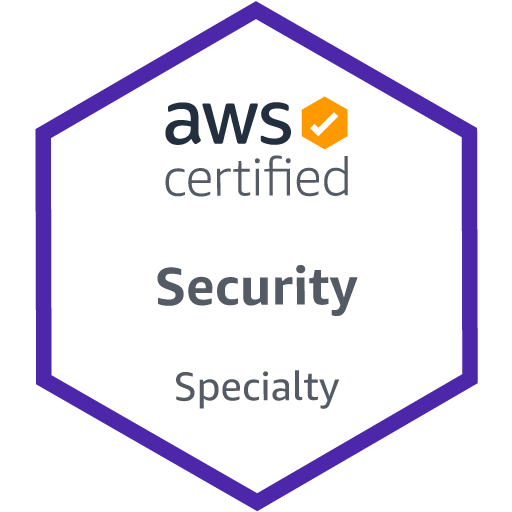

## Слайд 1: Вітаємо

AWS Academy Cloud Security Foundations

> **Нотатки:**
>
> Вітаємо на курсі AWS Academy Cloud Security Foundations. Цей модуль містить вступ до курсу.

---

## Слайд 2: Огляд модуля

**Розділи**

- Передумови та цілі курсу
- Огляд курсу
- Сертифікація AWS Certified Security – Specialty

**Практична вправа**

- AWS Documentation Scavenger Hunt (пошук інформації в документації AWS)

> **Нотатки:**
>
> Цей модуль містить такі розділи:  
> Передумови та цілі курсу  
> Огляд курсу  
> Сертифікація AWS Certified Security – Specialty  
>
> Також у цьому модулі є практична вправа AWS Documentation Scavenger Hunt.

---

## Слайд 3: Передумови та цілі курсу

Вітаємо

> **Нотатки:**
>
> Цей розділ містить інформацію про передумови та цілі курсу.

---

## Слайд 4: Передумови курсу

- Пройдений курс AWS Academy Cloud Foundations або еквівалентний досвід
- Практичні знання розподілених систем (distributed systems)
- Практичні знання загальних концепцій мереж
- Практичні знання багаторівневих архітектур (multi-tier architectures)
- Ознайомленість із концепціями хмарних обчислень

> **Нотатки:**
>
> Цей курс вимагає міцної основи в ІТ-концепціях і навичках. Щоб успішно пройти курс, ви повинні мати таке:  
> Пройдений курс AWS Academy Cloud Foundations або еквівалентний досвід  
> Практичні знання розподілених систем  
> Практичні знання загальних концепцій мереж  
> Практичні знання багаторівневих архітектур  
> Ознайомленість із концепціями хмарних обчислень  
>
> Практичні знання (working knowledge) означають, що ви вмієте успішно працювати з предметом, хоча й можете не мати глибокого розуміння того, як він працює. Ознайомленість (familiarity) означає, що ви стикалися з концепціями та маєте базове уявлення про них.

---

## Слайд 5: Цілі курсу

Після завершення цього курсу ви повинні вміти таке:

- Визначати переваги безпеки та відповідальність під час використання хмари Amazon Web Services (AWS).
- Використовувати функції керування ідентифікацією та доступом (identity and access management) в AWS.
- Описувати, як захистити мережевий доступ до ресурсів AWS.
- Пояснювати наявні методи шифрування даних у стані спокою (data at rest) та даних під час передавання (data in transit).
- Визначати, які сервіси AWS можна використовувати для моніторингу та реагування на інциденти.

> **Нотатки:**
>
> Після завершення цього курсу ви повинні вміти таке:  
> Визначати переваги безпеки та відповідальність під час використання хмари Amazon Web Services (AWS).  
> Використовувати функції керування ідентифікацією та доступом (identity and access management) в AWS.  
> Описувати, як захистити мережевий доступ до ресурсів AWS.  
> Пояснювати наявні методи шифрування даних у стані спокою (data at rest) та даних під час передавання (data in transit).  
> Визначати, які сервіси AWS можна використовувати для моніторингу та реагування на інциденти.

---

## Слайд 6: Огляд курсу

Вітаємо

> **Нотатки:**
>
> Цей розділ містить огляд модулів курсу.

---

## Слайд 7: План курсу

- Модуль 1: Вітаємо (Welcome)
- Модуль 2: Вступ до безпеки в AWS (Introduction to Security on AWS)
- Модуль 3: Захист доступу до хмарних ресурсів (Securing Access to Cloud Resources)
- Модуль 4: Захист вашої інфраструктури (Securing Your Infrastructure)
- Модуль 5: Захист даних у вашому застосунку (Protecting Data in Your Application)
- Модуль 6: Журналювання та моніторинг (Logging and Monitoring)
- Модуль 7: Реагування на інцидент і керування ним (Responding to and Managing an Incident)
- Модуль 8: Перехід до сертифікації (Bridging to Certification)

> **Нотатки:**
>
> Для досягнення цілей курсу він складається з модулів, наведених на слайді.

---

## Слайд 8: Формати проведення курсу

**Слайди (Slides)**

- Усі модулі

**Практичні вправи (Activities)**

- Модуль 1: AWS Documentation Scavenger Hunt
- Модуль 2: Shared Responsibility Model (модель спільної відповідальності)
- Модуль 6: Reading a Log File (читання файлу журналу)

**Демонстрації (Demonstrations)**

- Модуль 3: Amazon S3 Cross-Account Resource-Based Policy (міжакаунтна політика на основі ресурсів для Amazon S3)
- Модуль 6: Security Hub

**Лабораторні роботи (Labs)**

- Модуль 3: Using Resource-Based Policies to Secure an S3 Bucket (захист бакета S3 за допомогою політик на основі ресурсів)
- Модуль 4: Securing VPC Resources by Using Security Groups (захист ресурсів VPC за допомогою груп безпеки)
- Модуль 5: Encrypting Data at Rest by Using AWS KMS (шифрування даних у стані спокою за допомогою AWS KMS)
- Модуль 6: Monitoring and Alerting with CloudTrail and CloudWatch (моніторинг і сповіщення за допомогою CloudTrail і CloudWatch)
- Модуль 7: Remediating an Incident by Using AWS Config and Lambda (усунення інциденту за допомогою AWS Config і Lambda)

> **Нотатки:**
>
> Цей курс подається за допомогою поєднання слайдів, практичних вправ, демонстрацій і практичних лабораторних робіт. Слайди є основним методом подання матеріалу й доступні для кожного модуля. Решта форматів розподілені так, як показано на слайді.

---

## Слайд 9: Оцінювання навчання

**Перевірки знань (Knowledge checks)**

- Надаються для модулів із 2 по 7
- Складені на основі слайдів і нотаток до посібника студента

**Підсумкове оцінювання курсу (Course assessment)**

- 25 запитань у випадковому порядку
- Складені на основі слайдів і нотаток до посібника студента

> **Нотатки:**
>
> Ви можете оцінювати свій прогрес протягом курсу, виконуючи перевірки знань і підсумкове оцінювання, які входять до матеріалів курсу. Запитання як для перевірок знань, так і для підсумкового оцінювання складені на основі матеріалу зі слайдів і нотаток до посібника студента.

---

## Слайд 10: Сертифікація AWS Certified Security – Specialty

Вітаємо

> **Нотатки:**
>
> Цей розділ містить інформацію про сертифікацію AWS Certified Security – Specialty.

---

## Слайд 11: Підготовка до сертифікації

- Цей курс не призначений для повної підготовки до іспиту на сертифікацію AWS Certified Security – Specialty.
- Інформацію про сертифікацію шукайте в посібнику з іспиту (Exam Guide).
- Модуль **Bridging to Certification** надасть вам додаткові ресурси для підготовки до іспиту.

> **Нотатки:**
>
> Хоча цей курс ознайомить вас із багатьма аспектами безпеки в AWS, він не підготує вас повністю до іспиту на сертифікацію AWS Certified Security – Specialty. Додаткову інформацію про сертифікацію див. у посібнику з іспиту (Exam Guide) за адресою https://d1.awsstatic.com/training-and-certification/docs-security-spec/AWS-Certified-Security-Specialty_Exam-Guide.pdf.  
>
> Модуль Bridging to Certification надасть додаткову інформацію про сертифікацію та ресурси для підготовки до іспиту.

---

## Слайд 12: Рекомендовані знання та досвід

- 5 років досвіду в ІТ-безпеці щодо проєктування та впровадження рішень безпеки
- 2 або більше років практичного досвіду із захисту робочих навантажень (workloads) в AWS
- Знання AWS у сфері безпеки

> **Нотатки:**
>
> Перш ніж складати іспит AWS Certified Security – Specialty, рекомендуємо мати щонайменше 5 років досвіду в ІТ-безпеці щодо проєктування та впровадження рішень безпеки, а також 2 або більше років практичного досвіду із захисту робочих навантажень в AWS.  
>
> Додаткову інформацію про іспит див. за адресою https://aws.amazon.com/certification/certified-security-specialty/.

---

## Слайд 13: Сценарій курсу

> **Нотатки:**
>
> Доступне відео, що описує вигаданий сценарій, на якому побудовано модулі цього курсу. Сценарій дає змогу розглядати теми безпеки хмарних обчислень у контексті зрозумілих бізнес-потреб. Він має на меті показати застосовність технічних концепцій, які ви вивчатимете на цьому курсі, у реальному світі.  
>
> Це відео можна знайти в розділі цього модуля в матеріалах курсу. Якщо ви не можете його знайти, зверніться по допомогу до свого викладача.

---

## Слайд 14: Практична вправа: AWS Documentation Scavenger Hunt

> **Нотатки:**
>
> Зараз ви виконаєте вправу AWS Documentation Scavenger Hunt. Мета цієї короткої вправи — призвичаїти вас до пошуку інформації в документації AWS, що допоможе вам навчатися протягом усього курсу.  
>
> Радимо додати сайт документації AWS https://docs.aws.amazon.com до закладок для подальшого використання.

---

## Слайд 15: AWS Documentation Scavenger Hunt

- Де можна знайти посилання на *AWS CloudTrail User Guide*?
- Де можна знайти інформацію про керування акаунтами в *AWS Security Hub User Guide*?
- У якому розділі вебсайту розміщено посібники швидкого старту (quick start guides) з безпеки, ідентифікації та відповідності вимогам?
- Де можна знайти посилання, щоб дізнатися, як активні клієнти AWS використовують AWS у своїх організаціях?
- Як перейти до технічного посібника під назвою *AWS Security Incident Response Guide*?

[https://docs.aws.amazon.com](https://docs.aws.amazon.com/)

> **Нотатки:**
>
> Щоб відповісти на такі запитання, скористайтеся вебсайтом документації AWS: https://docs.aws.amazon.com  
> Де можна знайти посилання на AWS CloudTrail User Guide?  
> Де можна знайти інформацію про керування акаунтами в AWS Security Hub User Guide?  
> У якому розділі вебсайту розміщено посібники швидкого старту з безпеки, ідентифікації та відповідності вимогам?  
> Де можна знайти посилання, щоб дізнатися, як активні клієнти AWS використовують AWS у своїх організаціях?  
> Як перейти до технічного посібника під назвою AWS Security Incident Response Guide?

---

## Слайд 16: Дякуємо

Зауваження, відгуки чи інші запитання?  
Зверніться до нас за адресою [https://support.aws.amazon.com/#/contacts/aws-academy](https://support.aws.amazon.com/#/contacts/aws-academy).  
Усі торговельні марки є власністю їхніх власників.

> **Нотатки:**
>
> Дякуємо, що пройшли цей модуль.
