## Слайд 1: Introduction to Security on AWS

AWS Academy Cloud Security Foundations

> **Нотатки:**
>
> Welcome to the Introduction to Security on AWS module.

---

## Слайд 2: Introduction

Introduction to Security on AWS

> **Нотатки:**
>
> This first section provides an introduction to the module.

---

## Слайд 3: Module objectives

At the end of this module, you should be able to do the following:

- Identify security features and benefits of cloud computing.
- Identify the security principles that the AWS Cloud is structured around.
- Identify which part of an application the user is responsible to secure in the cloud.

> **Нотатки:**
>
> At the end of this module, you should be able to do the following:  
> Identify security features and benefits of cloud computing.  
> Identify the security principles that the AWS Cloud is structured around.  
> Identify which part of an application the user is responsible to secure in the cloud.

---

## Слайд 4: Module overview

**Sections**

- Security in the AWS Cloud
- Security design principles
- Shared responsibility model

**Activity**

- Shared Responsibility Model

**Knowledge check**

> **Нотатки:**
>
> This module includes the following sections:  
> Security in the AWS Cloud  
> Security design principles  
> Shared responsibility model  
>
> This module also includes an activity about the shared responsibility model.  
>
> Finally, you will be asked to complete a knowledge check that will test your understanding of key concepts covered in this module.

---

## Слайд 5: Bank business scenario (1 of 3)

> **Нотатки:**
>
> Let’s discuss how the concepts in this module are applicable to the bank business scenario.

---

## Слайд 6: Bank business scenario (2 of 3)

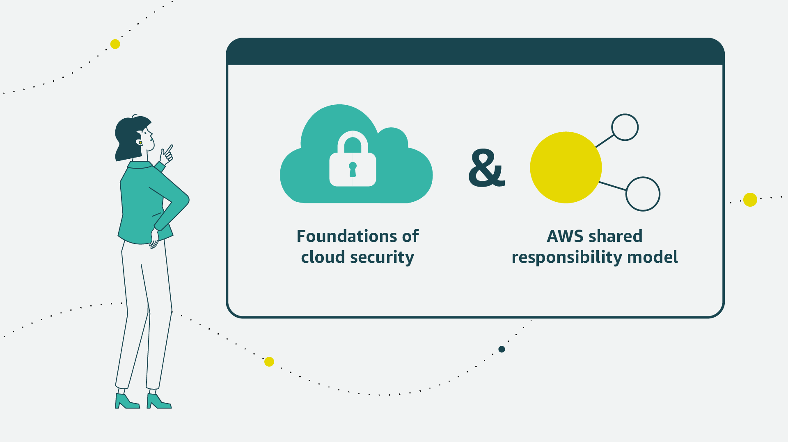

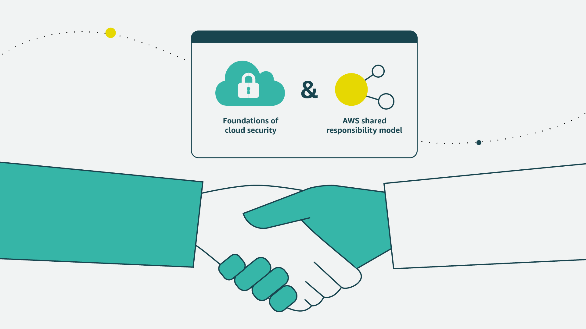

> **Нотатки:**
>
> For her first meeting with John, María decides to present information about the foundations of cloud security and the AWS shared responsibility model.  
>
> This will be an excellent way to build trust and rapport with her new supervisor.

---

## Слайд 7: Bank business scenario (3 of 3)

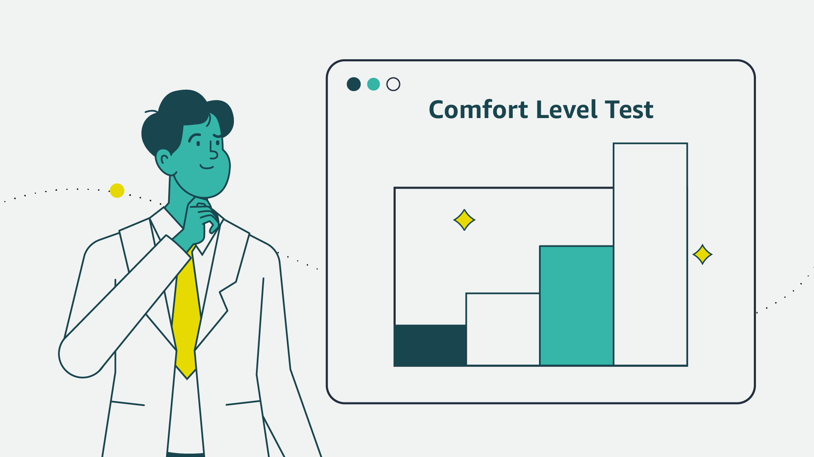

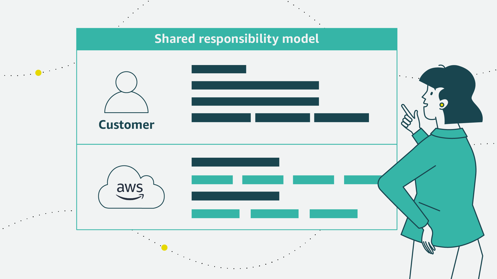

> **Нотатки:**
>
> By beginning with the foundations of cloud security, she can assess John’s comfort level with the subject matter while providing the necessary information to make her business case.  
>
> María decides to introduce the shared responsibility model to explain how both the bank and AWS will protect the bank’s resources with multiple layers of security. She intends to use the model to demonstrate the areas where the bank or AWS would be responsible.

---

## Слайд 8: Security in the AWS Cloud

Introduction to Security on AWS

> **Нотатки:**
>
> This section covers security in the AWS Cloud.

---

## Слайд 9: Benefits of the cloud

Trade fixed expense for variable expense.

Benefit from massive economies of scale.

Stop guessing on your capacity needs.

Increase speed and agility.

Stop spending money to run and maintain data centers.

Go global in minutes.

> **Нотатки:**
>
> Companies can realize the following benefits by moving to the cloud:  
>
> Trade fixed expense for variable expense: Instead of needing to invest heavily in data centers and servers before you know how you will use them, pay only when you consume computing resources, and pay only for how much you consume.  
>
> Benefit from massive economies of scale: By using cloud computing, you can achieve a lower variable cost than you can get on your own. Because usage from hundreds of thousands of customers is aggregated in the cloud, providers such as AWS can achieve higher economies of scale, which translates into lower pay-as-you-go prices.  
>
> Stop guessing on your capacity needs: Stop guessing on your infrastructure capacity needs. When you make a capacity decision prior to deploying an application, you often either sit on expensive idle resources or deal with limited capacity. With cloud computing, these problems go away. You can access as much or as little capacity as you need, and scale up and down as required with only a few minutes of notice.  
>
> Increase speed and agility: In a cloud computing environment, new IT resources are only a click away. This means that you reduce the time to make those resources available to your developers from weeks to minutes. This results in a dramatic increase in agility for the organization, because the cost and time that it takes to experiment and develop is significantly lower.  
>
> Stop spending money to run and maintain data centers: Focus on projects that differentiate your business instead of focusing on the infrastructure. With cloud computing, you can focus on your own customers, rather than on the heavy lifting of racking, stacking, and powering servers.  
>
> Go global in minutes: Easily deploy your application in multiple regions around the world with a few clicks. This means you can provide lower latency and a better experience for your customers at minimal cost.  
>
> For more information, see What Is Cloud Computing? at https://aws.amazon.com/what-is-cloud-computing.

---

## Слайд 10: Security is familiar

Confidentiality

Integrity

Availability

- Limit access and disclosure to authorized users
- Prevent access by unauthorized people

- Maintain data consistency during its lifecycle
- Preserve data at rest and data in transit

- Have access to information resources when needed

> **Нотатки:**
>
> Security is the practice of protecting your intellectual property from unauthorized access, use, or modification. The triad of confidentiality, integrity, and availability, or CIA, was originally developed to highlight the important aspects of information security within an organization.  
>
> Confidentiality refers to limiting information access and disclosure to authorized users and preventing access by unauthorized people.  
>
> Integrity involves maintaining the consistency, accuracy, and trustworthiness of data over its entire lifecycle. This includes “origin” or “source integrity,” which is assurance that the sender of that information is who it is supposed to be. Integrity can mean ensuring that the person or entity in question entered the correct information. However, integrity of an information system might only mean preserving data without corruption of whatever was transmitted into or entered into the system.  
>
> Availability refers to the readiness of information resources. An information system that is not available when you need it is almost as useless as no information system. Modern day IT environments bring challenges to the CIA triad because of the volume of information that must be safeguarded, the multiplicity of sources that the data comes from, and the variety of formats.

---

## Слайд 11: AWS Cloud security: Objectives

- Controllability
- Auditability
- Visibility
- Agility
- Automation

> **Нотатки:**
>
> Security in the cloud is similar to security in on-premises data centers, only without the costs and complexities of protecting facilities and hardware. Because the cloud doesn't have any physical servers or storage devices, you use software-based security tools to monitor and protect the flow of information into and out of your AWS resources.  
>
> At AWS, we strive to make security as familiar as what you are doing today. You can bring the same security models that you use today in your environment over to the cloud. This includes providing visibility, auditability, and controllability to your resources in the cloud. Additionally, AWS offers several services and tools to equip you with the agility and automation that you need to adapt to cloud-level scaling to take security to the next level.

---

## Слайд 12: AWS Cloud security: Controllability

- Can I effectively manage users?
- How can I provide temporary credentials?
- Can I use my own keys?

**AWS Identity and Access Management (IAM)**

> **Нотатки:**
>
> AWS provides methods and tools to manage access control for users, groups, and roles; provide temporary security credentials; and control encryption keys.  
>
> The AWS Identity and Access Management (IAM) service helps you securely control access to AWS resources for your users. Use IAM to control who can use your AWS resources (authentication), what resources they can use, and in what ways (authorization). You can define granular permissions for entities such as users, groups, or roles. This enables entities to administer and use resources in your AWS account without having to share your password or access key.  
>
> You can grant different permissions to different people for different resources. For example, you might allow some users complete access to Amazon Elastic Compute Cloud (Amazon EC2), Amazon Simple Storage Service (Amazon S3), and other AWS services. For other users, you can allow read-only access to just some S3 buckets, permission to administer just some EC2 instances, or access to your billing information but nothing else. With IAM, you can also allow users who already have passwords elsewhere to access your AWS account. For example, users with passwords in your corporate network or with an internet identity provider can get access to your AWS account.  
>
> You can use the AWS Security Token Service (AWS STS) to create and provide trusted users with temporary security credentials that can control access to your AWS resources. Temporary security credentials work almost identically to the long-term access key credentials that your IAM users can use.  
>
> With AWS CloudHSM, you can protect your encryption keys within hardware security modules (HSMs) that are designed and validated to government standards for secure key management. You can securely generate, store, and manage the cryptographic keys used for data encryption in a way that ensures that only you have access to the keys. CloudHSM helps you comply with strict key management requirements within the AWS Cloud without sacrificing application performance.

---

## Слайд 13: AWS Cloud security: Auditability

- Who has access to this resource?
- Who performed what action?
- When was the action performed and from where?
- Where is the evidence?

**AWS CloudTrail**

> **Нотатки:**
>
> It's important to test and validate your protection measures to ensure that they meet compliance requirements and are operating as intended. Organizations typically rely on regular audits, either internal or external, of their environments to ensure conformity with policies and regulations.  
>
> AWS services such as AWS CloudTrail can help you answer questions such as what actions did a specific user take over a given time period? For a specific resource, which user has taken actions on it over a given time period? What is the source IP address of a specific activity?

---

## Слайд 14: AWS Cloud security: Visibility

- What is in my environment?
- What impact did a particular action have?
- What has changed?
- Where is the evidence?

**AWS Config**

> **Нотатки:**
>
> The first step to secure your assets is to know what they are. You shouldn't need to guess what your IT inventory consists of, who is accessing your resources, and what actions anyone has run on your resources.  
>
> AWS offers tools to keep track of and monitor your AWS resources, so you have instant visibility into your inventory, and your user and application activity. For example, by using AWS Config, you can discover existing AWS resources, export a complete inventory of your AWS resources with all configuration details, and determine how a resource was configured at any point in time. These capabilities can help you with compliance auditing, security analysis, resource change tracking, and troubleshooting.

---

## Слайд 15: AWS Cloud security: Agility and automation

- How do I ensure high availability?
- Can I automatically deploy applications with security and compliance-related settings?
- How can I apply security checks in a reproducible manner?

**AWS CloudFormation**

> **Нотатки:**
>
> The increase in agility and the ability to perform actions faster, at a larger scale and at a lower cost, does not invalidate well-established principles of information security. Automatically scaling to ensure high availability during a security attack is one of the ways that AWS provides agility to meet needs. AWS designs data centers with excess bandwidth, so that if a major disruption occurs, sufficient capacity is available to load balance traffic and route it to remaining sites, to minimize the impact on our customers. Customers also use this multiple Region, multiple Availability Zone strategy to build highly resilient applications at a disruptively low cost, to easily replicate and back up data, and to deploy global security controls consistently across their business.  
>
> AWS tools are purpose built, and tailored to your unique environment, size, and global requirements. By building security tools from the ground up, AWS can automate many of the routine tasks that security experts normally spend time on. This means AWS security experts can spend more time focusing on measures to increase the security of your AWS Cloud environment. Customers can also automate security engineering and operations functions by using a comprehensive set of APIs and tools.  
>
> When you automate by using AWS services such as AWS CloudFormation, rather than manually deploying an environment for forensics troubleshooting, for example, you can have AWS deploy an environment in a secure and reproducible manner.

---

## Слайд 16: Key takeaways: Security in the AWS Cloud

- The triad of confidentiality, integrity, and availability, or CIA, was originally developed to highlight the important aspects of information security within an organization.
- AWS offers several tools and features to help you meet the security objectives around controllability, auditability, visibility, agility, and automation.

> **Нотатки:**
>
> Key takeaways from this section of the module include the following:  
> The triad of confidentiality, integrity, and availability, or CIA, was originally developed to highlight the important aspects of information security within an organization.  
> AWS offers several tools and features to help you meet the security objectives around controllability, auditability, visibility, agility, and automation.

---

## Слайд 17: Security design principles

Introduction to Security on AWS

> **Нотатки:**
>
> This section describes security design principles.

---

## Слайд 18: 1. Apply the principle of least privilege

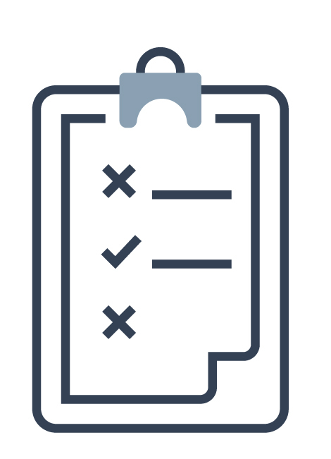

- Grant access as needed
- Enforce separation of duties
- Avoid long-term credentials

> **Нотатки:**
>
> This section describes the seven design principles from the security pillar of the AWS Well-Architected Framework. Following these principles can help you strengthen your workload security, and can help guide your conversations around security and compliance.  
>
> An organizational security culture should be built on the principle of least privilege. Only grant access to data and other resources to the people who really need that access. You can start with denying access to everything and grant access as needed, based on job role.  
>
> A security best practice is to enforce separation of duties with appropriate authorization for each interaction with your AWS resources. Set expectations for how authority will be delegated down through software engineers, operations staff, and other job functions that are involved in cloud adoption.  
>
> By reducing or even ending reliance on long-term credentials, you can diminish your attack surface area. You can use temporary credentials and require identities to dynamically acquire them. For workforce identities, use AWS Single Sign-On or federation with IAM to access AWS accounts. For machine identities, such as EC2 instances or AWS Lambda functions, require the use of IAM roles, instead of IAM users with long-term access keys.  
>
> Identity and access management are key parts of an information security program to ensure that only authorized and authenticated users and components are able to access your resources, and only in a manner that you intend. In AWS, IAM is the primary service for permissions management. The service provides the ability to control user and programmatic access to AWS services and resources.  
>
> With IAM, you can define principals (that is, accounts, users, roles, and services that can perform actions in your account) and build out granular policies aligned with these principals. You also have the ability to require strong password practices, such as setting a complexity level, avoiding re-use, and enforcing multi-factor authentication (MFA). You can use federation with your existing directory service. For workloads that require systems to have access to AWS, IAM can provide secure access through roles, instance profiles, identity federation, and temporary credentials.

---

## Слайд 19: 2. Enable traceability

- Monitor actions and changes
- Use logs and metrics
- Audit your cloud resources

> **Нотатки:**
>
> With AWS, you can monitor, alert, and audit actions and changes to your environment in real time. AWS provides native logging as well as services that you can use to provide greater visibility in near-real time for occurrences in your environment. Integrate these tools with your existing logging and monitoring solutions. Know what workloads are deployed and operational, so that you can audit and ensure that the environment is operating at expected security governance levels and meeting required security standards.  
>
> In AWS, you can implement detective controls by processing logs and events, and monitoring, which allows for auditing, automated analysis, and alarming. CloudTrail logs, AWS API calls, and Amazon CloudWatch provide monitoring of metrics with alarming, and AWS Config provides configuration history. Amazon GuardDuty is a managed threat detection service that continuously monitors for malicious or unauthorized behavior to help you protect your AWS accounts and workloads. Service-level logs are also available; for example, you can use Amazon S3 to log access requests.

---

## Слайд 20: 3. Secure all layers

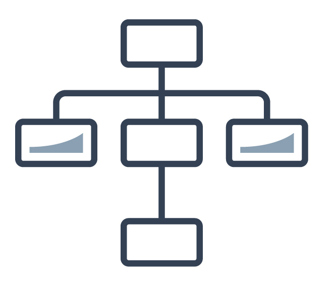

- Use a defense in depth approach
- Use different AWS services

> **Нотатки:**
>
> Rather than only focusing on the protection of a single outer layer, apply a defense in depth approach with other security controls. This means to apply security to all layers, such as your network, application, and data store. For example, you can require users to strongly authenticate to an application. In addition, ensure that users come from a trusted network path and require access to the decryption keys to process encrypted data. One of the benefits of using AWS is that our services are also built for integration. You can use several AWS services together to provide the most secure environment for your data and resources.  
>
> AWS customers are able to tailor, or harden, the configuration of an EC2 instance, Amazon Elastic Container Service (Amazon ECS) container, or AWS Elastic Beanstalk instance, and persist this configuration to an immutable Amazon Machine Image (AMI). Then, all new virtual servers (instances) launched with this AMI receive the hardened configuration, whether they are launched manually or through automatic scaling.

---

## Слайд 21: 4. Automate security

- Automate routine security tasks with APIs
- Implement infrastructure as code

> **Нотатки:**
>
> AWS develops purpose-built security tools that can help you to automate many of the routine tasks that security experts normally spend time on. This means the security experts can spend more time focusing on measures to increase the security of your AWS Cloud environment.  
>
> You can automate security engineering and operations functions by using a comprehensive set of APIs and tools. You can fully automate identity management, network security and data protection, and monitoring capabilities, and deliver them by using popular software development methods that you already have in place. Rather than having people monitor your security position and react to an event, with automation, your system can monitor, review, and initiate a response.  
>
> In the AWS Cloud, you can turn your infrastructure into code. With this capability, you can automate the creation of trusted environments to conduct deeper investigations and forensics. You can run incident response simulations and use tools with automation to increase your speed for detection, investigation, and recovery. By automating deployments and maintenance, you can remove operator access to reduce your attack surface area.

---

## Слайд 22: 5. Protect data in transit and data at rest

- Use encryption and access controls
- Classify your data with tags
- Use VPN and TLS connections

> **Нотатки:**
>
> Safeguarding data is a critical piece of building and operating information systems. AWS provides services and features that help you to protect your data at rest and in transit. Safeguards include fine-grained access controls to objects, creating and controlling the encryption keys that are used to encrypt your data, selecting appropriate encryption methods, integrity validation, and appropriate data retention. To help you manage protection, implement a tagging schema to classify your data into sensitivity levels. Another security best practice is to construct mechanisms to protect data in transit, such as using virtual private network (VPN) and Transport Layer Security (TLS) connections.  
>
> AWS provides multiple means to encrypt data at rest and data in transit. We build features into our services that make it easier to encrypt your data. For example, we have implemented server-side encryption (SSE) for Amazon S3 to make it easier for you to store your data in an encrypted form. You can also arrange for Elastic Load Balancing (ELB) to handle the entire HTTPS encryption and decryption process (generally known as SSL termination).

---

## Слайд 23: 6. Prepare for security events

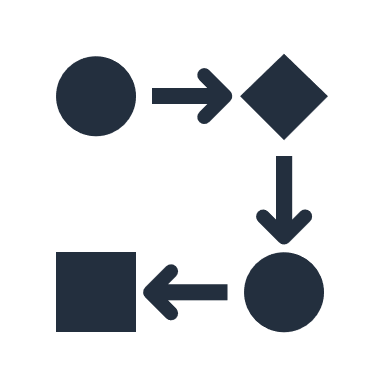

- Mitigate the impact of security incidents
- Create processes to isolate incidents and restore operations

> **Нотатки:**
>
> Even with mature preventive and detective controls, you should put processes in place to respond to and mitigate the potential impact of security incidents. The architecture of your workload strongly affects your ability to operate effectively during an incident, isolate or contain systems, and restore operations to a known good state. Put tools and access in place ahead of a security incident. Then, routinely practice incident response through game days. This will help you ensure that your architecture can accommodate timely investigation and recovery. Another module in this course will describe a variety of approaches to incident response.  
>
> In AWS, the following practices facilitate effective incident response:  
> Detailed logging is available. Logs contain important content such as file access and changes.  
> Events can be automatically processed and invoke tools that automate responses through the use of AWS APIs.  
> You can pre-provision tooling and a “clean room” by using AWS CloudFormation. This provides the ability to carry out forensics in a safe, isolated environment.

---

## Слайд 24: 7. Minimize the attack surface

- Be ready to scale and absorb the attack
- Safeguard exposed resources

> **Нотатки:**
>
> Generally, a cyberattack shuts down due to two reasons: either the attackers exhaust themselves and give up, or the attackers achieve their goal. Reduce your exposure to unintended access by hardening operating systems and minimizing the components, libraries, and externally consumable services in use. Start by reducing unused components, such as operating system packages and applications. Configure security groups and network access control lists (ACLs) in Amazon Virtual Private Cloud (Amazon VPC) to help reduce the attack surface of your applications.  
>
> Certain AWS services, such as AWS Auto Scaling and Amazon CloudFront, help applications to scale to absorb common infrastructure layer attacks such as UDP reflection attacks and SYN floods. A UDP reflection attack takes place when the attacker asks the target computer for information by using a forged source address. A SYN flood is a type of distributed denial of service (DDoS) attack that aims to make a server unavailable to legitimate traffic by consuming all available server resources. By using techniques such as automatic scaling, you can absorb larger volumes of application layer attacks.  
>
> For more information, see the Security Pillar: AWS Well-Architected Framework whitepaper at https://docs.aws.amazon.com/wellarchitected/latest/security-pillar/welcome.html.

---

## Слайд 25: Key takeaways: Security design principles

The design principles for security in the cloud are as follows:

- Apply the principle of least privilege.
- Enable traceability.
- Secure all layers.
- Automate security.
- Protect data in transit and data at rest.
- Prepare for security events.
- Minimize the attack surface.

> **Нотатки:**
>
> The key takeaways from this section of the module are the design principles for security in the cloud:  
> Apply the principle of least privilege.  
> Enable traceability.  
> Secure all layers.  
> Automate security.  
> Protect data in transit and data at rest.  
> Prepare for security events.  
> Minimize the attack surface.

---

## Слайд 26: Shared responsibility model

Introduction to Security on AWS

> **Нотатки:**
>
> This section covers the shared responsibility model.

---

## Слайд 27: AWS shared responsibility model

> **Нотатки:**
>
> For accessibility: Shared responsibility model listing customer and AWS responsibilities. Customer is responsible for security in the cloud. This includes customer data. Platform, applications, identity and access management. Operating system, network, and firewall configuration. Client-side data encryption and data integrity, authentication. Server-side encryption of file system and data. Networking traffic protection, to include encryption, integrity, and identity. AWS is responsible for security of the cloud. This includes the AWS foundation services for compute, storage, databases, and networking. And the AWS Global Infrastructure, to include Regions, Availability Zones, and Edge Locations. End of accessibility description.  
>
> Security and compliance are shared responsibilities between AWS and customers. AWS operates, manages, and controls security of the cloud. This responsibility includes securing components, from the host operating system and virtualization layer down to the physical security of the facilities where the service operates. AWS is responsible for protecting the global infrastructure that runs all the services that are offered in the AWS Cloud. This infrastructure is composed of the hardware, software, networking, and facilities that run AWS Cloud services.  
>
> You assume responsibility and management in the cloud. The security steps that you must take depend on the services that you use and the complexity of your system. Customer responsibilities include selecting and securing operating systems that run on EC2 instances, and securing the applications that are launched on AWS resources. Customers must also select and handle security group configurations, firewall configurations, network configurations, and secure account management. Customers are also responsible for managing their data, including encryption options.  
>
> To reiterate, AWS secures the hardware, software, facilities, and networks that run all AWS products and services. You are responsible for what you implement by using AWS products and services, and for the applications that you connect to AWS. The security steps that you must take depend on the services that you use and the complexity of your system.

---

## Слайд 28: Shared responsibility example

Accounts and credentials

Customer responsibility examples:

- Guest OS configuration
- Application-level security
- Security group configuration

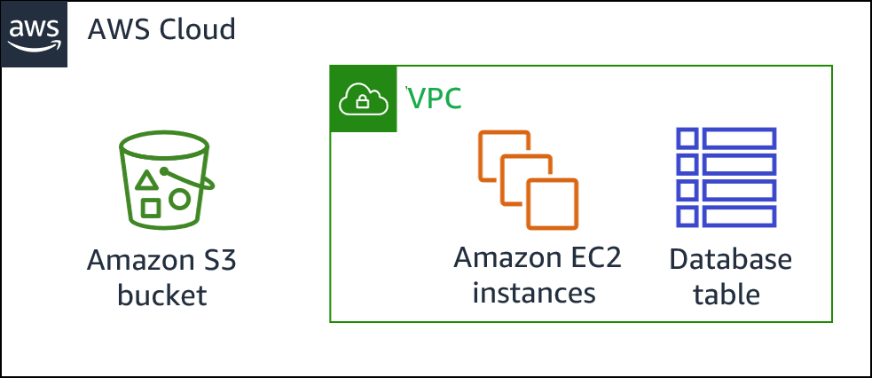

Customer

AWS

AWS Global Infrastructure

> **Нотатки:**
>
> Consider an example where your company uses Amazon S3 to store data. Your AWS environment also includes EC2 instances and an Amazon Relational Database Service (Amazon RDS) instance. These resources run a MySQL database, which is deployed inside a virtual private cloud (VPC). One EC2 instance hosts a web server, and the web application that runs on it uses the database to store application data.  
>
> In this scenario, AWS is responsible for protecting the global infrastructure, which contains the physical servers that host the virtual machines and storage hardware. These virtual machines and storage hardware host your S3 bucket, EC2 instances, and database instance. AWS is responsible for the security of the physical networking infrastructure that ensures that these components can be accessed. AWS is also responsible for the security of the hypervisor layer that hosts the EC2 instances. (The hypervisor is the host OS that runs the EC2 instances, which are virtual machines that run guest operating systems.)  
>
> You (the customer) are responsible for managing the guest OS that runs on the EC2 instances (including Microsoft Windows or Linux OS updates and security patches). You are also responsible for managing any application software or utilities that you install. Additionally, you are responsible for the configuration of the security groups that control network access to each EC2 instance and to the RDS database instance. You are also responsible for configuring security on the S3 bucket and the objects that you store in it. For example, you could use one or more of the security features that AWS provides, such as bucket policies, data encryption, and S3 Block Public Access.  
>
> For more information, see Shared Responsibility Model at https://aws.amazon.com/compliance/shared-responsibility-model.

---

## Слайд 29: Security in the cloud

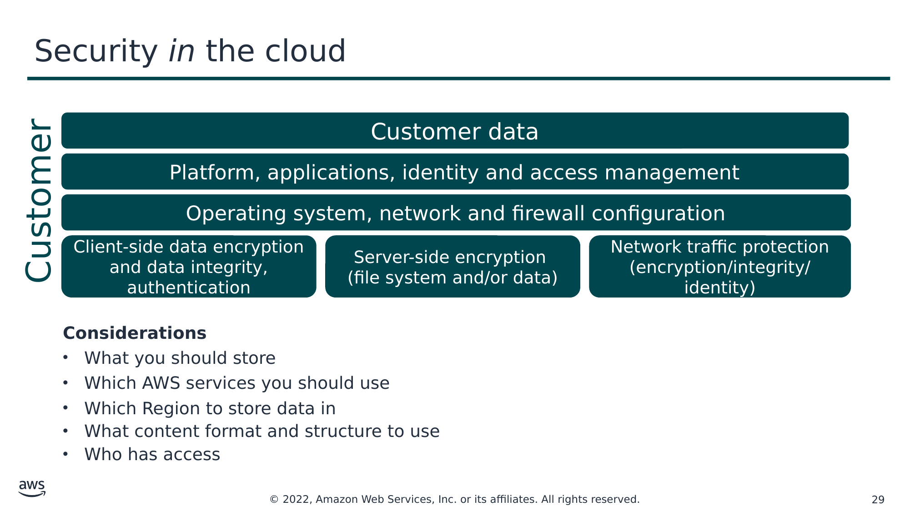

Текст зі схеми

Customer data

Platform, applications, identity and access management

Customer

Operating system, network and firewall configuration

Client-side data encryption and data integrity, authentication

Server-side encryption

(file system and/or data)

Network traffic protection

(encryption/integrity/identity)

**Considerations**

- What you should store
- Which AWS services you should use
- Which Region to store data in
- What content format and structure to use
- Who has access

> **Нотатки:**
>
> While AWS secures and maintains the cloud infrastructure, you are responsible for securing everything that you put IN the cloud.  
>
> Before you architect any workload, you need to put practices in place that influence security. You will want to control who can do what. In addition, you want to be able to identify security incidents, protect your systems and services, and maintain the confidentiality and integrity of data through data protection. You should have a well-defined and practiced process to respond to security incidents. These tools and techniques are important because they support objectives such as preventing financial loss or complying with regulatory obligations.  
>
> Because AWS physically secures the infrastructure that supports our cloud services, as an AWS customer you can focus on using services to accomplish your goals. The AWS Cloud also provides greater access to security data and an automated approach to respond to security events.  
>
> When using AWS services, you maintain complete control over your content and are responsible for managing critical security requirements, including the following:  
> The content you choose to store on AWS  
> The AWS services that are used with the content  
> The country in which that content is stored  
> The format and structure of that content, and whether it is masked, anonymized, or encrypted  
> Who has access to that content, and how those access rights are granted, managed, and revoked  
>
> You retain control of what security you choose to implement to protect your own data, platform, applications, identity and access management, and operating system. This means that the shared responsibility model changes depending on the AWS services that you use.

---

## Слайд 30: Activity: Shared Responsibility Model

> **Нотатки:**
>
> Now you will complete an activity about the shared responsibility model, and the responsibilities of AWS and the customer.

---

## Слайд 31: Activity: Scenario 1 of 2

Consider this deployment. Who is responsible: AWS or the customer?

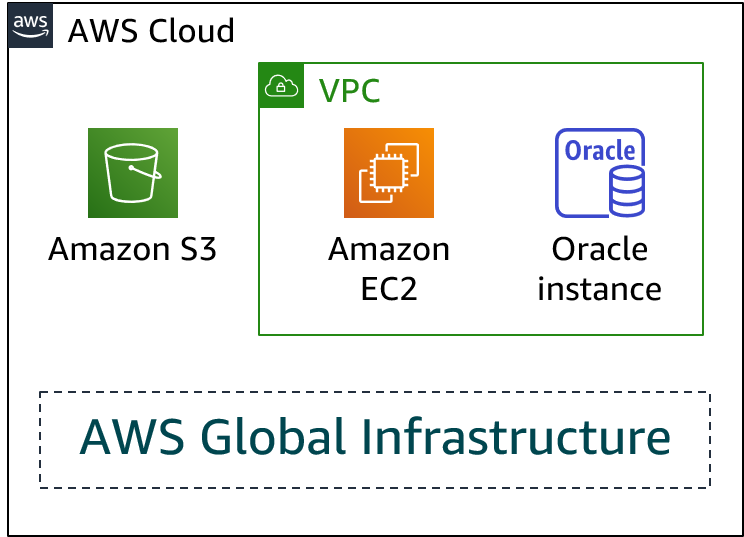

- Upgrades and patches to the operating system on the EC2 instance?
- Physical security of the data center?
- Virtualization infrastructure?
- EC2 security group settings?
- Configuration of applications that run on the EC2 instance?

- Oracle upgrades or patches if the Oracle instance runs as an Amazon RDS instance?
- Oracle upgrades or patches if Oracle runs on an EC2 instance?
- S3 bucket access configuration?

> **Нотатки:**
>
> For accessibility: the architectural diagram shows an AWS Cloud box which contains an AWS Global Infrastructure area, as well as an Amazon S3 bucket, and finally a VPC which contains an Amazon EC2 instance and an Oracle instance. End of accessibility description.  
>
> Consider the case where a customer uses the AWS services and resources that are shown here. The customer uses Amazon S3 to store data. The customer manages a VPC that contains an EC2 instance and an Amazon RDS for Oracle database instance.  
>
> Who is responsible for maintaining the security of each component? AWS or the customer?

---

## Слайд 32: Activity: Scenario 1 of 2 answers

Consider this deployment. Who is responsible: AWS or the customer?

- Upgrades and patches to the operating system on the EC2 instance?

**Answer: The customer**

- Physical security of the data center?

**Answer: AWS**

- Virtualization infrastructure?

**Answer: AWS**

- EC2 security group settings?

**Answer: The customer**

- Configuration of applications that run on the EC2 instance?

**Answer: The customer**

- Oracle upgrades or patches if the Oracle instance runs as an Amazon RDS instance?

**Answer: AWS**

- Oracle upgrades or patches if Oracle runs on an EC2 instance?

**Answer: The customer**

- S3 bucket access configuration?

**Answer: The customer**

> **Нотатки:**
>
> For accessibility: the architectural diagram shows an AWS Cloud box which contains an AWS Global Infrastructure area, as well as an Amazon S3 bucket, and finally a VPC which contains an Amazon EC2 instance and an Oracle instance. End of accessibility description.  
>
> The customer controls the security in the cloud. In the scenario above, this includes updating and patching the guest operating system and associated application software on the EC2 instance, and configuration of the AWS provided security group firewall. Because the customer's responsibility is determined by the AWS Cloud services that they select, the Oracle upgrades or patches will be a customer responsibility if they are running the Oracle database on an EC2 instance. The customer is also responsible for using IAM tools to apply the correct permissions at the platform level, such as for S3 buckets, and at the IAM user or group level.  
>
> AWS manages security of the cloud by ensuring that the AWS infrastructure complies with global and regional regulatory requirements and best practices. AWS operates, manages, and controls the components from the host operating system and virtualization layer down to the physical security of the facilities that the service operates in.  
>
> In this example, AWS is responsible for the physical security of the data center and the virtualization infrastructure. If the Oracle instance runs as an Amazon RDS instance, then AWS is responsible for the Oracle upgrades and patches. Amazon RDS automates common administrative tasks, such as performing backups and patching the software that powers your database.

---

## Слайд 33: Activity: Scenario 2 of 2

Consider this deployment. Who is responsible: AWS or the customer?

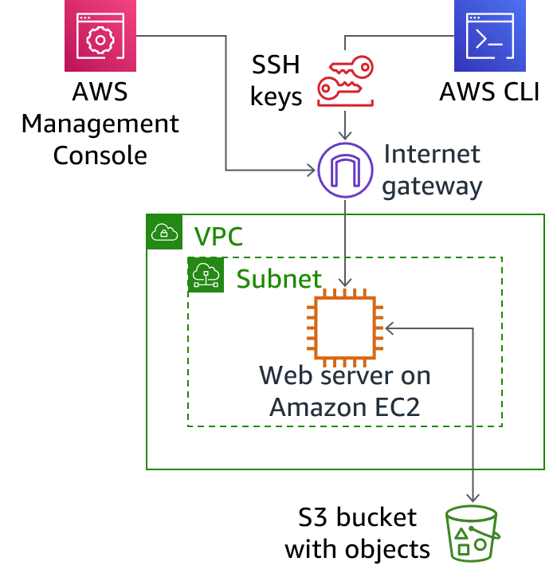

- Ensuring that the AWS Management Console is not hacked?
- Configuring the subnet?
- Configuring the VPC?
- Protecting against network outages in AWS Regions?
- Securing the SSH keys?

- Ensuring network isolation between AWS customers' data?
- Ensuring low-latency network connection between the web server and the S3 bucket?
- Enforcing multi-factor authentication for all user logins?

> **Нотатки:**
>
> For accessibility: Architectural diagram showing a web server running on EC2 inside a subnet and VPC. The web server connects to an S3 bucket. The web server is accessible via an internet gateway either using the AWS Management console or using the AWS Command Line Interface which makes use of SSH keys. End of accessibility description.  
>
> Now, consider this additional case where a customer uses the AWS services and resources that are shown here.  
>
> A customer uses Amazon S3 to store data. The customer configured a virtual private cloud (VPC) with Amazon VPC, and is running a web server on an EC2 instance in the VPC. The customer configured an internet gateway as part of the VPC so that the web server can be reached by using the AWS Management Console or the AWS Command Line Interface (AWS CLI). When the customer uses the AWS CLI, the connection requires the use of Secure Shell (SSH) keys.  
>
>
> Who is responsible for maintaining the security of each component? AWS or the customer?

---

## Слайд 34: Activity: Scenario 2 of 2 answers

Consider this deployment. Who is responsible: AWS or the customer?

- Ensuring that the AWS Management Console is not hacked?

**Answer: AWS**

- Configuring the subnet?

**Answer: The customer**

- Configuring the VPC?

**Answer: The customer**

- Protecting against network outages in AWS Regions?

**Answer: AWS**

- Securing the SSH keys?

**Answer: The customer**

- Ensuring network isolation between AWS customers' data?

**Answer: AWS**

- Ensuring low-latency network connection between the web server and the S3 bucket?

**Answer: AWS**

- Enforcing multi-factor authentication for all user logins?

**Answer: The customer**

> **Нотатки:**
>
> For accessibility: Architectural diagram showing a web server running on EC2 inside a subnet and VPC. The web server connects to an S3 bucket. The web server is accessible via an internet gateway either using the AWS Management console or using the AWS Command Line Interface which makes use of SSH keys. End of accessibility description.  
>
> In the shared responsibility model, the customer is responsible for what they implement by using AWS and for the applications that are connected to the AWS Cloud. In this example, the customer is responsible to configure the VPC and subnet, secure the SSH keys, and enforce multi-factor authentication for all user logins.  
>
> Remember that customers are responsible for the security of the content they put in the AWS Cloud or that they connect to their AWS infrastructure. This includes content stored and processed in AWS storage, databases, or other services. As an AWS customer, you control the entire lifecycle of your content on AWS, and you can manage your content in accordance with your own specific needs, including content classification, access control, retention, and deletion.  
>
> As described in the shared responsibility model, AWS is responsible for protecting the global infrastructure that runs all of the AWS Cloud. This includes the physical infrastructure that hosts your resources. In this example, AWS is responsible for the following:  
> Ensure that the console isn't hacked.  
> Protect the infrastructure against network outages in AWS Regions.  
> Ensure network isolation between AWS customers' data.  
> Ensure a low-latency network connection between the web server and the S3 bucket.

---

## Слайд 35: Managed services organization

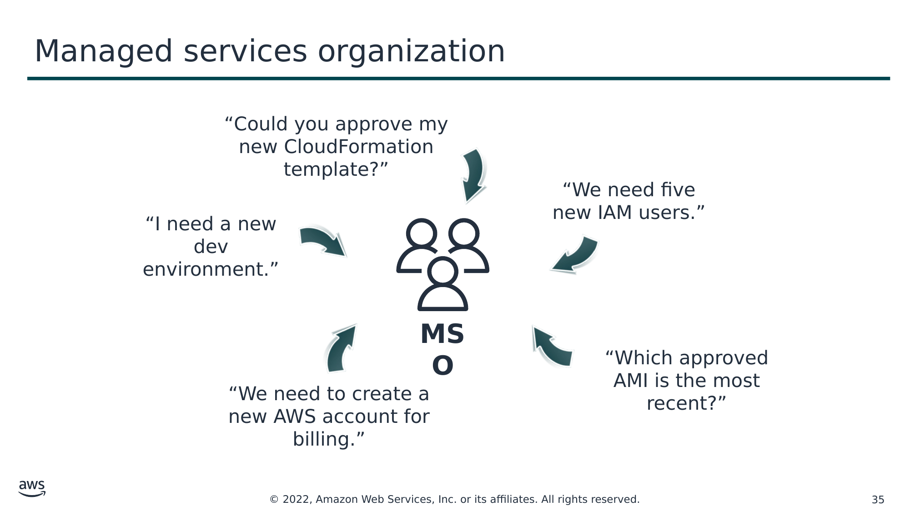

Текст зі схеми

“Could you approve my new CloudFormation template?”

“We need five new IAM users.”

“I need a new dev environment.”

**MSO**

“Which approved AMI is the most recent?”

“We need to create a new AWS account for billing.”

> **Нотатки:**
>
> One approach to implement security and governance is to create a centralized team that is responsible for establishing repeatable processes and templates to deploy applications to AWS while maintaining organizational control over the deployments. Such a team could be either internal or external (third-party vendors), and is often referred to as a provisioning team, center of excellence, or managed services organization (MSO). External vendors are commonly referred to as managed service providers (MSPs). AWS validates AWS Partners under the AWS Managed Service Provider (MSP) Program.  
>
> MSOs or MSPs are typically responsible for provisioning accounts; establishing repeatable processes for deployment; auditing the deployments of workload owners; and hosting shared services for security, continuous monitoring, connectivity, and authentication. MSOs essentially create the guardrails for security, data protection, and disaster recovery in the company.  
>
> For more information, see AWS Managed Service Provider (MSP) Program at https://aws.amazon.com/partners/programs/msp.

---

## Слайд 36: MSO responsibility model

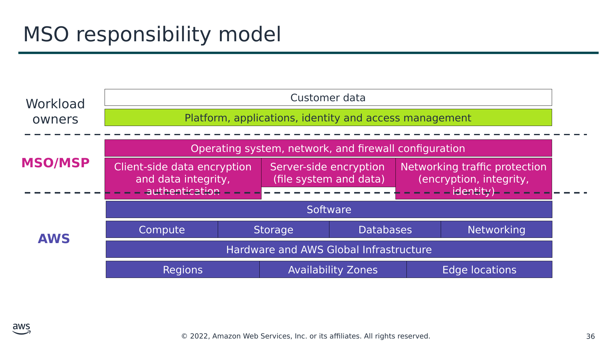

Текст зі схеми

Workload owners

Customer data

Platform, applications, identity and access management

**MSO/MSP**

Operating system, network, and firewall configuration

Client-side data encryption and data integrity, authentication

Server-side encryption  
(file system and data)

Networking traffic protection

(encryption, integrity, identity)

Software

**AWS**

Compute

Storage

Databases

Networking

Hardware and AWS Global Infrastructure

Regions

Availability Zones

Edge locations

> **Нотатки:**
>
> In the MSO model, workload owners handle the actual deployment, development, and maintenance of applications. Workload owners typically include system administrators, developers, and others who are directly responsible for one or more applications. Adding an MSO helps ensure that applications are deployed in a secure and compliant fashion through the automated implementation of organizational security requirements. Having an MSO also means that the workload owner can scope down their authorization documentation to only the configuration and installation of software that is specific to a particular application. This is because the workload owner inherits a significant portion of the security control implementation from the MSO.  
>
> AWS customer MSOs often perform the following activities:  
>
> Account provisioning: After reviewing the workload owner’s use case, the MSO establishes the initial account, connects it to the appropriate account for consolidated billing, and configures basic security functionality before granting access to the workload owner.  
>
> Security oversight: With centralized account provisioning, the MSO can implement features that enable security personnel to monitor the application as it is deployed and managed. The MSO might perform activities such as establishing an auditor group with cross-account access and linking the application VPC to a shared services VPC that the MSO controls.  
>
> Amazon VPC configuration: An Amazon VPC configuration includes the VPC and its subnets, security group configurations, and network access control lists (ACLs). To maintain tighter control over the application VPCs, the MSO might retain control of VPC configuration and require the workload owner to request wanted changes to network security.  
>
> IAM configuration: The MSO can create user groups and assign permissions. This can include creating groups for internal auditors, an IAM superuser, and application administrative groups that are segregated by functionality (for example, database and Unix administrators).  
>
> Development and approval of templates: The MSO can create preapproved CloudFormation templates for common use cases. By using templates, workload owners inherit the security implementation of the approved template, which limits their authorization documentation to the features that are unique to their application. Templates can be reused to shorten the time required to approve and deploy new applications.  
>
> AMI creation and management: The MSO can create a library of common, approved AMIs for the organization, thus providing centralized management and updating of machine images. By creating common templates, the MSO can enforce the use of approved AMIs.  
>
> Development of a shared services VPC: With a shared service VPC, the MSO can receive nearly continuous monitoring feeds from the organization’s application VPC and common, shared services that are required for their organization. This often includes a shared access management platform, logging endpoints, and aggregation of configuration information.

---

## Слайд 37: Key takeaways: Shared responsibility model

- The AWS shared responsibility model helps organizations that adopt the cloud to achieve their security and compliance goals.
- Customers are responsible for securing everything they put in the cloud.
- An MSO essentially creates the guardrails for security, data protection, and disaster recovery.

> **Нотатки:**
>
> Key takeaways from this section of the module include the following:  
> The AWS shared responsibility model helps organizations that adopt the cloud to achieve their security and compliance goals.  
> Customers are responsible for securing everything they put IN the cloud.  
> An MSO essentially creates the guardrails for security, data protection, and disaster recovery.

---

## Слайд 38: Module wrap-up

Introduction to Security on AWS

> **Нотатки:**
>
> It’s now time to review the module, and wrap up with a knowledge check and discussion of a practice certification exam question.

---

## Слайд 39: Module summary

In this module, you learned how to do the following:

- Identify security features and benefits of cloud computing.
- Identify the security principles that the AWS Cloud is structured around.
- Identify which part of an application the user is responsible to secure in the cloud.

> **Нотатки:**
>
> In this module, you learned how to do the following:  
> Identify security features and benefits of cloud computing.  
> Identify the security principles that the AWS Cloud is structured around.  
> Identify which part of an application the user is responsible to secure in the cloud.

---

## Слайд 40: Complete the knowledge check

> **Нотатки:**
>
> It is now time to complete the knowledge check for this module.

---

## Слайд 41: Sample exam question

According to the shared responsibility model, who is responsible for configuring security group rules to determine which ports are open to an EC2 Linux instance?

Choice

Response

A

AWS is responsible for configuring security group rules.

B

The customer is responsible for configuring security group rules.

C

Security group rules are not needed.

D

AWS is responsible for configuring security group rules, and the customer must open ports to the instance.

> **Нотатки:**
>
> Look at the answer choices and rule them out based on the keywords.

---

## Слайд 42: Sample exam question answer

Copy and paste the same question here.

The correct answer is B.

The keywords in the question are **configuring security group rules**.

> **Нотатки:**
>
> The following are the keywords to recognize: configuring security group rules.  
>
> The correct answer is B. The customer is responsible for controlling network access to EC2 instances.  
>
> Incorrect answers:  
> Answer A: AWS maintains the configuration of its infrastructure devices, but the customer is responsible for configuring their own guest operating systems (including networking traffic protection), databases, and applications.  
> Answer C: Security group rules filter traffic based on protocols and port numbers, and the customer is responsible for configuring the networking traffic protection.  
> Answer D: AWS maintains the configuration of its infrastructure devices, but the customer is responsible for configuring their own guest operating systems (including networking traffic protection), databases, and applications.

---

## Слайд 43: Thank you

Corrections, feedback, or other questions?  
Contact us at [https://support.aws.amazon.com/#/contacts/aws-academy](https://support.aws.amazon.com/#/contacts/aws-academy).  
All trademarks are the property of their owners.

> **Нотатки:**
>
> Thank you for completing this module.

---

## Слайд 44: Source (editable) versions of slides

<!-- hidden slide -->

---

## Слайд 45: Activity: Scenario 1 of 2

<!-- hidden slide -->

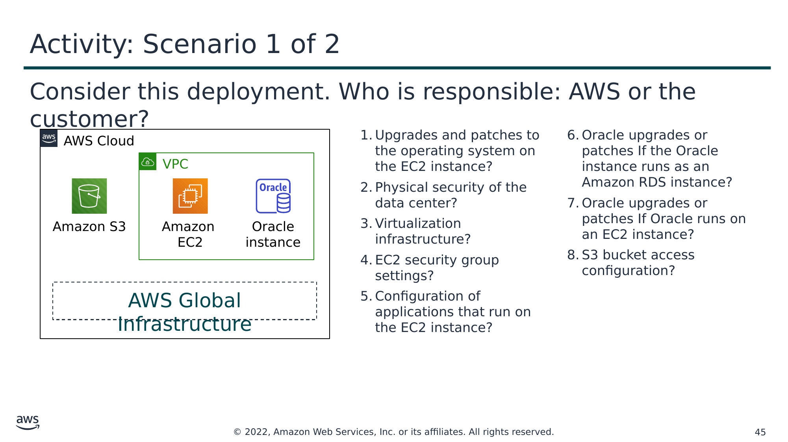

Текст зі схеми

Consider this deployment. Who is responsible: AWS or the customer?

AWS Cloud

- Upgrades and patches to the operating system on the EC2 instance?
- Physical security of the data center?
- Virtualization infrastructure?
- EC2 security group settings?
- Configuration of applications that run on the EC2 instance?

- Oracle upgrades or patches If the Oracle instance runs as an Amazon RDS instance?
- Oracle upgrades or patches If Oracle runs on an EC2 instance?
- S3 bucket access configuration?

VPC

Amazon S3

Amazon  
EC2

Oracle instance

AWS Global Infrastructure

> **Нотатки:**
>
> For accessibility: the architectural diagram shows an AWS Cloud box which contains an AWS Global Infrastructure area, as well as an Amazon S3 bucket, and finally a VPC which contains an Amazon EC2 instance and an Oracle instance. End of accessibility description.  
>
> Consider the case where a customer uses the AWS services and resources that are shown here. Who is responsible for maintaining security? AWS or the customer?  
>
> The customer uses Amazon Simple Storage Service (Amazon S3) to store data. The customer configured a virtual private cloud (VPC) with Amazon Virtual Private Cloud (Amazon VPC). The EC2 instance and the Oracle database instance that they created both run in the VPC.

---

## Слайд 46: Activity: Scenario 2 of 2

<!-- hidden slide -->

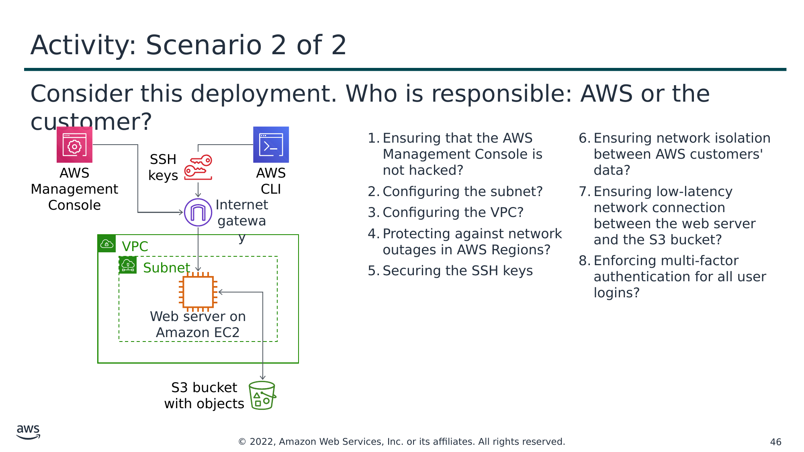

Текст зі схеми

Consider this deployment. Who is responsible: AWS or the customer?

- Ensuring that the AWS Management Console is not hacked?
- Configuring the subnet?
- Configuring the VPC?
- Protecting against network outages in AWS Regions?
- Securing the SSH keys

- Ensuring network isolation between AWS customers' data?
- Ensuring low-latency network connection between the web server and the S3 bucket?
- Enforcing multi-factor authentication for all user logins?

AWS Management Console

SSH keys

AWS CLI

Internet gateway

VPC

Subnet

Web server on Amazon EC2

S3 bucket with objects

> **Нотатки:**
>
> For accessibility: Architectural diagram showing a web server running on EC2 inside a subnet and VPC. The web server connects to an S3 bucket. The web server is accessible via an internet gateway either using the AWS Management console or using the AWS Command Line Interface which makes use of SSH keys. End of accessibility description.  
>
> Now, consider this additional case where a customer uses the AWS services and resources that are shown here. Who is responsible for maintaining security? AWS or the customer?  
>
> A customer uses Amazon S3 to store data. The customer configured a virtual private cloud (VPC) with Amazon VPC, and is running a web server on an EC2 instance in the VPC. The customer configured an internet gateway as part of the VPC so that the web server can be reached by using the AWS Management Console or the AWS Command Line Interface (AWS CLI). When the customer uses the AWS CLI, the connection requires the use of Secure Shell (SSH) keys.
