## Слайд 1: Вступ до безпеки в AWS

AWS Academy Cloud Security Foundations

> **Нотатки:**
>
> Вітаємо в модулі «Вступ до безпеки в AWS» (Introduction to Security on AWS).

---

## Слайд 2: Вступ

Вступ до безпеки в AWS

> **Нотатки:**
>
> Цей перший розділ містить вступ до модуля.

---

## Слайд 3: Цілі модуля

Наприкінці цього модуля ви повинні вміти таке:

- Визначати функції безпеки та переваги хмарних обчислень.
- Визначати принципи безпеки, на яких побудовано хмару AWS.
- Визначати, яку частину застосунку користувач відповідає за захист у хмарі.

> **Нотатки:**
>
> Наприкінці цього модуля ви повинні вміти таке:  
> Визначати функції безпеки та переваги хмарних обчислень.  
> Визначати принципи безпеки, на яких побудовано хмару AWS.  
> Визначати, яку частину застосунку користувач відповідає за захист у хмарі.

---

## Слайд 4: Огляд модуля

**Розділи**

- Безпека в хмарі AWS
- Принципи проєктування безпеки
- Модель спільної відповідальності (shared responsibility model)

**Практична вправа**

- Модель спільної відповідальності

**Перевірка знань**

> **Нотатки:**
>
> Цей модуль містить такі розділи:  
> Безпека в хмарі AWS  
> Принципи проєктування безпеки  
> Модель спільної відповідальності  
>
> Також у цьому модулі є практична вправа щодо моделі спільної відповідальності.  
>
> Наприкінці вам буде запропоновано пройти перевірку знань, яка перевірить ваше розуміння ключових концепцій, розглянутих у цьому модулі.

---

## Слайд 5: Бізнес-сценарій банку (1 із 3)

> **Нотатки:**
>
> Розгляньмо, як концепції цього модуля застосовуються до бізнес-сценарію банку.

---

## Слайд 6: Бізнес-сценарій банку (2 із 3)

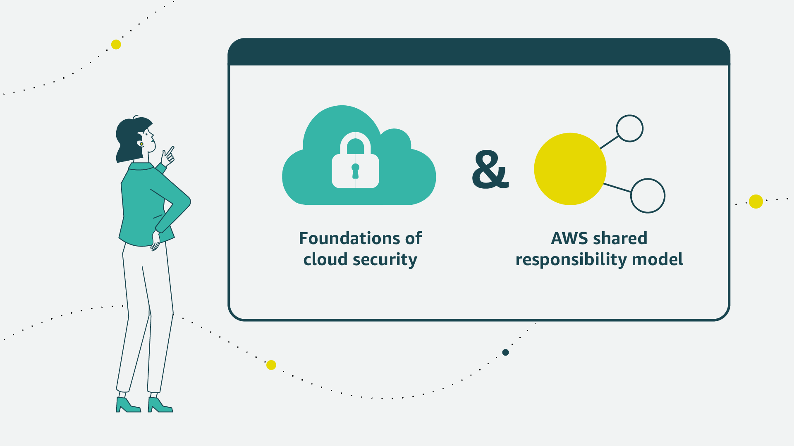

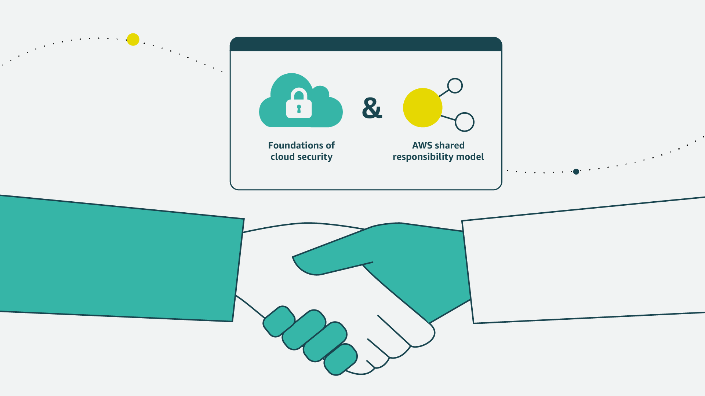

> **Нотатки:**
>
> Для своєї першої зустрічі з Джоном Марія вирішує представити інформацію про основи хмарної безпеки та модель спільної відповідальності AWS.  
>
> Це буде чудовий спосіб налагодити довіру та порозуміння з її новим керівником.

---

## Слайд 7: Бізнес-сценарій банку (3 із 3)

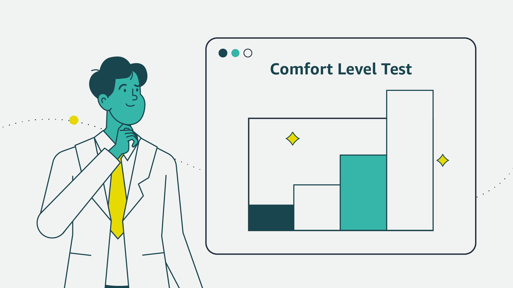

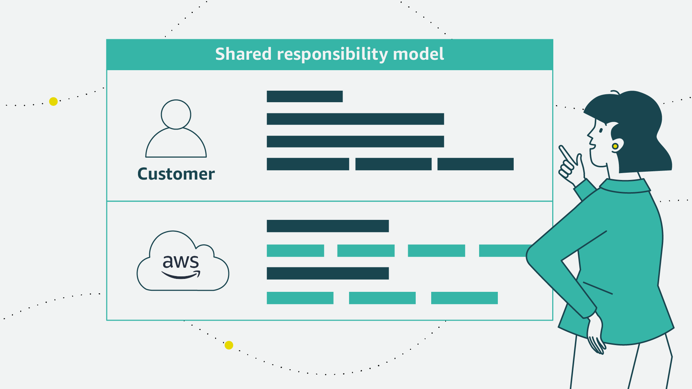

> **Нотатки:**
>
> Почавши з основ хмарної безпеки, вона зможе оцінити рівень комфорту Джона щодо цієї тематики й водночас надати необхідну інформацію для обґрунтування свого бізнес-кейсу.  
>
> Марія вирішує представити модель спільної відповідальності, щоб пояснити, як банк і AWS захищатимуть ресурси банку за допомогою кількох рівнів безпеки. Вона має намір використати цю модель, щоб показати, за які сфери відповідає банк, а за які — AWS.

---

## Слайд 8: Безпека в хмарі AWS

Вступ до безпеки в AWS

> **Нотатки:**
>
> Цей розділ присвячено безпеці в хмарі AWS.

---

## Слайд 9: Переваги хмари

Заміна фіксованих витрат змінними.

Використання значної економії за рахунок масштабу.

Припиніть вгадувати потрібні потужності.

Підвищення швидкості та гнучкості (agility).

Припиніть витрачати гроші на експлуатацію та обслуговування центрів обробки даних.

Вихід на глобальний рівень за лічені хвилини.

> **Нотатки:**
>
> Компанії можуть отримати такі переваги, перейшовши в хмару:  
>
> Заміна фіксованих витрат змінними: замість того щоб робити великі інвестиції в центри обробки даних і сервери ще до того, як ви знаєте, як їх використовуватимете, платіть лише тоді, коли споживаєте обчислювальні ресурси, і лише за той обсяг, який споживаєте.  
>
> Використання значної економії за рахунок масштабу: використовуючи хмарні обчислення, ви можете отримати нижчу змінну вартість, ніж могли б досягти самостійно. Оскільки в хмарі агрегується використання сотень тисяч клієнтів, провайдери на кшталт AWS можуть досягати вищої економії за рахунок масштабу, що виливається в нижчі ціни з оплатою за фактом використання (pay-as-you-go).  
>
> Припиніть вгадувати потрібні потужності: припиніть вгадувати потреби вашої інфраструктури в потужностях. Коли ви ухвалюєте рішення щодо потужностей до розгортання застосунку, то часто або отримуєте дорогі ресурси, що простоюють, або стикаєтеся з обмеженими потужностями. У хмарних обчисленнях цих проблем немає. Ви можете отримати стільки потужностей, скільки потрібно, — багато чи мало — і масштабувати їх вгору та вниз за потреби, маючи лише кілька хвилин на попередження.  
>
> Підвищення швидкості та гнучкості (agility): у середовищі хмарних обчислень нові ІТ-ресурси доступні за один клік. Це означає, що час, потрібний для того, щоб надати ці ресурси розробникам, скорочується з тижнів до хвилин. Результатом є різке підвищення гнучкості організації, оскільки вартість і час на експерименти та розробку суттєво зменшуються.  
>
> Припиніть витрачати гроші на експлуатацію та обслуговування центрів обробки даних: зосередьтеся на проєктах, які вирізняють ваш бізнес, а не на інфраструктурі. Хмарні обчислення дають змогу зосередитися на власних клієнтах, а не на важкій рутинній роботі з монтажу серверів у стійки, їх укладання та живлення.  
>
> Вихід на глобальний рівень за лічені хвилини: легко розгортайте свій застосунок у кількох регіонах по всьому світу за кілька кліків. Це означає, що ви можете за мінімальних витрат забезпечити клієнтам меншу затримку (latency) та кращий досвід користування.  
>
> Докладніше див. «Що таке хмарні обчислення?» (What Is Cloud Computing?) за адресою https://aws.amazon.com/what-is-cloud-computing.

---

## Слайд 10: Безпека — це знайома річ

**Конфіденційність (Confidentiality)**

**Цілісність (Integrity)**

**Доступність (Availability)**

- Обмеження доступу та розкриття інформації авторизованими користувачами
- Запобігання доступу неавторизованих осіб

- Підтримка узгодженості даних протягом їхнього життєвого циклу
- Збереження даних у стані спокою (data at rest) та даних під час передавання (data in transit)

- Наявність доступу до інформаційних ресурсів, коли це потрібно

> **Нотатки:**
>
> Безпека — це практика захисту вашої інтелектуальної власності від неавторизованого доступу, використання чи зміни. Тріаду конфіденційності, цілісності та доступності, або CIA (confidentiality, integrity, availability), спочатку було розроблено, щоб підкреслити важливі аспекти інформаційної безпеки в організації.  
>
> Конфіденційність означає обмеження доступу до інформації та її розкриття авторизованими користувачами й запобігання доступу неавторизованих осіб.  
>
> Цілісність передбачає підтримку узгодженості, точності та достовірності даних протягом усього їхнього життєвого циклу. Сюди належить «цілісність походження» (origin integrity, або source integrity) — гарантія того, що відправник інформації є тим, ким має бути. Цілісність може означати забезпечення того, що відповідна особа чи сутність ввела правильну інформацію. Однак цілісність інформаційної системи може означати лише збереження даних без пошкоджень щодо всього, що було передано до системи чи введено в неї.  
>
> Доступність означає готовність інформаційних ресурсів. Інформаційна система, яка недоступна, коли вона вам потрібна, майже така сама марна, як і відсутність інформаційної системи. Сучасні ІТ-середовища створюють виклики для тріади CIA через обсяг інформації, яку потрібно захищати, множинність джерел, з яких надходять дані, та різноманітність форматів.

---

## Слайд 11: Безпека хмари AWS: цілі

- Керованість (Controllability)
- Можливість аудиту (Auditability)
- Прозорість (Visibility)
- Гнучкість (Agility)
- Автоматизація (Automation)

> **Нотатки:**
>
> Безпека в хмарі подібна до безпеки в локальних (on-premises) центрах обробки даних, тільки без витрат і складнощів, пов’язаних із захистом приміщень та обладнання. Оскільки в хмарі немає фізичних серверів чи пристроїв зберігання, ви використовуєте програмні засоби безпеки для моніторингу та захисту потоку інформації до ваших ресурсів AWS і з них.  
>
> В AWS ми прагнемо зробити безпеку такою ж знайомою, як те, що ви робите сьогодні. Ви можете перенести в хмару ті самі моделі безпеки, які використовуєте у своєму середовищі нині. Це включає забезпечення прозорості (visibility), можливості аудиту (auditability) та керованості (controllability) щодо ваших ресурсів у хмарі. Крім того, AWS пропонує кілька сервісів та інструментів, які надають гнучкість (agility) й автоматизацію, потрібні для адаптації до масштабування на рівні хмари, щоб вивести безпеку на новий рівень.

---

## Слайд 12: Безпека хмари AWS: керованість (Controllability)

- Чи можу я ефективно керувати користувачами?
- Як я можу надати тимчасові облікові дані?
- Чи можу я використовувати власні ключі?

**AWS Identity and Access Management (IAM)**

> **Нотатки:**
>
> AWS надає методи та інструменти для керування контролем доступу для користувачів, груп і ролей; надання тимчасових облікових даних безпеки; і керування ключами шифрування.  
>
> Сервіс AWS Identity and Access Management (IAM) допомагає безпечно контролювати доступ ваших користувачів до ресурсів AWS. Використовуйте IAM, щоб контролювати, хто може використовувати ваші ресурси AWS (автентифікація), які ресурси вони можуть використовувати та яким чином (авторизація). Ви можете визначати детальні дозволи для сутностей, як-от користувачі, групи чи ролі. Це дає змогу сутностям адмініструвати ресурси у вашому акаунті AWS і використовувати їх, не передаючи пароль чи ключ доступу.  
>
> Ви можете надавати різні дозволи різним людям для різних ресурсів. Наприклад, деяким користувачам можна дозволити повний доступ до Amazon Elastic Compute Cloud (Amazon EC2), Amazon Simple Storage Service (Amazon S3) та інших сервісів AWS. Для інших користувачів можна дозволити доступ лише на читання до окремих бакетів S3, дозвіл адмініструвати лише певні екземпляри EC2 або доступ до інформації про оплату, але нічого більше. За допомогою IAM можна також дозволити користувачам, які вже мають паролі в іншому місці, отримувати доступ до вашого акаунта AWS. Наприклад, користувачі з паролями у вашій корпоративній мережі або з ідентифікацією від інтернет-постачальника ідентифікації (identity provider) можуть отримати доступ до вашого акаунта AWS.  
>
> Ви можете використовувати AWS Security Token Service (AWS STS), щоб створювати й надавати довіреним користувачам тимчасові облікові дані безпеки, які можуть контролювати доступ до ваших ресурсів AWS. Тимчасові облікові дані безпеки працюють майже так само, як довгострокові облікові дані з ключем доступу, які можуть використовувати ваші користувачі IAM.  
>
> За допомогою AWS CloudHSM ви можете захищати свої ключі шифрування в апаратних модулях безпеки (hardware security modules, HSM), розроблених і сертифікованих за державними стандартами безпечного керування ключами. Ви можете безпечно генерувати, зберігати й адмініструвати криптографічні ключі, що використовуються для шифрування даних, так, щоб лише ви мали доступ до ключів. CloudHSM допомагає виконувати суворі вимоги до керування ключами в хмарі AWS без шкоди для продуктивності застосунків.

---

## Слайд 13: Безпека хмари AWS: можливість аудиту (Auditability)

- Хто має доступ до цього ресурсу?
- Хто виконав яку дію?
- Коли й звідки було виконано дію?
- Де докази?

**AWS CloudTrail**

> **Нотатки:**
>
> Важливо тестувати та перевіряти ваші засоби захисту, щоб переконатися, що вони відповідають вимогам відповідності та працюють належним чином. Організації зазвичай покладаються на регулярні внутрішні або зовнішні аудити своїх середовищ, щоб забезпечити відповідність політикам і нормативним вимогам.  
>
> Сервіси AWS, як-от AWS CloudTrail, можуть допомогти вам відповісти на такі запитання: які дії виконав певний користувач за певний період? Які користувачі виконували дії щодо певного ресурсу за певний період? Яка вихідна IP-адреса певної активності?

---

## Слайд 14: Безпека хмари AWS: прозорість (Visibility)

- Що є в моєму середовищі?
- Який вплив мала певна дія?
- Що змінилося?
- Де докази?

**AWS Config**

> **Нотатки:**
>
> Перший крок до захисту ваших активів — знати, що це за активи. Вам не повинно доводитися вгадувати, з чого складається ваш ІТ-інвентар, хто отримує доступ до ваших ресурсів і які дії хтось виконав над вашими ресурсами.  
>
> AWS пропонує інструменти для відстеження й моніторингу ваших ресурсів AWS, щоб ви миттєво бачили свій інвентар, а також активність користувачів і застосунків. Наприклад, за допомогою AWS Config можна виявляти наявні ресурси AWS, експортувати повний інвентар ресурсів AWS з усіма деталями конфігурації та визначати, як ресурс був налаштований у будь-який момент часу. Ці можливості можуть допомогти з аудитом відповідності, аналізом безпеки, відстеженням змін ресурсів і усуненням несправностей.

---

## Слайд 15: Безпека хмари AWS: гнучкість та автоматизація (Agility and automation)

- Як забезпечити високу доступність?
- Чи можу я автоматично розгортати застосунки з налаштуваннями безпеки та відповідності вимогам?
- Як я можу застосовувати перевірки безпеки відтворюваним способом?

**AWS CloudFormation**

> **Нотатки:**
>
> Підвищення гнучкості та можливість виконувати дії швидше, у більшому масштабі й за нижчою вартістю не скасовує усталених принципів інформаційної безпеки. Автоматичне масштабування для забезпечення високої доступності під час атаки на безпеку — один зі способів, яким AWS забезпечує гнучкість для задоволення потреб. AWS проєктує центри обробки даних із надлишковою пропускною здатністю, щоб у разі серйозного збою було достатньо потужностей для балансування навантаження трафіку та його маршрутизації на решту майданчиків, щоб мінімізувати вплив на наших клієнтів. Клієнти також використовують цю стратегію з кількома регіонами та кількома зонами доступності (Availability Zones), щоб створювати високостійкі застосунки за надзвичайно низькою вартістю, легко реплікувати й резервно копіювати дані та послідовно розгортати глобальні засоби безпеки в усьому своєму бізнесі.  
>
> Інструменти AWS створено спеціально й адаптовано до вашого унікального середовища, масштабу та глобальних вимог. Створюючи засоби безпеки з нуля, AWS може автоматизувати багато рутинних завдань, на які зазвичай витрачають час експерти з безпеки. Це означає, що експерти з безпеки AWS можуть більше зосередитися на заходах, які підвищують безпеку вашого середовища в хмарі AWS. Клієнти також можуть автоматизувати функції інженерії та операцій безпеки за допомогою комплексного набору API та інструментів.  
>
> Коли ви автоматизуєте роботу за допомогою сервісів AWS, як-от AWS CloudFormation, замість того щоб, наприклад, вручну розгортати середовище для усунення несправностей під час криміналістичного розслідування (forensics), ви можете доручити AWS розгорнути середовище безпечним і відтворюваним способом.

---

## Слайд 16: Ключові висновки: безпека в хмарі AWS

- Тріаду конфіденційності, цілісності та доступності, або CIA, спочатку було розроблено, щоб підкреслити важливі аспекти інформаційної безпеки в організації.
- AWS пропонує кілька інструментів і функцій, які допомагають досягати цілей безпеки щодо керованості, можливості аудиту, прозорості, гнучкості та автоматизації.

> **Нотатки:**
>
> Основні висновки цього розділу модуля:  
> Тріаду конфіденційності, цілісності та доступності, або CIA, спочатку було розроблено, щоб підкреслити важливі аспекти інформаційної безпеки в організації.  
> AWS пропонує кілька інструментів і функцій, які допомагають досягати цілей безпеки щодо керованості, можливості аудиту, прозорості, гнучкості та автоматизації.

---

## Слайд 17: Принципи проєктування безпеки

Вступ до безпеки в AWS

> **Нотатки:**
>
> Цей розділ описує принципи проєктування безпеки.

---

## Слайд 18: 1. Застосовуйте принцип найменших привілеїв (least privilege)

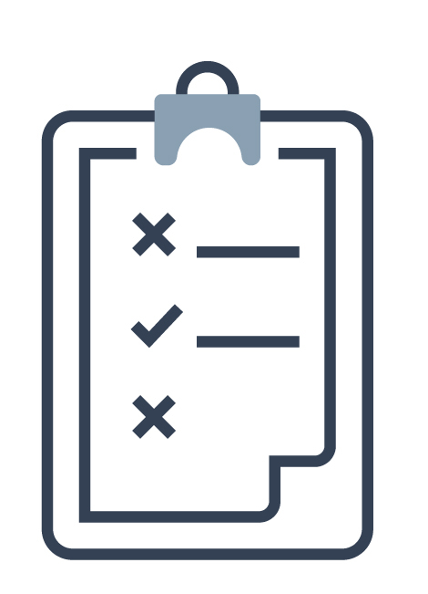

- Надавайте доступ за потреби
- Забезпечуйте розподіл обов’язків (separation of duties)
- Уникайте довгострокових облікових даних

> **Нотатки:**
>
> Цей розділ описує сім принципів проєктування з опори безпеки (security pillar) AWS Well-Architected Framework. Дотримання цих принципів може допомогти посилити безпеку ваших робочих навантажень (workloads) і спрямовувати ваші розмови щодо безпеки та відповідності вимогам.  
> Організаційну культуру безпеки слід будувати на принципі найменших привілеїв. Надавайте доступ до даних та інших ресурсів лише тим людям, яким цей доступ справді потрібен. Можна почати із заборони доступу до всього й надавати доступ за потреби залежно від посадової ролі.  
>
> Найкращою практикою безпеки є забезпечення розподілу обов’язків із відповідною авторизацією для кожної взаємодії з вашими ресурсами AWS. Визначте очікування щодо того, як повноваження делегуватимуться вниз через інженерів-програмістів, операційний персонал та інші посадові функції, залучені до впровадження хмари.  
>
> Зменшивши або навіть припинивши залежність від довгострокових облікових даних, ви можете зменшити поверхню атаки. Ви можете використовувати тимчасові облікові дані та вимагати від ідентичностей динамічно їх отримувати. Для ідентичностей персоналу використовуйте AWS Single Sign-On або федерацію з IAM для доступу до акаунтів AWS. Для ідентичностей машин, як-от екземпляри EC2 або функції AWS Lambda, вимагайте використання ролей IAM замість користувачів IAM з довгостроковими ключами доступу.  
>
> Керування ідентифікацією та доступом — ключові частини програми інформаційної безпеки, що гарантують, що лише авторизовані й автентифіковані користувачі та компоненти можуть отримувати доступ до ваших ресурсів, і лише так, як ви цього хочете. В AWS основним сервісом для керування дозволами є IAM. Сервіс надає можливість контролювати доступ користувачів і програмний доступ до сервісів і ресурсів AWS.  
>
> За допомогою IAM можна визначати принципали (principals; тобто акаунти, користувачів, ролі та сервіси, які можуть виконувати дії у вашому акаунті) і створювати детальні політики, узгоджені з цими принципалами. Також можна вимагати суворих практик щодо паролів, наприклад встановлювати рівень складності, уникати повторного використання та вимагати багатофакторну автентифікацію (MFA). Можна використовувати федерацію з наявною службою каталогів. Для робочих навантажень, де системам потрібен доступ до AWS, IAM може забезпечити безпечний доступ через ролі, профілі екземплярів (instance profiles), федерацію ідентичностей і тимчасові облікові дані.

---

## Слайд 19: 2. Забезпечте відстежуваність (traceability)

- Відстежуйте дії та зміни
- Використовуйте журнали та метрики
- Проводьте аудит своїх хмарних ресурсів

> **Нотатки:**
>
> З AWS ви можете відстежувати дії та зміни у вашому середовищі, надсилати сповіщення про них і проводити їх аудит у реальному часі. AWS надає власне журналювання, а також сервіси, які можна використовувати для підвищення прозорості подій у вашому середовищі майже в реальному часі. Інтегруйте ці інструменти з наявними рішеннями для журналювання та моніторингу. Знайте, які робочі навантаження розгорнуто й які працюють, щоб ви могли проводити аудит і гарантувати, що середовище працює на очікуваних рівнях управління безпекою та відповідає необхідним стандартам безпеки.  
>
> В AWS можна впроваджувати детективні засоби контролю (detective controls) шляхом обробки журналів і подій та моніторингу, що забезпечує аудит, автоматизований аналіз і сигналізацію. Журнали CloudTrail, виклики API AWS та Amazon CloudWatch забезпечують моніторинг метрик із сигналізацією, а AWS Config надає історію конфігурації. Amazon GuardDuty — це керований сервіс виявлення загроз, який безперервно відстежує шкідливу або неавторизовану поведінку, допомагаючи захищати ваші акаунти й робочі навантаження AWS. Також доступні журнали на рівні сервісів; наприклад, можна використовувати Amazon S3 для журналювання запитів на доступ.

---

## Слайд 20: 3. Захищайте всі рівні

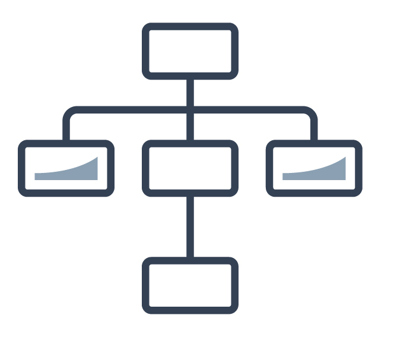

- Використовуйте підхід глибокоешелонованого захисту (defense in depth)
- Використовуйте різні сервіси AWS

> **Нотатки:**
>
> Замість того щоб зосереджуватися лише на захисті одного зовнішнього рівня, застосовуйте підхід глибокоешелонованого захисту з іншими засобами контролю безпеки. Це означає застосовувати безпеку на всіх рівнях, як-от мережа, застосунок і сховище даних. Наприклад, можна вимагати від користувачів сильної автентифікації в застосунку. Крім того, переконайтеся, що користувачі надходять із довіреного мережевого шляху, і вимагайте доступу до ключів розшифрування для обробки зашифрованих даних. Однією з переваг використання AWS є те, що наші сервіси також створено для інтеграції. Ви можете використовувати кілька сервісів AWS разом, щоб забезпечити найбезпечніше середовище для ваших даних і ресурсів.  
>
> Клієнти AWS можуть налаштовувати, або зміцнювати (harden), конфігурацію екземпляра EC2, контейнера Amazon Elastic Container Service (Amazon ECS) чи екземпляра AWS Elastic Beanstalk і зберігати цю конфігурацію в незмінному образі Amazon Machine Image (AMI). Тоді всі нові віртуальні сервери (екземпляри), запущені з цього AMI, отримують зміцнену конфігурацію незалежно від того, чи їх запущено вручну, чи за допомогою автоматичного масштабування.

---

## Слайд 21: 4. Автоматизуйте безпеку

- Автоматизуйте рутинні завдання безпеки за допомогою API
- Впроваджуйте інфраструктуру як код (infrastructure as code)

> **Нотатки:**
>
> AWS розробляє спеціалізовані інструменти безпеки, які допомагають автоматизувати багато рутинних завдань, на які зазвичай витрачають час експерти з безпеки. Це означає, що експерти з безпеки можуть більше зосередитися на заходах, які підвищують безпеку вашого середовища в хмарі AWS.  
>
> Ви можете автоматизувати функції інженерії та операцій безпеки за допомогою комплексного набору API та інструментів. Можна повністю автоматизувати керування ідентифікацією, мережеву безпеку, захист даних і можливості моніторингу та постачати їх за допомогою популярних методів розробки програмного забезпечення, які у вас уже впроваджені. Замість того щоб люди стежили за вашим станом безпеки й реагували на подію, з автоматизацією ваша система може сама відстежувати, перевіряти й ініціювати реагування.  
>
> У хмарі AWS ви можете перетворити свою інфраструктуру на код. Ця можливість дає змогу автоматизувати створення довірених середовищ для проведення глибших розслідувань і криміналістичного аналізу (forensics). Ви можете проводити симуляції реагування на інциденти та використовувати інструменти з автоматизацією, щоб збільшити швидкість виявлення, розслідування та відновлення. Автоматизуючи розгортання та обслуговування, ви можете прибрати операторський доступ, щоб зменшити поверхню атаки.

---

## Слайд 22: 5. Захищайте дані під час передавання (in transit) та в стані спокою (at rest)

- Використовуйте шифрування та засоби контролю доступу
- Класифікуйте свої дані за допомогою тегів
- Використовуйте VPN та TLS-з’єднання

> **Нотатки:**
>
> Захист даних — критично важлива частина створення та експлуатації інформаційних систем. AWS надає сервіси та функції, які допомагають захищати ваші дані в стані спокою та під час передавання. Засоби захисту включають детальний контроль доступу до об’єктів, створення та контроль ключів шифрування, що використовуються для шифрування ваших даних, вибір відповідних методів шифрування, перевірку цілісності та належне зберігання даних. Щоб допомогти керувати захистом, впровадьте схему тегування (tagging schema) для класифікації ваших даних за рівнями чутливості. Ще одна найкраща практика безпеки — створення механізмів захисту даних під час передавання, наприклад використання з’єднань віртуальної приватної мережі (VPN) і Transport Layer Security (TLS).  
>
> AWS пропонує кілька способів шифрування даних у стані спокою та під час передавання. Ми вбудовуємо функції у наші сервіси, щоб полегшити шифрування ваших даних. Наприклад, ми впровадили серверне шифрування (server-side encryption, SSE) для Amazon S3, щоб вам було легше зберігати дані в зашифрованому вигляді. Ви також можете доручити Elastic Load Balancing (ELB) обробляти весь процес шифрування та розшифрування HTTPS (відомий як SSL termination).

---

## Слайд 23: 6. Готуйтеся до подій безпеки

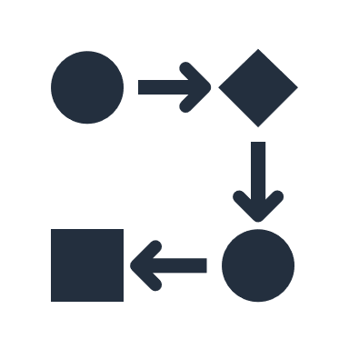

- Зменшуйте вплив інцидентів безпеки
- Створюйте процеси для ізоляції інцидентів і відновлення роботи

> **Нотатки:**
>
> Навіть за наявності зрілих превентивних і детективних засобів контролю слід запровадити процеси реагування на потенційний вплив інцидентів безпеки та його пом’якшення. Архітектура вашого робочого навантаження суттєво впливає на вашу здатність ефективно працювати під час інциденту, ізолювати чи локалізувати системи та відновлювати роботу до відомого справного стану. Підготуйте інструменти та доступ заздалегідь, до інциденту безпеки. Потім регулярно практикуйте реагування на інциденти за допомогою навчань (game days). Це допоможе переконатися, що ваша архітектура дає змогу своєчасно проводити розслідування та відновлення. Інший модуль цього курсу описуватиме різні підходи до реагування на інциденти.  
>
> В AWS ефективному реагуванню на інциденти сприяють такі практики:  
> Доступне детальне журналювання. Журнали містять важливу інформацію, як-от доступ до файлів і їхні зміни.  
> Події можуть автоматично оброблятися й запускати інструменти, що автоматизують реагування за допомогою API AWS.  
> Ви можете заздалегідь розгорнути інструментарій і «чисту кімнату» (clean room) за допомогою AWS CloudFormation. Це дає змогу проводити криміналістичний аналіз (forensics) у безпечному ізольованому середовищі.

---

## Слайд 24: 7. Мінімізуйте поверхню атаки (attack surface)

- Будьте готові масштабуватися та поглинути атаку
- Захищайте ресурси, доступні ззовні

> **Нотатки:**
>
> Зазвичай кібератака припиняється з двох причин: або зловмисники вичерпують свої сили й здаються, або досягають своєї мети. Зменшіть ризик ненавмисного доступу, зміцнивши (harden) операційні системи та мінімізувавши кількість компонентів, бібліотек і зовнішніх сервісів, що використовуються. Почніть зі скорочення невикористовуваних компонентів, таких як пакети операційної системи та застосунки. Налаштуйте групи безпеки (security groups) і списки контролю доступу до мережі (network ACLs) в Amazon Virtual Private Cloud (Amazon VPC), щоб допомогти зменшити поверхню атаки ваших застосунків.  
>
> Деякі сервіси AWS, як-от AWS Auto Scaling і Amazon CloudFront, допомагають застосункам масштабуватися, щоб поглинати поширені атаки на рівні інфраструктури, такі як атаки з відбиттям UDP (UDP reflection attacks) і SYN-флуд (SYN floods). Атака з відбиттям UDP відбувається, коли зловмисник запитує інформацію в цільового комп’ютера, використовуючи підроблену адресу джерела. SYN-флуд — це тип розподіленої атаки «відмова в обслуговуванні» (DDoS), яка має на меті зробити сервер недоступним для легітимного трафіку, вичерпуючи всі наявні ресурси сервера. За допомогою таких методів, як автоматичне масштабування, ви можете поглинати більші обсяги атак на рівні застосунку.  
>
> Докладніше див. технічний документ (whitepaper) Security Pillar: AWS Well-Architected Framework за адресою https://docs.aws.amazon.com/wellarchitected/latest/security-pillar/welcome.html.

---

## Слайд 25: Ключові висновки: принципи проєктування безпеки

Принципи проєктування безпеки в хмарі такі:

- Застосовуйте принцип найменших привілеїв (least privilege).
- Забезпечте відстежуваність (traceability).
- Захищайте всі рівні.
- Автоматизуйте безпеку.
- Захищайте дані під час передавання та в стані спокою.
- Готуйтеся до подій безпеки.
- Мінімізуйте поверхню атаки.

> **Нотатки:**
>
> Основні висновки цього розділу модуля — принципи проєктування безпеки в хмарі:  
> Застосовуйте принцип найменших привілеїв.  
> Забезпечте відстежуваність.  
> Захищайте всі рівні.  
> Автоматизуйте безпеку.  
> Захищайте дані під час передавання та в стані спокою.  
> Готуйтеся до подій безпеки.  
> Мінімізуйте поверхню атаки.

---

## Слайд 26: Модель спільної відповідальності (shared responsibility model)

Вступ до безпеки в AWS

> **Нотатки:**
>
> Цей розділ присвячено моделі спільної відповідальності.

---

## Слайд 27: Модель спільної відповідальності AWS

> **Нотатки:**
>
> Для доступності (for accessibility): модель спільної відповідальності, що перелічує обов’язки клієнта та AWS. Клієнт відповідає за безпеку в хмарі (security in the cloud). Це включає дані клієнта. Платформу, застосунки, керування ідентифікацією та доступом. Конфігурацію операційної системи, мережі та брандмауера. Шифрування даних на стороні клієнта та цілісність даних, автентифікацію. Серверне шифрування файлової системи та даних. Захист мережевого трафіку, зокрема шифрування, цілісність та ідентичність. AWS відповідає за безпеку самої хмари (security of the cloud). Це включає базові сервіси AWS для обчислень, сховищ, баз даних і мереж, а також глобальну інфраструктуру AWS (AWS Global Infrastructure), зокрема регіони, зони доступності та периферійні локації (edge locations). Кінець опису для доступності.  
>
> Безпека та відповідність вимогам — це спільна відповідальність AWS і клієнтів. AWS експлуатує, обслуговує та контролює безпеку хмари. Ця відповідальність охоплює захист компонентів — від операційної системи хоста та рівня віртуалізації до фізичної безпеки приміщень, у яких працює сервіс. AWS відповідає за захист глобальної інфраструктури, на якій працюють усі сервіси, що пропонуються в хмарі AWS. Ця інфраструктура складається з апаратного забезпечення, програмного забезпечення, мереж і приміщень, на яких працюють хмарні сервіси AWS.  
>
> Ви берете на себе відповідальність і керування в хмарі. Кроки безпеки, які потрібно виконати, залежать від сервісів, що ви використовуєте, і складності вашої системи. Обов’язки клієнта включають вибір і захист операційних систем, що працюють на екземплярах EC2, а також захист застосунків, запущених на ресурсах AWS. Клієнти також повинні обирати та обробляти конфігурації груп безпеки, конфігурації брандмауерів, мережеві конфігурації й безпечне керування акаунтами. Клієнти також відповідають за керування своїми даними, зокрема за варіанти шифрування.  
>
> Підсумовуючи: AWS захищає апаратне забезпечення, програмне забезпечення, приміщення та мережі, на яких працюють усі продукти й сервіси AWS. Ви відповідаєте за те, що впроваджуєте за допомогою продуктів і сервісів AWS, і за застосунки, які підключаєте до AWS. Кроки безпеки, які потрібно виконати, залежать від сервісів, що ви використовуєте, і складності вашої системи.

---

## Слайд 28: Приклад спільної відповідальності

Акаунти та облікові дані (Accounts and credentials)

Приклади відповідальності клієнта:

- Конфігурація гостьової ОС (guest OS)
- Безпека на рівні застосунку
- Конфігурація груп безпеки

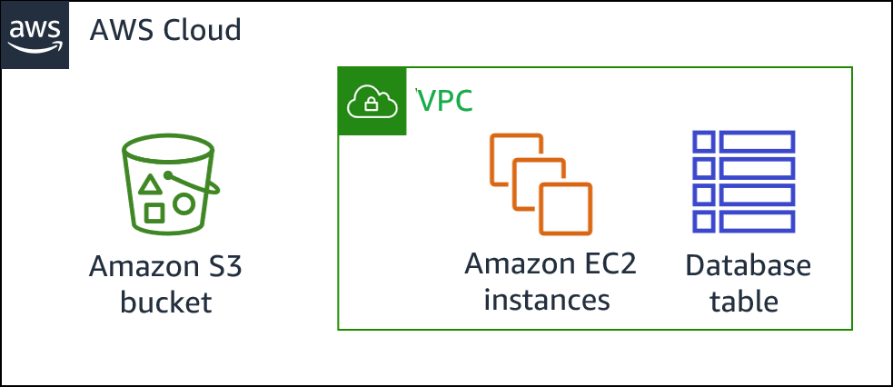

Клієнт (Customer)

AWS

AWS Global Infrastructure

> **Нотатки:**
>
> Розгляньмо приклад, у якому ваша компанія використовує Amazon S3 для зберігання даних. Ваше середовище AWS також містить екземпляри EC2 і екземпляр Amazon Relational Database Service (Amazon RDS). Ці ресурси працюють із базою даних MySQL, розгорнутою всередині віртуальної приватної хмари (VPC). Один екземпляр EC2 розміщує вебсервер, а вебзастосунок, що на ньому працює, використовує базу даних для зберігання даних застосунку.  
>
> У цьому сценарії AWS відповідає за захист глобальної інфраструктури, що містить фізичні сервери, на яких розміщено віртуальні машини, та апаратне забезпечення сховищ. Ці віртуальні машини та апаратне забезпечення сховищ містять ваш бакет S3, екземпляри EC2 і екземпляр бази даних. AWS відповідає за безпеку фізичної мережевої інфраструктури, яка забезпечує доступність цих компонентів. AWS також відповідає за безпеку рівня гіпервізора (hypervisor), що розміщує екземпляри EC2. (Гіпервізор — це хостова ОС, яка запускає екземпляри EC2, що є віртуальними машинами з гостьовими операційними системами.)  
>
> Ви (клієнт) відповідаєте за керування гостьовою ОС, що працює на екземплярах EC2 (зокрема за оновлення Microsoft Windows чи Linux та виправлення безпеки). Ви також відповідаєте за керування будь-яким прикладним програмним забезпеченням або утилітами, які ви встановлюєте. Крім того, ви відповідаєте за конфігурацію груп безпеки, що контролюють мережевий доступ до кожного екземпляра EC2 та до екземпляра бази даних RDS. Ви також відповідаєте за налаштування безпеки бакета S3 та об’єктів, які ви в ньому зберігаєте. Наприклад, ви можете використовувати одну чи кілька функцій безпеки, які надає AWS, як-от політики бакета (bucket policies), шифрування даних і S3 Block Public Access.  
>
> Докладніше див. «Модель спільної відповідальності» (Shared Responsibility Model) за адресою https://aws.amazon.com/compliance/shared-responsibility-model.

---

## Слайд 29: Безпека в хмарі

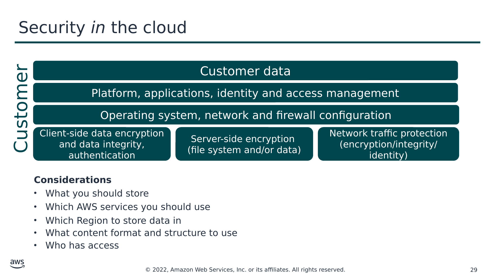

Текст зі схеми

Customer data (Дані клієнта)

Platform, applications, identity and access management (Платформа, застосунки, керування ідентифікацією та доступом)

Customer (Клієнт)

Operating system, network and firewall configuration (Конфігурація операційної системи, мережі та брандмауера)

Client-side data encryption and data integrity, authentication (Шифрування даних на стороні клієнта, цілісність даних, автентифікація)

Server-side encryption

(file system and/or data) (Серверне шифрування: файлова система та/або дані)

Network traffic protection

(encryption/integrity/identity) (Захист мережевого трафіку: шифрування/цілісність/ідентичність)

**Considerations (Міркування)**

- Що ви повинні зберігати
- Які сервіси AWS слід використовувати
- У якому регіоні зберігати дані
- Який формат і структуру контенту використовувати
- Хто має доступ

> **Нотатки:**
>
> Поки AWS захищає та підтримує хмарну інфраструктуру, ви відповідаєте за захист усього, що ви розміщуєте В хмарі.  
>
> Перш ніж проєктувати архітектуру будь-якого робочого навантаження, потрібно запровадити практики, що впливають на безпеку. Ви захочете контролювати, хто що може робити. Крім того, вам потрібно вміти виявляти інциденти безпеки, захищати свої системи та сервіси й зберігати конфіденційність і цілісність даних за допомогою захисту даних. У вас має бути чітко визначений і відпрацьований процес реагування на інциденти безпеки. Ці інструменти та методи важливі, оскільки підтримують такі цілі, як запобігання фінансовим втратам чи виконання регуляторних зобов’язань.  
>
> Оскільки AWS фізично захищає інфраструктуру, що підтримує наші хмарні сервіси, ви як клієнт AWS можете зосередитися на використанні сервісів для досягнення своїх цілей. Хмара AWS також забезпечує ширший доступ до даних безпеки та автоматизований підхід до реагування на події безпеки.  
>
> Використовуючи сервіси AWS, ви зберігаєте повний контроль над своїм контентом і відповідаєте за керування критичними вимогами безпеки, зокрема такими:  
> Контент, який ви обираєте зберігати в AWS  
> Сервіси AWS, що використовуються з цим контентом  
> Країна, у якій зберігається цей контент  
> Формат і структура цього контенту та те, чи його маскують, анонімізують або шифрують  
> Хто має доступ до цього контенту й як ці права доступу надаються, керуються та скасовуються  
>
> Ви зберігаєте контроль над тим, які засоби безпеки впроваджувати для захисту власних даних, платформи, застосунків, керування ідентифікацією та доступом і операційної системи. Це означає, що модель спільної відповідальності змінюється залежно від сервісів AWS, які ви використовуєте.

---

## Слайд 30: Практична вправа: модель спільної відповідальності

> **Нотатки:**
>
> Зараз ви виконаєте вправу щодо моделі спільної відповідальності та обов’язків AWS і клієнта.

---

## Слайд 31: Практична вправа: сценарій 1 із 2

Розгляньте це розгортання. Хто відповідає: AWS чи клієнт?

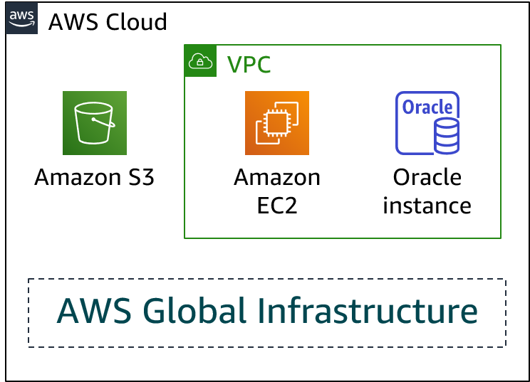

- Оновлення та виправлення операційної системи на екземплярі EC2?
- Фізична безпека центру обробки даних?
- Інфраструктура віртуалізації?
- Налаштування групи безпеки EC2?
- Конфігурація застосунків, що працюють на екземплярі EC2?

- Оновлення чи виправлення Oracle, якщо екземпляр Oracle працює як екземпляр Amazon RDS?
- Оновлення чи виправлення Oracle, якщо Oracle працює на екземплярі EC2?
- Конфігурація доступу до бакета S3?

> **Нотатки:**
>
> Для доступності: архітектурна схема показує блок AWS Cloud, який містить область AWS Global Infrastructure, а також бакет Amazon S3 і, нарешті, VPC, що містить екземпляр Amazon EC2 та екземпляр Oracle. Кінець опису для доступності.  
>
> Розгляньте випадок, коли клієнт використовує сервіси та ресурси AWS, показані тут. Клієнт використовує Amazon S3 для зберігання даних. Клієнт керує VPC, що містить екземпляр EC2 та екземпляр бази даних Amazon RDS for Oracle.  
>
> Хто відповідає за підтримку безпеки кожного компонента? AWS чи клієнт?

---

## Слайд 32: Практична вправа: сценарій 1 із 2 — відповіді

Розгляньте це розгортання. Хто відповідає: AWS чи клієнт?

- Оновлення та виправлення операційної системи на екземплярі EC2?

**Відповідь: клієнт**

- Фізична безпека центру обробки даних?

**Відповідь: AWS**

- Інфраструктура віртуалізації?

**Відповідь: AWS**

- Налаштування групи безпеки EC2?

**Відповідь: клієнт**

- Конфігурація застосунків, що працюють на екземплярі EC2?

**Відповідь: клієнт**

- Оновлення чи виправлення Oracle, якщо екземпляр Oracle працює як екземпляр Amazon RDS?

**Відповідь: AWS**

- Оновлення чи виправлення Oracle, якщо Oracle працює на екземплярі EC2?

**Відповідь: клієнт**

- Конфігурація доступу до бакета S3?

**Відповідь: клієнт**

> **Нотатки:**
>
> Для доступності: архітектурна схема показує блок AWS Cloud, який містить область AWS Global Infrastructure, а також бакет Amazon S3 і, нарешті, VPC, що містить екземпляр Amazon EC2 та екземпляр Oracle. Кінець опису для доступності.  
>
> Клієнт контролює безпеку в хмарі (security in the cloud). У наведеному вище сценарії це включає оновлення та виправлення гостьової операційної системи й пов’язаного прикладного програмного забезпечення на екземплярі EC2, а також конфігурацію брандмауера групи безпеки, наданого AWS. Оскільки відповідальність клієнта визначається обраними хмарними сервісами AWS, оновлення чи виправлення Oracle будуть відповідальністю клієнта, якщо він запускає базу даних Oracle на екземплярі EC2. Клієнт також відповідає за використання інструментів IAM для застосування правильних дозволів на рівні платформи, наприклад для бакетів S3, а також на рівні користувача чи групи IAM.  
>
> AWS керує безпекою хмари (security of the cloud), гарантуючи, що інфраструктура AWS відповідає глобальним і регіональним регуляторним вимогам та найкращим практикам. AWS експлуатує, обслуговує та контролює компоненти — від операційної системи хоста та рівня віртуалізації до фізичної безпеки приміщень, у яких працює сервіс.  
>
> У цьому прикладі AWS відповідає за фізичну безпеку центру обробки даних та інфраструктуру віртуалізації. Якщо екземпляр Oracle працює як екземпляр Amazon RDS, то AWS відповідає за оновлення та виправлення Oracle. Amazon RDS автоматизує типові адміністративні завдання, як-от створення резервних копій і встановлення виправлень програмного забезпечення, на якому працює ваша база даних.

---

## Слайд 33: Практична вправа: сценарій 2 із 2

Розгляньте це розгортання. Хто відповідає: AWS чи клієнт?

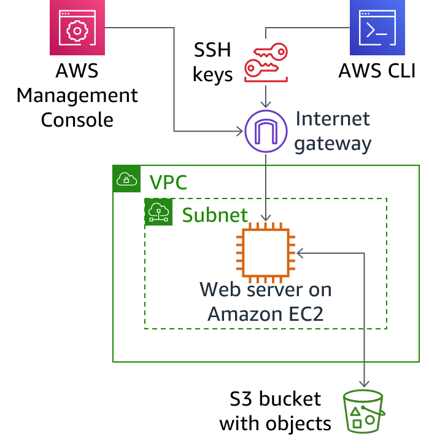

- Гарантування того, що AWS Management Console не зламано?
- Конфігурація підмережі (subnet)?
- Конфігурація VPC?
- Захист від мережевих збоїв у регіонах AWS?
- Захист ключів SSH?

- Забезпечення мережевої ізоляції даних клієнтів AWS?
- Забезпечення мережевого з’єднання з низькою затримкою між вебсервером і бакетом S3?
- Примусове використання багатофакторної автентифікації для всіх входів користувачів?

> **Нотатки:**
>
> Для доступності: архітектурна схема, що показує вебсервер, який працює на EC2 всередині підмережі та VPC. Вебсервер підключається до бакета S3. До вебсервера можна отримати доступ через інтернет-шлюз (internet gateway) або за допомогою AWS Management Console, або за допомогою AWS Command Line Interface, який використовує ключі SSH. Кінець опису для доступності.  
>
> Тепер розгляньте цей додатковий випадок, коли клієнт використовує сервіси та ресурси AWS, показані тут.  
>
> Клієнт використовує Amazon S3 для зберігання даних. Клієнт налаштував віртуальну приватну хмару (VPC) за допомогою Amazon VPC і запускає вебсервер на екземплярі EC2 у VPC. Клієнт налаштував інтернет-шлюз як частину VPC, щоб до вебсервера можна було отримати доступ за допомогою AWS Management Console або AWS Command Line Interface (AWS CLI). Коли клієнт використовує AWS CLI, з’єднання вимагає використання ключів Secure Shell (SSH).  
>
> Хто відповідає за підтримку безпеки кожного компонента? AWS чи клієнт?

---

## Слайд 34: Практична вправа: сценарій 2 із 2 — відповіді

Розгляньте це розгортання. Хто відповідає: AWS чи клієнт?

- Гарантування того, що AWS Management Console не зламано?

**Відповідь: AWS**

- Конфігурація підмережі (subnet)?

**Відповідь: клієнт**

- Конфігурація VPC?

**Відповідь: клієнт**

- Захист від мережевих збоїв у регіонах AWS?

**Відповідь: AWS**

- Захист ключів SSH?

**Відповідь: клієнт**

- Забезпечення мережевої ізоляції даних клієнтів AWS?

**Відповідь: AWS**

- Забезпечення мережевого з’єднання з низькою затримкою між вебсервером і бакетом S3?

**Відповідь: AWS**

- Примусове використання багатофакторної автентифікації для всіх входів користувачів?

**Відповідь: клієнт**

> **Нотатки:**
>
> Для доступності: архітектурна схема, що показує вебсервер, який працює на EC2 всередині підмережі та VPC. Вебсервер підключається до бакета S3. До вебсервера можна отримати доступ через інтернет-шлюз або за допомогою AWS Management Console, або за допомогою AWS Command Line Interface, який використовує ключі SSH. Кінець опису для доступності.  
>
> У моделі спільної відповідальності клієнт відповідає за те, що він впроваджує за допомогою AWS, і за застосунки, підключені до хмари AWS. У цьому прикладі клієнт відповідає за налаштування VPC і підмережі, захист ключів SSH та примусове використання багатофакторної автентифікації для всіх входів користувачів.  
>
> Пам’ятайте, що клієнти відповідають за безпеку контенту, який вони розміщують у хмарі AWS або підключають до своєї інфраструктури AWS. Це включає контент, що зберігається й обробляється в сховищах, базах даних або інших сервісах AWS. Як клієнт AWS ви контролюєте весь життєвий цикл свого контенту в AWS і можете керувати ним відповідно до власних потреб, зокрема класифікацією контенту, контролем доступу, зберіганням і видаленням.  
>
> Як описано в моделі спільної відповідальності, AWS відповідає за захист глобальної інфраструктури, на якій працює вся хмара AWS. Це включає фізичну інфраструктуру, що розміщує ваші ресурси. У цьому прикладі AWS відповідає за таке:  
> Гарантувати, що консоль не зламано.  
> Захищати інфраструктуру від мережевих збоїв у регіонах AWS.  
> Забезпечувати мережеву ізоляцію даних клієнтів AWS.  
> Забезпечувати мережеве з’єднання з низькою затримкою між вебсервером і бакетом S3.

---

## Слайд 35: Організація з управління сервісами (Managed services organization)

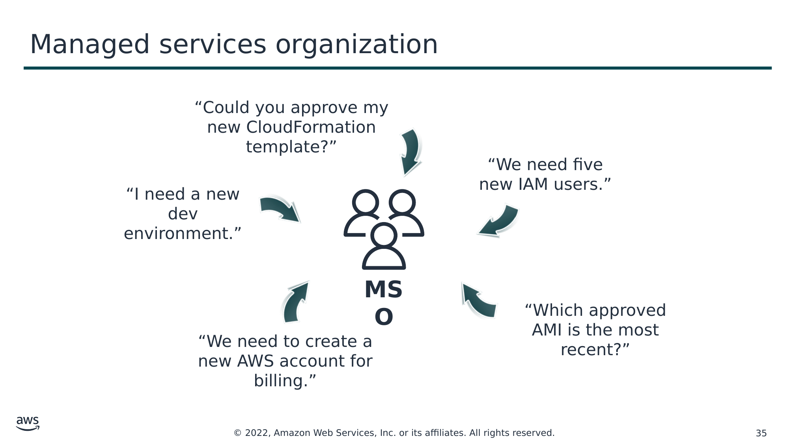

Текст зі схеми

“Чи могли б ви затвердити мій новий шаблон CloudFormation?”

“Нам потрібні п’ять нових користувачів IAM.”

“Мені потрібне нове середовище розробки.”

**MSO**

“Який із затверджених AMI найновіший?”

“Нам потрібно створити новий акаунт AWS для виставлення рахунків.”

> **Нотатки:**
>
> Один із підходів до впровадження безпеки та управління (governance) — створити централізовану команду, відповідальну за встановлення повторюваних процесів і шаблонів для розгортання застосунків в AWS зі збереженням організаційного контролю над розгортаннями. Така команда може бути внутрішньою або зовнішньою (сторонні постачальники) і часто називається командою з розгортання (provisioning team), центром компетенції (center of excellence) або організацією з управління сервісами (managed services organization, MSO). Зовнішніх постачальників зазвичай називають постачальниками керованих сервісів (managed service providers, MSP). AWS перевіряє партнерів AWS у межах програми AWS Managed Service Provider (MSP) Program.  
>
> MSO або MSP зазвичай відповідають за розгортання акаунтів; встановлення повторюваних процесів розгортання; аудит розгортань власників робочих навантажень; і розміщення спільних сервісів безпеки, безперервного моніторингу, підключення та автентифікації. MSO по суті створюють запобіжні обмеження (guardrails) для безпеки, захисту даних і аварійного відновлення в компанії.  
>
> Докладніше див. програму AWS Managed Service Provider (MSP) Program за адресою https://aws.amazon.com/partners/programs/msp.

---

## Слайд 36: Модель відповідальності MSO

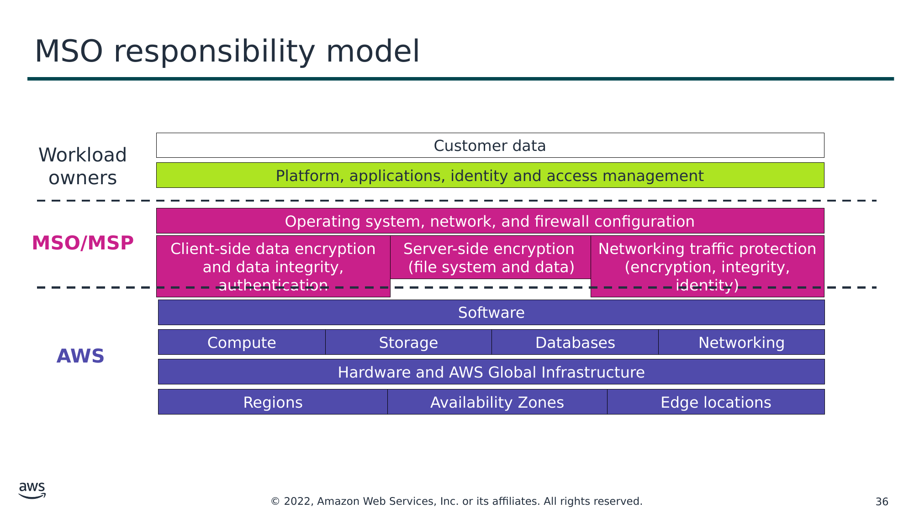

Текст зі схеми

Workload owners (Власники робочих навантажень)

Customer data (Дані клієнта)

Platform, applications, identity and access management (Платформа, застосунки, керування ідентифікацією та доступом)

**MSO/MSP**

Operating system, network, and firewall configuration (Конфігурація операційної системи, мережі та брандмауера)

Client-side data encryption and data integrity, authentication (Шифрування даних на стороні клієнта, цілісність даних, автентифікація)

Server-side encryption  
(file system and data) (Серверне шифрування: файлова система та дані)

Networking traffic protection

(encryption, integrity, identity) (Захист мережевого трафіку: шифрування, цілісність, ідентичність)

Software (Програмне забезпечення)

**AWS**

Compute (Обчислення)

Storage (Сховище)

Databases (Бази даних)

Networking (Мережі)

Hardware and AWS Global Infrastructure (Апаратне забезпечення та глобальна інфраструктура AWS)

Regions (Регіони)

Availability Zones (Зони доступності)

Edge locations (Периферійні локації)

> **Нотатки:**
>
> У моделі MSO власники робочих навантажень (workload owners) займаються фактичним розгортанням, розробкою та підтримкою застосунків. Власники робочих навантажень зазвичай включають системних адміністраторів, розробників та інших осіб, які безпосередньо відповідають за один чи кілька застосунків. Додавання MSO допомагає гарантувати, що застосунки розгортаються безпечно та відповідно до вимог завдяки автоматизованому впровадженню організаційних вимог безпеки. Наявність MSO також означає, що власник робочого навантаження може звузити свою документацію з авторизації лише до конфігурації та встановлення програмного забезпечення, специфічного для певного застосунку. Це пояснюється тим, що власник робочого навантаження успадковує значну частину реалізації засобів безпеки від MSO.  
>
> MSO клієнтів AWS часто виконують такі дії:  
>
> Розгортання акаунтів (Account provisioning): після розгляду сценарію використання власника робочого навантаження MSO створює початковий акаунт, підключає його до відповідного акаунта для консолідованого виставлення рахунків і налаштовує базову функціональність безпеки, перш ніж надати доступ власнику робочого навантаження.  
>
> Нагляд за безпекою (Security oversight): завдяки централізованому розгортанню акаунтів MSO може впроваджувати функції, що дають змогу персоналу з безпеки відстежувати застосунок під час його розгортання та експлуатації. MSO може виконувати такі дії, як створення групи аудиторів із міжакаунтним доступом (cross-account access) і зв’язування VPC застосунку зі спільним VPC сервісів (shared services VPC), який контролює MSO.  
>
> Конфігурація Amazon VPC (Amazon VPC configuration): конфігурація Amazon VPC включає VPC та її підмережі, конфігурації груп безпеки та списки контролю доступу до мережі (network ACLs). Щоб зберегти жорсткіший контроль над VPC застосунків, MSO може залишити за собою контроль над конфігурацією VPC і вимагати від власника робочого навантаження запитувати потрібні зміни мережевої безпеки.  
>
> Конфігурація IAM (IAM configuration): MSO може створювати групи користувачів і призначати дозволи. Це може включати створення груп для внутрішніх аудиторів, суперкористувача IAM та адміністративних груп застосунків, розділених за функціональністю (наприклад, адміністратори баз даних і Unix).  
>
> Розробка та затвердження шаблонів (Development and approval of templates): MSO може створювати попередньо затверджені шаблони CloudFormation для типових сценаріїв використання. Використовуючи шаблони, власники робочих навантажень успадковують реалізацію безпеки затвердженого шаблону, що обмежує їхню документацію з авторизації функціями, унікальними для їхнього застосунку. Шаблони можна використовувати повторно, щоб скоротити час, потрібний для затвердження та розгортання нових застосунків.  
>
> Створення та керування AMI (AMI creation and management): MSO може створити бібліотеку типових затверджених AMI для організації, забезпечивши централізоване керування та оновлення образів машин. Створюючи типові шаблони, MSO може вимагати використання затверджених AMI.  
>
> Розробка спільного VPC сервісів (Development of a shared services VPC): зі спільним VPC сервісів MSO може отримувати майже безперервні потоки даних моніторингу з VPC застосунків організації та від типових спільних сервісів, потрібних для їхньої організації. Це часто включає спільну платформу керування доступом, кінцеві точки журналювання та агрегацію інформації про конфігурацію.

---

## Слайд 37: Ключові висновки: модель спільної відповідальності

- Модель спільної відповідальності AWS допомагає організаціям, які переходять у хмару, досягати цілей безпеки та відповідності вимогам.
- Клієнти відповідають за захист усього, що вони розміщують у хмарі.
- MSO по суті створює запобіжні обмеження (guardrails) для безпеки, захисту даних і аварійного відновлення.

> **Нотатки:**
>
> Основні висновки цього розділу модуля:  
> Модель спільної відповідальності AWS допомагає організаціям, які переходять у хмару, досягати цілей безпеки та відповідності вимогам.  
> Клієнти відповідають за захист усього, що вони розміщують У хмарі.  
> MSO по суті створює запобіжні обмеження для безпеки, захисту даних і аварійного відновлення.

---

## Слайд 38: Підсумки модуля

Вступ до безпеки в AWS

> **Нотатки:**
>
> Настав час повторити матеріал модуля та завершити його перевіркою знань і розбором запитання практичного сертифікаційного іспиту.

---

## Слайд 39: Резюме модуля

У цьому модулі ви навчилися таке:

- Визначати функції безпеки та переваги хмарних обчислень.
- Визначати принципи безпеки, на яких побудовано хмару AWS.
- Визначати, яку частину застосунку користувач відповідає за захист у хмарі.

> **Нотатки:**
>
> У цьому модулі ви навчилися таке:  
> Визначати функції безпеки та переваги хмарних обчислень.  
> Визначати принципи безпеки, на яких побудовано хмару AWS.  
> Визначати, яку частину застосунку користувач відповідає за захист у хмарі.

---

## Слайд 40: Пройдіть перевірку знань

> **Нотатки:**
>
> Настав час пройти перевірку знань для цього модуля.

---

## Слайд 41: Приклад запитання іспиту

Відповідно до моделі спільної відповідальності, хто відповідає за налаштування правил групи безпеки, що визначають, які порти відкриті для екземпляра EC2 з Linux?

Варіант

Відповідь

A

AWS відповідає за налаштування правил групи безпеки.

B

Клієнт відповідає за налаштування правил групи безпеки.

C

Правила групи безпеки не потрібні.

D

AWS відповідає за налаштування правил групи безпеки, а клієнт має відкрити порти для екземпляра.

> **Нотатки:**
>
> Розгляньте варіанти відповідей і відсійте їх за ключовими словами.

---

## Слайд 42: Відповідь на приклад запитання іспиту

Скопіюйте й вставте сюди те саме запитання.

Правильна відповідь — B.

Ключові слова в запитанні: **налаштування правил групи безпеки**.

> **Нотатки:**
>
> Ключові слова, які потрібно розпізнати: налаштування правил групи безпеки.  
>
> Правильна відповідь — B. Клієнт відповідає за контроль мережевого доступу до екземплярів EC2.  
>
> Неправильні відповіді:  
> Відповідь A: AWS підтримує конфігурацію своїх пристроїв інфраструктури, але клієнт відповідає за налаштування власних гостьових операційних систем (зокрема захисту мережевого трафіку), баз даних і застосунків.  
> Відповідь C: правила групи безпеки фільтрують трафік на основі протоколів і номерів портів, і клієнт відповідає за налаштування захисту мережевого трафіку.  
> Відповідь D: AWS підтримує конфігурацію своїх пристроїв інфраструктури, але клієнт відповідає за налаштування власних гостьових операційних систем (зокрема захисту мережевого трафіку), баз даних і застосунків.

---

## Слайд 43: Дякуємо

Зауваження, відгуки чи інші запитання?  
Зверніться до нас за адресою [https://support.aws.amazon.com/#/contacts/aws-academy](https://support.aws.amazon.com/#/contacts/aws-academy).  
Усі торговельні марки є власністю їхніх власників.

> **Нотатки:**
>
> Дякуємо, що пройшли цей модуль.

---

## Слайд 44: Вихідні (редаговані) версії слайдів

<!-- hidden slide -->

---

## Слайд 45: Практична вправа: сценарій 1 із 2

<!-- hidden slide -->

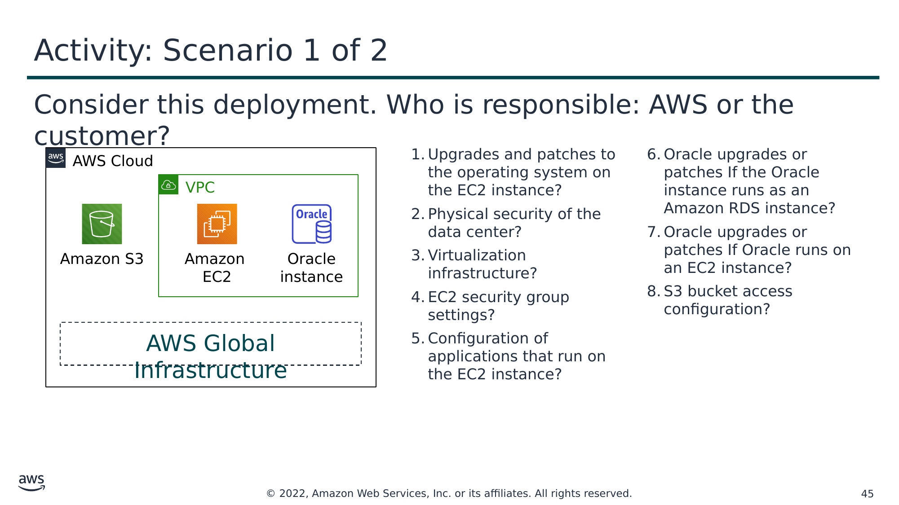

Текст зі схеми

Розгляньте це розгортання. Хто відповідає: AWS чи клієнт?

AWS Cloud

- Оновлення та виправлення операційної системи на екземплярі EC2?
- Фізична безпека центру обробки даних?
- Інфраструктура віртуалізації?
- Налаштування групи безпеки EC2?
- Конфігурація застосунків, що працюють на екземплярі EC2?

- Оновлення чи виправлення Oracle, якщо екземпляр Oracle працює як екземпляр Amazon RDS?
- Оновлення чи виправлення Oracle, якщо Oracle працює на екземплярі EC2?
- Конфігурація доступу до бакета S3?

VPC

Amazon S3

Amazon  
EC2

Екземпляр Oracle (Oracle instance)

AWS Global Infrastructure

> **Нотатки:**
>
> Для доступності: архітектурна схема показує блок AWS Cloud, який містить область AWS Global Infrastructure, а також бакет Amazon S3 і, нарешті, VPC, що містить екземпляр Amazon EC2 та екземпляр Oracle. Кінець опису для доступності.  
>
> Розгляньте випадок, коли клієнт використовує сервіси та ресурси AWS, показані тут. Хто відповідає за підтримку безпеки? AWS чи клієнт?  
>
> Клієнт використовує Amazon Simple Storage Service (Amazon S3) для зберігання даних. Клієнт налаштував віртуальну приватну хмару (VPC) за допомогою Amazon Virtual Private Cloud (Amazon VPC). Екземпляр EC2 та екземпляр бази даних Oracle, які він створив, обидва працюють у VPC.

---

## Слайд 46: Практична вправа: сценарій 2 із 2

<!-- hidden slide -->

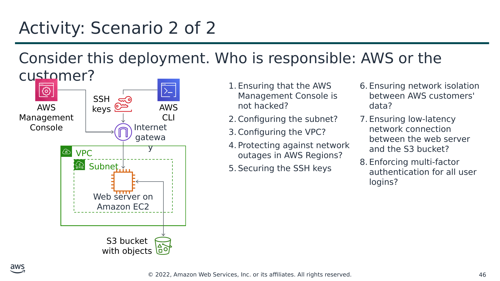

Текст зі схеми

Розгляньте це розгортання. Хто відповідає: AWS чи клієнт?

- Гарантування того, що AWS Management Console не зламано?
- Конфігурація підмережі (subnet)?
- Конфігурація VPC?
- Захист від мережевих збоїв у регіонах AWS?
- Захист ключів SSH

- Забезпечення мережевої ізоляції даних клієнтів AWS?
- Забезпечення мережевого з’єднання з низькою затримкою між вебсервером і бакетом S3?
- Примусове використання багатофакторної автентифікації для всіх входів користувачів?

AWS Management Console

SSH keys (Ключі SSH)

AWS CLI

Internet gateway (Інтернет-шлюз)

VPC

Subnet (Підмережа)

Web server on Amazon EC2 (Вебсервер на Amazon EC2)

S3 bucket with objects (Бакет S3 з об’єктами)

> **Нотатки:**
>
> Для доступності: архітектурна схема, що показує вебсервер, який працює на EC2 всередині підмережі та VPC. Вебсервер підключається до бакета S3. До вебсервера можна отримати доступ через інтернет-шлюз або за допомогою AWS Management Console, або за допомогою AWS Command Line Interface, який використовує ключі SSH. Кінець опису для доступності.  
>
> Тепер розгляньте цей додатковий випадок, коли клієнт використовує сервіси та ресурси AWS, показані тут. Хто відповідає за підтримку безпеки? AWS чи клієнт?  
>
> Клієнт використовує Amazon S3 для зберігання даних. Клієнт налаштував віртуальну приватну хмару (VPC) за допомогою Amazon VPC і запускає вебсервер на екземплярі EC2 у VPC. Клієнт налаштував інтернет-шлюз як частину VPC, щоб до вебсервера можна було отримати доступ за допомогою AWS Management Console або AWS Command Line Interface (AWS CLI). Коли клієнт використовує AWS CLI, з’єднання вимагає використання ключів Secure Shell (SSH).
