## Слайд 1: Securing Your Infrastructure

AWS Academy Cloud Security Foundations

> **Нотатки:**
>
> Welcome to the Securing Your Infrastructure module.

---

## Слайд 2: Introduction

Securing Your Infrastructure

> **Нотатки:**
>
> This first section provides an introduction to the module.

---

## Слайд 3: Module objectives

At the end of this module, you should be able to do the following:

- Define the components of a virtual private cloud (VPC).
- Recognize account boundaries.
- Describe Amazon Web Services (AWS) services that are available to protect your network and resources.

> **Нотатки:**
>
> At the end of this module, you should be able to do the following:  
> Define the components of a virtual private cloud (VPC).  
> Recognize account boundaries.  
> Describe Amazon Web Services (AWS) services that are available to protect your network and resources.

---

## Слайд 4: Module overview

**Sections**

- Structure of a three-tier web application
- Using a VPC
- Setting up public and private subnets and internet protocols
- Using AWS security groups
- Using AWS network ACLs
- Using AWS load balancers
- Pulling it all together
- Protecting your compute resources

**Lab**

- Securing VPC Resources by Using Security Groups

**Knowledge check**

> **Нотатки:**
>
> This module includes the following sections:  
> Structure of a three-tier web application  
> Using a VPC  
> Setting up public and private subnets and internet protocols  
> Using AWS security groups  
> Using AWS network ACLs  
> Using AWS load balancers  
> Pulling it all together  
> Protecting your compute resources  
>
> This module also includes a lab where you will secure VPC resources by using security groups.  
>
> Finally, you will be asked to complete a knowledge check that will test your understanding of key concepts covered in this module.

---

## Слайд 5: Bank business scenario (1 of 3)

> **Нотатки:**
>
> Let’s discuss how the concepts in this module are applicable to the bank business scenario.

---

## Слайд 6: Bank business scenario (2 of 3)

> **Нотатки:**
>
> After María’s last meeting with John, she realized that John’s security concerns go beyond user access and management.  
>
> To make her case for AWS migration, María will need to assuage John’s concerns by helping him understand how the bank’s infrastructure can be properly secured in AWS.

---

## Слайд 7: Bank business scenario (3 of 3)

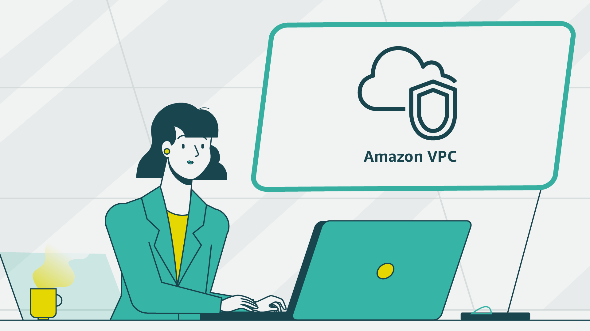

> **Нотатки:**
>
> John asked María how they would ensure the security of the infrastructure that AnyBank could potentially migrate into AWS.  
>
> For the next meeting, María decides to focus on using a virtual private cloud (VPC) and applying multiple layers of security to support the network infrastructure.

---

## Слайд 8: Shared responsibility model

> **Нотатки:**
>
> For accessibility: Shared responsibility model listing customer and AWS responsibilities. Customer is responsible for security in the cloud. This includes customer data. Platform, applications, identity and access management. Operating system, network, and firewall configuration. Client-side data encryption and data integrity, authentication. Server-side encryption of file system and data. Networking traffic protection, to include encryption, integrity, and identity. AWS is responsible for security of the cloud. This includes the AWS foundation services for compute, storage, databases, and networking. And the AWS Global Infrastructure, to include Regions, Availability Zones, and Edge Locations. End of accessibility description.  
>
> This module focuses on the operating system, network, and firewall configuration portion, and the network traffic protection portion of the shared responsibility model, which the customer is responsible to secure.

---

## Слайд 9: Structure of a three-tier web application

Securing Your Infrastructure

> **Нотатки:**
>
> This section describes the structure of a three-tier web application.

---

## Слайд 10: Three-tier architecture

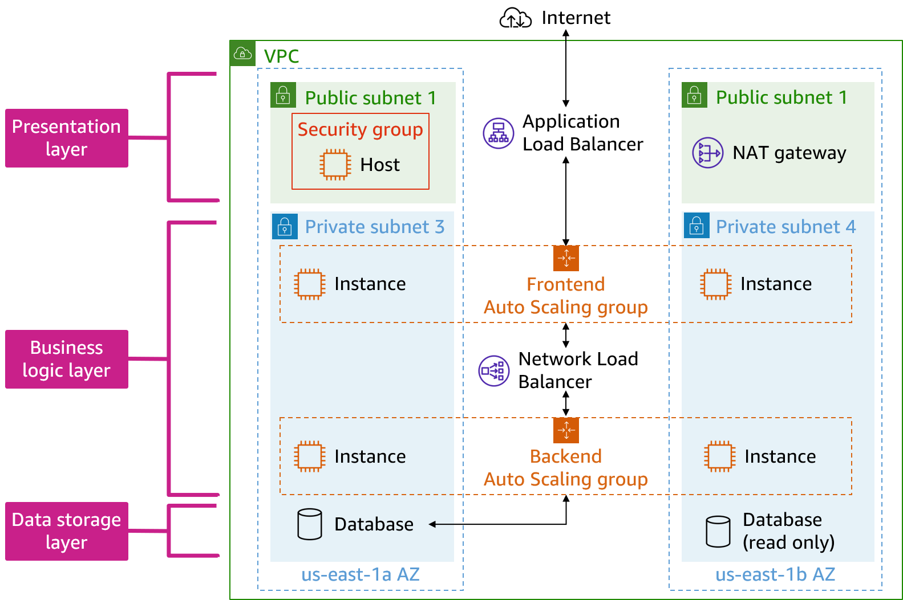

> **Нотатки:**
>
> For accessibility: Diagram of a three-tier web application that includes a presentation layer, business logic layer, and data storage layer. A VPC has subnets in two Availability Zones. The presentation layer includes two public subnets, one in each Availability Zone. One subnet contains a security group with a host instance, and the other subnet has a NAT gateway. An Application Load Balancer in this layer manages traffic between the internet and a frontend Auto Scaling group in the business logic layer. This Auto Scaling group handles scaling for frontend instances across the two Availability Zones. A Network Load Balancer in the business logic layer layer manages traffic between the frontend Auto Scaling group and a backend Auto Scaling group. The backend Auto Scaling group handles scaling for backend instances across the two Availability Zones. The data storage layer contains a primary database in one Availability Zone, with a read-only database in the second Availability Zone. The data storage layer communicates with the backend Auto Scaling group in the business logic layer. End of accessibility description.  
>
> A three-tier architecture is a software architecture pattern where the application has three logical tiers: the presentation layer, the application layer, and the data storage layer. This architecture is used in a client-server application such as a web application that has a frontend, backend, and database. Each layer or tier performs a specific task and can be managed independently of each other. This represents a shift from the monolithic way of building an application where the frontend, backend, and database are all in one place.

---

## Слайд 11: Using a VPC

Securing Your Infrastructure

> **Нотатки:**
>
> This section provides information about using a VPC as part of securing your infrastructure.

---

## Слайд 12: Amazon Virtual Private Cloud (Amazon VPC)

- Provision a logically isolated section of the AWS Cloud where you can launch AWS resources in a virtual network that you define.
- Control your virtual networking resources, including the following:
  - Select the IP address range.
  - Create subnets.
  - Configure route tables and network gateways.
- Customize the network configuration for your VPC.
- Use multiple layers of security.

Amazon Virtual Private Cloud (Amazon VPC)

> **Нотатки:**
>
> Use the Amazon Virtual Private Cloud (Amazon VPC) service to provision a logically isolated section of the AWS Cloud where you can launch your AWS resources. This isolated section is called a virtual private cloud, or VPC.  
>
> Amazon VPC provides control over your virtual networking resources, such as selecting your own IP address range, creating subnets, and configuring route tables and network gateways. You can use both IPv4 and IPv6 in your VPC for secure access to resources and applications.  
>
> You can also customize the network configuration for your VPC. For example, you can create a public subnet for your web servers that can access the public internet. You can place your backend systems, such as databases or application servers, in a private subnet without public internet access.  
>
> Finally, you can use multiple layers of security in a VPC to help control access to Amazon Elastic Compute Cloud (Amazon EC2) instances in the VPC's subnets. Security mechanisms include security groups and network access control lists (ACLs).  
>
> For more information, see What Is Amazon VPC? in the Amazon VPC User Guide at https://docs.aws.amazon.com/vpc/latest/userguide/what-is-amazon-vpc.html.

---

## Слайд 13: VPCs and subnets

- VPC
  - Is logically isolated from other VPCs
  - Is dedicated to your AWS account
  - Belongs to a single AWS Region and can span multiple Availability Zones
- Subnet
  - Is a range of IP addresses that divide a VPC
  - Belongs to a single Availability Zone
  - Is classified as public or private

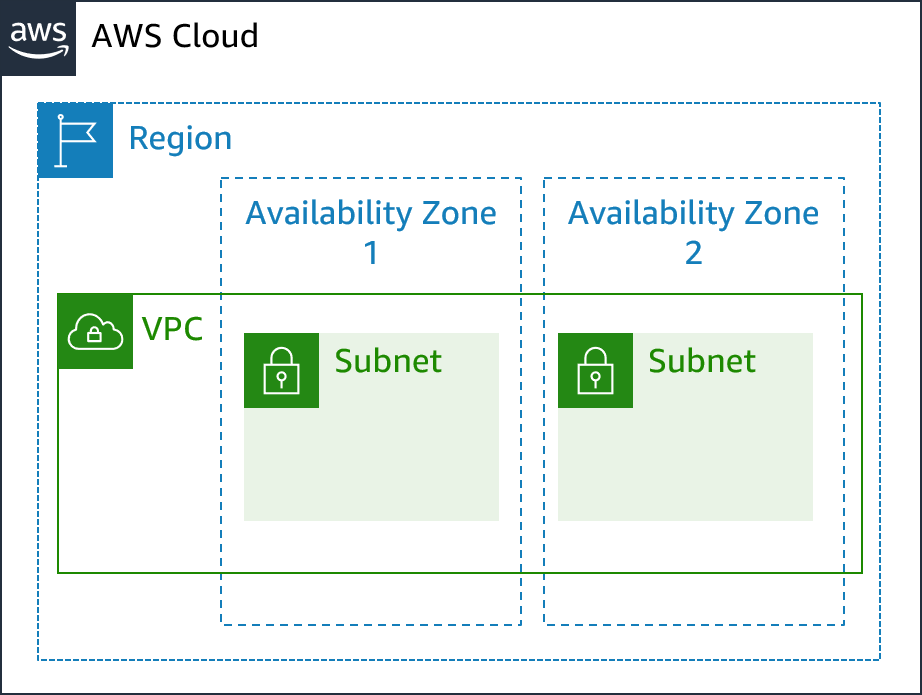

> **Нотатки:**
>
> For accessibility: Diagram of subnets in a VPC. A Region within the AWS Cloud has one VPC, which spreads across two Availability Zones. The VPC has one subnet in each Availability Zone. End of accessibility description.  
>
> A VPC is a virtual network that is logically isolated from other virtual networks in the AWS Cloud. A VPC is dedicated to your account, belongs to a single AWS Region, and can span multiple Availability Zones.  
>
> After you create a VPC, you can divide it into one or more subnets. A subnet is a range of IP addresses that divide a VPC. Subnets belong to a single Availability Zone, but you can create subnets in different Availability Zones for high availability. Subnets are generally classified as public or private.

---

## Слайд 14: Setting up public and private subnets and internet protocols

Securing Your Infrastructure

> **Нотатки:**
>
> This section describes how to set up public and private subnets and internet protocols.

---

## Слайд 15: Internet gateway

- Provides a target in your VPC route tables for internet-routable traffic
- Performs network address translation (NAT) for instances that have been assigned public IPv4 addresses
- Supports IPv4 and IPv6 traffic
- Doesn't incur an additional charge in your account

> **Нотатки:**
>
> An internet gateway serves two purposes:  
> Provides a target in your VPC route tables for internet-routable traffic  
> Performs network address translation (NAT) for instances that have been assigned public IPv4 addresses  
>
> An internet gateway supports IPv4 and IPv6 traffic, and it doesn't cause availability risks or bandwidth constraints on your network traffic. There's no additional charge to have an internet gateway in your account.  
>
> To enable access to or from the internet for instances in a subnet in a VPC, you must do the following:  
> Create an internet gateway, and attach it to your VPC.  
> Add a route to your subnet's route table that directs internet-bound traffic to the internet gateway.  
> Confirm that each instance in your subnet has a globally unique IP address (public IPv4 address, Elastic IP address, or IPv6 address).  
> Confirm that your network ACL and security group rules allow the relevant traffic to flow to and from your instance.  
>
> For more information, see Connect to the Internet Using an Internet Gateway in the Amazon VPC User Guide at https://docs.aws.amazon.com/vpc/latest/userguide/VPC_Internet_Gateway.html.

---

## Слайд 16: NAT gateway

[https://docs.aws.amazon.com/vpc/latest/userguide/vpc-nat-comparison.html](https://docs.aws.amazon.com/vpc/latest/userguide/vpc-nat-comparison.html)

- Supports instances in a private subnet to connect to the internet or other AWS services
- Prevents the internet from initiating a connection to those instances
- Requires that you specify the following at creation:
  - Public subnet in which the NAT gateway should reside
  - An Elastic IP address to associate with the NAT gateway
- After creation, requires that you update the route table for one or more of your private subnets to direct internet-bound traffic to the NAT gateway

> **Нотатки:**
>
> A network address translation (NAT) gateway supports instances in a private subnet to connect to the internet or other AWS services. A NAT gateway also prevents the internet from initiating a connection with those instances.  
>
> To create a NAT gateway, you must specify the public subnet in which the NAT gateway should reside. You must also specify an Elastic IP address to associate with the NAT gateway. After you create a NAT gateway, you must update the route table that is associated with one or more of your private subnets to point internet-bound traffic to the NAT gateway. Thus, instances in your private subnets can communicate with the internet.  
>
> You can also use a NAT instance in a public subnet in your VPC instead of a NAT gateway. However, a NAT gateway is a managed NAT service that provides better availability, higher bandwidth, and less administrative effort. For common use cases, AWS recommends that you use a NAT gateway instead of a NAT instance.  
>
> For more information, see the following topics in the Amazon VPC User Guide:  
> NAT Gateways at https://docs.aws.amazon.com/vpc/latest/userguide/vpc-nat-gateway.html  
> NAT Instances at https://docs.aws.amazon.com/vpc/latest/userguide/VPC_NAT_Instance.html  
> Compare NAT Gateways and NAT Instances at https://docs.aws.amazon.com/vpc/latest/userguide/vpc-nat-comparison.html

---

## Слайд 17: Private subnet

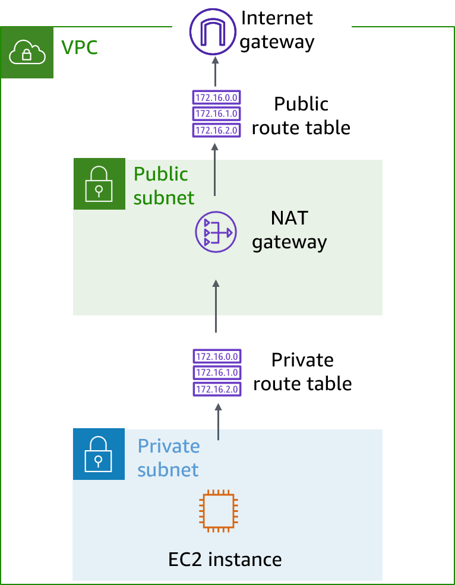

- All subnets consist of a contiguous range of IP addresses.
- Interfaces that are attached to instances in private subnets cannot be reached from outside the parent VPC.
- Private subnets are often used to host database instances that don't need to be accessed through the public internet.

> **Нотатки:**
>
> For accessibility: Diagram of a VPC with a public subnet and a private subnet. An EC2 instance in the private subnet routes traffic to a private route table, and then to a NAT gateway in the public subnet. From there, the traffic is routed to a public route table and then to an internet gateway. End of accessibility description.  
>
> All subnets consist of a contiguous range of IP addresses. These addresses should not overlap with other subnets in your VPC.  
> Interfaces that are attached to EC2 instances in private subnets are not reachable from outside the parent VPC. However, by using an AWS managed NAT gateway, EC2 instances can make outbound requests, such as for patching, and the response from the external resource will be allowed back in.  
> Private subnets are often used to host database (DB) instances that don't need to be accessed through the public internet.  
> A NAT gateway must have an Elastic IP address assigned to it.

---

## Слайд 18: Public subnet

- When external traffic needs to reach an interface, such as an Amazon Elastic Compute Cloud (Amazon EC2) instance, the interface requires the following:
  - A public IP address must be assigned to an EC2 instance.
  - The subnet's route table must include an entry to the interface.
- With these two factors in place, the subnet is considered to be a public subnet.

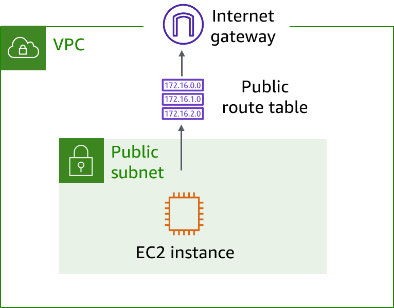

> **Нотатки:**
>
> For accessibility: Diagram of a VPC with a public subnet. Traffic from an EC2 instance in the subnet goes to a public route table and then to an internet gateway. End of accessibility description.  
>
> When external traffic needs to reach an interface, such as an EC2 instance, the interface requires the following:  
> A public IP address must be assigned to an EC2 instance.  
> The subnet's route table must include an entry to the interface.  
>
> With these two factors in place, the subnet is determined to be a public subnet.  
>   
> Often, companies will place web servers inside a public subnet. However, AWS recommends using a load balancer in the public subnet and having the load balancer relay traffic to web servers that are hosted in private subnets.

---

## Слайд 19: IP addressing

- When you create a VPC, you assign a CIDR range (a range of private addresses).
- You cannot change the range in a VPC or subnet, but you can add more CIDR ranges to your VPC.
- The largest CIDR block size is /16, and the smallest is /28.
- The CIDR ranges of subnets shouldn't overlap.

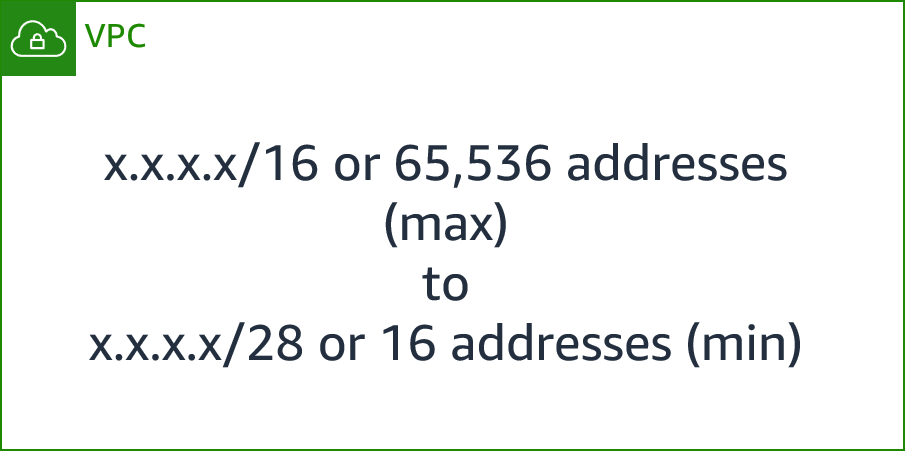

> **Нотатки:**
>
> IP addresses enable resources in your VPC to communicate with each other and with resources over the internet. When you create a VPC, you assign a Classless Inter-Domain Routing (CIDR) range to it, which is a range of private addresses.  
>
> The CIDR block might be as large as /16 (which is 216, or 65,536 addresses) or as small as /28 (which is 24, or 16 addresses).  
>
> The CIDR block of a subnet can be the same as the block for the VPC that the subnet is in. This means that the VPC and subnet are the same size; the VPC has a single subnet.  
>
> The CIDR block of a subnet can be a subset of the CIDR block for the VPC. This structure supports the definition of multiple subnets. If you create more than one subnet in a VPC, the CIDR ranges of the subnets should not overlap. You cannot have duplicate IP addresses in the same VPC.  
>
> For more information, see VPC Sizing in the Amazon VPC User Guide at https://docs.aws.amazon.com/vpc/latest/userguide/configure-your-vpc.html#vpc-sizing.

---

## Слайд 20: Reserved IP addresses

**Example:** A VPC with an IPv4 CIDR block of 10.0.0.0/16 has 65,536 total IP addresses. The VPC has four subnets, all with /24 CIDR blocks. Although each subnet has 256 IP addresses, only 251 IP addresses are available for use in each.

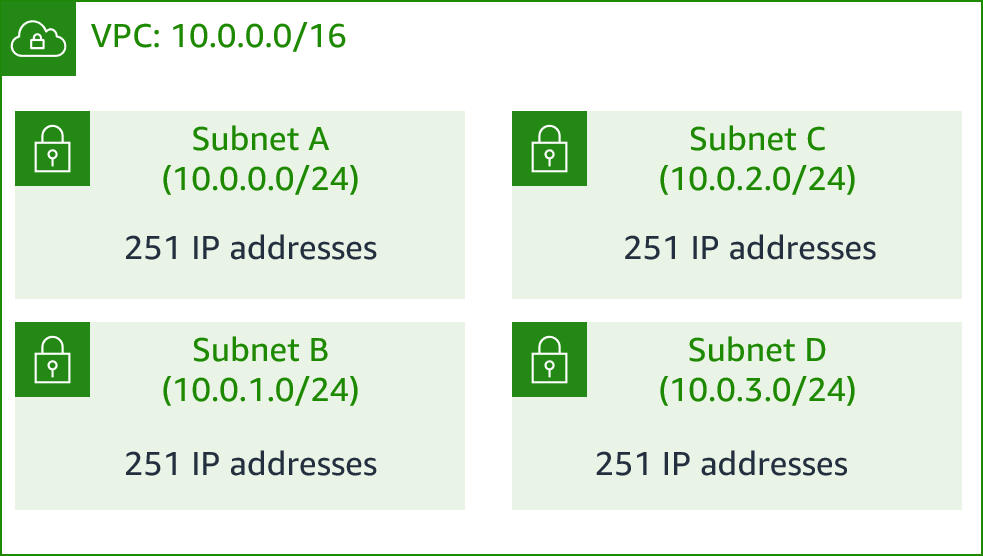

| IP Addresses for CIDR Block 10.0.0.0/24 | Reserved for |
|---|---|
| 10.0.0.0 | Network address |
| 10.0.0.1 | Internal communication |
| 10.0.0.2 | Domain Name System (DNS) resolution |
| 10.0.0.3 | Future use |
| 10.0.0.255 | Network broadcast address |

> **Нотатки:**
>
> When you create a subnet, it requires its own CIDR block. For each CIDR block that you specify, AWS reserves five IP addresses within that block, and you cannot use these five addresses. AWS reserves these IP addresses for the following purposes:  
> Network address  
> VPC local router (internal communication)  
> Domain Name System (DNS) resolution  
> Future use  
> Network broadcast address  
>
> For example, suppose that you create a subnet with an IPv4 CIDR block of 10.0.0.0/24, which has 256 total IP addresses. The subnet has 256 IP addresses, but only 251 are available because 5 are reserved for AWS.

---

## Слайд 21: Public IP address

- A public IP address is an IP address that is used to access the internet.
- A public IP address can be automatically assigned if you modify the subnet's auto-assign public IP address properties.
- Public IP addresses are dynamic. If you stop or start your instance, a new public IP is assigned. For production projects, use an Elastic IP address rather than an assigned public IP, which will be dissociated if you stop the instance.

> **Нотатки:**
>
> When you create a VPC, every instance in that VPC gets a private IP address automatically. You can also request a public IP address to be assigned when you create the instance by modifying the subnet’s auto-assign public IP address properties. A public IP address is used to access the internet.  
>
> Public IP addresses are dynamic. If you stop or start your instance, a new public IP is assigned. For production projects, use an Elastic IP address rather than an assigned public IP, which will be dissociated if you stop the instance.  
>
> For more information, see Public IPv4 Addresses in the Amazon VPC User Guide at https://docs.aws.amazon.com/vpc/latest/userguide/how-it-works.html#vpc-public-ipv4-addresses.

---

## Слайд 22: Elastic IP address

- Is associated with an AWS account
- Is static and doesn't change over time
- Comes from Amazon's pool of IPv4 addresses
  - If you unassign an Elastic IP address, you are charged until you remove it completely.

Elastic IP addresses get allocated to your account and stay the same. Use an Elastic IP address when you work on a long-term project and configuring IP addresses can be time-consuming.

> **Нотатки:**
>
> An Elastic IP address is a static, public IP address that is designed for dynamic cloud computing. You can associate an Elastic IP address with any instance or network interface for any VPC in your account.  
>
> By using an Elastic IP address, you can mask the failure of an instance or software by rapidly remapping the address to another instance in your account. Alternatively, you can specify the Elastic IP address in a DNS record for your domain, so that your domain points to your instance.  
>
> If your instance doesn't have a public IPv4 address, you can associate an Elastic IP address with your instance to enable communication with the internet. For example, this allows you to connect to your instance from your local computer.  
>
> An Elastic IP address is static and doesn't change over time. It comes from Amazon's pool of IPv4 addresses or from a custom IP address pool that you have brought to your AWS account. If you unassign an Elastic IP address, you are charged until you remove it completely. Additional costs might apply when you use Elastic IP addresses, so it's important to release them when you no longer need them.  
>
> Elastic IP addresses get allocated to your account and stay the same. Use an Elastic IP address when you work on a long-term project and configuring IP addresses can be time-consuming.  
>
> For more information, see Associate Elastic IP Addresses with Resources in Your VPC in the Amazon VPC User Guide at https://docs.aws.amazon.com/vpc/latest/userguide/vpc-eips.html.

---

## Слайд 23: Elastic network interface

- An elastic network interface is a virtual network interface. You can do the following:
  - Attach it to an instance.
  - Detach it from the instance, and attach it to another instance to redirect network traffic.
- Its attributes follow when it is reattached to a new instance.
- Each instance in your VPC has a default network interface, which can be assigned a private IPv4 address from your VPC's range.

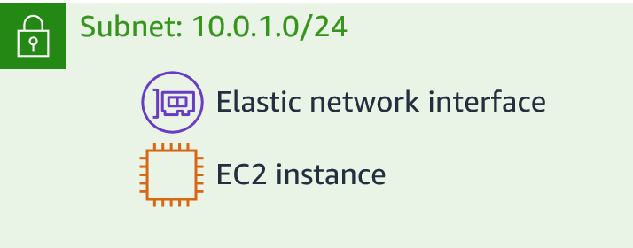

> **Нотатки:**
>
> An elastic network interface is a virtual network interface that you can attach or detach from an instance in a VPC. A network interface's attributes follow it when it's reattached to another instance. When you move a network interface from one instance to another, network traffic is redirected to the new instance.  
>
> Each instance in your VPC has a default network interface (the primary network interface), which can be assigned a private IPv4 address from your VPC's range. You cannot detach a primary network interface from an instance. You can create and attach an additional network interface to any instance in your VPC. The number of network interfaces that you can attach varies by instance type.  
>
> In certain circumstances, you can have two network interfaces on an EC2 instance, which is great for forensics. Associate the network interface to a forensic instance and start tracking the exploit.

---

## Слайд 24: Route tables and routes

- A route table contains a set of rules (or routes), which you can configure to direct network traffic from your subnet.
- Each route specifies a destination and a target.
- By default, every route table contains a local route for communication within the VPC.
- Each subnet should have its own route table.

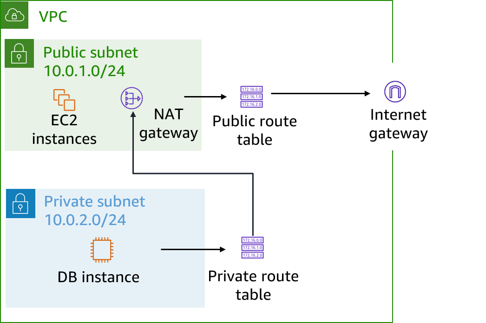

> **Нотатки:**
>
> For accessibility: Diagram of a VPC with public and private route tables. The public subnet contains an EC2 instance and a NAT gateway. The NAT gateway directs traffic to a public route table and then to an internet gateway. The private subnet contains an EC2 instance whose traffic goes to a private route table. From there, traffic is directed to the NAT gateway in the public subnet. End of accessibility description.  
>
> A route table contains a set of rules (called routes) that direct network traffic from your subnet. Each route specifies a destination and a target. The destination is the destination CIDR block where you want traffic from your subnet to go. The target is the target that the destination traffic is sent through. A routing table is a simple lookup table that keeps track of paths, like a map, and uses these to determine which way to forward traffic.  
>
> By default, every route table that you create contains a local route for communication within the VPC. You cannot delete the local route entry, which is used for internal communications. But you can customize a route table by adding routes.  
>
> Each subnet should have its own route table, or it will use the main route table of the parent VPC (which controls the routing for all subnets that are not explicitly associated with any other route table).  
>   
> The main route table is the route table that is automatically assigned to your VPC. The main route table controls the routing for all subnets that are not explicitly associated with any other route table. A subnet can be associated with only one route table at a time, but you can associate multiple subnets with the same route table.  
>
> For more information, see Configure Route Tables in the Amazon VPC User Guide at https://docs.aws.amazon.com/vpc/latest/userguide/VPC_Route_Tables.html.

---

## Слайд 25: Key takeaways: Setting up public and private subnets and internet protocols

- Public subnets are used when external traffic needs to reach an interface, such as an EC2 instance.
- Private subnets are often used to host database instances that don't need to be accessed through the public internet.
- Route tables determine where traffic is routed in your VPC.

> **Нотатки:**
>
> Some key takeaways from this section of the module include the following:  
> Public subnets are used when external traffic needs to reach an interface, such as an EC2 instance.  
> Private subnets are often used to host database instances that don't need to be accessed through the public internet.  
> Route tables determine where traffic is to be routed in your VPC.

---

## Слайд 26: Using AWS security groups

Securing Your Infrastructure

> **Нотатки:**
>
> This section provides information about using security groups as part of securing your infrastructure.

---

## Слайд 27: Security groups (1 of 2)

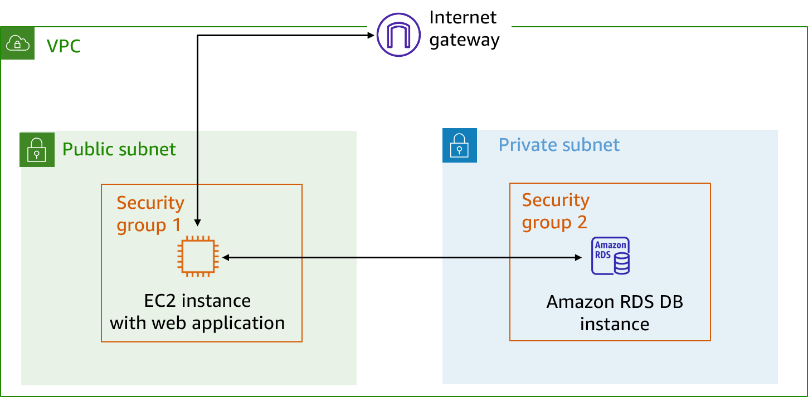

> **Нотатки:**
>
> For accessibility: Diagram of a VPC with a public subnet and a private subnet. The public subnet contains an EC2 instance that is protected by security group 1. The private subnet contains an Amazon Relational Database Service (Amazon RDS) database instance that is protected by security group 2. Communication is allowed between the two security groups, and the internet can communicate with security group 1. End of accessibility description.  
>
> A security group acts as a virtual firewall for an EC2 instance, and controls inbound and outbound traffic for the instance. Security groups act at the instance level, not the subnet level. Therefore, each instance in a subnet in your VPC can be assigned to a different set of security groups.  
>
> At the most basic level, a security group is a way to filter traffic to your instances.

---

## Слайд 28: Security groups (2 of 2)

- Security groups have rules that control inbound and outbound instance traffic.
- Default security groups deny all inbound traffic and allow all outbound traffic. This is considered *stateful*.

**Inbound**

| Source | Protocol | Port Range | Description |
|---|---|---|---|
| sg-xxxxxxxx | All | All | Allow inbound traffic from network interfaces that are assigned to the same security group. |

**Outbound**

| Destination | Protocol | Port Range | Description |
|---|---|---|---|
| 0.0.0.0/0 | All | All | Allow all outbound IPv4 traffic. |
| ::/0 | All | All | Allow all outbound IPv6 traffic. |

> **Нотатки:**
>
> When you create a security group, it doesn't have any inbound rules. Therefore, inbound traffic that originates from another host to your instance isn't permitted until you add inbound rules to the security group.  
>
> By default, a security group includes an outbound rule that allows all outbound traffic. You can remove the rule and add outbound rules that allow specific outbound traffic only. If your security group doesn't have any outbound rules, then outbound traffic that originates from your instance isn't allowed.  
>
> Security groups are stateful, which means that state information is kept even after a request is processed. Thus, if you send a request from your instance, the response traffic for that request is allowed to flow in regardless of inbound security group rules. Responses to allowed inbound traffic are allowed to flow out, regardless of outbound rules.  
>
> All rules are evaluated before a decision is made to allow traffic.  
>
> The tables on the slide indicate that inbound traffic is allowed from any network interface assigned to the same security group. All outbound traffic is allowed.  
>
> For more information, see Control Traffic to Resources Using Security Groups in the Amazon VPC User Guide at https://docs.aws.amazon.com/vpc/latest/userguide/VPC_SecurityGroups.html.

---

## Слайд 29: Key takeaways: Using AWS security groups

- A security group acts as a virtual firewall for an instance to control inbound and outbound traffic.
- Security groups are stateful, which means that state information is kept even after a request is processed.
- All rules are evaluated before a decision is made to allow traffic.

> **Нотатки:**
>
> Some key takeaways from this section of the module include the following:  
> A security group acts as a virtual firewall for an instance to control inbound and outbound traffic.  
> Security groups are stateful, which means that state information is kept even after a request is processed.  
> All rules are evaluated before a decision is made to allow traffic.

---

## Слайд 30: Using AWS network ACLs

Securing Your Infrastructure

> **Нотатки:**
>
> This section provides information about using network access control lists (ACLs) as part of securing your infrastructure.

---

## Слайд 31: Network ACLs (1 of 2)

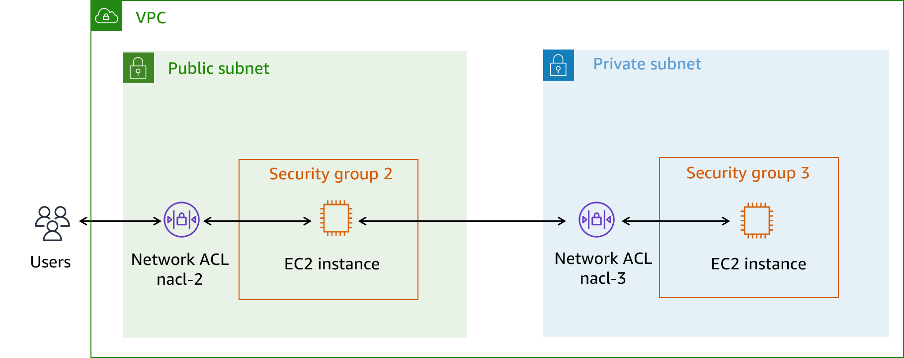

> **Нотатки:**
>
> For accessibility: Diagram showing how network ACLs work. A VPC contains a public subnet and a private subnet. Each subnet contains an EC2 instance. A network ACL in each subnet controls traffic to and from the instances. End of accessibility description.  
>
> A network access control list (ACL) is an optional layer of security for your VPC. A network ACL acts as a firewall to control traffic in and out of one or more subnets. To add another layer of security to your VPC, you can set up network ACLs with rules that are similar to your security group rules.  
>
> Each subnet in your VPC must be associated with a network ACL. If you don't explicitly associate a subnet with a network ACL, the subnet is automatically associated with the default network ACL. You can associate a network ACL with multiple subnets; however, a subnet can be associated with only one network ACL at a time. When you associate a network ACL with a subnet, the previous association is removed.

---

## Слайд 32: Network ACLs (2 of 2)

- A network ACL has separate inbound and outbound rules, and each rule can  
either allow or deny traffic. Network ACLs are stateless.
- Each VPC automatically comes with a modifiable default network ACL. By default, it allows all inbound and outbound IPv4 traffic.
- You can create a custom network ACL and associate it with a subnet. By default, each custom network ACL denies all inbound and outbound traffic until you add rules.

**Default inbound and outbound rules**

| Rule | Type | Protocol | Port Range | Source | Allow/Deny |
|---|---|---|---|---|---|
| 100 | All IPv4 traffic | All | All | 0.0.0.0/0 | ALLOW |
| * | All IPv4 traffic | All | All | 0.0.0.0/0 | DENY |

> **Нотатки:**
>
> A network ACL has separate inbound and outbound rules, and each rule can either allow or deny traffic. Network ACLs are stateless, which means that responses to inbound traffic are subject to the rules for outbound traffic (and vice versa).  
>
> Your VPC automatically comes with a modifiable default network ACL. By default, it allows all inbound and outbound IPv4 traffic and, if applicable, IPv6 traffic. The table shows a default network ACL for a VPC that supports IPv4 only.  
>
> You can create a custom network ACL and associate it with a subnet. By default, each custom network ACL denies all inbound and outbound traffic until you add rules.  
>
> Rules are evaluated in number order before a decision is made to allow traffic.  
>
> Each network ACL also includes a rule whose rule number is an asterisk. This rule ensures that if a packet doesn't match any of the other numbered rules, it's denied. You can't modify or remove this rule.  
>
> For more information, see Control Traffic to Subnets Using Network ACLs in the Amazon VPC User Guide at https://docs.aws.amazon.com/vpc/latest/userguide/vpc-network-acls.html.

---

## Слайд 33: Comparing security groups and network ACLs

| Attribute | Security Groups | Network ACLs |
|---|---|---|
| Scope | Instance or interface level | Subnet level |
| Supported Rules | Allow rules only | Allow and deny rules |
| State | Stateful (return traffic is automatically allowed, regardless of rules) | Stateless (return traffic must be explicitly allowed by rules) |
| Order of Rules | All rules are evaluated before a decision is made to allow traffic | Rules are evaluated in number order before a decision is made to allow traffic |

> **Нотатки:**
>
> Here is a summary of the differences between security groups and network ACLs:  
> Security groups act at the instance or interface level, but network ACLs act at the subnet level.  
> Security groups support allow rules only, but network ACLs support both allow and deny rules.  
> Security groups are stateful, but network ACLs are stateless.  
> For security groups, all rules are evaluated before the decision is made to allow traffic. For network ACLs, rules are evaluated in number order before the decision is made to allow traffic.

---

## Слайд 34: VPC security features

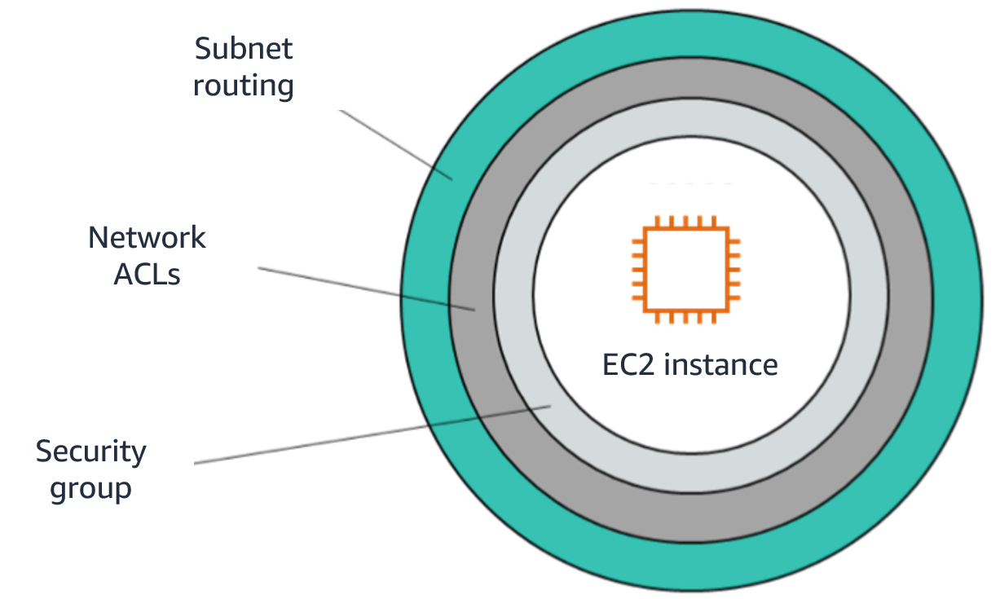

- Security groups
- Network ACLs
- Subnets
- Route tables

Note: VPC Flow Logs can log activity down to the interface level.

> **Нотатки:**
>
> For accessibility: EC2 instance surrounded by layers of security. The closest layer to the instance is a security group. The next layer is network ACLs. The outside, and farthest layer, is subnet routing. End of accessibility description.  
>
> VPC security features include the following:  
> Security groups act as virtual firewalls for your EC2 instances to control inbound and outbound traffic.  
> Network ACLs provide an optional layer of security for your VPC. They act as firewalls to control traffic in and out of one or more subnets.  
> Subnets make networks more efficient. Through subnetting, network traffic can travel a shorter distance without passing through unnecessary routers to reach its destination.  
> Route tables control where network traffic is directed.  
>
> With the VPC Flow Logs feature, you can capture information about the IP traffic going to and from network interfaces in your VPC. You can publish flow log data to Amazon CloudWatch Logs or Amazon Simple Storage Service (Amazon S3). After you create a flow log, you can retrieve and view its data in the chosen destination.  
>
> You can create a flow log for a VPC, subnet, or network interface. If you create a flow log for a subnet or VPC, each network interface in that subnet or VPC is monitored. Flow log data for a monitored network interface is recorded as flow log records, which are log events consisting of fields that describe the traffic flow.  
>
> For more information, see Logging IP Traffic Using VPC Flow Logs in the Amazon VPC User Guide at https://docs.aws.amazon.com/vpc/latest/userguide/flow-logs.html.

---

## Слайд 35: Key takeaways: Using AWS network ACLs

- A network ACL is an optional layer of security for your VPC and acts as a firewall to control traffic at the subnet level.
- Each subnet in your VPC must be associated with a network ACL.
- Network ACLs are stateless, which means that responses to inbound traffic are subject to the rules for outbound traffic (and vice versa).
- Rules are evaluated in number order before a decision is made to allow traffic.

> **Нотатки:**
>
> Some key takeaways from this section of the module include the following:  
> A network ACL is an optional layer of security for your VPC and acts as a firewall to control traffic at the subnet level.  
> Each subnet in your VPC must be associated with a network ACL.  
> Network ACLs are stateless, which means that responses to inbound traffic are subject to the rules for outbound traffic (and vice versa).  
> Rules are evaluated in number order before a decision is made to allow traffic.

---

## Слайд 36: Using AWS load balancers

Securing Your Infrastructure

> **Нотатки:**
>
> This section provides information about using load balancers as part of securing your infrastructure.

---

## Слайд 37: Elastic Load Balancing (ELB)

- Distributes incoming application traffic
- Supports high availability
- Performs health checks on instances
- Provides the following:
  - Application Load Balancer
  - Network Load Balancer
  - Classic Load Balancer

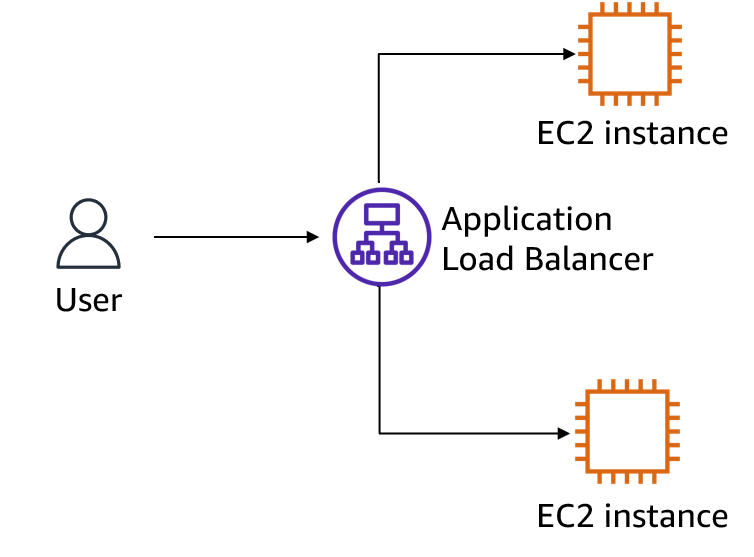

> **Нотатки:**
>
> For accessibility: Diagram of traffic from a user going to an application load balancer. Traffic is then split between two EC2 instances. End of accessibility description.  
>
> The Elastic Load Balancing (ELB) service automatically distributes incoming application traffic across multiple targets, such as EC2 instances, containers, and IP addresses. You configure your load balancer to accept incoming traffic by specifying one or more listeners. A listener is a process that checks for connection requests.  
>
> ELB scales your load-balancing device as traffic to your application changes over time, and can scale to the vast majority of workloads automatically. This increases the availability and fault tolerance of your applications. You can add and remove instances from your load balancer as your needs change, without disrupting the overall flow of requests to your application. ELB can handle the varying load of your application traffic in a single Availability Zone or across multiple Availability Zones.  
>
> You can also configure health checks, which monitor the health of registered targets. With health checks in place, the load-balancing device can send requests to only healthy targets. When the load balancer detects an unhealthy target, it stops routing traffic to that target. The load balancer resumes routing traffic to that target after detecting that the target is healthy again.  
>
> ELB is integrated with other popular AWS services such as Amazon EC2 Auto Scaling, Amazon Elastic Container Service (Amazon ECS), AWS CloudFormation, and AWS Certificate Manager (ACM).  
>
> ELB supports three types of load balancers: Application, Network, and Classic Load Balancers.  
>
> An Application Load Balancer operates at the request level, and routes traffic to targets (EC2 instances, containers, IP addresses, and AWS Lambda functions) based on the content of the request. An Application Load Balancer is ideal for advanced load balancing of HTTP and HTTPS traffic. This type of load balancer provides advanced request routing targeted at delivery of modern application architectures, including microservices and container-based applications. An Application Load Balancer simplifies and improves the security of your application, by ensuring that the latest SSL and TLS ciphers and protocols are used at all times.  
>
> A Network Load Balancer operates at the connection level, and routes connections to targets (EC2 instances, microservices, and containers) within a VPC, based on IP protocol data. A Network Load Balancer is ideal for load balancing both TCP and UDP traffic. This type of load balancer is capable of handling millions of requests per second while maintaining ultra-low latencies. A Network Load Balancer is optimized to handle sudden and volatile traffic patterns while using a single static IP address per Availability Zone.  
>
> A Classic Load Balancer provides basic load balancing across multiple EC2 instances, and operates at both the request level and connection level. A Classic Load Balancer is intended for applications that are built within the EC2-Classic network.  
>
> For more information, see What Is Elastic Load Balancing? in the ELB User Guide at https://docs.aws.amazon.com/elasticloadbalancing/latest/userguide/what-is-load-balancing.html.

---

## Слайд 38: Data protection in ELB

Single point of contact

Encryption

at rest

Encryption

in transit

> **Нотатки:**
>
> Single point of contact: A load balancer serves as the single point of contact for clients. The load balancer distributes incoming application traffic across multiple targets, such as EC2 instances, in multiple Availability Zones. This increases the availability of your application.  
>
> An Application Load Balancer can sustain secure HTTPS communication and certificates for communications with clients. It can optionally terminate the SSL connection at the load balancer level so that you don’t need to handle certificates in your own application.  
>
> Encryption at rest: If you enable server-side encryption with Amazon S3 managed encryption keys (SSE-S3) for your S3 bucket for ELB access logs, ELB automatically encrypts each access log file before it is stored in your S3 bucket. ELB also decrypts the access log files when you access them. Each log file is encrypted with a unique key, which is itself encrypted with a key that is regularly rotated.  
>
> Encryption in transit: ELB simplifies the process of building secure web applications by terminating HTTPS and TLS traffic from clients at the load balancer. The load balancer performs the work of encrypting and decrypting the traffic, instead of requiring each EC2 instance to handle the work for TLS termination.  
>
> For more information, see Data Protection in Elastic Load Balancing in the ELB User Guide  
> at https://docs.aws.amazon.com/elasticloadbalancing/latest/userguide/data-protection.html.

---

## Слайд 39: Load balancers in action

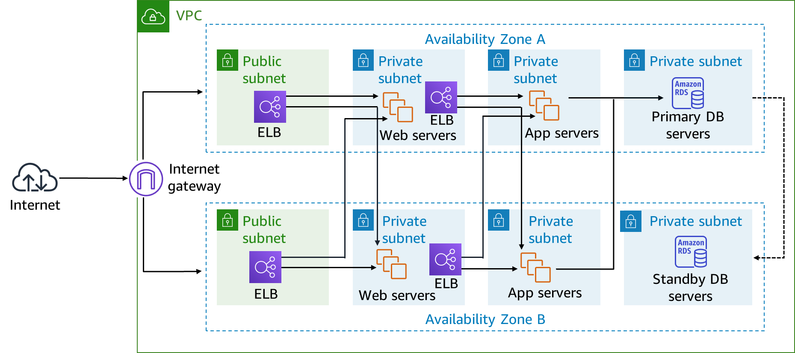

> **Нотатки:**
>
> This diagram shows how load balancers work. This VPC has subnets in two Availability Zones. Each Availability Zone has a public subnet and multiple private subnets.  
>
> Internet traffic goes from an internet gateway to each Availability Zone. A load balancer in each public subnet directs traffic to web servers in a private subnet in either Availability Zone. Traffic from the web servers goes to a load balancer, which directs the traffic to application servers in another private subnet in either Availability Zone. Traffic from the application servers goes to the primary database server in another private subnet in the first Availability Zone. The primary database can communicate with a standby database server in a private subnet in the second Availability Zone.

---

## Слайд 40: Key takeaways: Using AWS load balancers

- ELB automatically distributes incoming application traffic across multiple targets, such as EC2 instances, containers, IP addresses, and Lambda functions.
- ELB can handle the varying load of your application traffic in a single Availability Zone or across multiple Availability Zones.
- You can add and remove instances from your load balancer as your needs change, without disrupting the overall flow of requests to your application.

> **Нотатки:**
>
> Some key takeaways from this section of the module include the following:  
> ELB automatically distributes incoming application traffic across multiple targets, such as EC2 instances, containers, IP addresses, and Lambda functions.  
> ELB can handle the varying load of your application traffic in a single Availability Zone or across multiple Availability Zones.  
> You can add and remove instances from your load balancer as your needs change, without disrupting the overall flow of requests to your application.

---

## Слайд 41: Pulling it all together

Securing Your Infrastructure

> **Нотатки:**
>
> This section examines how all of these security features work together.

---

## Слайд 42: Workflow

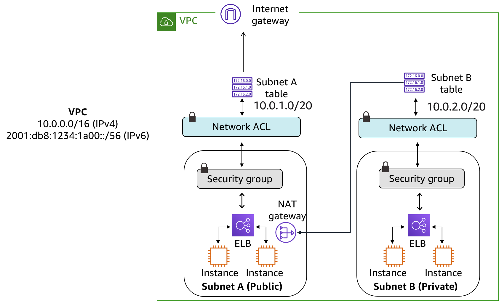

> **Нотатки:**
>
> The diagram on this slide shows how load balancing and VPC components work together.  
>
> A VPC has two subnets. Subnet A, which is a public subnet, contains two EC2 instances. Traffic from each instance routes through a load balancer to a security group, and then to a network ACL. Traffic then routes through a route table to an internet gateway.  
>
> Subnet B, which is a private subnet, contains two EC2 instances. Traffic from each instance routes through a load balancer to a security group, and then to a network ACL. Traffic then routes through a route table to a NAT gateway in subnet A, the public subnet.

---

## Слайд 43: Best practices to protect your network

- Control traffic at all layers.
- Inspect and filter your traffic at the application level.
- Automate network protection.
- Limit exposure.

> **Нотатки:**
>
> One of the best practices to protect your network is to apply controls for both inbound and outbound traffic. For a VPC, this includes using security groups, network ACLs, and subnets. Use subnets in multiple Availability Zones to separate layers of your application. Configure security groups and network ACLs to only allow the necessary inbound and outbound traffic.  
>
> Another best practice is to inspect and filter network traffic at the application level.  
>
> In addition, use threat intelligence and anomaly detection to automate protection mechanisms to provide a self-defending network.  
>
> Finally, limit the exposure of the workload to the internet and internal networks by only allowing the minimum required access.

---

## Слайд 44: Protecting your compute resources

Securing Your Infrastructure

> **Нотатки:**
>
> This section describes best practices to protect your compute resources.

---

## Слайд 45: Amazon Inspector

- Run automated security assessments on EC2 instances and applications.
- Identify application security issues.
- Enforce security standards and best practices.
- Generate assessment reports.

Amazon Inspector

> **Нотатки:**
>
> Amazon Inspector is an automated security assessment service that helps improve the security and compliance of applications deployed on AWS. The service helps you to identify security vulnerabilities and deviations from security best practices in applications, both before they are deployed and while they are running in a production environment. For example, the service can help you check for unintended network accessibility of your EC2 instances and for vulnerabilities on those instances.  
>
> Amazon Inspector provides you the opportunity to define standards and best practices for your applications, and validate adherence to these standards. This simplifies enforcement of your organization’s security standards and best practices, and helps to proactively manage security issues before they impact your production application.  
>
> After performing an assessment, Amazon Inspector produces a detailed list of security findings, prioritized by level of severity. You can review these findings directly or as part of detailed assessment reports, which are available through the AWS Management Console or API.  
>
> For more information, see Amazon Inspector at https://aws.amazon.com/inspector.

---

## Слайд 46: Security benefits of Amazon Inspector

- Automate tasks to help you respond to security issues
- Regularly monitor your resources
- Benefit from AWS security expertise
- Integrate security into DevOps

> **Нотатки:**
>
> Amazon Inspector security benefits include the following:  
> Automate tasks to respond to security issues: When you use Amazon EventBridge events with Amazon Inspector, you can automate tasks to help you respond to security issues that Amazon Inspector findings reveal.  
> Regular monitoring of your resources: Amazon Inspector helps to find security vulnerabilities in applications and departures from security best practices. The service find these issues before your application is deployed and while it's running in production. This improves the overall security of your applications hosted on AWS.  
> AWS security expertise: Amazon Inspector includes a knowledge base of rules charted to common security best practices and vulnerability definitions. AWS constantly updates the security best practices and rules.  
> Integration of security into DevOps: Amazon Inspector is an API-bound service that analyzes network configurations in your AWS account. Moreover, the service uses an optional agent for visibility into EC2 instances. The agent can help you to build Amazon Inspector assessments into your existing DevOps process. This helps you to empower both development and operations teams to make security assessments an essential part of the deployment process.

---

## Слайд 47: AWS Systems Manager

- Amazon Inspector uses the widely deployed AWS Systems Manager Agent (SSM Agent) to collect the software inventory and configurations from your EC2 instances.
- The collected application inventory and configurations are used to assess workloads for vulnerabilities.

AWS Systems Manager

> **Нотатки:**
>
> Amazon Inspector uses the widely deployed AWS Systems Manager Agent (SSM Agent) to collect the software inventory and configurations from your EC2 instances.  
>
> AWS Systems Manager gives you visibility and control of your infrastructure on AWS. Systems Manager provides a unified user interface so you can view operational data from multiple AWS services. The service includes capabilities that help you automate management tasks. You can collect system inventory, apply operating system patches, maintain up-to-date antivirus definitions, and configure operating systems and applications at scale. Systems Manager helps keep your systems compliant with your defined configuration policies.

---

## Слайд 48: Key takeaways: Protecting your compute resources

- Amazon Inspector is an automated security assessment service that helps improve the security and compliance of applications deployed on AWS.
- Systems Manager gives you visibility and control of your infrastructure on AWS.
- Scan your compute resources regularly for vulnerabilities, and patch them accordingly. You can automate this task by using AWS services such as Lambda and Systems Manager.

> **Нотатки:**
>
> Some key takeaways from this section of the module include the following:  
> Amazon Inspector is an automated security assessment service that helps improve the security and compliance of applications deployed on AWS.  
> Systems Manager gives you visibility and control of your infrastructure on AWS.  
> Scan your compute resources regularly for vulnerabilities, and patch them accordingly. You can automate this task by using AWS services such as Lambda and Systems Manager.

---

## Слайд 49: Lab: Securing VPC Resources by Using Security Groups

> **Нотатки:**
>
> You will now complete the Securing VPC Resources by Using Security Groups lab.  
>
> In this lab, you will analyze resource settings for a VPC and its subnets. You will gain experience with creating and updating security groups and network ACLs. Finally, you will connect to an instance in a private subnet by using two different methods.

---

## Слайд 50: Lab: Tasks

1. Analyzing the VPC and private subnet resource settings
2. Analyzing the public subnet resource settings
3. Testing HTTP connectivity from public EC2 instances
4. Restricting HTTP access by using an IP address
5. Scaling restricted HTTP access by referencing a security group
6. Restricting HTTP access by using a network ACL
7. Connecting to the AppServer by using a bastion host and SSH
8. Connecting directly to a host in a private subnet by using Session Manager

> **Нотатки:**
>
> In this lab, you will complete the following tasks:  
> Analyzing the VPC and private subnet resource settings  
> Analyzing the public subnet resource settings  
> Testing HTTP connectivity from public EC2 instances  
> Restricting HTTP access by using an IP address  
> Scaling restricted HTTP access by referencing a security group  
> Restricting HTTP access by using a network ACL  
> Connecting to the AppServer by using a bastion host and SSH  
> Connecting directly to a host in a private subnet by using Session Manager

---

## Слайд 51: Begin Lab: Securing VPC Resources by Using Security Groups

Duration: 90 minutes

> **Нотатки:**
>
> It's now time to start the lab.

---

## Слайд 52: Lab debrief: Key takeaways

> **Нотатки:**
>
> After you complete the lab, your educator might choose to lead a conversation about the key takeaways from the lab.

---

## Слайд 53: Module wrap-up

Securing Your Infrastructure

> **Нотатки:**
>
> It’s now time to review the module, and wrap up with a knowledge check and discussion of a practice certification exam question.

---

## Слайд 54: Module summary

In this module, you learned how to do the following:

- Define the components of a VPC.
- Recognize account boundaries.
- Describe AWS services that are available to protect your network and resources.

> **Нотатки:**
>
> In this module, you learned how to do the following:  
> Define the components of a VPC.  
> Recognize account boundaries.  
> Describe AWS services that are available to protect your network and resources.

---

## Слайд 55: Complete the knowledge check

> **Нотатки:**
>
> It is now time to complete the knowledge check for this module.

---

## Слайд 56: Sample exam question

A system administrator created a single EC2 instance, and set up network ACLs and the appropriate subnet routing. However, they want to provide an extra layer of security by applying a firewall to control access to and from the EC2 instance. Which action should the system administrator take?

Choice

Response

A

Create a network ACL.

B

Configure a security group.

C

Update the subnet route tables.

D

Set up a load balancer.

> **Нотатки:**
>
> Look at the answer choices and rule them out based on the keywords.

---

## Слайд 57: Sample exam question answer

A system administrator created a single EC2 instance, and set up network ACLs and the appropriate subnet routing. However, they want to provide an extra layer of security by applying a firewall to control access to and from the EC2 instance. Which action should the system administrator take?

The correct answer is B.

The keywords in the question are **applying a firewall** and **control access to and from the EC2 instance**.

> **Нотатки:**
>
> The following are the keywords to recognize: applying a firewall and control access to and from the EC2 instance.  
>
> The correct answer is B. A security group acts as a virtual firewall for your EC2 instances to control inbound and outbound traffic.  
>
> Incorrect answers:  
> Answer A: A network ACL acts as a firewall for associated subnets to control inbound and outbound traffic, but it operates at the subnet level.  
> Answer C: A route table is used to control where network traffic is directed. It does not function as a firewall.  
> Answer D: A load balancer automatically distributes incoming application traffic and scales resources to meet traffic demands. It does not function as a firewall.

---

## Слайд 58: Thank you

Corrections, feedback, or other questions?  
Contact us at [https://support.aws.amazon.com/#/contacts/aws-academy](https://support.aws.amazon.com/#/contacts/aws-academy).  
All trademarks are the property of their owners.

> **Нотатки:**
>
> Thank you for completing this module.

---

## Слайд 59: Image source files for development use only

<!-- hidden slide -->

> **Нотатки:**
>
> Image source files for development use only

---

## Слайд 60: Three-tier architecture

<!-- hidden slide -->

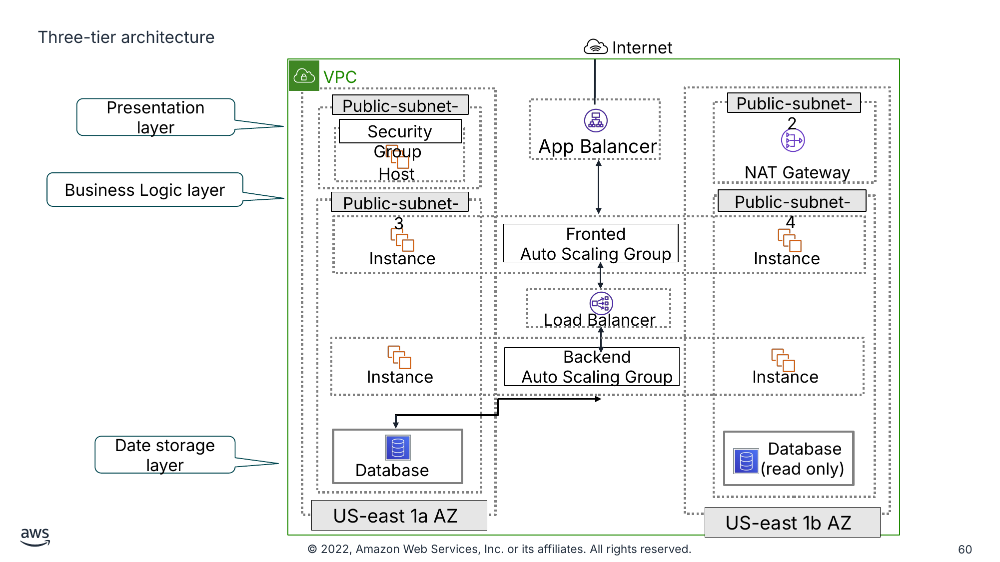

Текст зі схеми

Internet

VPC

 Public-subnet-1

 Public-subnet-2

 Security Group

App Balancer

 Host

NAT Gateway

 Public-subnet-3

 Public-subnet-4

Fronted

Auto Scaling Group

Instance

Instance

Load Balancer

Backend

Auto Scaling Group

Instance

Instance

Database (read only)

Database

US-east 1a AZ

US-east 1b AZ

Presentation layer

Business Logic layer

Date storage layer

---

## Слайд 61: VPCs and subnets

<!-- hidden slide -->

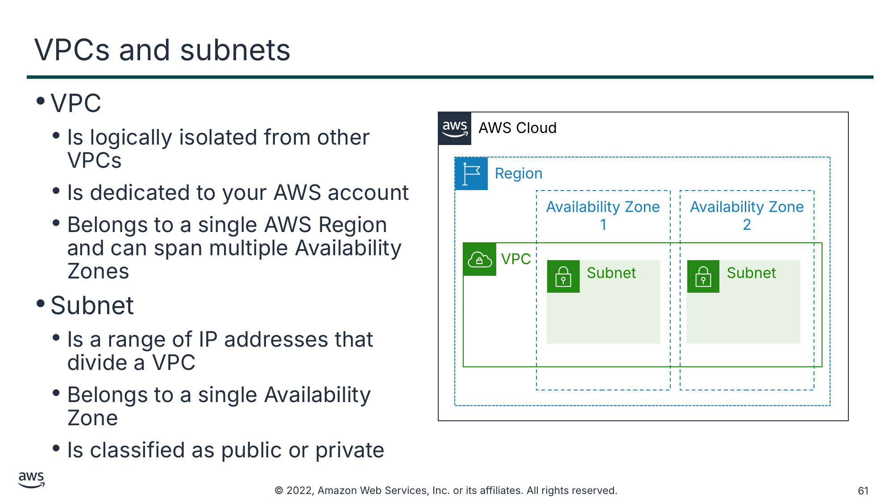

- VPC
  - Is logically isolated from other VPCs
  - Is dedicated to your AWS account
  - Belongs to a single AWS Region and can span multiple Availability Zones
- Subnet
  - Is a range of IP addresses that divide a VPC
  - Belongs to a single Availability Zone
  - Is classified as public or private

Текст зі схеми

AWS Cloud

Region

Availability Zone

1

Availability Zone

2

 VPC

Subnet

Subnet

> **Нотатки:**
>
> For accessibility: Diagram of subnets in a VPC. A Region within the AWS Cloud has one VPC, which spreads across two Availability Zones. The VPC has one subnet in each Availability Zone. End of accessibility description.  
>
> A VPC is a virtual network that is logically isolated from other virtual networks in the AWS Cloud. A VPC is dedicated to your account, belongs to a single AWS Region, and can span multiple Availability Zones.  
>
> After you create a VPC, you can divide it into one or more subnets. A subnet is a range of IP addresses that divide a VPC. Subnets belong to a single Availability Zone, but you can create subnets in different Availability Zones for high availability. Subnets are generally classified as public or private.

---

## Слайд 62: Three-tier architecture

<!-- hidden slide -->

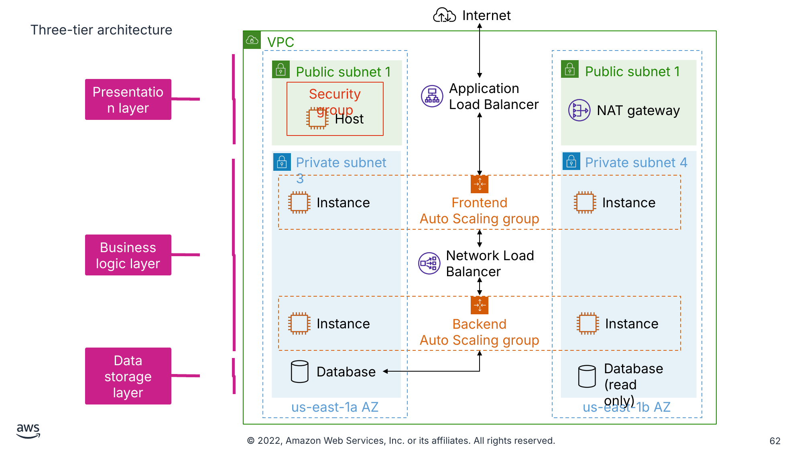

Private subnet 4

Текст зі схеми

Internet

VPC

Presentation layer

us-east-1a AZ

us-east-1b AZ

Public subnet 1

NAT gateway

Public subnet 1

Security group

Host

Application  
Load Balancer

Business logic layer

Private subnet 3

Frontend  
Auto Scaling group

Instance

Instance

Network Load  
Balancer

Backend  
Auto Scaling group

Instance

Instance

Data storage layer

Database

Database  
(read only)

> **Нотатки:**
>
> Diagram of a three-tier web application. See description in slide notes.

---

## Слайд 63: Private subnet

<!-- hidden slide -->

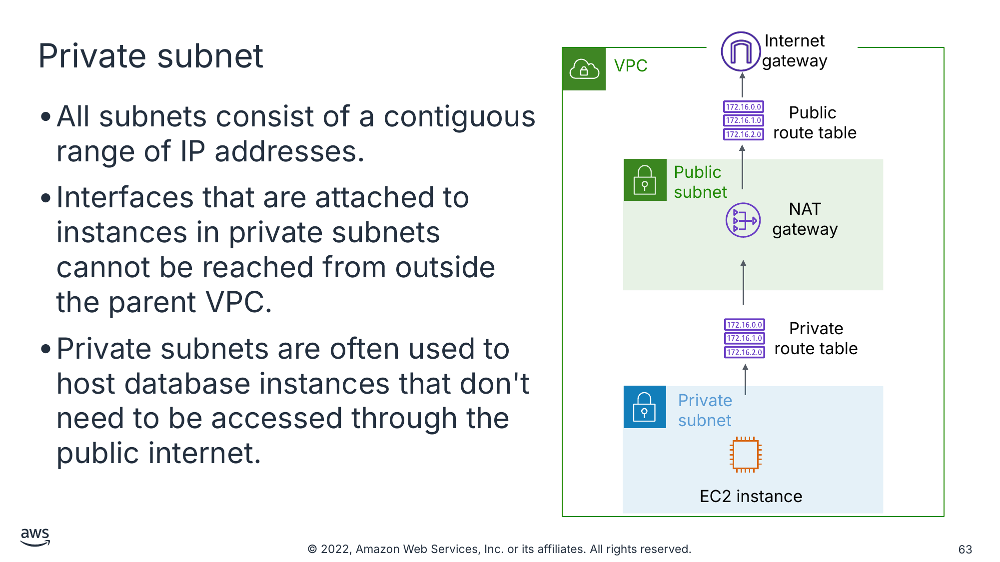

- All subnets consist of a contiguous range of IP addresses.
- Interfaces that are attached to instances in private subnets cannot be reached from outside the parent VPC.
- Private subnets are often used to host database instances that don't need to be accessed through the public internet.

Текст зі схеми

Internet  
gateway

   VPC

Public

route table

Public subnet

NAT  
gateway

Private route table

   Private

   subnet

 EC2 instance

---

## Слайд 64: Public subnet

<!-- hidden slide -->

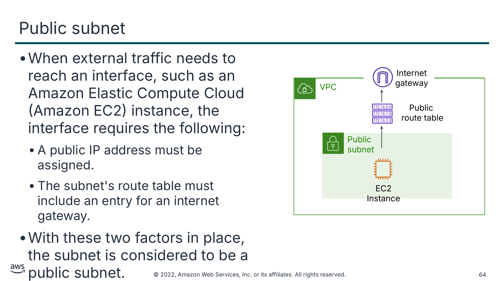

- When external traffic needs to reach an interface, such as an Amazon Elastic Compute Cloud (Amazon EC2) instance, the interface requires the following:
  - A public IP address must be assigned.
  - The subnet's route table must include an entry for an internet gateway.
- With these two factors in place, the subnet is considered to be a public subnet.

Текст зі схеми

Internet  
gateway

   VPC

Public  
route table

Public subnet

EC2 Instance

---

## Слайд 65: Route tables and routes

<!-- hidden slide -->

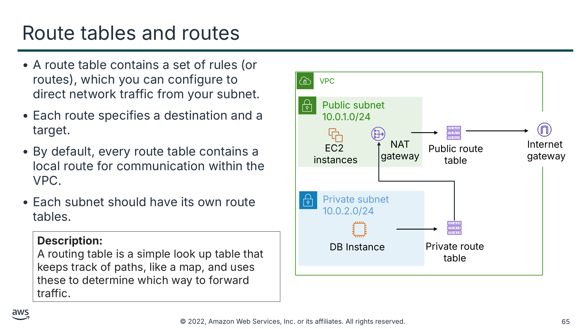

- A route table contains a set of rules (or routes), which you can configure to direct network traffic from your subnet.
- Each route specifies a destination and a target.
- By default, every route table contains a local route for communication within the VPC.
- Each subnet should have its own route tables.

**Description:**  
A routing table is a simple look up table that keeps track of paths, like a map, and uses these to determine which way to forward traffic.

Текст зі схеми

VPC

Public subnet

10.0.1.0/24

EC2  
instances

NAT  
gateway

Public route table

Internet

gateway

Private subnet

10.0.2.0/24

DB Instance

Private route table

---

## Слайд 66: Security groups (1 of 2)

<!-- hidden slide -->

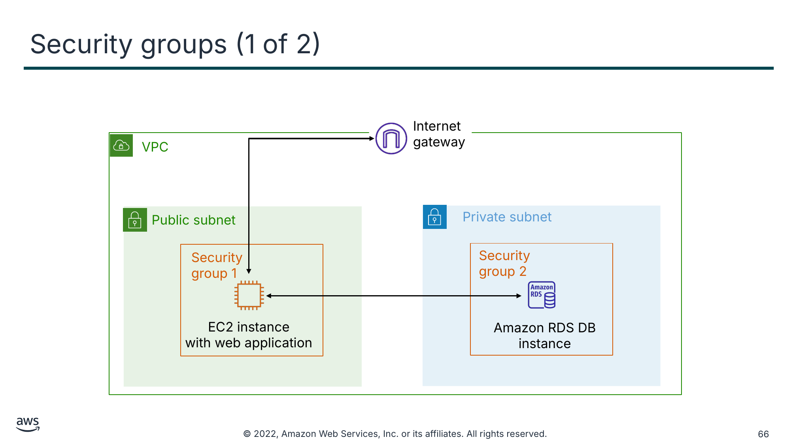

Текст зі схеми

Internet  
gateway

VPC

  Private subnet

Public subnet

Security group 1

Security group 2

EC2 instance  
with web application

Amazon RDS DB instance

---

## Слайд 67: Network ACLs (1 of 2)

<!-- hidden slide -->

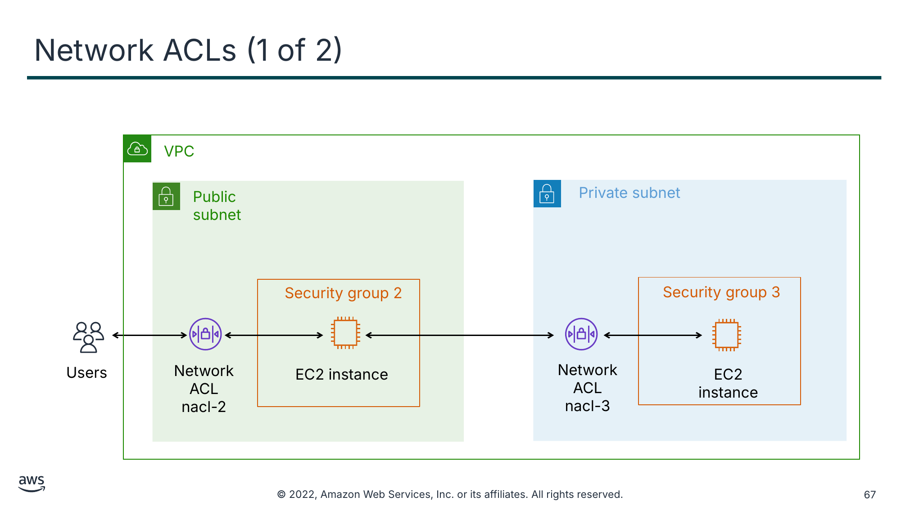

Текст зі схеми

VPC

Public subnet

  Private subnet

Security group 2

Security group 3

Users

Network ACL

nacl-2

EC2 instance

Network ACL

nacl-3

EC2 instance

> **Нотатки:**
>
> For accessibility: Diagram showing how network ACLs work. A VPC contains a public subnet and a private subnet. Each subnet contains an EC2 instance. A network ACL in each subnet controls traffic to and from the instances. End of accessibility description.  
>
> A network access control list (ACL) is an optional layer of security for your VPC. A network ACL acts as a firewall to control traffic in and out of one or more subnets. To add another layer of security to your VPC, you can set up network ACLs with rules that are similar to your security group rules.  
>
> Each subnet in your VPC must be associated with a network ACL. If you don't explicitly associate a subnet with a network ACL, the subnet is automatically associated with the default network ACL. You can associate a network ACL with multiple subnets; however, a subnet can be associated with only one network ACL at a time. When you associate a network ACL with a subnet, the previous association is removed.

---

## Слайд 68: Elastic Load Balancing (ELB)

<!-- hidden slide -->

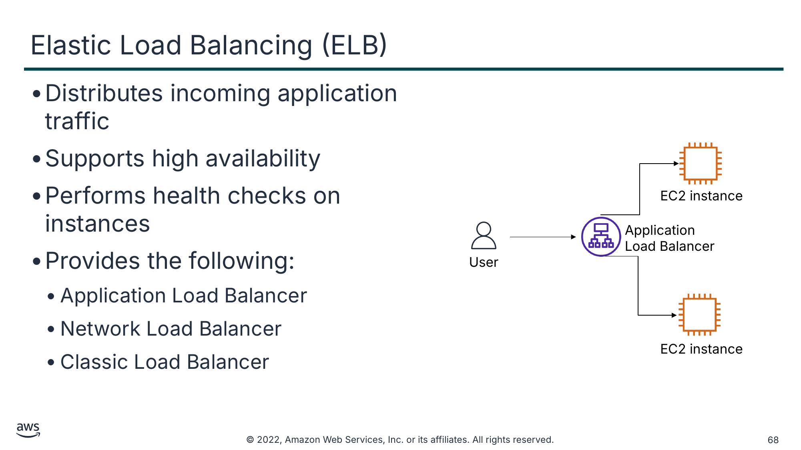

- Distributes incoming application traffic
- Supports high availability
- Performs health checks on instances
- Provides the following:
  - Application Load Balancer
  - Network Load Balancer
  - Classic Load Balancer

Текст зі схеми

EC2 instance

Application  
Load Balancer

EC2 instance

User

> **Нотатки:**
>
> Diagram of traffic going to a load balancer. See description in slide notes.  
>
> For accessibility: Diagram of traffic from a user going to a load balancer. Traffic is then split between two EC2 instances. End of accessibility description.  
>
> The Elastic Load Balancing (ELB) service automatically distributes incoming application traffic across multiple targets, such as EC2 instances, containers, and IP addresses. You configure your load balancer to accept incoming traffic by specifying one or more listeners. A listener is a process that checks for connection requests.  
>
> ELB scales your load-balancing device as traffic to your application changes over time, and can scale to the vast majority of workloads automatically. This increases the fault tolerance of your applications. You can add and remove instances from your load balancer as your needs change, without disrupting the overall flow of requests to your application. ELB can handle the varying load of your application traffic in a single Availability Zone or across multiple Availability Zones.  
>
> You can also configure health checks, which monitor the health of registered targets. With health checks in place, the load-balancing device can send requests to only healthy targets. When the load balancer detects an unhealthy target, it stops routing traffic to that target. The load balancer resumes routing traffic to that target after detecting that the target is healthy again.  
>
> ELB is integrated with other popular AWS services such as Amazon EC2 Auto Scaling, Amazon Elastic Container Service (Amazon ECS), AWS CloudFormation, and AWS Certificate Manager (ACM).  
>
> ELB supports three types of load balancers: Application, Network, and Classic Load Balancers.  
>
> An Application Load Balancer operates at the request level (Layer 7), and routes traffic to targets (EC2 instances, containers, IP addresses, and AWS Lambda functions) based on the content of the request. An Application Load Balancer is ideal for advanced load balancing of HTTP and HTTPS traffic. This type of load balancer provides advanced request routing targeted at delivery of modern application architectures, including microservices and container-based applications. An Application Load Balancer simplifies and improves the security of your application, by ensuring that the latest SSL and TLS ciphers and protocols are used at all times.  
>
> A Network Load Balancer operates at the connection level (Layer 4), and routes connections to targets (EC2 instances, microservices, and containers) within a VPC, based on IP protocol data. A Network Load Balancer is ideal for load balancing both TCP and UDP traffic. This type of load balancer is capable of handling millions of requests per second while maintaining ultra-low latencies. A Network Load Balancer is optimized to handle sudden and volatile traffic patterns while using a single static IP address per Availability Zone.  
>
> A Classic Load Balancer provides basic load balancing across multiple EC2 instances, and operates at both the request level and connection level. A Classic Load Balancer is intended for applications that are built within the EC2-Classic network.  
>
> AWS recommends an Application Load Balancer for Layer 7 traffic and a Network Load Balancer for Layer 4 traffic when using a VPC.

---

## Слайд 69: Load balancers in action

<!-- hidden slide -->

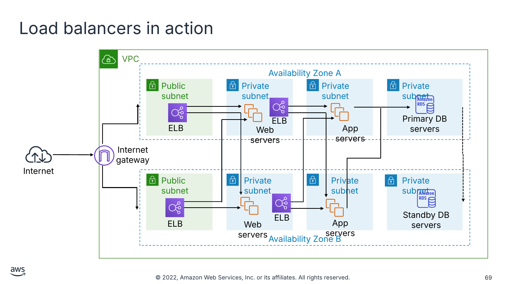

Текст зі схеми

VPC

Availability Zone A

Public subnet

Private subnet

Web servers

Private subnet

App servers

Private subnet

Primary DB servers

Internet

Internet gateway

Availability Zone B

Public subnet

 Private  
 subnet

Web servers

    Private  
    subnet

App servers

Private subnet

Standby DB servers

ELB

ELB

ELB

ELB

> **Нотатки:**
>
> This diagram shows how load balancers works. A VPC has subnets in two Availability Zones. Each Availability Zone has a public subnet and multiple private subnets.  
>
> Internet traffic goes from an internet gateway to each Availability Zone. A load balancer in each public subnet directs traffic to web servers in a private subnet in either Availability Zone. Traffic from the web servers goes to a load balancer, which directs the traffic to application servers in another private subnet in either Availability Zone. Traffic from the application servers goes to the primary database server in another private subnet in the first Availability Zone. The primary database can communicate with a standby database server in a private subnet in the second Availability Zone.

---

## Слайд 70: Workflow

<!-- hidden slide -->

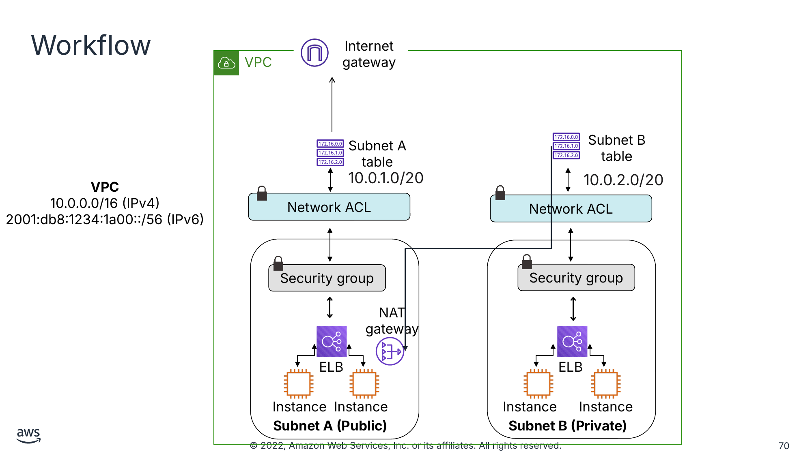

Текст зі схеми

Subnet B

table

Subnet A

table

**VPC**

10.0.0.0/16 (IPv4)

2001:db8:1234:1a00::/56 (IPv6)

Network ACL

Security group

Instance

Instance

**Subnet A (Public)**

**Subnet B (Private)**

Instance

Instance

10.0.1.0/20

10.0.2.0/20

Network ACL

Security group

NAT gateway

ELB

ELB

Internet  
gateway

VPC

