## Слайд 1: Захист вашої інфраструктури (Securing Your Infrastructure)

AWS Academy Cloud Security Foundations

> **Нотатки:**
>
> Вітаємо в модулі «Захист вашої інфраструктури» (Securing Your Infrastructure).

---

## Слайд 2: Вступ

Захист вашої інфраструктури

> **Нотатки:**
>
> Цей перший розділ надає вступ до модуля.

---

## Слайд 3: Цілі модуля

Наприкінці цього модуля ви повинні вміти:

- Визначати компоненти віртуальної приватної хмари (VPC).
- Розпізнавати межі акаунтів (account boundaries).
- Описувати сервіси Amazon Web Services (AWS), доступні для захисту вашої мережі та ресурсів.

> **Нотатки:**
>
> Наприкінці цього модуля ви повинні вміти:  
> Визначати компоненти віртуальної приватної хмари (VPC).  
> Розпізнавати межі акаунтів.  
> Описувати сервіси Amazon Web Services (AWS), доступні для захисту вашої мережі та ресурсів.

---

## Слайд 4: Огляд модуля

**Розділи**

- Структура триярусного вебзастосунку (three-tier web application)
- Використання VPC
- Налаштування публічних і приватних підмереж та інтернет-протоколів
- Використання груп безпеки AWS (security groups)
- Використання мережевих ACL AWS (network ACLs)
- Використання балансувальників навантаження AWS
- Збираємо все разом
- Захист ваших обчислювальних ресурсів

**Лабораторна робота**

- Захист ресурсів VPC за допомогою груп безпеки (Securing VPC Resources by Using Security Groups)

**Перевірка знань**

> **Нотатки:**
>
> Цей модуль містить такі розділи:  
> Структура триярусного вебзастосунку  
> Використання VPC  
> Налаштування публічних і приватних підмереж та інтернет-протоколів  
> Використання груп безпеки AWS  
> Використання мережевих ACL AWS  
> Використання балансувальників навантаження AWS  
> Збираємо все разом  
> Захист ваших обчислювальних ресурсів  
>
> Також цей модуль містить лабораторну роботу, у якій ви захищатимете ресурси VPC за допомогою груп безпеки.  
>
> Наприкінці вам буде запропоновано пройти перевірку знань, що перевіряє ваше розуміння ключових концепцій, розглянутих у цьому модулі.

---

## Слайд 5: Банківський бізнес-сценарій (1 із 3)

> **Нотатки:**
>
> Обговорімо, як концепції цього модуля застосовуються до банківського бізнес-сценарію.

---

## Слайд 6: Банківський бізнес-сценарій (2 із 3)

> **Нотатки:**
>
> Після останньої зустрічі з Джоном (John) Марія (María) зрозуміла, що занепокоєння Джона щодо безпеки виходять за межі доступу користувачів і керування ним.  
>
> Щоб обґрунтувати міграцію в AWS, Марії потрібно буде заспокоїти Джона, допомігши йому зрозуміти, як належним чином захистити інфраструктуру банку в AWS.

---

## Слайд 7: Банківський бізнес-сценарій (3 із 3)

> **Нотатки:**
>
> Джон запитав Марію, як вони забезпечать безпеку інфраструктури, яку AnyBank потенційно може перенести в AWS.  
>
> До наступної зустрічі Марія вирішує зосередитися на використанні віртуальної приватної хмари (VPC) і застосуванні кількох рівнів безпеки для підтримки мережевої інфраструктури.

---

## Слайд 8: Модель спільної відповідальності (shared responsibility model)

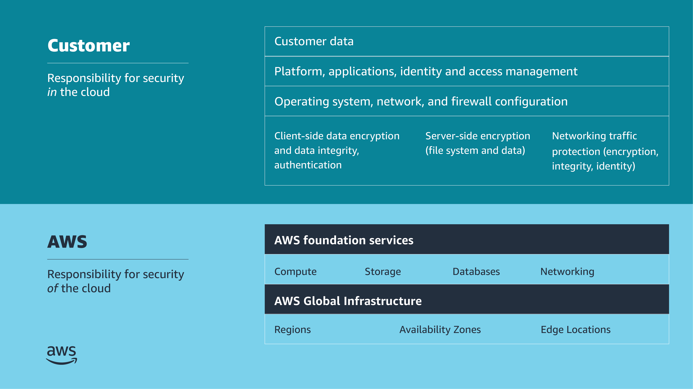

> **Нотатки:**
>
> Для доступності: модель спільної відповідальності з переліком обов’язків клієнта й AWS. Клієнт відповідає за безпеку в хмарі. Це включає дані клієнта; платформу, застосунки, керування ідентичністю та доступом; конфігурацію операційної системи, мережі та брандмауера; шифрування даних на стороні клієнта та цілісність даних, автентифікацію; серверне шифрування файлової системи та даних; захист мережевого трафіку, що включає шифрування, цілісність і ідентичність. AWS відповідає за безпеку самої хмари. Це включає базові сервіси AWS для обчислень, зберігання, баз даних і мереж, а також глобальну інфраструктуру AWS, що включає регіони, зони доступності та периферійні локації. Кінець опису для доступності.  
>
> Цей модуль зосереджений на частині моделі спільної відповідальності, що стосується конфігурації операційної системи, мережі та брандмауера й захисту мережевого трафіку, за безпеку яких відповідає клієнт.

---

## Слайд 9: Структура триярусного вебзастосунку

Захист вашої інфраструктури

> **Нотатки:**
>
> Цей розділ описує структуру триярусного вебзастосунку.

---

## Слайд 10: Триярусна архітектура (three-tier architecture)

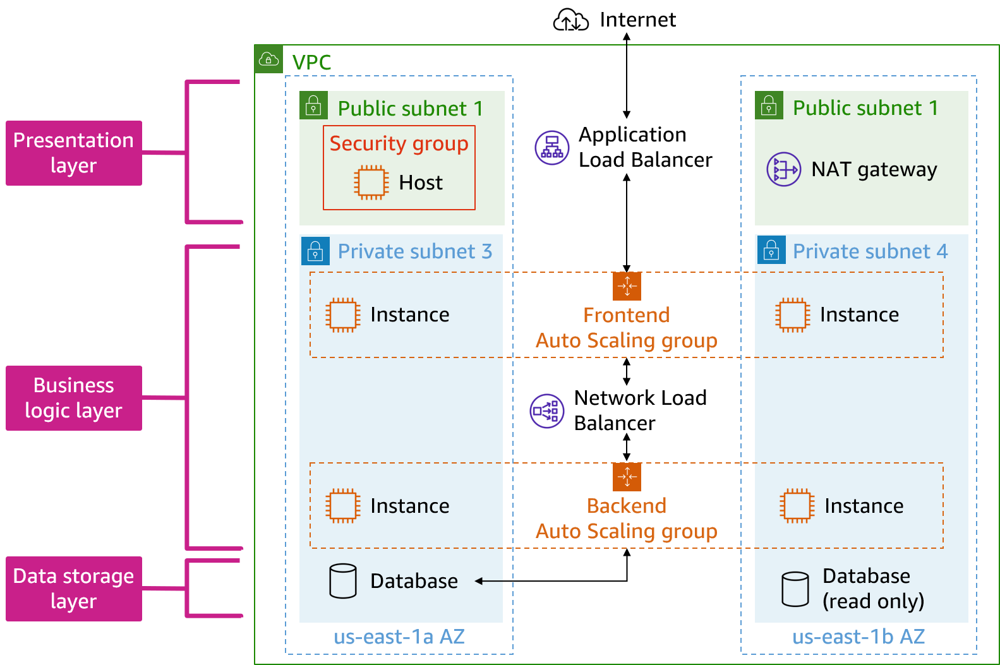

> **Нотатки:**
>
> Для доступності: схема триярусного вебзастосунку, що включає рівень представлення (presentation layer), рівень бізнес-логіки (business logic layer) і рівень зберігання даних (data storage layer). VPC має підмережі у двох зонах доступності. Рівень представлення включає дві публічні підмережі — по одній у кожній зоні доступності. Одна підмережа містить групу безпеки з екземпляром-хостом, а в іншій підмережі є NAT-шлюз. Application Load Balancer на цьому рівні керує трафіком між інтернетом і фронтенд-групою Auto Scaling на рівні бізнес-логіки. Ця група Auto Scaling відповідає за масштабування фронтенд-екземплярів у двох зонах доступності. Network Load Balancer на рівні бізнес-логіки керує трафіком між фронтенд-групою Auto Scaling і бекенд-групою Auto Scaling. Бекенд-група Auto Scaling відповідає за масштабування бекенд-екземплярів у двох зонах доступності. Рівень зберігання даних містить основну базу даних в одній зоні доступності та базу даних лише для читання в другій зоні доступності. Рівень зберігання даних взаємодіє з бекенд-групою Auto Scaling на рівні бізнес-логіки. Кінець опису для доступності.  
>
> Триярусна архітектура — це шаблон програмної архітектури, де застосунок має три логічні яруси: рівень представлення, рівень застосунку та рівень зберігання даних. Ця архітектура використовується в клієнт-серверних застосунках, як-от вебзастосунок, що має фронтенд, бекенд і базу даних. Кожен рівень, або ярус, виконує певне завдання й може керуватися незалежно від інших. Це відхід від монолітного способу побудови застосунку, коли фронтенд, бекенд і база даних розташовані в одному місці.

---

## Слайд 11: Використання VPC

Захист вашої інфраструктури

> **Нотатки:**
>
> Цей розділ надає інформацію про використання VPC як частини захисту вашої інфраструктури.

---

## Слайд 12: Amazon Virtual Private Cloud (Amazon VPC)

- Розгорніть логічно ізольовану ділянку хмари AWS, де можна запускати ресурси AWS у віртуальній мережі, яку ви визначаєте.
- Контролюйте свої ресурси віртуальної мережі, зокрема:
  - Вибирайте діапазон IP-адрес.
  - Створюйте підмережі.
  - Налаштовуйте таблиці маршрутизації та мережеві шлюзи.
- Налаштовуйте конфігурацію мережі для вашої VPC.
- Використовуйте кілька рівнів безпеки.

Amazon Virtual Private Cloud (Amazon VPC)

> **Нотатки:**
>
> Використовуйте сервіс Amazon Virtual Private Cloud (Amazon VPC), щоб розгорнути логічно ізольовану ділянку хмари AWS, де можна запускати ваші ресурси AWS. Ця ізольована ділянка називається віртуальною приватною хмарою, або VPC.  
>
> Amazon VPC надає контроль над вашими ресурсами віртуальної мережі, як-от вибір власного діапазону IP-адрес, створення підмереж і налаштування таблиць маршрутизації та мережевих шлюзів. У вашій VPC можна використовувати і IPv4, і IPv6 для безпечного доступу до ресурсів і застосунків.  
>
> Ви також можете налаштувати конфігурацію мережі для вашої VPC. Наприклад, можна створити публічну підмережу для ваших вебсерверів, що мають доступ до публічного інтернету. Ваші бекенд-системи, як-от бази даних чи сервери застосунків, можна розмістити в приватній підмережі без доступу до публічного інтернету.  
>
> Нарешті, у VPC можна використовувати кілька рівнів безпеки, щоб допомогти контролювати доступ до екземплярів Amazon Elastic Compute Cloud (Amazon EC2) у підмережах VPC. Механізми безпеки включають групи безпеки та списки контролю доступу до мережі (network ACLs).  
>
> Докладніше див. «Що таке Amazon VPC?» (What Is Amazon VPC?) у посібнику користувача Amazon VPC за адресою https://docs.aws.amazon.com/vpc/latest/userguide/what-is-amazon-vpc.html.

---

## Слайд 13: VPC та підмережі

- VPC
  - Логічно ізольована від інших VPC
  - Виділена для вашого акаунта AWS
  - Належить до одного регіону AWS і може охоплювати кілька зон доступності
- Підмережа
  - Діапазон IP-адрес, що розділяють VPC
  - Належить до однієї зони доступності
  - Класифікується як публічна або приватна

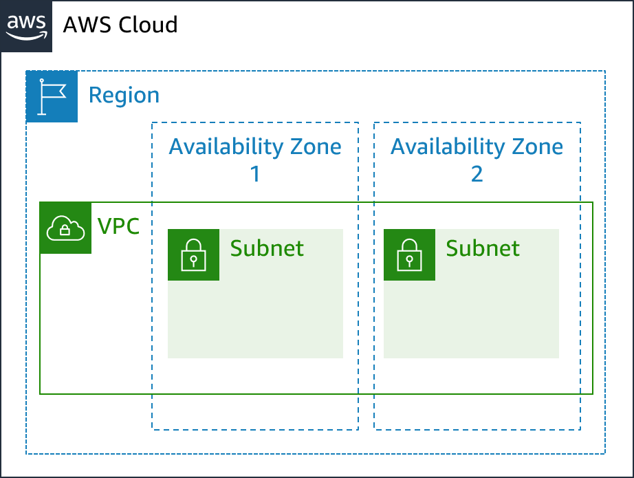

> **Нотатки:**
>
> Для доступності: схема підмереж у VPC. Регіон у хмарі AWS має одну VPC, що охоплює дві зони доступності. VPC має по одній підмережі в кожній зоні доступності. Кінець опису для доступності.  
>
> VPC — це віртуальна мережа, логічно ізольована від інших віртуальних мереж у хмарі AWS. VPC виділена для вашого акаунта, належить до одного регіону AWS і може охоплювати кілька зон доступності.  
>
> Після створення VPC її можна розділити на одну чи кілька підмереж. Підмережа — це діапазон IP-адрес, що розділяють VPC. Підмережі належать до однієї зони доступності, але ви можете створювати підмережі в різних зонах доступності для високої доступності. Підмережі загалом класифікують як публічні або приватні.

---

## Слайд 14: Налаштування публічних і приватних підмереж та інтернет-протоколів

Захист вашої інфраструктури

> **Нотатки:**
>
> Цей розділ описує, як налаштувати публічні та приватні підмережі й інтернет-протоколи.

---

## Слайд 15: Інтернет-шлюз (internet gateway)

- Надає ціль у таблицях маршрутизації вашої VPC для трафіку, що маршрутизується в інтернет
- Виконує трансляцію мережевих адрес (NAT) для екземплярів, яким призначено публічні адреси IPv4
- Підтримує трафік IPv4 та IPv6
- Не спричиняє додаткової плати у вашому акаунті

> **Нотатки:**
>
> Інтернет-шлюз виконує дві функції:  
> Надає ціль у таблицях маршрутизації вашої VPC для трафіку, що маршрутизується в інтернет  
> Виконує трансляцію мережевих адрес (NAT) для екземплярів, яким призначено публічні адреси IPv4  
>
> Інтернет-шлюз підтримує трафік IPv4 та IPv6 і не створює ризиків доступності чи обмежень пропускної здатності для вашого мережевого трафіку. За наявність інтернет-шлюзу у вашому акаунті додаткова плата не стягується.  
>
> Щоб увімкнути доступ до інтернету або з інтернету для екземплярів у підмережі VPC, потрібно виконати таке:  
> Створити інтернет-шлюз і приєднати його до вашої VPC.  
> Додати до таблиці маршрутизації вашої підмережі маршрут, що спрямовує трафік, призначений для інтернету, до інтернет-шлюзу.  
> Переконатися, що кожен екземпляр у вашій підмережі має глобально унікальну IP-адресу (публічну адресу IPv4, еластичну IP-адресу або адресу IPv6).  
> Переконатися, що правила вашого мережевого ACL і групи безпеки дозволяють потрібному трафіку проходити до вашого екземпляра та від нього.  
>
> Докладніше див. «Підключення до інтернету за допомогою інтернет-шлюзу» (Connect to the Internet Using an Internet Gateway) у посібнику користувача Amazon VPC за адресою https://docs.aws.amazon.com/vpc/latest/userguide/VPC_Internet_Gateway.html.

---

## Слайд 16: NAT-шлюз (NAT gateway)

[https://docs.aws.amazon.com/vpc/latest/userguide/vpc-nat-comparison.html](https://docs.aws.amazon.com/vpc/latest/userguide/vpc-nat-comparison.html)

- Дає змогу екземплярам у приватній підмережі підключатися до інтернету чи інших сервісів AWS
- Не дозволяє інтернету ініціювати з’єднання з цими екземплярами
- Під час створення вимагає вказати таке:
  - Публічну підмережу, у якій має розміщуватися NAT-шлюз
  - Еластичну IP-адресу, яку слід пов’язати з NAT-шлюзом
- Після створення вимагає оновити таблицю маршрутизації однієї чи кількох ваших приватних підмереж, щоб спрямовувати трафік, призначений для інтернету, до NAT-шлюзу

> **Нотатки:**
>
> Шлюз трансляції мережевих адрес (NAT gateway) дає змогу екземплярам у приватній підмережі підключатися до інтернету чи інших сервісів AWS. NAT-шлюз також не дозволяє інтернету ініціювати з’єднання з цими екземплярами.  
>
> Щоб створити NAT-шлюз, потрібно вказати публічну підмережу, у якій має розміщуватися NAT-шлюз. Також потрібно вказати еластичну IP-адресу, яку слід пов’язати з NAT-шлюзом. Після створення NAT-шлюзу потрібно оновити таблицю маршрутизації, пов’язану з однією чи кількома вашими приватними підмережами, щоб спрямувати трафік, призначений для інтернету, до NAT-шлюзу. Таким чином екземпляри у ваших приватних підмережах можуть обмінюватися даними з інтернетом.  
>
> Замість NAT-шлюзу можна також використати екземпляр NAT (NAT instance) у публічній підмережі вашої VPC. Однак NAT-шлюз — це кероване NAT-обслуговування, що забезпечує кращу доступність, вищу пропускну здатність і менше адміністративних зусиль. Для типових сценаріїв використання AWS рекомендує використовувати NAT-шлюз замість екземпляра NAT.  
>
> Докладніше див. такі теми в посібнику користувача Amazon VPC:  
> NAT-шлюзи: https://docs.aws.amazon.com/vpc/latest/userguide/vpc-nat-gateway.html  
> Екземпляри NAT: https://docs.aws.amazon.com/vpc/latest/userguide/VPC_NAT_Instance.html  
> Порівняння NAT-шлюзів і екземплярів NAT: https://docs.aws.amazon.com/vpc/latest/userguide/vpc-nat-comparison.html

---

## Слайд 17: Приватна підмережа (private subnet)

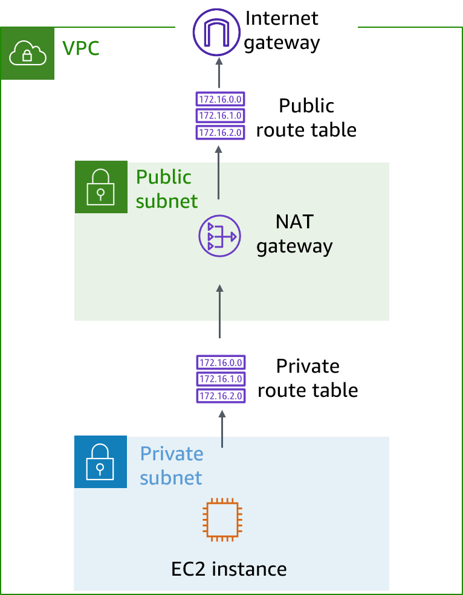

- Усі підмережі складаються з неперервного діапазону IP-адрес.
- Інтерфейси, приєднані до екземплярів у приватних підмережах, недосяжні ззовні батьківської VPC.
- Приватні підмережі часто використовуються для розміщення екземплярів баз даних, до яких не потрібен доступ через публічний інтернет.

> **Нотатки:**
>
> Для доступності: схема VPC з публічною та приватною підмережами. Екземпляр EC2 у приватній підмережі маршрутизує трафік до приватної таблиці маршрутизації, а потім до NAT-шлюзу в публічній підмережі. Звідти трафік маршрутизується до публічної таблиці маршрутизації, а потім до інтернет-шлюзу. Кінець опису для доступності.  
>
> Усі підмережі складаються з неперервного діапазону IP-адрес. Ці адреси не повинні перетинатися з іншими підмережами у вашій VPC.  
> Інтерфейси, приєднані до екземплярів EC2 у приватних підмережах, недосяжні ззовні батьківської VPC. Однак завдяки керованому AWS NAT-шлюзу екземпляри EC2 можуть робити вихідні запити, наприклад для встановлення виправлень (patching), а відповідь зовнішнього ресурсу буде дозволено повернути.  
> Приватні підмережі часто використовуються для розміщення екземплярів баз даних (DB), до яких не потрібен доступ через публічний інтернет.  
> NAT-шлюзу має бути призначена еластична IP-адреса.

---

## Слайд 18: Публічна підмережа (public subnet)

- Коли зовнішній трафік має досягти інтерфейсу, як-от екземпляр Amazon Elastic Compute Cloud (Amazon EC2), інтерфейс вимагає таке:
  - Екземпляру EC2 має бути призначена публічна IP-адреса.
  - Таблиця маршрутизації підмережі має містити запис для інтерфейсу.
- За наявності цих двох чинників підмережа вважається публічною.

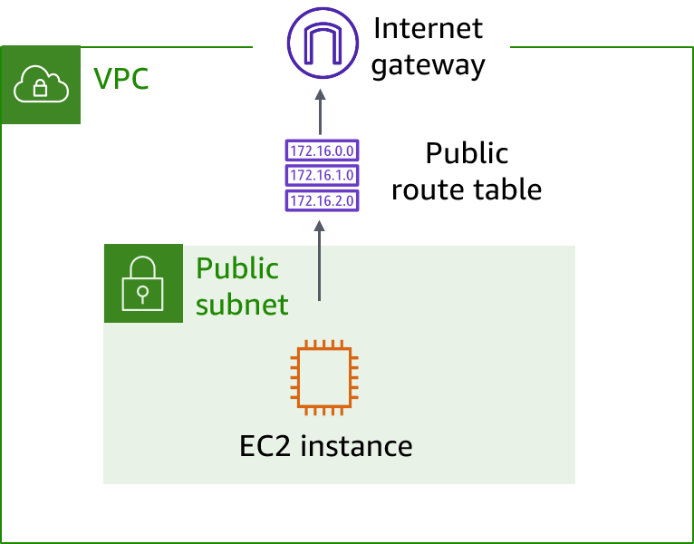

> **Нотатки:**
>
> Для доступності: схема VPC з публічною підмережею. Трафік від екземпляра EC2 у підмережі йде до публічної таблиці маршрутизації, а потім до інтернет-шлюзу. Кінець опису для доступності.  
>
> Коли зовнішній трафік має досягти інтерфейсу, як-от екземпляр EC2, інтерфейс вимагає таке:  
> Екземпляру EC2 має бути призначена публічна IP-адреса.  
> Таблиця маршрутизації підмережі має містити запис для інтерфейсу.  
>
> За наявності цих двох чинників підмережа визначається як публічна.  
>   
> Часто компанії розміщують вебсервери в публічній підмережі. Однак AWS рекомендує використовувати балансувальник навантаження в публічній підмережі та змушувати його передавати трафік вебсерверам, розміщеним у приватних підмережах.

---

## Слайд 19: IP-адресація

- Коли ви створюєте VPC, ви призначаєте їй діапазон CIDR (діапазон приватних адрес).
- Діапазон у VPC чи підмережі змінити не можна, але можна додавати до вашої VPC додаткові діапазони CIDR.
- Найбільший розмір блока CIDR — /16, а найменший — /28.
- Діапазони CIDR підмереж не повинні перетинатися.

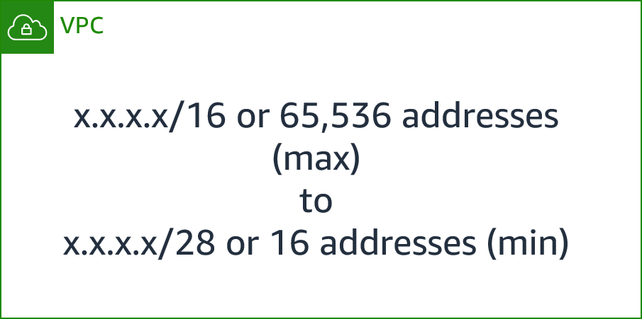

> **Нотатки:**
>
> IP-адреси дають змогу ресурсам у вашій VPC обмінюватися даними один з одним і з ресурсами через інтернет. Коли ви створюєте VPC, ви призначаєте їй діапазон безкласової міждоменної маршрутизації (Classless Inter-Domain Routing, CIDR) — діапазон приватних адрес.  
>
> Блок CIDR може бути розміром до /16 (що становить 2¹⁶, або 65 536 адрес) або розміром лише /28 (що становить 2⁴, або 16 адрес).  
>
> Блок CIDR підмережі може збігатися з блоком CIDR VPC, у якій розташована підмережа. Це означає, що VPC і підмережа мають однаковий розмір; VPC має єдину підмережу.  
>
> Блок CIDR підмережі може бути підмножиною блока CIDR VPC. Така структура підтримує визначення кількох підмереж. Якщо ви створюєте більше однієї підмережі у VPC, діапазони CIDR підмереж не повинні перетинатися. У тій самій VPC не може бути дублікатів IP-адрес.  
>
> Докладніше див. «Визначення розміру VPC» (VPC Sizing) у посібнику користувача Amazon VPC за адресою https://docs.aws.amazon.com/vpc/latest/userguide/configure-your-vpc.html#vpc-sizing.

---

## Слайд 20: Зарезервовані IP-адреси

**Приклад:** VPC з блоком CIDR IPv4 10.0.0.0/16 має 65 536 IP-адрес загалом. VPC має чотири підмережі, усі з блоками CIDR /24. Хоча кожна підмережа має 256 IP-адрес, для використання в кожній доступні лише 251 IP-адреса.

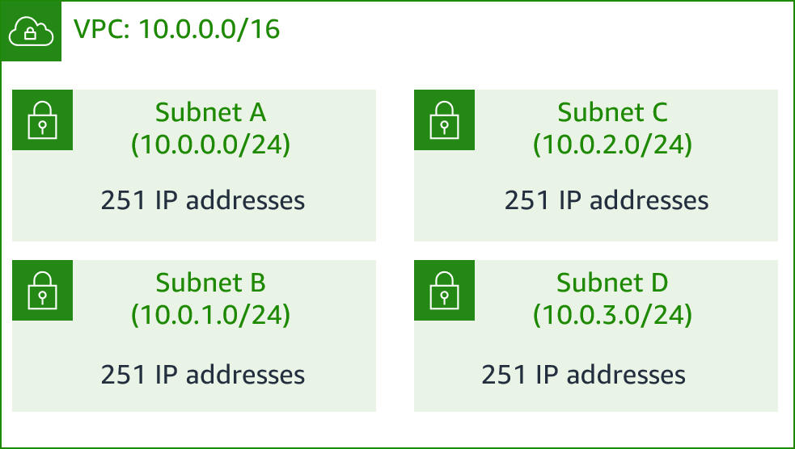

| IP-адреси для блока CIDR 10.0.0.0/24 | Зарезервовано для |
|---|---|
| 10.0.0.0 | Адреса мережі |
| 10.0.0.1 | Внутрішній обмін даними |
| 10.0.0.2 | Розв’язання імен системи доменних імен (DNS) |
| 10.0.0.3 | Майбутнє використання |
| 10.0.0.255 | Широкомовна адреса мережі (network broadcast address) |

> **Нотатки:**
>
> Коли ви створюєте підмережу, їй потрібен власний блок CIDR. Для кожного блока CIDR, який ви вказуєте, AWS резервує п’ять IP-адрес у цьому блоці, і ці п’ять адрес використовувати не можна. AWS резервує ці IP-адреси для:  
> Адреси мережі  
> Локального маршрутизатора VPC (внутрішній обмін даними)  
> Розв’язання імен системи доменних імен (DNS)  
> Майбутнього використання  
> Широкомовної адреси мережі  
>
> Наприклад, припустімо, що ви створюєте підмережу з блоком CIDR IPv4 10.0.0.0/24, що має 256 IP-адрес загалом. Підмережа має 256 IP-адрес, але доступні лише 251, оскільки 5 зарезервовано для AWS.

---

## Слайд 21: Публічна IP-адреса (public IP address)

- Публічна IP-адреса — це IP-адреса, що використовується для доступу до інтернету.
- Публічну IP-адресу можна призначати автоматично, якщо змінити властивості автоматичного призначення публічної IP-адреси для підмережі.
- Публічні IP-адреси динамічні. Якщо ви зупиняєте або запускаєте екземпляр, призначається нова публічна IP-адреса. Для продуктивних проєктів використовуйте еластичну IP-адресу (Elastic IP address) замість призначеної публічної IP-адреси, яку буде від’єднано, якщо зупинити екземпляр.

> **Нотатки:**
>
> Коли ви створюєте VPC, кожен екземпляр у цій VPC автоматично отримує приватну IP-адресу. Ви також можете запросити призначення публічної IP-адреси під час створення екземпляра, змінивши властивості автоматичного призначення публічної IP-адреси для підмережі. Публічна IP-адреса використовується для доступу до інтернету.  
>
> Публічні IP-адреси динамічні. Якщо ви зупиняєте або запускаєте екземпляр, призначається нова публічна IP-адреса. Для продуктивних проєктів використовуйте еластичну IP-адресу замість призначеної публічної IP-адреси, яку буде від’єднано, якщо зупинити екземпляр.  
>
> Докладніше див. «Публічні адреси IPv4» (Public IPv4 Addresses) у посібнику користувача Amazon VPC за адресою https://docs.aws.amazon.com/vpc/latest/userguide/how-it-works.html#vpc-public-ipv4-addresses.

---

## Слайд 22: Еластична IP-адреса (Elastic IP address)

- Пов’язана з акаунтом AWS
- Статична й не змінюється з часом
- Береться з пулу адрес IPv4 Amazon
  - Якщо ви скасуєте призначення еластичної IP-адреси, плата стягується, доки ви не видалите її повністю.

Еластичні IP-адреси виділяються вашому акаунту й залишаються незмінними. Використовуйте еластичну IP-адресу, коли ви працюєте над довгостроковим проєктом і налаштування IP-адрес може забирати багато часу.

> **Нотатки:**
>
> Еластична IP-адреса — це статична публічна IP-адреса, розроблена для динамічних хмарних обчислень. Еластичну IP-адресу можна пов’язати з будь-яким екземпляром чи мережевим інтерфейсом для будь-якої VPC у вашому акаунті.  
>
> За допомогою еластичної IP-адреси можна приховати відмову екземпляра чи програмного забезпечення, швидко переспрямувавши адресу на інший екземпляр у вашому акаунті. Як варіант, можна вказати еластичну IP-адресу в записі DNS вашого домену, щоб ваш домен вказував на ваш екземпляр.  
>
> Якщо ваш екземпляр не має публічної адреси IPv4, ви можете пов’язати з ним еластичну IP-адресу, щоб увімкнути обмін даними з інтернетом. Наприклад, це дає змогу підключатися до вашого екземпляра з локального комп’ютера.  
>
> Еластична IP-адреса статична й не змінюється з часом. Вона береться з пулу адрес IPv4 Amazon або з користувацького пулу IP-адрес, який ви привнесли в ваш акаунт AWS. Якщо ви скасуєте призначення еластичної IP-адреси, плата стягується, доки ви не видалите її повністю. Під час використання еластичних IP-адрес можуть застосовуватися додаткові витрати, тому важливо вивільняти їх, коли вони більше не потрібні.  
>
> Еластичні IP-адреси виділяються вашому акаунту й залишаються незмінними. Використовуйте еластичну IP-адресу, коли ви працюєте над довгостроковим проєктом і налаштування IP-адрес може забирати багато часу.  
>
> Докладніше див. «Пов’язування еластичних IP-адрес із ресурсами у вашій VPC» (Associate Elastic IP Addresses with Resources in Your VPC) у посібнику користувача Amazon VPC за адресою https://docs.aws.amazon.com/vpc/latest/userguide/vpc-eips.html.

---

## Слайд 23: Еластичний мережевий інтерфейс (elastic network interface)

- Еластичний мережевий інтерфейс — це віртуальний мережевий інтерфейс. Ви можете:
  - Приєднати його до екземпляра.
  - Від’єднати його від екземпляра й приєднати до іншого екземпляра, щоб переспрямувати мережевий трафік.
- Його атрибути слідують за ним, коли його повторно приєднують до нового екземпляра.
- Кожен екземпляр у вашій VPC має мережевий інтерфейс за замовчуванням, якому може бути призначена приватна адреса IPv4 з діапазону вашої VPC.

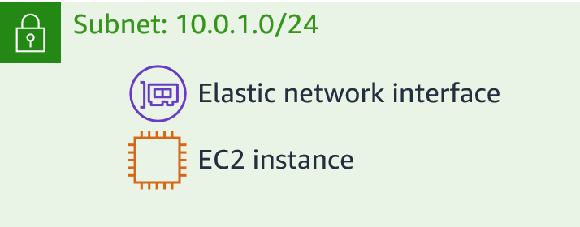

> **Нотатки:**
>
> Еластичний мережевий інтерфейс — це віртуальний мережевий інтерфейс, який можна приєднувати до екземпляра у VPC або від’єднувати від нього. Атрибути мережевого інтерфейсу слідують за ним, коли його повторно приєднують до іншого екземпляра. Коли ви переміщуєте мережевий інтерфейс з одного екземпляра на інший, мережевий трафік переспрямовується на новий екземпляр.  
>
> Кожен екземпляр у вашій VPC має мережевий інтерфейс за замовчуванням (основний мережевий інтерфейс), якому може бути призначена приватна адреса IPv4 з діапазону вашої VPC. Основний мережевий інтерфейс не можна від’єднати від екземпляра. Ви можете створити й приєднати додатковий мережевий інтерфейс до будь-якого екземпляра у вашій VPC. Кількість мережевих інтерфейсів, які можна приєднати, залежить від типу екземпляра.  
>
> За певних обставин на екземплярі EC2 можна мати два мережеві інтерфейси, що чудово підходить для криміналістичного аналізу (forensics). Пов’яжіть мережевий інтерфейс із криміналістичним екземпляром і почніть відстежувати експлойт.

---

## Слайд 24: Таблиці маршрутизації та маршрути (route tables and routes)

- Таблиця маршрутизації містить набір правил (або маршрутів), які можна налаштувати для спрямування мережевого трафіку з вашої підмережі.
- Кожен маршрут указує призначення (destination) і ціль (target).
- За замовчуванням кожна таблиця маршрутизації містить локальний маршрут для обміну даними всередині VPC.
- Кожна підмережа повинна мати власну таблицю маршрутизації.

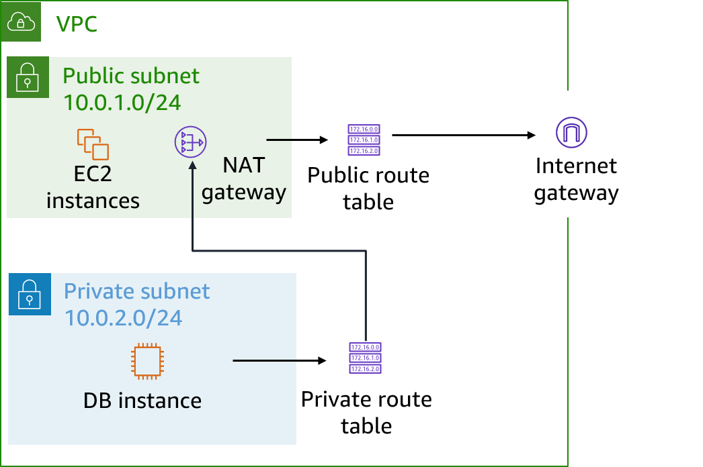

> **Нотатки:**
>
> Для доступності: схема VPC з публічною та приватною таблицями маршрутизації. Публічна підмережа містить екземпляр EC2 і NAT-шлюз. NAT-шлюз спрямовує трафік до публічної таблиці маршрутизації, а потім до інтернет-шлюзу. Приватна підмережа містить екземпляр EC2, трафік якого йде до приватної таблиці маршрутизації. Звідти трафік спрямовується до NAT-шлюзу в публічній підмережі. Кінець опису для доступності.  
>
> Таблиця маршрутизації містить набір правил (які називаються маршрутами), що спрямовують мережевий трафік з вашої підмережі. Кожен маршрут указує призначення та ціль. Призначення — це цільовий блок CIDR, куди ви хочете спрямувати трафік зі своєї підмережі. Ціль — це об’єкт, через який надсилається трафік призначення. Таблиця маршрутизації — це проста таблиця пошуку, що відстежує шляхи, подібно до мапи, і використовує їх, щоб визначити, у який бік пересилати трафік.  
>
> За замовчуванням кожна таблиця маршрутизації, яку ви створюєте, містить локальний маршрут для обміну даними у VPC. Запис локального маршруту, що використовується для внутрішнього обміну даними, видалити не можна. Але ви можете налаштувати таблицю маршрутизації, додаючи маршрути.  
>
> Кожна підмережа повинна мати власну таблицю маршрутизації, інакше вона використовуватиме основну таблицю маршрутизації батьківської VPC (що керує маршрутизацією для всіх підмереж, які явно не пов’язані з жодною іншою таблицею маршрутизації).  
>   
> Основна таблиця маршрутизації (main route table) — це таблиця маршрутизації, що автоматично призначається вашій VPC. Основна таблиця маршрутизації керує маршрутизацією для всіх підмереж, які явно не пов’язані з жодною іншою таблицею маршрутизації. Підмережа може бути пов’язана лише з однією таблицею маршрутизації одночасно, але з однією таблицею маршрутизації можна пов’язати кілька підмереж.  
>
> Докладніше див. «Налаштування таблиць маршрутизації» (Configure Route Tables) у посібнику користувача Amazon VPC за адресою https://docs.aws.amazon.com/vpc/latest/userguide/VPC_Route_Tables.html.

---

## Слайд 25: Ключові висновки: налаштування публічних і приватних підмереж та інтернет-протоколів

- Публічні підмережі використовуються, коли зовнішній трафік має досягти інтерфейсу, як-от екземпляра EC2.
- Приватні підмережі часто використовуються для розміщення екземплярів баз даних, до яких не потрібен доступ через публічний інтернет.
- Таблиці маршрутизації визначають, куди маршрутизується трафік у вашій VPC.

> **Нотатки:**
>
> Деякі ключові висновки з цього розділу модуля:  
> Публічні підмережі використовуються, коли зовнішній трафік має досягти інтерфейсу, як-от екземпляра EC2.  
> Приватні підмережі часто використовуються для розміщення екземплярів баз даних, до яких не потрібен доступ через публічний інтернет.  
> Таблиці маршрутизації визначають, куди має маршрутизуватися трафік у вашій VPC.

---

## Слайд 26: Використання груп безпеки AWS

Захист вашої інфраструктури

> **Нотатки:**
>
> Цей розділ надає інформацію про використання груп безпеки як частини захисту вашої інфраструктури.

---

## Слайд 27: Групи безпеки (1 із 2)

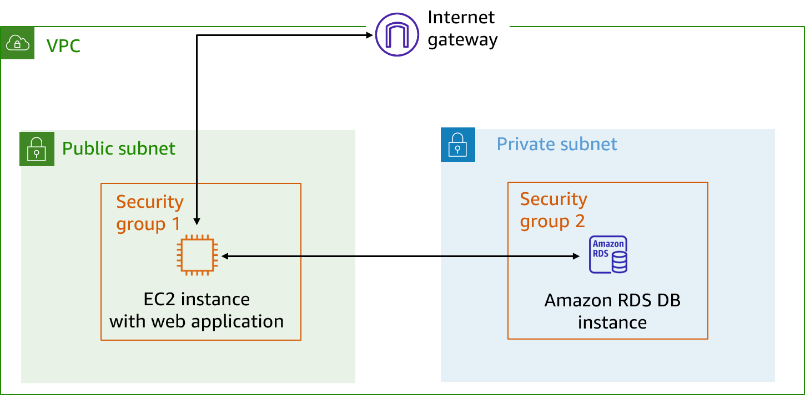

> **Нотатки:**
>
> Для доступності: схема VPC з публічною та приватною підмережами. Публічна підмережа містить екземпляр EC2, захищений групою безпеки 1. Приватна підмережа містить екземпляр бази даних Amazon Relational Database Service (Amazon RDS), захищений групою безпеки 2. Обмін даними дозволено між двома групами безпеки, а інтернет може обмінюватися даними з групою безпеки 1. Кінець опису для доступності.  
>
> Група безпеки діє як віртуальний брандмауер для екземпляра EC2 та контролює вхідний і вихідний трафік екземпляра. Групи безпеки діють на рівні екземпляра, а не на рівні підмережі. Тому кожному екземпляру в підмережі у вашій VPC можна призначити різний набір груп безпеки.  
>
> На найпростішому рівні група безпеки — це спосіб фільтрувати трафік до ваших екземплярів.

---

## Слайд 28: Групи безпеки (2 із 2)

- Групи безпеки мають правила, що контролюють вхідний і вихідний трафік екземпляра.
- Групи безпеки за замовчуванням забороняють весь вхідний трафік і дозволяють весь вихідний трафік. Це вважається *станним (stateful)* режимом.

**Inbound (Вхідний)**

| Source (Джерело) | Protocol (Протокол) | Port Range (Діапазон портів) | Description (Опис) |
|---|---|---|---|
| sg-xxxxxxxx | All | All | Дозволити вхідний трафік від мережевих інтерфейсів, призначених тій самій групі безпеки. |

**Outbound (Вихідний)**

| Destination (Призначення) | Protocol (Протокол) | Port Range (Діапазон портів) | Description (Опис) |
|---|---|---|---|
| 0.0.0.0/0 | All | All | Дозволити весь вихідний трафік IPv4. |
| ::/0 | All | All | Дозволити весь вихідний трафік IPv6. |

> **Нотатки:**
>
> Коли ви створюєте групу безпеки, вона не має вхідних правил. Тому вхідний трафік, що походить від іншого хоста до вашого екземпляра, не дозволяється, доки ви не додасте вхідні правила до групи безпеки.  
>
> За замовчуванням група безпеки включає вихідне правило, що дозволяє весь вихідний трафік. Ви можете видалити це правило та додати вихідні правила, що дозволяють лише певний вихідний трафік. Якщо у вашої групи безпеки немає вихідних правил, жоден вихідний трафік, що походить від вашого екземпляра, не дозволяється.  
>
> Групи безпеки є станними (stateful), що означає, що інформація про стан зберігається навіть після обробки запиту. Тому, якщо ви надсилаєте запит зі свого екземпляра, трафік відповіді на цей запит може надходити незалежно від вхідних правил групи безпеки. Відповіді на дозволений вхідний трафік можуть виходити незалежно від вихідних правил.  
>
> Усі правила оцінюються перед ухваленням рішення про дозвіл трафіку.  
>
> Таблиці на слайді вказують, що вхідний трафік дозволено від будь-якого мережевого інтерфейсу, призначеного тій самій групі безпеки. Увесь вихідний трафік дозволено.  
>
> Докладніше див. «Контроль трафіку до ресурсів за допомогою груп безпеки» (Control Traffic to Resources Using Security Groups) у посібнику користувача Amazon VPC за адресою https://docs.aws.amazon.com/vpc/latest/userguide/VPC_SecurityGroups.html.

---

## Слайд 29: Ключові висновки: використання груп безпеки AWS

- Група безпеки діє як віртуальний брандмауер для екземпляра, контролюючи вхідний і вихідний трафік.
- Групи безпеки є станними, що означає, що інформація про стан зберігається навіть після обробки запиту.
- Усі правила оцінюються перед ухваленням рішення про дозвіл трафіку.

> **Нотатки:**
>
> Деякі ключові висновки з цього розділу модуля:  
> Група безпеки діє як віртуальний брандмауер для екземпляра, контролюючи вхідний і вихідний трафік.  
> Групи безпеки є станними, що означає, що інформація про стан зберігається навіть після обробки запиту.  
> Усі правила оцінюються перед ухваленням рішення про дозвіл трафіку.

---

## Слайд 30: Використання мережевих ACL AWS

Захист вашої інфраструктури

> **Нотатки:**
>
> Цей розділ надає інформацію про використання списків контролю доступу до мережі (ACL) як частини захисту вашої інфраструктури.

---

## Слайд 31: Мережеві ACL (1 із 2)

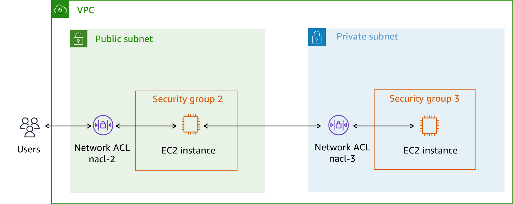

> **Нотатки:**
>
> Для доступності: схема, що показує, як працюють мережеві ACL. VPC містить публічну та приватну підмережі. Кожна підмережа містить екземпляр EC2. Мережевий ACL у кожній підмережі контролює трафік до екземплярів і від них. Кінець опису для доступності.  
>
> Список контролю доступу до мережі (network ACL) — це необов’язковий рівень безпеки для вашої VPC. Мережевий ACL діє як брандмауер для контролю трафіку, що входить до однієї чи кількох підмереж і виходить з них. Щоб додати ще один рівень безпеки до вашої VPC, можна налаштувати мережеві ACL з правилами, подібними до правил ваших груп безпеки.  
>
> Кожна підмережа у вашій VPC має бути пов’язана з мережевим ACL. Якщо ви явно не пов’язуєте підмережу з мережевим ACL, підмережа автоматично пов’язується з мережевим ACL за замовчуванням. Мережевий ACL можна пов’язати з кількома підмережами; однак підмережа може бути пов’язана лише з одним мережевим ACL одночасно. Коли ви пов’язуєте мережевий ACL з підмережею, попередній зв’язок видаляється.

---

## Слайд 32: Мережеві ACL (2 із 2)

- Мережевий ACL має окремі вхідні та вихідні правила, і кожне правило може  
або дозволяти, або забороняти трафік. Мережеві ACL є безстанними (stateless).
- Кожна VPC автоматично постачається зі змінюваним мережевим ACL за замовчуванням. За замовчуванням він дозволяє весь вхідний і вихідний трафік IPv4.
- Ви можете створити користувацький мережевий ACL і пов’язати його з підмережею. За замовчуванням кожен користувацький мережевий ACL забороняє весь вхідний і вихідний трафік, доки ви не додасте правила.

**Правила за замовчуванням (вхідні та вихідні)**

| Rule (Правило) | Type (Тип) | Protocol (Протокол) | Port Range (Діапазон портів) | Source (Джерело) | Allow/Deny (Дозвіл/заборона) |
|---|---|---|---|---|---|
| 100 | Весь трафік IPv4 | All | All | 0.0.0.0/0 | ALLOW |
| * | Весь трафік IPv4 | All | All | 0.0.0.0/0 | DENY |

> **Нотатки:**
>
> Мережевий ACL має окремі вхідні та вихідні правила, і кожне правило може або дозволяти, або забороняти трафік. Мережеві ACL є безстанними (stateless), що означає, що відповіді на вхідний трафік підпадають під правила вихідного трафіку (і навпаки).  
>
> Ваша VPC автоматично постачається зі змінюваним мережевим ACL за замовчуванням. За замовчуванням він дозволяє весь вхідний і вихідний трафік IPv4 і, за потреби, трафік IPv6. У таблиці показано мережевий ACL за замовчуванням для VPC, що підтримує лише IPv4.  
>
> Ви можете створити користувацький мережевий ACL і пов’язати його з підмережею. За замовчуванням кожен користувацький мережевий ACL забороняє весь вхідний і вихідний трафік, доки ви не додасте правила.  
>
> Правила оцінюються за порядком номерів перед ухваленням рішення про дозвіл трафіку.  
>
> Кожен мережевий ACL також включає правило, номером якого є зірочка. Це правило гарантує, що якщо пакет не відповідає жодному з інших пронумерованих правил, його буде відхилено. Це правило не можна змінити чи видалити.  
>
> Докладніше див. «Контроль трафіку до підмереж за допомогою мережевих ACL» (Control Traffic to Subnets Using Network ACLs) у посібнику користувача Amazon VPC за адресою https://docs.aws.amazon.com/vpc/latest/userguide/vpc-network-acls.html.

---

## Слайд 33: Порівняння груп безпеки та мережевих ACL

| Атрибут (Attribute) | Групи безпеки (Security Groups) | Мережеві ACL (Network ACLs) |
|---|---|---|
| Область дії (Scope) | Рівень екземпляра або інтерфейсу | Рівень підмережі |
| Підтримувані правила (Supported Rules) | Лише правила дозволу | Правила дозволу та заборони |
| Стан (State) | Станні (stateful; зворотний трафік автоматично дозволений незалежно від правил) | Безстанні (stateless; зворотний трафік має бути явно дозволений правилами) |
| Порядок правил (Order of Rules) | Усі правила оцінюються перед ухваленням рішення про дозвіл трафіку | Правила оцінюються за порядком номерів перед ухваленням рішення про дозвіл трафіку |

> **Нотатки:**
>
> Ось підсумок відмінностей між групами безпеки та мережевими ACL:  
> Групи безпеки діють на рівні екземпляра чи інтерфейсу, а мережеві ACL — на рівні підмережі.  
> Групи безпеки підтримують лише правила дозволу, а мережеві ACL підтримують і правила дозволу, і правила заборони.  
> Групи безпеки є станними, а мережеві ACL — безстанними.  
> Для груп безпеки перед ухваленням рішення про дозвіл трафіку оцінюються всі правила. Для мережевих ACL правила оцінюються за порядком номерів перед ухваленням рішення про дозвіл трафіку.

---

## Слайд 34: Функції безпеки VPC

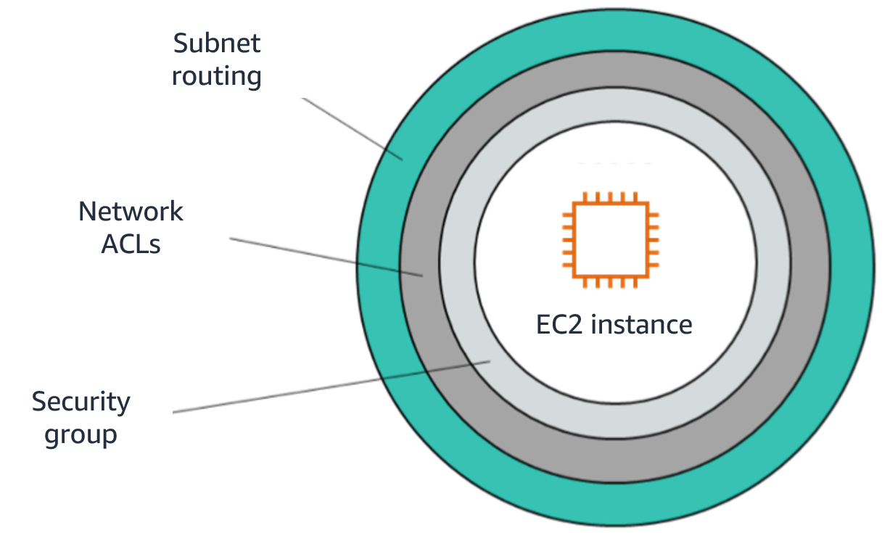

- Групи безпеки
- Мережеві ACL
- Підмережі
- Таблиці маршрутизації

Примітка: VPC Flow Logs можуть журналювати активність на рівні інтерфейсу.

> **Нотатки:**
>
> Для доступності: екземпляр EC2, оточений рівнями безпеки. Найближчий до екземпляра рівень — група безпеки. Наступний рівень — мережеві ACL. Зовнішній, найвіддаленіший рівень — маршрутизація підмережі. Кінець опису для доступності.  
>
> Функції безпеки VPC включають таке:  
> Групи безпеки діють як віртуальні брандмауери для ваших екземплярів EC2, контролюючи вхідний і вихідний трафік.  
> Мережеві ACL надають необов’язковий рівень безпеки для вашої VPC. Вони діють як брандмауери для контролю трафіку, що входить до однієї чи кількох підмереж і виходить з них.  
> Підмережі роблять мережі ефективнішими. Завдяки поділу на підмережі мережевий трафік може проходити коротшу відстань, не проходячи через непотрібні маршрутизатори на шляху до призначення.  
> Таблиці маршрутизації контролюють, куди спрямовується мережевий трафік.  
>
> За допомогою функції VPC Flow Logs ви можете збирати інформацію про IP-трафік до мережевих інтерфейсів вашої VPC і від них. Дані журналу потоків можна публікувати в Amazon CloudWatch Logs або Amazon Simple Storage Service (Amazon S3). Після створення журналу потоків ви можете отримати й переглянути його дані у вибраному призначенні.  
>
> Журнал потоків можна створити для VPC, підмережі або мережевого інтерфейсу. Якщо ви створюєте журнал потоків для підмережі чи VPC, кожен мережевий інтерфейс у цій підмережі чи VPC відстежується. Дані журналу потоків для відстежуваного мережевого інтерфейсу записуються як записи журналу потоків — події журналу, що складаються з полів, які описують потік трафіку.  
>
> Докладніше див. «Журналювання IP-трафіку за допомогою VPC Flow Logs» (Logging IP Traffic Using VPC Flow Logs) у посібнику користувача Amazon VPC за адресою https://docs.aws.amazon.com/vpc/latest/userguide/flow-logs.html.

---

## Слайд 35: Ключові висновки: використання мережевих ACL AWS

- Мережевий ACL — це необов’язковий рівень безпеки для вашої VPC, що діє як брандмауер для контролю трафіку на рівні підмережі.
- Кожна підмережа у вашій VPC має бути пов’язана з мережевим ACL.
- Мережеві ACL є безстанними, що означає, що відповіді на вхідний трафік підпадають під правила вихідного трафіку (і навпаки).
- Правила оцінюються за порядком номерів перед ухваленням рішення про дозвіл трафіку.

> **Нотатки:**
>
> Деякі ключові висновки з цього розділу модуля:  
> Мережевий ACL — це необов’язковий рівень безпеки для вашої VPC, що діє як брандмауер для контролю трафіку на рівні підмережі.  
> Кожна підмережа у вашій VPC має бути пов’язана з мережевим ACL.  
> Мережеві ACL є безстанними, що означає, що відповіді на вхідний трафік підпадають під правила вихідного трафіку (і навпаки).  
> Правила оцінюються за порядком номерів перед ухваленням рішення про дозвіл трафіку.

---

## Слайд 36: Використання балансувальників навантаження AWS

Захист вашої інфраструктури

> **Нотатки:**
>
> Цей розділ надає інформацію про використання балансувальників навантаження як частини захисту вашої інфраструктури.

---

## Слайд 37: Elastic Load Balancing (ELB)

- Розподіляє вхідний трафік застосунків
- Підтримує високу доступність
- Виконує перевірки стану (health checks) екземплярів
- Надає таке:
  - Application Load Balancer
  - Network Load Balancer
  - Classic Load Balancer

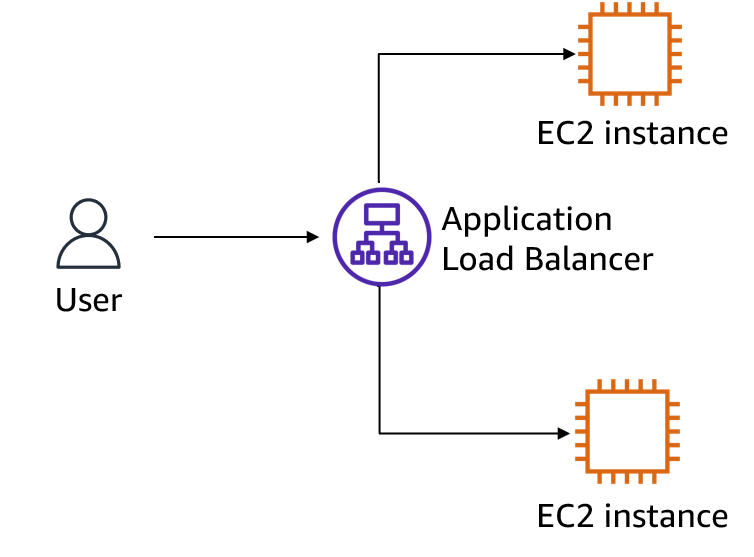

> **Нотатки:**
>
> Для доступності: схема трафіку від користувача, що надходить до балансувальника навантаження застосунків (Application Load Balancer). Потім трафік розподіляється між двома екземплярами EC2. Кінець опису для доступності.  
>
> Сервіс Elastic Load Balancing (ELB) автоматично розподіляє вхідний трафік застосунків між кількома цілями, як-от екземпляри EC2, контейнери та IP-адреси. Ви налаштовуєте свій балансувальник навантаження на прийом вхідного трафіку, указуючи один або кілька слухачів (listeners). Слухач — це процес, що перевіряє запити на з’єднання.  
>
> ELB масштабує ваш пристрій балансування навантаження в міру зміни трафіку до вашого застосунку з часом і може автоматично масштабуватися для переважної більшості робочих навантажень. Це підвищує доступність і відмовостійкість ваших застосунків. Ви можете додавати й видаляти екземпляри з вашого балансувальника навантаження в міру зміни ваших потреб, не порушуючи загального потоку запитів до вашого застосунку. ELB може обробляти змінне навантаження трафіку вашого застосунку в одній зоні доступності або в кількох зонах доступності.  
>
> Також можна налаштувати перевірки стану, що відстежують стан зареєстрованих цілей. За наявності перевірок стану пристрій балансування навантаження може надсилати запити лише до справних цілей. Коли балансувальник навантаження виявляє несправну ціль, він припиняє маршрутизувати трафік до цієї цілі. Балансувальник навантаження відновлює маршрутизацію трафіку до цієї цілі після того, як виявляє, що ціль знову справна.  
>
> ELB інтегровано з іншими популярними сервісами AWS, як-от Amazon EC2 Auto Scaling, Amazon Elastic Container Service (Amazon ECS), AWS CloudFormation та AWS Certificate Manager (ACM).  
>
> ELB підтримує три типи балансувальників навантаження: Application, Network і Classic Load Balancer.  
>
> Application Load Balancer працює на рівні запитів і маршрутизує трафік до цілей (екземпляри EC2, контейнери, IP-адреси та функції AWS Lambda) на основі вмісту запиту. Application Load Balancer ідеально підходить для розширеного балансування навантаження трафіку HTTP і HTTPS. Цей тип балансувальника навантаження забезпечує розширену маршрутизацію запитів, орієнтовану на доставку сучасних архітектур застосунків, зокрема мікросервісів і застосунків на основі контейнерів. Application Load Balancer спрощує та підвищує безпеку вашого застосунку, гарантуючи, що завжди використовуються найновіші шифри та протоколи SSL і TLS.  
>
> Network Load Balancer працює на рівні з’єднань і маршрутизує з’єднання до цілей (екземпляри EC2, мікросервіси та контейнери) у межах VPC на основі даних IP-протоколу. Network Load Balancer ідеально підходить для балансування навантаження як трафіку TCP, так і UDP. Цей тип балансувальника навантаження здатний обробляти мільйони запитів на секунду, зберігаючи наднизькі затримки. Network Load Balancer оптимізований для обробки раптових і нестабільних шаблонів трафіку з використанням однієї статичної IP-адреси на зону доступності.  
>
> Classic Load Balancer забезпечує базове балансування навантаження між кількома екземплярами EC2 і працює як на рівні запитів, так і на рівні з’єднань. Classic Load Balancer призначений для застосунків, побудованих у мережі EC2-Classic.  
>
> Докладніше див. «Що таке Elastic Load Balancing?» (What Is Elastic Load Balancing?) у посібнику користувача ELB за адресою https://docs.aws.amazon.com/elasticloadbalancing/latest/userguide/what-is-load-balancing.html.

---

## Слайд 38: Захист даних в ELB

Єдина точка контакту

Шифрування

у стані спокою

Шифрування

під час передавання

> **Нотатки:**
>
> Єдина точка контакту: балансувальник навантаження слугує єдиною точкою контакту для клієнтів. Балансувальник навантаження розподіляє вхідний трафік застосунку між кількома цілями, як-от екземпляри EC2, у кількох зонах доступності. Це підвищує доступність вашого застосунку.  
>
> Application Load Balancer може підтримувати захищений обмін даними за протоколом HTTPS і сертифікати для обміну даними з клієнтами. За бажанням він може завершувати SSL-з’єднання на рівні балансувальника навантаження, щоб вам не потрібно було обробляти сертифікати у власному застосунку.  
>
> Шифрування в стані спокою: якщо ви вмикаєте серверне шифрування за допомогою ключів шифрування, керованих Amazon S3 (SSE-S3), для вашого бакета S3 для журналів доступу ELB, ELB автоматично шифрує кожен файл журналу доступу перед його збереженням у вашому бакеті S3. ELB також розшифровує файли журналів доступу, коли ви до них звертаєтеся. Кожен файл журналу шифрується унікальним ключем, який, своєю чергою, шифрується ключем, що регулярно змінюється (ротація).  
>
> Шифрування під час передавання: ELB спрощує процес побудови безпечних вебзастосунків, завершуючи трафік HTTPS і TLS від клієнтів на балансувальнику навантаження. Балансувальник навантаження виконує роботу з шифрування та розшифрування трафіку замість того, щоб вимагати від кожного екземпляра EC2 виконувати роботу із завершення TLS.  
>
> Докладніше див. «Захист даних в Elastic Load Balancing» (Data Protection in Elastic Load Balancing) у посібнику користувача ELB  
> за адресою https://docs.aws.amazon.com/elasticloadbalancing/latest/userguide/data-protection.html.

---

## Слайд 39: Балансувальники навантаження в дії

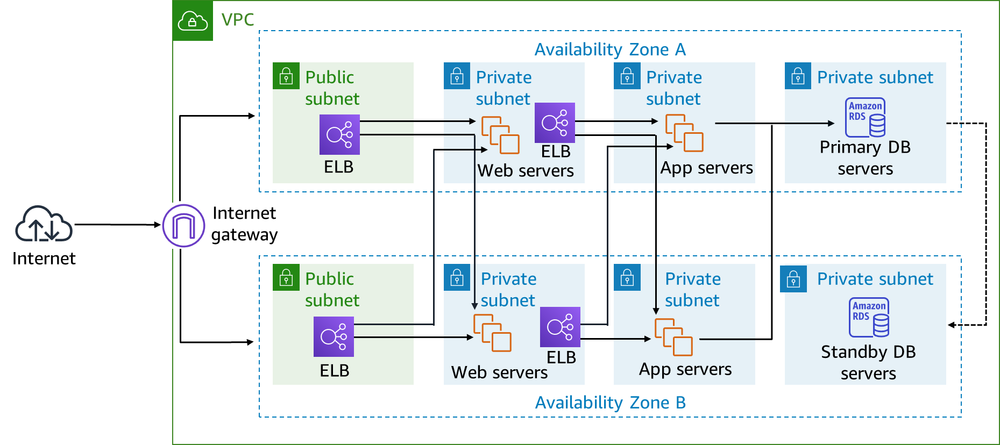

> **Нотатки:**
>
> Ця схема показує, як працюють балансувальники навантаження. Ця VPC має підмережі у двох зонах доступності. Кожна зона доступності має публічну підмережу та кілька приватних підмереж.  
>
> Інтернет-трафік іде від інтернет-шлюзу до кожної зони доступності. Балансувальник навантаження в кожній публічній підмережі спрямовує трафік до вебсерверів у приватній підмережі в будь-якій зоні доступності. Трафік від вебсерверів іде до балансувальника навантаження, що спрямовує трафік до серверів застосунків в іншій приватній підмережі в будь-якій зоні доступності. Трафік від серверів застосунків іде до основного сервера бази даних в іншій приватній підмережі в першій зоні доступності. Основна база даних може обмінюватися даними з резервним сервером бази даних (standby) у приватній підмережі в другій зоні доступності.

---

## Слайд 40: Ключові висновки: використання балансувальників навантаження AWS

- ELB автоматично розподіляє вхідний трафік застосунків між кількома цілями, як-от екземпляри EC2, контейнери, IP-адреси та функції Lambda.
- ELB може обробляти змінне навантаження трафіку вашого застосунку в одній зоні доступності або в кількох зонах доступності.
- Ви можете додавати й видаляти екземпляри з вашого балансувальника навантаження в міру зміни ваших потреб, не порушуючи загального потоку запитів до вашого застосунку.

> **Нотатки:**
>
> Деякі ключові висновки з цього розділу модуля:  
> ELB автоматично розподіляє вхідний трафік застосунків між кількома цілями, як-от екземпляри EC2, контейнери, IP-адреси та функції Lambda.  
> ELB може обробляти змінне навантаження трафіку вашого застосунку в одній зоні доступності або в кількох зонах доступності.  
> Ви можете додавати й видаляти екземпляри з вашого балансувальника навантаження в міру зміни ваших потреб, не порушуючи загального потоку запитів до вашого застосунку.

---

## Слайд 41: Збираємо все разом

Захист вашої інфраструктури

> **Нотатки:**
>
> Цей розділ розглядає, як усі ці функції безпеки працюють разом.

---

## Слайд 42: Робочий процес (workflow)

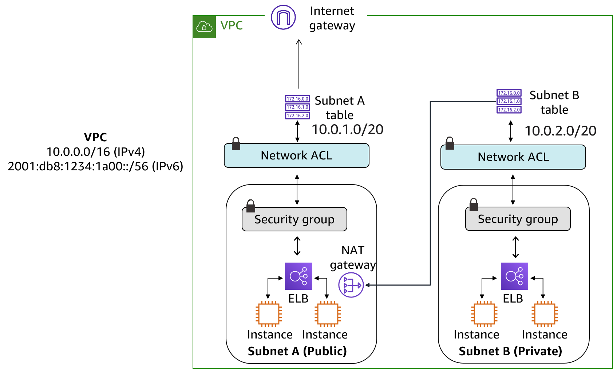

> **Нотатки:**
>
> Схема на цьому слайді показує, як балансування навантаження та компоненти VPC працюють разом.  
>
> VPC має дві підмережі. Підмережа A, що є публічною підмережею, містить два екземпляри EC2. Трафік від кожного екземпляра маршрутизується через балансувальник навантаження до групи безпеки, а потім до мережевого ACL. Потім трафік маршрутизується через таблицю маршрутизації до інтернет-шлюзу.  
>
> Підмережа B, що є приватною підмережею, містить два екземпляри EC2. Трафік від кожного екземпляра маршрутизується через балансувальник навантаження до групи безпеки, а потім до мережевого ACL. Потім трафік маршрутизується через таблицю маршрутизації до NAT-шлюзу в підмережі A, публічній підмережі.

---

## Слайд 43: Найкращі практики захисту вашої мережі

- Контролюйте трафік на всіх рівнях.
- Перевіряйте та фільтруйте свій трафік на рівні застосунку.
- Автоматизуйте захист мережі.
- Обмежуйте вразливість до впливу (limit exposure).

> **Нотатки:**
>
> Одна з найкращих практик захисту вашої мережі — застосовувати засоби контролю як до вхідного, так і до вихідного трафіку. Для VPC це включає використання груп безпеки, мережевих ACL і підмереж. Використовуйте підмережі в кількох зонах доступності, щоб розділити рівні вашого застосунку. Налаштуйте групи безпеки та мережеві ACL так, щоб вони дозволяли лише необхідний вхідний і вихідний трафік.  
>
> Ще одна найкраща практика — перевіряти та фільтрувати мережевий трафік на рівні застосунку.  
>
> Крім того, використовуйте розвідку загроз (threat intelligence) і виявлення аномалій, щоб автоматизувати механізми захисту та забезпечити мережу, що самозахищається.  
>
> Нарешті, обмежуйте вразливість робочого навантаження до впливу інтернету та внутрішніх мереж, дозволяючи лише мінімально необхідний доступ.

---

## Слайд 44: Захист ваших обчислювальних ресурсів

Захист вашої інфраструктури

> **Нотатки:**
>
> Цей розділ описує найкращі практики захисту ваших обчислювальних ресурсів.

---

## Слайд 45: Amazon Inspector

- Запускайте автоматизовані оцінювання безпеки екземплярів EC2 і застосунків.
- Визначайте проблеми безпеки застосунків.
- Забезпечуйте дотримання стандартів безпеки та найкращих практик.
- Генеруйте звіти про оцінювання.

Amazon Inspector

> **Нотатки:**
>
> Amazon Inspector — це автоматизований сервіс оцінювання безпеки, що допомагає покращити безпеку та відповідність застосунків, розгорнутих в AWS. Сервіс допомагає визначати вразливості безпеки та відхилення від найкращих практик безпеки в застосунках — як до їх розгортання, так і під час їхньої роботи в продуктивному середовищі. Наприклад, сервіс може допомогти перевірити наявність ненавмисної мережевої доступності ваших екземплярів EC2 та вразливостей на цих екземплярах.  
>
> Amazon Inspector дає вам змогу визначати стандарти та найкращі практики для ваших застосунків і перевіряти відповідність цим стандартам. Це спрощує забезпечення дотримання стандартів безпеки та найкращих практик вашої організації й допомагає проактивно керувати проблемами безпеки, поки вони не вплинули на ваш продуктивний застосунок.  
>
> Після виконання оцінювання Amazon Inspector створює докладний список результатів щодо безпеки, впорядкований за рівнем серйозності. Ці результати можна переглядати безпосередньо або в складі докладних звітів про оцінювання, доступних через AWS Management Console чи API.  
>
> Докладніше див. Amazon Inspector за адресою https://aws.amazon.com/inspector.

---

## Слайд 46: Переваги Amazon Inspector для безпеки

- Автоматизуйте завдання, щоб допомогти реагувати на проблеми безпеки
- Регулярно відстежуйте свої ресурси
- Користуйтеся експертизою AWS у сфері безпеки
- Інтегруйте безпеку в DevOps

> **Нотатки:**
>
> Переваги Amazon Inspector для безпеки включають таке:  
> Автоматизація завдань для реагування на проблеми безпеки: коли ви використовуєте події Amazon EventBridge з Amazon Inspector, ви можете автоматизувати завдання, щоб допомогти реагувати на проблеми безпеки, які виявляють результати Amazon Inspector.  
> Регулярний моніторинг ваших ресурсів: Amazon Inspector допомагає знаходити вразливості безпеки в застосунках і відхилення від найкращих практик безпеки. Сервіс знаходить ці проблеми до розгортання вашого застосунку та під час його роботи в продуктивному середовищі. Це покращує загальну безпеку ваших застосунків, розміщених в AWS.  
> Експертиза AWS у сфері безпеки: Amazon Inspector включає базу знань із правилами, складеними за поширеними найкращими практиками безпеки та визначеннями вразливостей. AWS постійно оновлює найкращі практики безпеки та правила.  
> Інтеграція безпеки в DevOps: Amazon Inspector — це сервіс, прив’язаний до API, що аналізує конфігурації мережі у вашому акаунті AWS. Крім того, сервіс використовує необов’язковий агент для видимості екземплярів EC2. Агент може допомогти вбудувати оцінювання Amazon Inspector у ваш наявний процес DevOps. Це допомагає надати командам розробки й експлуатації змогу зробити оцінювання безпеки невід’ємною частиною процесу розгортання.

---

## Слайд 47: AWS Systems Manager

- Amazon Inspector використовує широко розгорнутий AWS Systems Manager Agent (SSM Agent) для збирання інвентаря програмного забезпечення та конфігурацій з ваших екземплярів EC2.
- Зібраний інвентар застосунків і конфігурації використовуються для оцінювання робочих навантажень на вразливості.

AWS Systems Manager

> **Нотатки:**
>
> Amazon Inspector використовує широко розгорнутий AWS Systems Manager Agent (SSM Agent) для збирання інвентаря програмного забезпечення та конфігурацій з ваших екземплярів EC2.  
>
> AWS Systems Manager надає вам видимість і контроль вашої інфраструктури в AWS. Systems Manager надає єдиний користувацький інтерфейс, щоб ви могли переглядати операційні дані з кількох сервісів AWS. Сервіс включає можливості, що допомагають автоматизувати завдання керування. Ви можете збирати інвентар систем, застосовувати виправлення операційної системи, підтримувати актуальні визначення антивірусу та налаштовувати операційні системи й застосунки у великому масштабі. Systems Manager допомагає підтримувати відповідність ваших систем визначеним вами політикам конфігурації.

---

## Слайд 48: Ключові висновки: захист ваших обчислювальних ресурсів

- Amazon Inspector — це автоматизований сервіс оцінювання безпеки, що допомагає покращити безпеку та відповідність застосунків, розгорнутих в AWS.
- Systems Manager надає вам видимість і контроль вашої інфраструктури в AWS.
- Регулярно скануйте свої обчислювальні ресурси на вразливості й відповідно встановлюйте виправлення (patch). Це завдання можна автоматизувати за допомогою сервісів AWS, як-от Lambda і Systems Manager.

> **Нотатки:**
>
> Деякі ключові висновки з цього розділу модуля:  
> Amazon Inspector — це автоматизований сервіс оцінювання безпеки, що допомагає покращити безпеку та відповідність застосунків, розгорнутих в AWS.  
> Systems Manager надає вам видимість і контроль вашої інфраструктури в AWS.  
> Регулярно скануйте свої обчислювальні ресурси на вразливості й відповідно встановлюйте виправлення. Це завдання можна автоматизувати за допомогою сервісів AWS, як-от Lambda і Systems Manager.

---

## Слайд 49: Лабораторна робота: захист ресурсів VPC за допомогою груп безпеки (Securing VPC Resources by Using Security Groups)

> **Нотатки:**
>
> Зараз ви виконаєте лабораторну роботу «Захист ресурсів VPC за допомогою груп безпеки» (Securing VPC Resources by Using Security Groups).  
>
> У цій лабораторній роботі ви проаналізуєте налаштування ресурсів для VPC та її підмереж. Ви отримаєте досвід створення й оновлення груп безпеки та мережевих ACL. Нарешті, ви підключитеся до екземпляра в приватній підмережі двома різними способами.

---

## Слайд 50: Лабораторна робота: завдання

1. Аналіз налаштувань ресурсів VPC і приватної підмережі
2. Аналіз налаштувань ресурсів публічної підмережі
3. Перевірка HTTP-з’єднання з публічних екземплярів EC2
4. Обмеження HTTP-доступу за IP-адресою
5. Масштабування обмеженого HTTP-доступу за допомогою посилання на групу безпеки
6. Обмеження HTTP-доступу за допомогою мережевого ACL
7. Підключення до AppServer за допомогою бастіонного хоста (bastion host) та SSH
8. Пряме підключення до хоста в приватній підмережі за допомогою Session Manager

> **Нотатки:**
>
> У цій лабораторній роботі ви виконаєте такі завдання:  
> Аналіз налаштувань ресурсів VPC і приватної підмережі  
> Аналіз налаштувань ресурсів публічної підмережі  
> Перевірка HTTP-з’єднання з публічних екземплярів EC2  
> Обмеження HTTP-доступу за IP-адресою  
> Масштабування обмеженого HTTP-доступу за допомогою посилання на групу безпеки  
> Обмеження HTTP-доступу за допомогою мережевого ACL  
> Підключення до AppServer за допомогою бастіонного хоста та SSH  
> Пряме підключення до хоста в приватній підмережі за допомогою Session Manager

---

## Слайд 51: Початок лабораторної роботи: захист ресурсів VPC за допомогою груп безпеки

Тривалість: 90 хвилин

> **Нотатки:**
>
> Настав час розпочати лабораторну роботу.

---

## Слайд 52: Підсумки лабораторної роботи: ключові висновки

> **Нотатки:**
>
> Після завершення лабораторної роботи ваш викладач може вирішити провести обговорення ключових висновків із лабораторної роботи.

---

## Слайд 53: Підсумки модуля

Захист вашої інфраструктури

> **Нотатки:**
>
> Настав час повторити матеріал модуля та завершити його перевіркою знань і розбором запитання практичного сертифікаційного іспиту.

---

## Слайд 54: Резюме модуля

У цьому модулі ви навчилися:

- Визначати компоненти VPC.
- Розпізнавати межі акаунтів.
- Описувати сервіси AWS, доступні для захисту вашої мережі та ресурсів.

> **Нотатки:**
>
> У цьому модулі ви навчилися:  
> Визначати компоненти VPC.  
> Розпізнавати межі акаунтів.  
> Описувати сервіси AWS, доступні для захисту вашої мережі та ресурсів.

---

## Слайд 55: Пройдіть перевірку знань

> **Нотатки:**
>
> Настав час пройти перевірку знань для цього модуля.

---

## Слайд 56: Приклад запитання іспиту

Системний адміністратор створив один екземпляр EC2 і налаштував мережеві ACL та відповідну маршрутизацію підмережі. Однак він хоче забезпечити додатковий рівень безпеки, застосувавши брандмауер для контролю доступу до екземпляра EC2 і від нього. Яку дію має виконати системний адміністратор?

Варіант

Відповідь

A

Створити мережевий ACL.

B

Налаштувати групу безпеки.

C

Оновити таблиці маршрутизації підмережі.

D

Налаштувати балансувальник навантаження.

> **Нотатки:**
>
> Розгляньте варіанти відповідей і відсійте їх за ключовими словами.

---

## Слайд 57: Відповідь на приклад запитання іспиту

Системний адміністратор створив один екземпляр EC2 і налаштував мережеві ACL та відповідну маршрутизацію підмережі. Однак він хоче забезпечити додатковий рівень безпеки, застосувавши брандмауер для контролю доступу до екземпляра EC2 і від нього. Яку дію має виконати системний адміністратор?

Правильна відповідь — B.

Ключові слова в запитанні: **застосувавши брандмауер** та **контролю доступу до екземпляра EC2 і від нього**.

> **Нотатки:**
>
> Ключові слова, які потрібно розпізнати: застосувавши брандмауер та контролю доступу до екземпляра EC2 і від нього.  
>
> Правильна відповідь — B. Група безпеки діє як віртуальний брандмауер для ваших екземплярів EC2, контролюючи вхідний і вихідний трафік.  
>
> Неправильні відповіді:  
> Відповідь A: мережевий ACL діє як брандмауер для пов’язаних підмереж, контролюючи вхідний і вихідний трафік, але працює на рівні підмережі.  
> Відповідь C: таблиця маршрутизації використовується для контролю того, куди спрямовується мережевий трафік. Вона не функціонує як брандмауер.  
> Відповідь D: балансувальник навантаження автоматично розподіляє вхідний трафік застосунків і масштабує ресурси для задоволення вимог до трафіку. Він не функціонує як брандмауер.

---

## Слайд 58: Дякуємо

Виправлення, відгуки чи інші запитання?  
Зв’яжіться з нами за адресою [https://support.aws.amazon.com/#/contacts/aws-academy](https://support.aws.amazon.com/#/contacts/aws-academy).  
Усі торговельні марки є власністю їхніх власників.

> **Нотатки:**
>
> Дякуємо, що пройшли цей модуль.

---

## Слайд 59: Вихідні файли зображень лише для розробки

<!-- hidden slide -->

> **Нотатки:**
>
> Вихідні файли зображень лише для розробки (Image source files for development use only)

---

## Слайд 60: Триярусна архітектура

<!-- hidden slide -->

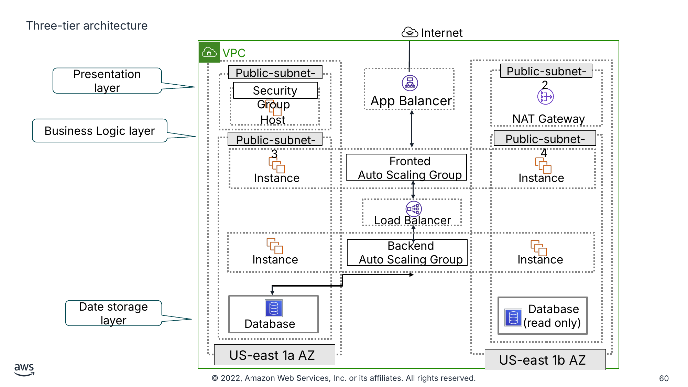

Текст зі схеми

Internet (Інтернет)

VPC

 Public-subnet-1

 Public-subnet-2

 Security Group (Група безпеки)

App Balancer (Балансувальник застосунків)

 Host (Хост)

NAT Gateway (NAT-шлюз)

 Public-subnet-3

 Public-subnet-4

Fronted (Фронтенд)

Auto Scaling Group (Група Auto Scaling)

Instance (Екземпляр)

Instance

Load Balancer (Балансувальник навантаження)

Backend (Бекенд)

Auto Scaling Group

Instance

Instance

Database (read only) (База даних (лише читання))

Database (База даних)

US-east 1a AZ

US-east 1b AZ

Presentation layer (Рівень представлення)

Business Logic layer (Рівень бізнес-логіки)

Date storage layer (Рівень зберігання даних)

---

## Слайд 61: VPC та підмережі

<!-- hidden slide -->

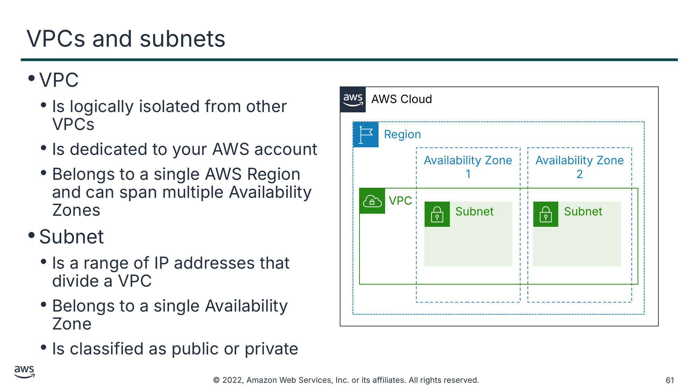

- VPC
  - Логічно ізольована від інших VPC
  - Виділена для вашого акаунта AWS
  - Належить до одного регіону AWS і може охоплювати кілька зон доступності
- Підмережа
  - Діапазон IP-адрес, що розділяють VPC
  - Належить до однієї зони доступності
  - Класифікується як публічна або приватна

Текст зі схеми

AWS Cloud

Region (Регіон)

Availability Zone (Зона доступності)

1

Availability Zone

2

 VPC

Subnet (Підмережа)

Subnet

> **Нотатки:**
>
> Для доступності: схема підмереж у VPC. Регіон у хмарі AWS має одну VPC, що охоплює дві зони доступності. VPC має по одній підмережі в кожній зоні доступності. Кінець опису для доступності.  
>
> VPC — це віртуальна мережа, логічно ізольована від інших віртуальних мереж у хмарі AWS. VPC виділена для вашого акаунта, належить до одного регіону AWS і може охоплювати кілька зон доступності.  
>
> Після створення VPC її можна розділити на одну чи кілька підмереж. Підмережа — це діапазон IP-адрес, що розділяють VPC. Підмережі належать до однієї зони доступності, але ви можете створювати підмережі в різних зонах доступності для високої доступності. Підмережі загалом класифікують як публічні або приватні.

---

## Слайд 62: Триярусна архітектура

<!-- hidden slide -->

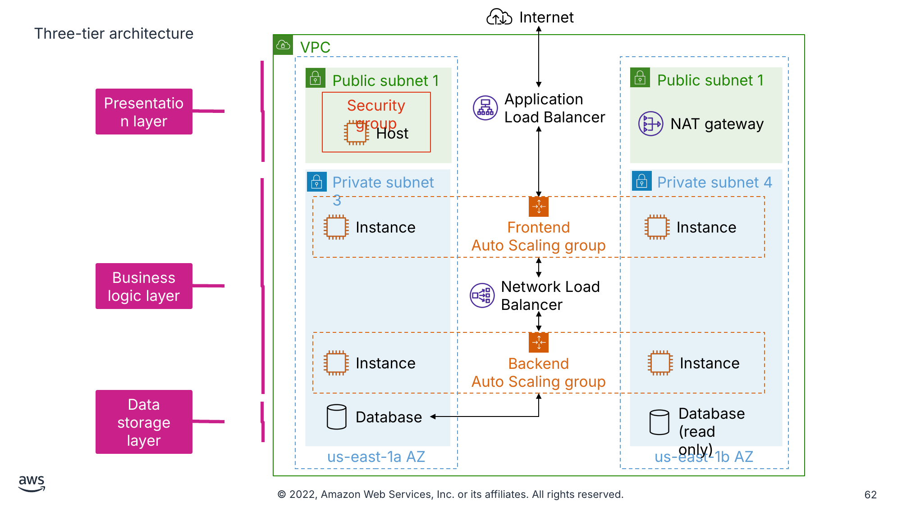

Private subnet 4

Текст зі схеми

Internet (Інтернет)

VPC

Presentation layer (Рівень представлення)

us-east-1a AZ

us-east-1b AZ

Public subnet 1 (Публічна підмережа 1)

NAT gateway (NAT-шлюз)

Public subnet 1

Security group (Група безпеки)

Host (Хост)

Application  
Load Balancer

Business logic layer (Рівень бізнес-логіки)

Private subnet 3 (Приватна підмережа 3)

Frontend  
Auto Scaling group (Фронтенд-група Auto Scaling)

Instance (Екземпляр)

Instance

Network Load  
Balancer

Backend  
Auto Scaling group (Бекенд-група Auto Scaling)

Instance

Instance

Data storage layer (Рівень зберігання даних)

Database (База даних)

Database  
(read only) (База даних (лише читання))

> **Нотатки:**
>
> Схема триярусного вебзастосунку. Див. опис у нотатках до слайда.

---

## Слайд 63: Приватна підмережа

<!-- hidden slide -->

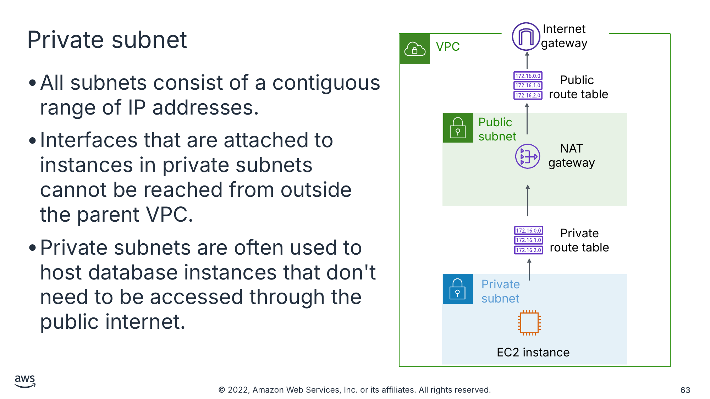

- Усі підмережі складаються з неперервного діапазону IP-адрес.
- Інтерфейси, приєднані до екземплярів у приватних підмережах, недосяжні ззовні батьківської VPC.
- Приватні підмережі часто використовуються для розміщення екземплярів баз даних, до яких не потрібен доступ через публічний інтернет.

Текст зі схеми

Internet  
gateway (Інтернет-шлюз)

   VPC

Public

route table (Публічна таблиця маршрутизації)

Public subnet (Публічна підмережа)

NAT  
gateway (NAT-шлюз)

Private route table (Приватна таблиця маршрутизації)

   Private

   subnet (Приватна підмережа)

 EC2 instance (Екземпляр EC2)

---

## Слайд 64: Публічна підмережа

<!-- hidden slide -->

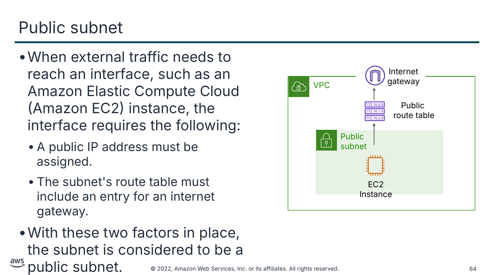

- Коли зовнішній трафік має досягти інтерфейсу, як-от екземпляр Amazon Elastic Compute Cloud (Amazon EC2), інтерфейс вимагає таке:
  - Має бути призначена публічна IP-адреса.
  - Таблиця маршрутизації підмережі має містити запис для інтернет-шлюзу.
- За наявності цих двох чинників підмережа вважається публічною.

Текст зі схеми

Internet  
gateway (Інтернет-шлюз)

   VPC

Public  
route table (Публічна таблиця маршрутизації)

Public subnet (Публічна підмережа)

EC2 Instance (Екземпляр EC2)

---

## Слайд 65: Таблиці маршрутизації та маршрути

<!-- hidden slide -->

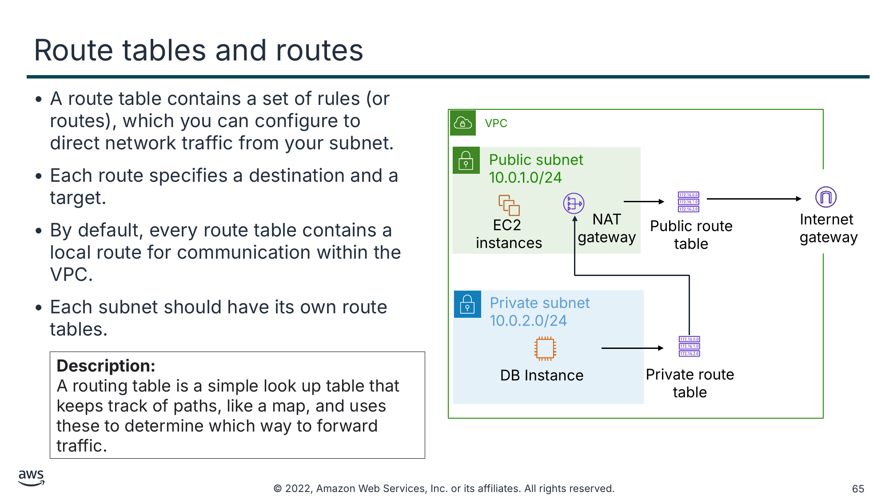

- Таблиця маршрутизації містить набір правил (або маршрутів), які можна налаштувати для спрямування мережевого трафіку з вашої підмережі.
- Кожен маршрут указує призначення (destination) і ціль (target).
- За замовчуванням кожна таблиця маршрутизації містить локальний маршрут для обміну даними всередині VPC.
- Кожна підмережа повинна мати власні таблиці маршрутизації.

**Опис:**  
Таблиця маршрутизації — це проста таблиця пошуку, що відстежує шляхи, подібно до мапи, і використовує їх, щоб визначити, у який бік пересилати трафік.

Текст зі схеми

VPC

Public subnet (Публічна підмережа)

10.0.1.0/24

EC2  
instances (Екземпляри EC2)

NAT  
gateway (NAT-шлюз)

Public route table (Публічна таблиця маршрутизації)

Internet

gateway (Інтернет-шлюз)

Private subnet (Приватна підмережа)

10.0.2.0/24

DB Instance (Екземпляр БД)

Private route table (Приватна таблиця маршрутизації)

---

## Слайд 66: Групи безпеки (1 із 2)

<!-- hidden slide -->

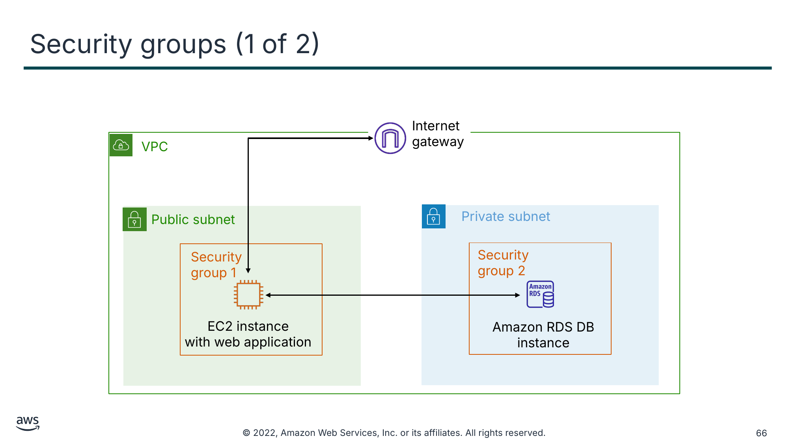

Текст зі схеми

Internet  
gateway (Інтернет-шлюз)

VPC

  Private subnet (Приватна підмережа)

Public subnet (Публічна підмережа)

Security group 1 (Група безпеки 1)

Security group 2 (Група безпеки 2)

EC2 instance  
with web application (Екземпляр EC2 з вебзастосунком)

Amazon RDS DB instance (Екземпляр БД Amazon RDS)

---

## Слайд 67: Мережеві ACL (1 із 2)

<!-- hidden slide -->

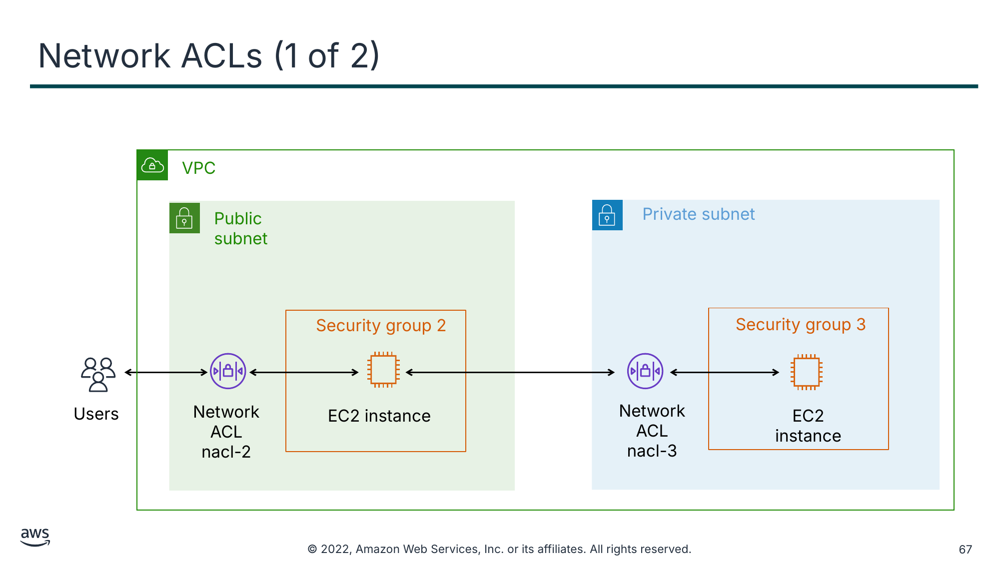

Текст зі схеми

VPC

Public subnet (Публічна підмережа)

  Private subnet (Приватна підмережа)

Security group 2 (Група безпеки 2)

Security group 3 (Група безпеки 3)

Users (Користувачі)

Network ACL (Мережевий ACL)

nacl-2

EC2 instance (Екземпляр EC2)

Network ACL

nacl-3

EC2 instance

> **Нотатки:**
>
> Для доступності: схема, що показує, як працюють мережеві ACL. VPC містить публічну та приватну підмережі. Кожна підмережа містить екземпляр EC2. Мережевий ACL у кожній підмережі контролює трафік до екземплярів і від них. Кінець опису для доступності.  
>
> Список контролю доступу до мережі (network ACL) — це необов’язковий рівень безпеки для вашої VPC. Мережевий ACL діє як брандмауер для контролю трафіку, що входить до однієї чи кількох підмереж і виходить з них. Щоб додати ще один рівень безпеки до вашої VPC, можна налаштувати мережеві ACL з правилами, подібними до правил ваших груп безпеки.  
>
> Кожна підмережа у вашій VPC має бути пов’язана з мережевим ACL. Якщо ви явно не пов’язуєте підмережу з мережевим ACL, підмережа автоматично пов’язується з мережевим ACL за замовчуванням. Мережевий ACL можна пов’язати з кількома підмережами; однак підмережа може бути пов’язана лише з одним мережевим ACL одночасно. Коли ви пов’язуєте мережевий ACL з підмережею, попередній зв’язок видаляється.

---

## Слайд 68: Elastic Load Balancing (ELB)

<!-- hidden slide -->

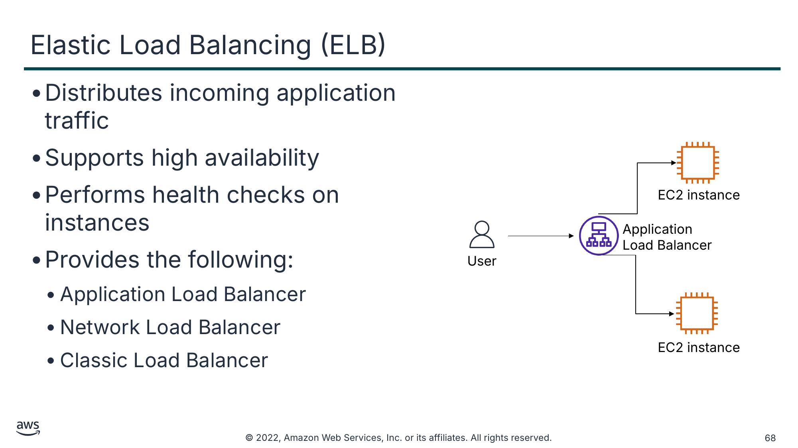

- Розподіляє вхідний трафік застосунків
- Підтримує високу доступність
- Виконує перевірки стану (health checks) екземплярів
- Надає таке:
  - Application Load Balancer
  - Network Load Balancer
  - Classic Load Balancer

Текст зі схеми

EC2 instance (Екземпляр EC2)

Application  
Load Balancer

EC2 instance

User (Користувач)

> **Нотатки:**
>
> Схема трафіку, що надходить до балансувальника навантаження. Див. опис у нотатках до слайда.  
>
> Для доступності: схема трафіку від користувача, що надходить до балансувальника навантаження. Потім трафік розподіляється між двома екземплярами EC2. Кінець опису для доступності.  
>
> Сервіс Elastic Load Balancing (ELB) автоматично розподіляє вхідний трафік застосунків між кількома цілями, як-от екземпляри EC2, контейнери та IP-адреси. Ви налаштовуєте свій балансувальник навантаження на прийом вхідного трафіку, указуючи один або кілька слухачів (listeners). Слухач — це процес, що перевіряє запити на з’єднання.  
>
> ELB масштабує ваш пристрій балансування навантаження в міру зміни трафіку до вашого застосунку з часом і може автоматично масштабуватися для переважної більшості робочих навантажень. Це підвищує відмовостійкість ваших застосунків. Ви можете додавати й видаляти екземпляри з вашого балансувальника навантаження в міру зміни ваших потреб, не порушуючи загального потоку запитів до вашого застосунку. ELB може обробляти змінне навантаження трафіку вашого застосунку в одній зоні доступності або в кількох зонах доступності.  
>
> Також можна налаштувати перевірки стану, що відстежують стан зареєстрованих цілей. За наявності перевірок стану пристрій балансування навантаження може надсилати запити лише до справних цілей. Коли балансувальник навантаження виявляє несправну ціль, він припиняє маршрутизувати трафік до цієї цілі. Балансувальник навантаження відновлює маршрутизацію трафіку до цієї цілі після того, як виявляє, що ціль знову справна.  
>
> ELB інтегровано з іншими популярними сервісами AWS, як-от Amazon EC2 Auto Scaling, Amazon Elastic Container Service (Amazon ECS), AWS CloudFormation та AWS Certificate Manager (ACM).  
>
> ELB підтримує три типи балансувальників навантаження: Application, Network і Classic Load Balancer.  
>
> Application Load Balancer працює на рівні запитів (рівень 7) і маршрутизує трафік до цілей (екземпляри EC2, контейнери, IP-адреси та функції AWS Lambda) на основі вмісту запиту. Application Load Balancer ідеально підходить для розширеного балансування навантаження трафіку HTTP і HTTPS. Цей тип балансувальника навантаження забезпечує розширену маршрутизацію запитів, орієнтовану на доставку сучасних архітектур застосунків, зокрема мікросервісів і застосунків на основі контейнерів. Application Load Balancer спрощує та підвищує безпеку вашого застосунку, гарантуючи, що завжди використовуються найновіші шифри та протоколи SSL і TLS.  
>
> Network Load Balancer працює на рівні з’єднань (рівень 4) і маршрутизує з’єднання до цілей (екземпляри EC2, мікросервіси та контейнери) у межах VPC на основі даних IP-протоколу. Network Load Balancer ідеально підходить для балансування навантаження як трафіку TCP, так і UDP. Цей тип балансувальника навантаження здатний обробляти мільйони запитів на секунду, зберігаючи наднизькі затримки. Network Load Balancer оптимізований для обробки раптових і нестабільних шаблонів трафіку з використанням однієї статичної IP-адреси на зону доступності.  
>
> Classic Load Balancer забезпечує базове балансування навантаження між кількома екземплярами EC2 і працює як на рівні запитів, так і на рівні з’єднань. Classic Load Balancer призначений для застосунків, побудованих у мережі EC2-Classic.  
>
> AWS рекомендує використовувати Application Load Balancer для трафіку рівня 7 і Network Load Balancer для трафіку рівня 4 під час використання VPC.

---

## Слайд 69: Балансувальники навантаження в дії

<!-- hidden slide -->

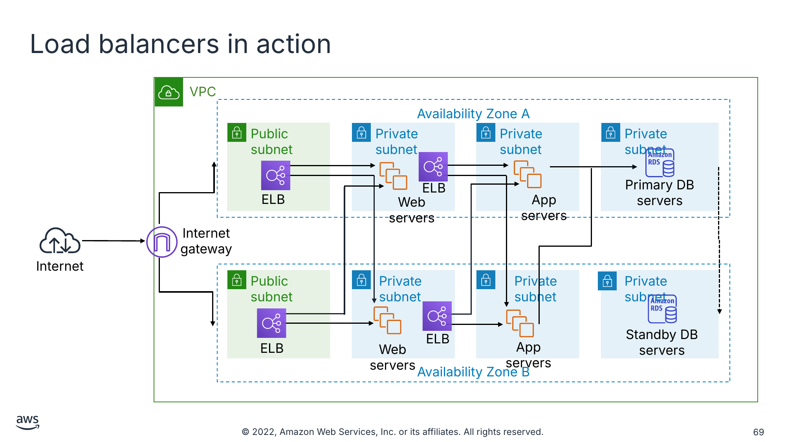

Текст зі схеми

VPC

Availability Zone A (Зона доступності A)

Public subnet (Публічна підмережа)

Private subnet (Приватна підмережа)

Web servers (Вебсервери)

Private subnet

App servers (Сервери застосунків)

Private subnet

Primary DB servers (Основні сервери БД)

Internet (Інтернет)

Internet gateway (Інтернет-шлюз)

Availability Zone B (Зона доступності B)

Public subnet

 Private  
 subnet

Web servers

    Private  
    subnet

App servers

Private subnet

Standby DB servers (Резервні сервери БД)

ELB

ELB

ELB

ELB

> **Нотатки:**
>
> Ця схема показує, як працюють балансувальники навантаження. VPC має підмережі у двох зонах доступності. Кожна зона доступності має публічну підмережу та кілька приватних підмереж.  
>
> Інтернет-трафік іде від інтернет-шлюзу до кожної зони доступності. Балансувальник навантаження в кожній публічній підмережі спрямовує трафік до вебсерверів у приватній підмережі в будь-якій зоні доступності. Трафік від вебсерверів іде до балансувальника навантаження, що спрямовує трафік до серверів застосунків в іншій приватній підмережі в будь-якій зоні доступності. Трафік від серверів застосунків іде до основного сервера бази даних в іншій приватній підмережі в першій зоні доступності. Основна база даних може обмінюватися даними з резервним сервером бази даних (standby) у приватній підмережі в другій зоні доступності.

---

## Слайд 70: Робочий процес

<!-- hidden slide -->

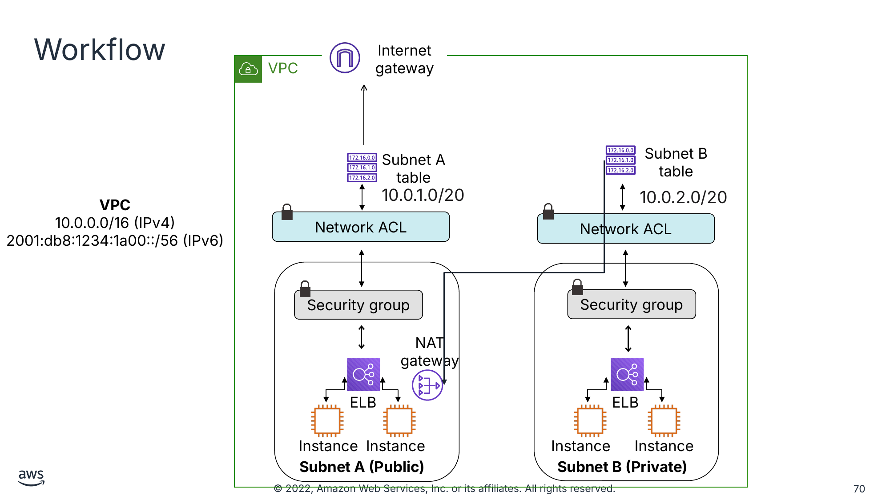

Текст зі схеми

Subnet B (Підмережа B)

table (таблиця)

Subnet A (Підмережа A)

table (таблиця)

**VPC**

10.0.0.0/16 (IPv4)

2001:db8:1234:1a00::/56 (IPv6)

Network ACL (Мережевий ACL)

Security group (Група безпеки)

Instance (Екземпляр)

Instance

**Subnet A (Public) (Підмережа A (публічна))**

**Subnet B (Private) (Підмережа B (приватна))**

Instance

Instance

10.0.1.0/20

10.0.2.0/20

Network ACL

Security group

NAT gateway (NAT-шлюз)

ELB

ELB

Internet  
gateway (Інтернет-шлюз)

VPC

