## Слайд 1: Protecting Data in Your Application

AWS Academy Cloud Security Foundations

> **Нотатки:**
>
> Welcome to the Protecting Data in Your Application module.

---

## Слайд 2: Introduction

Protecting Data in Your Application

> **Нотатки:**
>
> This section provides an introduction to the module.

---

## Слайд 3: Module objectives

At the end of this module, you should be able to do the following:

- Describe how to protect data at rest and in transit.
- Identify Amazon Simple Storage Service (Amazon S3) protection features.
- Encrypt data in Amazon S3.
- Differentiate between client-side encryption (CSE) and server-side encryption (SSE).
- Identify Amazon Web Services (AWS) services that help protect your data.

> **Нотатки:**
>
> At the end of this module, you should be able to do the following:  
> Describe how to protect data at rest and in transit.  
> Identify Amazon Simple Storage Service (Amazon S3) protection features.  
> Encrypt data in Amazon S3.  
> Differentiate between client-side encryption (CSE) and server-side encryption (SSE).  
> Identify Amazon Web Services (AWS) services that help protect your data.

---

## Слайд 4: Module overview

**Sections**

- Protect data at rest
- Amazon S3 protection features
- Protection through encryption
- Protect data in transit
- Best practices to protect data in Amazon S3
- Additional data protection services

**Lab**

- Encrypting Data at Rest by Using AWS KMS

**Knowledge check**

> **Нотатки:**
>
> This module includes the following sections:  
> Protect data at rest  
> Amazon S3 protection features  
> Protection through encryption  
> Protect data in transit  
> Best practices to protect data in Amazon S3  
> Additional data protection services  
>
> This module also includes a lab where you will practice implementing encryption of data at rest by using AWS KMS.  
>
> Finally, you will be asked to complete a knowledge check that will test your understanding of key concepts covered in this module.

---

## Слайд 5: Bank business scenario (1 of 4)

> **Нотатки:**
>
> Let’s discuss how the concepts in this module are applicable to the bank business scenario.

---

## Слайд 6: Bank business scenario (2 of 4)

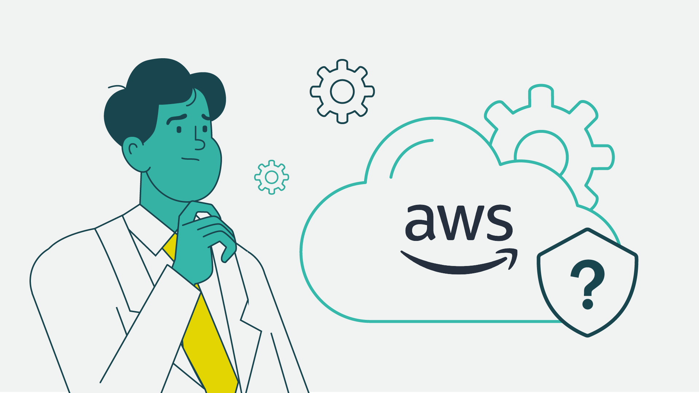

> **Нотатки:**
>
> John was receptive to María’s presentation and appears supportive of her plan to secure the bank’s assets from outside attacks.  
>
> However, María noticed that John still seemed unsure of the security capabilities inherent to AWS.

---

## Слайд 7: Bank business scenario (3 of 4)

> **Нотатки:**
>
> John explained that, at his previous employer, a disgruntled employee had inappropriately accessed some inadequately secured user data.  
>
> This wasn’t discovered until after the employee had left the company. This breach cost the company a large amount of money in fines and settlements.

---

## Слайд 8: Bank business scenario (4 of 4)

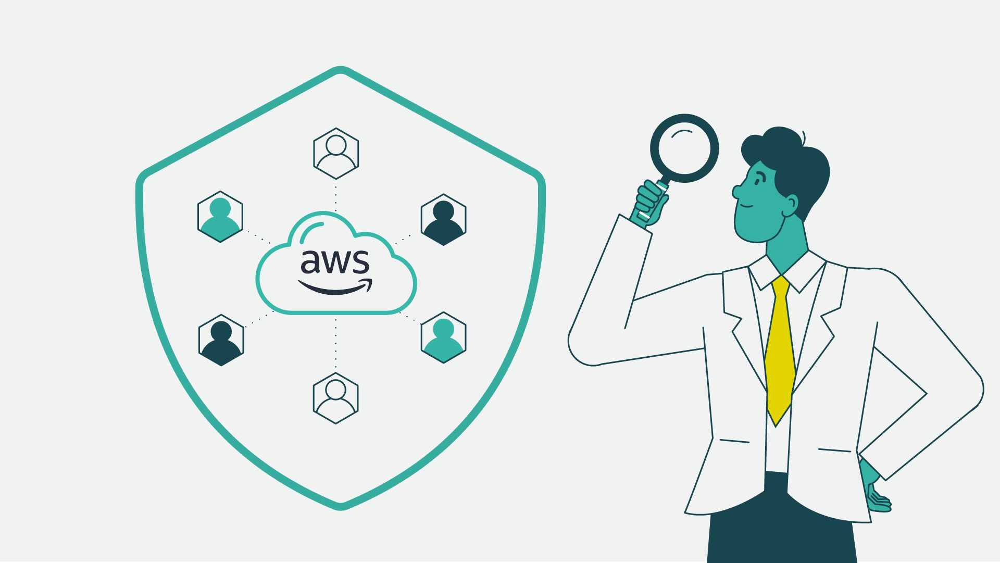

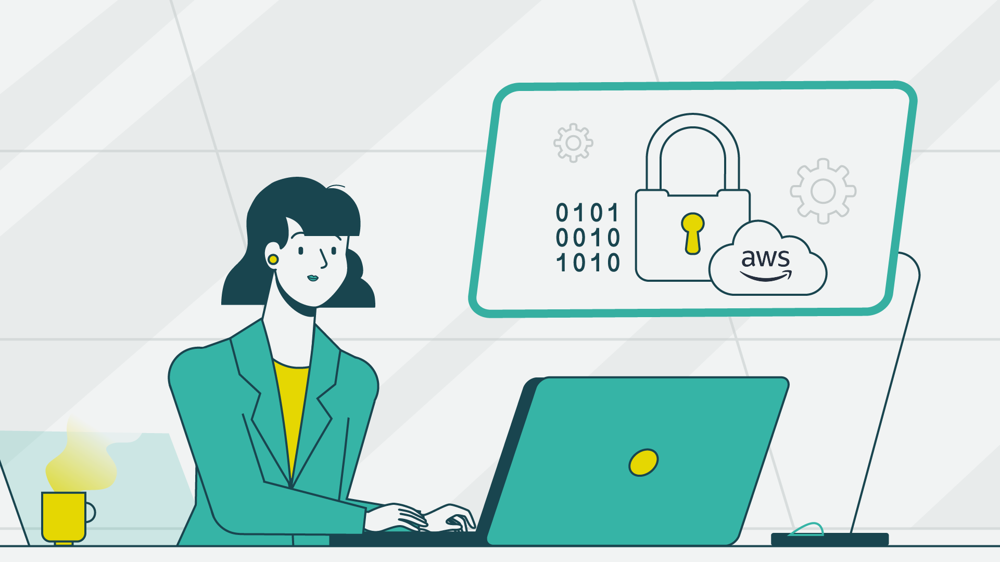

> **Нотатки:**
>
> For John to be comfortable with migrating to the cloud, he needs to understand how user data would be protected in the AWS Cloud.  
>
> For their next meeting, María wants to explain how they can secure user data that’s stored in the cloud.

---

## Слайд 9: Shared responsibility model

> **Нотатки:**
>
> For accessibility: Shared responsibility model listing customer and AWS responsibilities. Customer is responsible for security in the cloud. This includes customer data. Platform, applications, identity and access management. Operating system, network, and firewall configuration. Client-side data encryption and data integrity, authentication. Server-side encryption of file system and data. Networking traffic protection, to include encryption, integrity, and identity. AWS is responsible for security of the cloud. This includes the AWS foundation services for compute, storage, databases, and networking. And the AWS Global Infrastructure, to include Regions, Availability Zones, and Edge Locations. End of accessibility description.  
>
> This module covers two portions of the shared responsibility model: client-side encryption and data integrity, including authentication, and server-side encryption (file system and data). The customer is responsible to secure these portions.

---

## Слайд 10: Protect data at rest

Protecting Data in Your Application

> **Нотатки:**
>
> This section covers how to protect data at rest.

---

## Слайд 11: Why protect data at rest?

- Common scenarios
  - Information disclosure
  - Data integrity compromise
  - Accidental or malicious deletion
  - System, hardware, and software availability
- Extra layer of protection if your system is compromised

> **Нотатки:**
>
> It's important to encrypt data at rest. This ensures the security of the data even if an unauthorized party gains access to it. Encrypting data at rest makes it much more difficult for attackers to compromise data, even if they can compromise an endpoint. Also, you might need to protect your data at rest due to business or compliance requirements.  
>
> The following list identifies the most common issues that make it necessary to protect your data at rest. The list also describes how to protect against each issue:  
> Information disclosure: Limit the number of users who can access data, and use policies to manage access to resources. Use encryption to protect confidential data.  
> Data integrity compromise: Use resource permissions to limit the scope of users who can modify data. Implement digital signature and encryption. Restore data from backup, or, in the case of Amazon S3, from a previous object version.  
> Accidental or malicious deletion: Use the correct permissions and the principle of least privilege. Restore data from backup, or, in the case of Amazon S3, from a previous object version.  
> System, hardware, and software availability: In the case of a system failure or natural disaster, restore your data from replicas.

---

## Слайд 12: Data at rest in Amazon S3

Data stored in Amazon S3 is private by default and requires AWS credentials for access.

- Use bucket policies for granular access to objects.
- Consider encrypting data at rest.

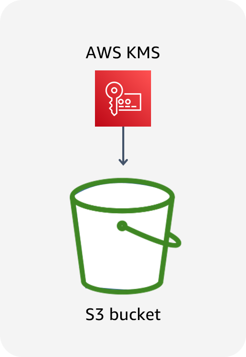

> **Нотатки:**
>
> By default, all Amazon S3 resources—buckets, objects, and related subresources (for example, lifecycle configuration and website configuration)—are private. Only the resource owner, the AWS account that created it, can access the resource. The resource owner can grant access permissions to others by writing an access policy.  
>
> You can modify bucket policies to allow additional access, and AWS provides a number of tools to configure buckets for a wide variety of workloads. For example, the S3 Block Public Access feature acts as an additional layer of protection to prevent accidental exposure of data.  
>
> In addition, consider encrypting data at rest in Amazon S3.

---

## Слайд 13: Granting permissions

**Identity based**

(Attached to an *IAM principal*)

**Resource based**

(Attached to an *AWS resource*)

**Bucket X**

| User | Get | Put | List |
|---|---|---|---|
| Bob | ALLOW | DENY | ALLOW |

**Bob**

| Resource | Get | Put | List |
|---|---|---|---|
| Bucket X | ALLOW | ALLOW | ALLOW |
| Bucket Y | N/A | N/A | ALLOW |

**Bucket Y**

| User | Get | Put | List |
|---|---|---|---|
| Bob | ALLOW | N/A | ALLOW |

Can Bob GET, PUT, or LIST for bucket X?

Can Bob GET or LIST for bucket Y?

> **Нотатки:**
>
> Note: In the tables on the slide, N/A means not applicable because the policy doesn't specify permissions for that particular action.  
>
> Amazon S3 supports two types of access control mechanisms: identity based (or user based) and resource based.  
>
> What are the differences between identity-based and resource-based policies? They are nearly identical in appearance and function, but have some slight syntax differences. The biggest difference is where they are applied. Identity-based permissions are attached to an AWS Identity and Access Management (IAM) user and indicate what the user is permitted to do. Resource-based permissions are attached to a resource and indicate what a specified user (or group of users) is permitted to do with the resource. For example, you can attach resource-based policies to S3 buckets, virtual private cloud (VPC) endpoints, and AWS Key Management Service (AWS KMS) encryption keys. Resource-based policies are a way to restrict access on a resource basis.  
>
> In the example on the slide, an IAM user named Bob has an identity-based policy attached. The policy allows him to use the GET, PUT, and LIST APIs for bucket X. However, the resource-based policy for bucket X allows him to use GET and LIST, and denies the ability to use PUT. This means that Bob cannot PUT objects into bucket X, even though his identity-based policy allows it.  
>
> For bucket Y, Bob's identity-based policy allows the LIST action. The policy does not explicitly allow or deny the GET and PUT actions on bucket Y. The resource-based policy for bucket Y allows him to use GET and LIST, but does not specify the PUT action. Therefore, Bob can read objects from the bucket, even though his identity-based policy doesn't explicitly allow it.  
>
> For some AWS services, you can grant cross-account access to your resources by putting a policy directly on the resource that you want to share, instead of using a role as a proxy. The resource that you want to share must support resource-based policies. The policy specifies who (as a list of AWS account IDs) can access that resource.  
>
> In addition to IAM and bucket policies, Amazon S3 supports a permissions mechanism known as an access control list (ACL). An ACL is independent of IAM policies and permissions, but can be used in combination with them. However, a majority of modern use cases in Amazon S3 no longer require the use of ACLs. AWS recommends that you disable ACLs except in unusual circumstances where you need to control access for each object individually. With ACLs disabled, the S3 bucket policy becomes the sole audit surface.

---

## Слайд 14: Key takeaways: Protect data at rest

- Encrypting data at rest makes it more difficult for attackers to compromise data.
- Data stored in Amazon S3 is private by default and requires AWS credentials for access.
- Amazon S3 supports two types of access control mechanisms:
  - Identity based (or user based)
  - Resource based

> **Нотатки:**
>
> Key takeaways from this section of the module include the following:  
> Encrypting data at rest makes it more difficult for attackers to compromise data.  
> Data stored in Amazon S3 is private by default and requires AWS credentials for access.  
> Amazon S3 supports two types of access control mechanisms:  
> Identity based (or user based)  
> Resource based

---

## Слайд 15: Amazon S3 protection features

Protecting Data in Your Application

> **Нотатки:**
>
> This section covers Amazon S3 protection features.

---

## Слайд 16: Amazon S3 Block Public Access

- Helps you manage public access to Amazon S3 resources
- Has four settings:
  - **BlockPublicAcls:** Block public access granted by new ACLs.
  - **IgnorePublicAcls:** Block public access granted by any ACLs.
  - **BlockPublicPolicy:** Block public access granted by new public bucket policies.
  - **RestrictPublicBuckets:** Block public and cross-account access by any public bucket policies.

Bucket with block public access settings

> **Нотатки:**
>
> Amazon S3 provides a number of security features to consider as you develop and implement your own security policies. Amazon S3 provides the Block Public Access feature to help you manage public access to S3 resources. By default, new buckets and objects don't allow public access, but users can modify bucket policies or object permissions to allow public access. S3 Block Public Access provides settings that override these policies and permissions so that you can limit public access to these resources.  
>
> This feature provides four settings:  
> BlockPublicAcls: Prevent any new operations to make buckets or objects public through bucket or object ACLs. Existing policies and ACLs for buckets and objects are not modified.  
> IgnorePublicAcls: Ignore all public ACLs on a bucket and any objects that it contains.  
> BlockPublicPolicy: Reject calls to PUT a bucket policy if the specified bucket policy allows public access. (Enabling this setting doesn't affect existing bucket policies.)  
> RestrictPublicBuckets: Restrict access to a bucket with a public policy to only AWS services and authorized users within the bucket owner's account.  
>
> These settings are independent and can be used in any combination. You can apply each setting to an access point, a bucket, or an entire AWS account. You cannot apply these settings on a per-object basis. If the block public access settings for the access point, bucket, or account differ, then Amazon S3 applies the most restrictive combination of the access point, bucket, and account settings.  
>
> When Amazon S3 receives a request to access a bucket or an object, the service determines whether the bucket or the bucket owner's account has a block public access setting applied. If an existing block public access setting prohibits the requested access, Amazon S3 rejects the request.  
>
> In addition to these settings, the Amazon S3 console highlights your publicly accessible buckets, indicates the source of public accessibility, and also warns you if changes to your bucket policies or bucket ACLs would make your bucket publicly accessible.  
>
> For more information, see Blocking Public Access to Your Amazon S3 Storage in the Amazon Simple Storage Service User Guide at https://docs.aws.amazon.com/AmazonS3/latest/userguide/access-control-block-public-access.html.

---

## Слайд 17: Amazon S3 Versioning

- Creates a new version with every upload
- Protects from unintended deletion
- Provides retrieval of deleted objects
- Can be used with lifecycle policies for cost savings
- Can’t be turned off once enabled (only suspended)
- Offers multi-factor authentication (MFA) delete for extra security

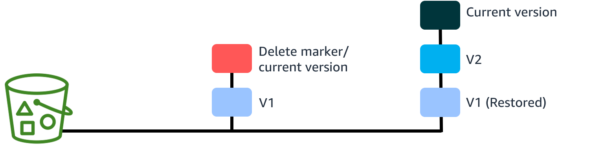

> **Нотатки:**
>
> Another security feature to consider is Versioning. It is a method of keeping multiple variants of an object in the same bucket. With this feature, you can preserve, retrieve, and restore every version of every object stored in your buckets. By default, S3 Versioning is disabled on buckets, and you must explicitly enable it.  
>
> Versioning can help you to recover objects from accidental deletion or overwrite. For example, if you delete an object, instead of removing it permanently, Amazon S3 inserts a delete marker, which becomes the current object version. You can always restore the previous version. Overwriting an object results in a new object version in the bucket, but you can always restore the previous version.  
>
> With versioning enabled, the most recently written version will be retrieved by default. You can retrieve older versions of an object by specifying the version in your request.  
>
> To customize your data retention approach and control storage costs, use object versioning with S3 Lifecycle.  
>
> After you enable versioning for a bucket, you can't return it to an unversioned state. You can, however, suspend versioning on a bucket, which stops accruing new versions of the same object in a bucket. You might do this because you only want a single version of an object in a bucket. Or, you might not want to accrue charges for multiple versions. When you suspend versioning, existing objects in your bucket do not change.  
>
> When working with S3 Versioning in Amazon S3 buckets, you can optionally add another layer of security by enabling multi-factor authentication (MFA) delete. When you do this, the bucket owner must include two forms of authentication in any request to delete a version or change the versioning state of the bucket.  
>
> For more information, see Using Versioning in S3 Buckets in the Amazon Simple Storage Service User Guide at https://docs.aws.amazon.com/AmazonS3/latest/userguide/Versioning.html.

---

## Слайд 18: Amazon S3 Object Lock

- Stores objects by using the write-once-read-many (WORM) model
- Works only in versioned buckets
- Provides the ability to manage object retention
- Provides two retention modes:
  - Governance
  - Compliance

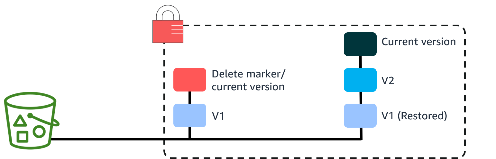

> **Нотатки:**
>
> Finally, with Object Lock, you can store objects by using a write-once-read-many (WORM) model. This feature provides protection for scenarios where it's imperative that data is not changed or deleted. The feature can provide protection for a fixed amount of time or indefinitely. You can use Object Lock to meet regulatory requirements that require WORM storage, or add an extra layer of protection against object changes and deletion.  
>
> Note that Object Lock works only in versioned buckets.  
>
> Object Lock provides two ways to manage object retention: retention periods and legal holds. A retention period specifies a fixed period during which an object remains locked. During this period, your object is WORM-protected and can't be overwritten or deleted. A legal hold provides the same protection as a retention period but has no expiration date. Instead, a legal hold remains in place until you explicitly remove it.  
>
> You can configure Object Lock in one of two modes. In governance mode, users can't overwrite or delete an object version or alter its lock settings unless they have special permissions. If you require stronger immutability to comply with regulations, you can use compliance mode. In compliance mode, a protected object version can't be overwritten or deleted by any user, including the root user in your AWS account.  
>
> For more information, see How S3 Object Lock Works in the Amazon Simple Storage Service User Guide at https://docs.aws.amazon.com/AmazonS3/latest/userguide/object-lock-overview.html.

---

## Слайд 19: Key takeaways: Amazon S3 protection features

- Block Public Access ensures that objects never have public access, now and in the future.
- Versioning preserves, retrieves, and restores every version of every object stored in an S3 bucket.
- Object Lock prevents an object version from being deleted or overwritten for a fixed amount of time or indefinitely.

> **Нотатки:**
>
> Key takeaways from this section of the module include the following:  
> Block Public Access ensures that objects never have public access, now and in the future.  
> Versioning preserves, retrieves, and restores every version of every object stored in an S3 bucket.  
> Object Lock prevents an object version from being deleted or overwritten for a fixed amount of time or indefinitely.

---

## Слайд 20: Protection through encryption

Protecting Data in Your Application

> **Нотатки:**
>
> This section covers protection through encryption.

---

## Слайд 21: Encryption: What, how, and why

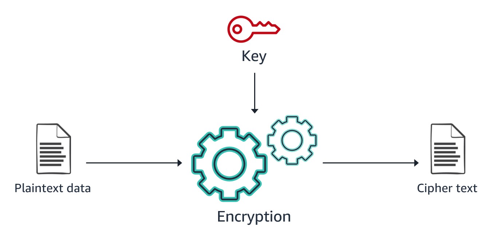

> **Нотатки:**
>
> Encryption works by using an algorithm with a key to convert plaintext data into unreadable data (ciphertext) that can only become readable again with the right key. For example, a simple phrase such as “Hello World!” might look like “1c28df2b595b4e30b7b07500963dc7c” when encrypted.  
>
> Several different encryption algorithms exist, all using different types of keys. A strong encryption algorithm relies on mathematical properties to produce ciphertext that can’t be decrypted by using any practically available amount of computing power without also having the necessary key. Therefore, protecting and managing the keys becomes a critical part of any encryption solution.

---

## Слайд 22: Comparing client-side and server-side encryption

Client-side encryption (CSE)

Server-side encryption (SSE)

- Your application encrypts data before sending it to AWS.
- Data is stored in its encrypted state.
- The keys and algorithms are known only to you.

- AWS encrypts data on your behalf after receiving it.
- The process is transparent to the user.

> **Нотатки:**
>
> Depending on your security requirements, you can use client-side encryption (CSE) or server-side encryption (SSE) to encrypt your data. The approaches differ in when, where, and who encrypts and decrypts the data. The approach doesn't necessarily define how the data is encrypted. In addition, the approaches are not exclusive—you can often use CSE and SSE on the same data for an enhanced security profile. Each approach has advantages.  
>
> With client-side encryption (CSE), your applications encrypt data locally before submitting it to AWS and decrypt data after receiving it from AWS. You create and manage your own encryption keys. Data is stored in an encrypted form, with keys and algorithms known only to you.  
>
> With server-side encryption (SSE), data is encrypted at its destination by the application or service that receives it. For example, if you use SSE with Amazon S3, the service encrypts your data at the object level as it writes to disks in AWS data centers and decrypts the data for you when you access it. The encryption process is transparent to the user.  
>
> AWS supports both CSE and SSE. Most AWS services that store or manage customer data offer an SSE option or perform SSE on your data by default. These services transparently encrypt your data before writing it to disk and transparently decrypt the data when you access it. Most AWS services that support SSE are integrated with AWS KMS to protect the encryption keys that protect your data. You will learn more about AWS KMS later in this module.  
>
> For more information, see Protecting Data Using Encryption in the Amazon Simple Storage Service User Guide at https://docs.aws.amazon.com/AmazonS3/latest/userguide/UsingEncryption.html.

---

## Слайд 23: Client-side encryption

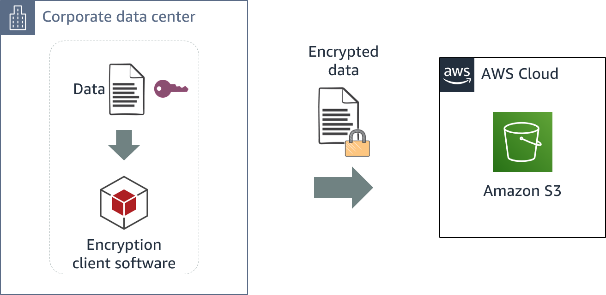

> **Нотатки:**
>
> Client-side encryption takes place before data is submitted to AWS, and decryption occurs after data is retrieved from AWS. Amazon S3 receives your encrypted data but does not play a role in encrypting or decrypting it.  
>
> To enable client-side encryption, you can use a key stored in AWS KMS or use a key that you store within your application.  
>
> AWS supports client-side encryption libraries such as the AWS Encryption SDK, Amazon DynamoDB Encryption Client, and Amazon S3 encryption clients.

---

## Слайд 24: AWS server-side encryption

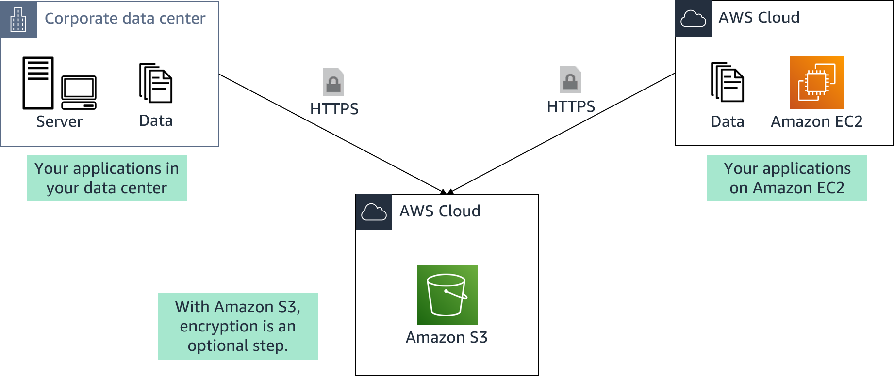

> **Нотатки:**
>
> Server-side encryption is the encryption of data at its destination by the application or service that receives it. With AWS server-side encryption, your source data comes from systems in your data center or an EC2 instance. You can upload that data over an HTTPS connection to any of the AWS services that support automatic server-side encryption. The service endpoint will handle the encryption and key management processes for you.  
>
> With Amazon S3, encryption is an optional step that you specify when you upload your data to the service.

---

## Слайд 25: Types of Amazon S3 server-side encryption

SSE-C

SSE-S3

SSE-KMS

- You retain control of the keys.
- Amazon S3 doesn't store the encryption keys that you provide.

- AWS manages the keys.
- The encrypted data and keys are stored in separate hosts.

- AWS manages the keys.
- An envelope key is used for added protection.

> **Нотатки:**
>
> For server-side encryption in Amazon S3, you have three mutually exclusive options, depending on how you choose to manage the encryption keys:  
>
> SSE with customer-provided keys (SSE-C)  
> With server-side encryption with customer-provided keys (SSE-C), you manage the encryption keys. With the encryption key that you provide as part of the request, Amazon S3 manages the encryption (as it writes to disks) and decryption (when you access your objects). You don't maintain the code to perform data encryption and decryption—you only maintain the keys.  
>
> Amazon S3 does not store the encryption key that you provide. Instead, a randomly salted hash-based message authentication code (HMAC) value of the encryption key is stored to validate future requests. The salted HMAC value cannot be used to derive the value of the encryption key or decrypt the contents of the encrypted object. So, if you lose the encryption key, you lose the object.  
>
> SSE with Amazon S3 managed keys (SSE-S3)  
> When you use server-side encryption with Amazon S3 managed keys (SSE-S3), each object is encrypted with a unique key. As an additional safeguard, Amazon S3 encrypts the key itself with a key that the service regularly rotates. SSE-S3 uses one of the strongest block ciphers available, 256-bit Advanced Encryption Standard (AES-256), to encrypt your data.  
>
> SSE with AWS KMS keys (SSE-KMS)  
> Server-side encryption with AWS KMS keys (SSE-KMS) is similar to SSE-S3 but with some additional benefits and charges for using the service. There are separate permissions for the use of a KMS key that provide added protection against unauthorized access of your objects in Amazon S3. SSE-KMS also provides you with an audit trail that shows when your KMS key was used and by whom. Additionally, you can create and manage customer managed KMS keys or use AWS managed KMS keys that are unique to you, your service, and your Region. AWS KMS uses envelope encryption to further protect your data. Envelope encryption is the practice of encrypting your plaintext data with a data key and then encrypting that data key with a root key.  
>
> For more information about the server-side encryption options in Amazon S3, see Protecting Data Using Server-Side Encryption in the Amazon Simple Storage Service User Guide at https://docs.aws.amazon.com/AmazonS3/latest/userguide/serv-side-encryption.html.

---

## Слайд 26: Encryption overview

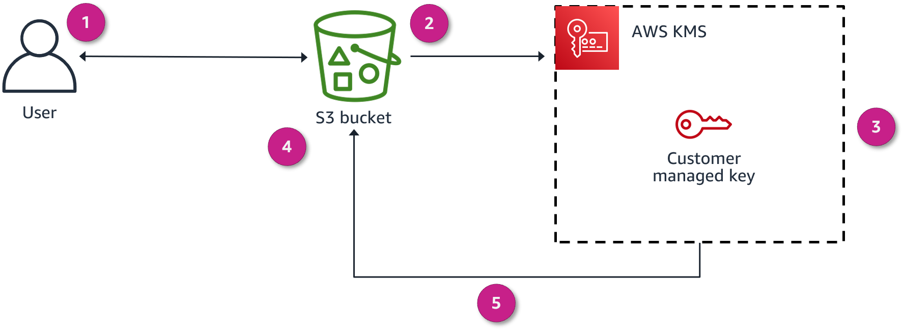

> **Нотатки:**
>
> In this scenario, AMS KMS is used to encrypt data at rest (SSE-KMS). The user creates a KMS key and uses it to encrypt objects that are stored in Amazon S3.  
>
> This diagram explains how encryption happens when uploading a file to Amazon S3:  
> You request to upload a file and store it as an encrypted object in an S3 bucket.  
> Amazon S3 requests a data key from AWS KMS to use to encrypt the file.  
> AWS KMS generates a plaintext data key and encrypts the data key by using the customer managed key.  
> AWS KMS sends both copies of the data key to Amazon S3.  
> Amazon S3 encrypts the object by using the plaintext data key, stores the object, and then deletes the plaintext data key. The encrypted key is kept in the object metadata.

---

## Слайд 27: Decryption overview

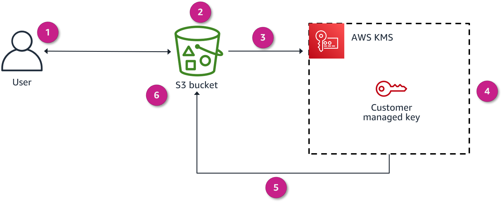

> **Нотатки:**
>
> Now, this diagram explains what happens in the same scenario (SSE-KMS) when the user requests to open an encrypted object that is stored in Amazon S3:  
> You request to open the object.  
> Amazon S3 notices that the requested object is encrypted.  
> Amazon S3 sends the encrypted copy of the data key that the object is encrypted with to AWS KMS.  
> AWS KMS then decrypts the data key by using the customer managed key (which never leaves the AWS KMS service).  
> AWS KMS then sends the plaintext data key back to Amazon S3.  
> Finally, Amazon S3 decrypts the ciphertext of the data object, allows you to open the object, and deletes the plaintext copy of the data key.

---

## Слайд 28: AWS Key Management Service (AWS KMS)

- Provides the ability to create and manage cryptographic keys
- Uses hardware security modules (HSMs) to protect your keys
- Is integrated with other AWS services
- Provides the ability to set usage policies to determine which users can use keys

AWS Key Management Service (AWS KMS)

> **Нотатки:**
>
> AWS KMS is a managed service that provides the ability to create and control the keys that are used to encrypt your data. You can create data keys with unique aliases and descriptions for better management, automatically rotate your keys on a scheduled basis, and disable or delete keys so that no one can use them. You can also import your own keys instead of using AWS generated keys.  
>
> The service uses FIPS 140-2 validated hardware security modules (HSMs) to protect keys. AWS KMS is integrated with other AWS services to help you protect the data that you store with these services. Integrated AWS services use envelope encryption to help protect your encryption keys.  
>
> With AWS KMS, you can centrally manage and securely store your keys. You can use the keys within your applications and supported AWS Cloud services to protect your data, but the keys never leave AWS KMS. This reduces the risk of having your data key compromised. You submit data to AWS KMS to be encrypted or decrypted under keys that you control.  
>
> You can set usage policies on these keys to determine which users can use them. All requests to use these keys are logged in AWS CloudTrail, so that you can understand who used which key and when. CloudTrail logs all AWS KMS operations, including read-only operations; operations that manage KMS keys; and cryptographic operations.  
>
> For more information, see the following resources:  
> AWS Key Management Service (AWS KMS) at https://aws.amazon.com/kms/  
> How AWS Services Use AWS KMS in the AWS Key Management Service Developer Guide at https://docs.aws.amazon.com/kms/latest/developerguide/service-integration.html

---

## Слайд 29: AWS KMS example with Amazon EBS

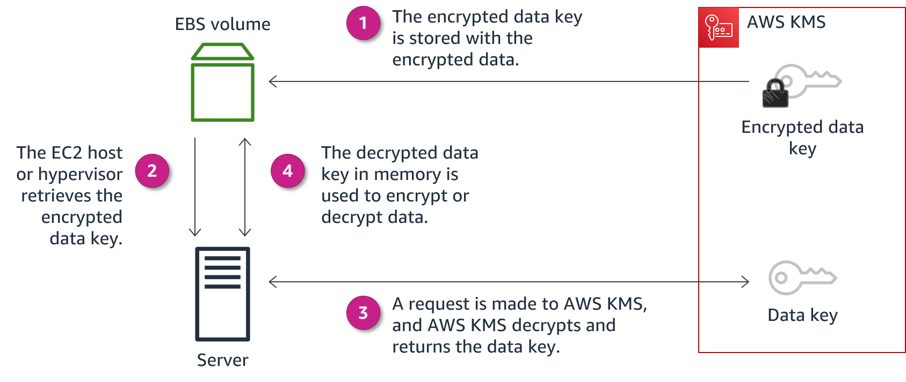

> **Нотатки:**
>
> Amazon Elastic Block Store (Amazon EBS) encryption is a straight-forward encryption solution for EBS resources that are associated with your EC2 instances. With Amazon EBS encryption, you aren't required to build, maintain, and secure your own key management infrastructure.  
>
> Amazon EBS encryption uses KMS keys when creating encrypted volumes and snapshots. Each volume is encrypted using AES-256-XTS. This requires two 256-bit keys, which you can think of as one 512-bit key. The data key is encrypted under a KMS key in your account. For Amazon EBS to encrypt a volume for you, it must have access to a customer managed key in the account. You do this by providing a grant for Amazon EBS to the customer managed key to create data keys, and to encrypt and decrypt these data keys.  
>
> The following are the basic steps to encrypt and decrypt EBS volume data:  
> Amazon EBS obtains an encrypted data key under a customer managed key through AWS KMS and stores the encrypted key with the encrypted data.  
> The servers that host EC2 instances retrieve the encrypted data key from storage.  
> A call is made to AWS KMS over TLS to decrypt the encrypted data key. AWS KMS identifies the KMS key, makes an internal request to an HSM in the fleet to decrypt the data key, and returns the key to the customer over the TLS session.  
> The decrypted data key is stored in memory and used to encrypt and decrypt all data going to and from the attached EBS volume. Amazon EBS retains the encrypted data key for later use in case the data key in memory is no longer available.

---

## Слайд 30: Key takeaways: Protection through encryption

- AWS supports both client-side and server-side encryption.
  - CSE: You encrypt your data before sending it to AWS.
  - SSE: AWS encrypts data on your behalf after receiving it.
- AWS provides three types of SSE:
  - SSE with customer-provided keys (SSE-C)
  - SSE with Amazon S3 managed keys (SSE-S3)
  - SSE with AWS KMS keys (SSE-KMS)
- AWS KMS can create and control the keys used to encrypt your data.

> **Нотатки:**
>
> Key takeaways from this section of the module include the following:  
> AWS supports both client-side and server-side encryption.  
> CSE: You encrypt your data before sending it to AWS.  
> SSE: AWS encrypts data on your behalf after receiving it.  
> AWS provides three types of SSE:  
> SSE with customer-provided keys (SSE-C)  
> SSE with Amazon S3 managed keys (SSE-S3)  
> SSE with AWS KMS keys (SSE-KMS)  
> AWS KMS can create and control the keys used to encrypt your data.

---

## Слайд 31: Lab: Encrypting Data at Rest by Using AWS KMS

> **Нотатки:**
>
> In this lab, you will use AMS KMS to encrypt data at rest. You will create a KMS key, use it to encrypt objects stored in Amazon S3, and use it to encrypt EBS volumes. You will also see how CloudTrail provides an audit log of KMS key usage and how disabling the key affects data access.

---

## Слайд 32: Lab: Tasks

1. Creating an AWS KMS key
2. Storing an encrypted object in an S3 bucket
3. Attempting public access to the encrypted object
4. Attempting signed access to the encrypted object
5. Monitoring AWS KMS activity by using CloudTrail
6. Encrypting the root volume of an existing EC2 instance
7. Disabling the encryption key and observing the effects

> **Нотатки:**
>
> In this lab, you will complete the following tasks:  
> Creating an AWS KMS key  
> Storing an encrypted object in an S3 bucket  
> Attempting public access to the encrypted object  
> Attempting signed access to the encrypted object  
> Monitoring AWS KMS activity by using CloudTrail  
> Encrypting the root volume of an existing EC2 instance  
> Disabling the encryption key and observing the effects

---

## Слайд 33: Begin Lab: Encrypting Data at Rest by Using AWS KMS

Duration: 90 minutes

> **Нотатки:**
>
> It's now time to start the lab.

---

## Слайд 34: Lab debrief: Key takeaways

> **Нотатки:**
>
> After you complete the lab, your educator might choose to lead a conversation about the key takeaways from the lab.

---

## Слайд 35: Protect data in transit

Protecting Data in Your Application

> **Нотатки:**
>
> This section covers how to protect data in transit.

---

## Слайд 36: Why protect data in transit?

- Your communications might go through the public internet.
- What are the risks that data in transit is exposed to?
  - Accidental information disclosures
  - Data integrity compromises
  - Identity compromises
    - Man-in-the-middle (MITM) attacks
    - Identity spoofing

> **Нотатки:**
>
> Data in transit is data that is actively moving from one location to another, such as across the internet or through a private network. To protect data in transit, you protect data while it's traveling from network to network or being transferred from a local storage device to a cloud storage device. Wherever data is moving, protection measures are critical, as data is often considered less secure while in motion.  
>
> Cloud applications often communicate over public links, such as the internet, so it's important to protect data in transit when you run applications in the cloud. This involves protecting network traffic between clients and servers, and network traffic between servers.  
>
> While being transferred through various applications and networks, data in transit is exposed to the following risks:  
> Accidental information disclosures  
> Data integrity compromises  
> Identity compromises  
> Man-in-middle (MITM) attacks  
> Identity spoofing  
>
> A man-in-the-middle (MITM) attack is a form of cyberattack in which criminals exploit weak web-based protocols to insert themselves between entities in a communication channel to steal data. The attacker is in the middle of ongoing communication between two entities. This type of attack makes the network vulnerable to packet sniffing and modification.

---

## Слайд 37: Protecting data in transit

- Use Secure Sockets Layer (SSL) endpoints over Transport Layer Security (TLS) (HTTPS).
- Use encryption.
- Use Amazon Virtual Private Cloud (Amazon VPC) endpoints to limit access to your bucket.

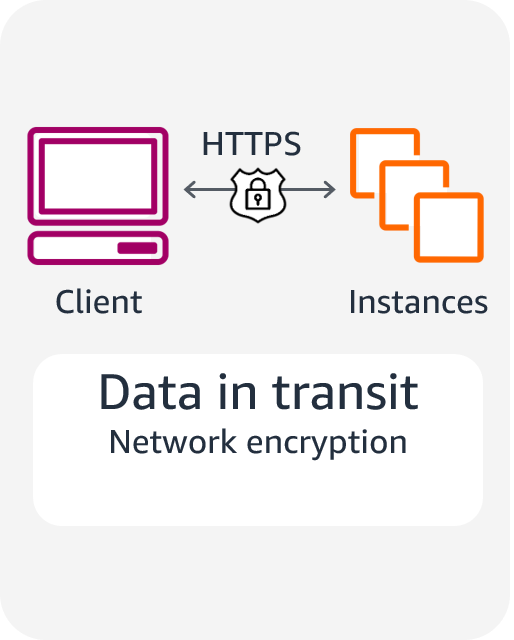

> **Нотатки:**
>
> You can protect data in transit by using Secure Sockets Layer (SSL) or client-side encryption. You can securely upload your data to or download it from Amazon S3 through SSL endpoints by using the HTTPS protocol. Client-side encryption will protect your data in transit because the data is encrypted before you send it to Amazon S3.  
>
> You can also limit access to an S3 bucket from a specific Amazon Virtual Private Cloud (Amazon VPC) endpoint or a set of endpoints by using S3 bucket policies.  
>
> To protect data in transit, AWS encourages customers to use a multi-level approach. All network traffic between AWS data centers is transparently encrypted at the physical layer. All traffic within a VPC and between peered VPCs across AWS Regions is transparently encrypted at the network layer when using supported EC2 instance types. At the application layer, customers have a choice about whether and how to use encryption by using a protocol such as Transport Layer Security (TLS). All AWS service endpoints support TLS to create a secure HTTPS connection to make API requests.

---

## Слайд 38: Protecting remote connections to servers

- Remote Desktop Protocol (RDP) is typically used for Windows servers.
  - RDP establishes an underlying SSL/TLS connection.
  - For better security, issue a trusted X.509 certificate.
  - Don't use the default self-signed certificates.
- Secure Shell (SSH) is typically used for Linux servers.
  - SSH establishes a secure communication channel.
  - Use tunneling to protect the application session in transit.
  - Don't allow the root user to use an SSH terminal.
  - Be sure that all users log in with an SSH key pair, and then deactivate password authentication.

> **Нотатки:**
>
> Users who access Windows Terminal Services in the public cloud usually use the Microsoft Remote Desktop Protocol (RDP). By default, RDP connections establish an underlying SSL/TLS connection. For optimal protection, the Windows server being accessed should be issued a trusted X.509 certificate to protect from identity spoofing or man-in-the-middle attacks. By default, Windows RDP servers use self-signed certificates, which are not trusted and should be avoided.  
>
> Secure Shell (SSH) is the preferred approach to establish administrative connections to Linux servers. SSH is a protocol that, like SSL, provides a secure communications channel between the client and server. SSH supports tunneling, which you should use to run applications such as X-Windows on top of SSH and to protect the application session in transit. By default, Amazon Machine Images (AMIs) that AWS and most vendors from the AWS Marketplace provide don't allow the root user to log in from an SSH terminal. The default configuration for AWS provided AMIs is logging in with an SSH key pair with password authentication deactivated.

---

## Слайд 39: AWS Certificate Manager (ACM)

- Provides a single interface to manage both public and private certificates
- Makes it easy to deploy certificates
- Protects and stores private certificates
- Minimizes downtime and outages with automatic renewals

AWS Certificate Manager (ACM)

> **Нотатки:**
>
> By making it easy to enable SSL/TLS, AWS Certificate Manager (ACM) helps organizations to meet regulatory and compliance requirements for encryption of data in transit. ACM handles the complexity of creating and managing public SSL/TLS certificates for your AWS based websites and applications. You can also use ACM to issue private SSL/TLS X.509 certificates that identify users, computers, applications, services, servers, and other devices internally.  
>
> ACM provides a single interface for you to manage both public and private certificates. With ACM, you can easily create and deploy public and private certificates for your on-premises resources, such as internal servers and Internet of Things (IoT) devices. You can also deploy private or public certificates on AWS resources, such as load balancers, Amazon CloudFront distributions, and Amazon API Gateway endpoints by using the AWS Management Console or the ACM API.  
>
> ACM is also designed to protect and manage private certificates. The service can also help you minimize downtime due to misconfigured or expired certificates. ACM helps manage the challenges of maintaining certificates, including certificate renewals so that you don’t have to worry about outages that result from expiring certificates. Renewed certificates are deployed automatically on AWS resources.

---

## Слайд 40: AWS Certificate Manager Private Certificate Authority

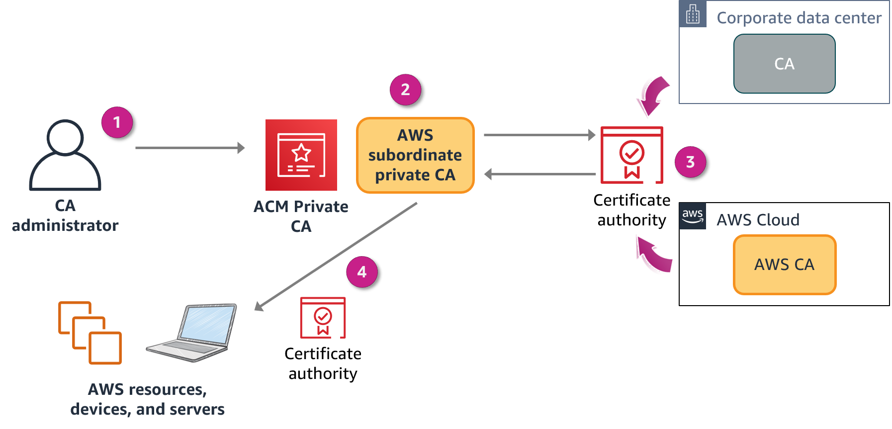

> **Нотатки:**
>
> By using AWS Certificate Manager Private Certificate Authority, you can create private certificate authority (CA) hierarchies, including root and subordinate CAs, without the investment and maintenance costs of operating an on-premises CA. Your private CAs can issue end-entity X.509 certificates, which are useful in scenarios such as the following:  
> Creating encrypted TLS communication channels  
> Authenticating users, computers, API endpoints, and IoT devices  
> Cryptographically signing code  
> Implementing Online Certificate Status Protocol (OCSP) to obtain certificate revocation status  
>
> ACM Private CA is for enterprise customers who are building a public key infrastructure (PKI) inside the AWS Cloud. The service is intended for private use within an organization. With ACM Private CA, you can create your own CA hierarchy and issue certificates with it to authenticate internal users, computers, applications, services, servers, and other devices, and to sign computer code. Certificates that a private CA issues are trusted only within your organization, not on the internet. After creating a private CA, you have the ability to issue certificates directly (that is, without obtaining validation from a third-party CA) and to customize them to meet your organization's internal needs.  
>
> The diagram shows ACM Private CA in action:  
> The CA administrator creates a subordinate CA to issue certificates.  
> The subordinate CA sends the certificate to be signed.  
> The on-premises CA or AWS CA signs the certificate.  
> ACM Private CA issues the signed certificate to resources.

---

## Слайд 41: ACM Private CA considerations

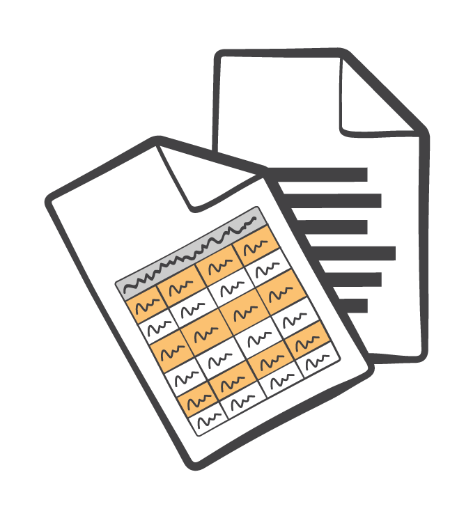

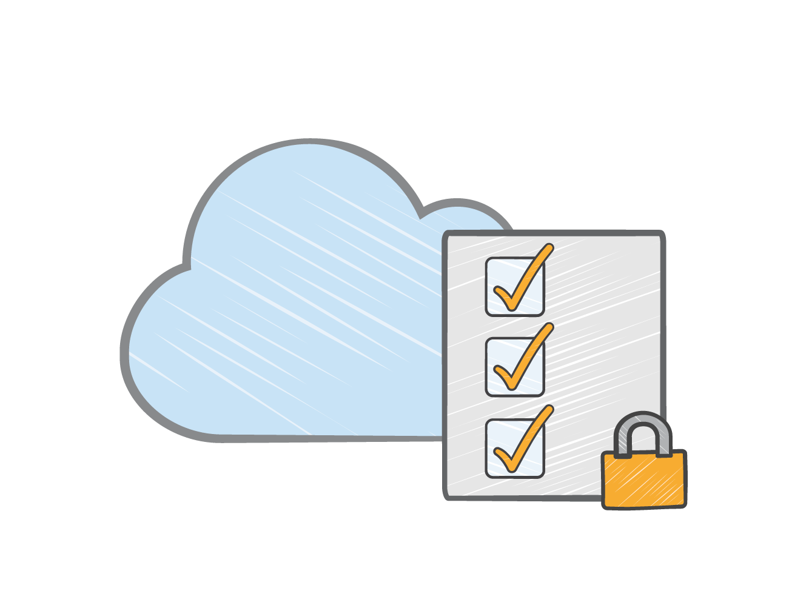

Hardware security modules (HSMs)

IAM policies for access control

Certificate revocation

list

Generated audit

reports

> **Нотатки:**
>
> ACM Private CA is secured with HSMs. These HSMs adhere to FIPS 140-2 Level 3 security standards to help protect your private CA against key compromises. CA administrators can also control access to the service by using IAM policies. ACM Private CA publishes and updates certificate revocation lists to an S3 bucket automatically to help prevent the use of revoked certificates. For instance, an IoT application can check if the private certificate for a sensor is valid before accepting data from the sensor. ACM Private CA also creates another S3 bucket that provides the ability to generate audit reports.  
>
> Securing internal services is a common use case for ACM Private CA. For example, a private certificate is useful to secure connections to your load balancers, API endpoints, applications, and internal Wi-Fi. This service is also an infrastructure component of ACM, which has a wide variety of uses of its own. Examples include managing private certificates with the benefit of managed renewals and certificate binding, and issuing private certificates to identify AWS resources, such as EC2 instances, Amazon Simple Notification Service (Amazon SNS) messages, or IoT devices. ACM Private CA also works well for customers who want a replacement for self-signed certificates and automation through APIs.

---

## Слайд 42: Key takeaways: Protect data in transit

- Protect data in transit by using SSL or client-side encryption when you run applications in the cloud.
- Use VPC endpoints to limit access to S3 buckets.
- The ACM service handles the complexity of creating and managing public SSL/TLS certificates for your AWS based websites and applications.
- ACM Private CA can manage the lifecycle of your private certificates centrally and in a highly available way.

> **Нотатки:**
>
> Key takeaways from this section of the module include the following:  
> Protect data in transit by using SSL or client-side encryption when you run applications in the cloud.  
> Use VPC endpoints to limit access to S3 buckets.  
> The ACM service handles the complexity of creating and managing public SSL/TLS certificates for your AWS based websites and applications.  
> ACM Private CA can manage the lifecycle of your private certificates centrally and in a highly available way.

---

## Слайд 43: Best practices to protect data in Amazon S3

Protecting Data in Your Application

> **Нотатки:**
>
> This section covers best practices to protect data in Amazon S3.

---

## Слайд 44: Presigned URLs

- Generate an S3 Presigned URL, and use it to upload files (objects).
- A presigned URL uses three parameters to limit user access:
  - Bucket: Bucket that the object is in (or will be in)
  - Key: Name of the object
  - Expires: Amount of time that the URL is valid

> **Нотатки:**
>
> All objects in an S3 bucket are private by default. Only the object owner has permissions to access these objects. However, the object owner can optionally share objects with others by creating a presigned URL, using their own security credentials, to grant time-limited permissions to upload or download the objects.  
>
> A presigned URL provides temporary access to a specific S3 object. By using the URL, a user can either read, write, or update the object. For example, if you have a video in your bucket and both the bucket and the video are private, you can share the video with others by generating a presigned URL.  
>
> Similarly, if you want to receive an object from a user without an AWS account, they can upload an object by using a presigned URL that you share with them.  
>
> For more information, see Generating a Presigned URL to Upload an Object in the Amazon Simple Storage Service User Guide at https://docs.aws.amazon.com/AmazonS3/latest/userguide/PresignedUrlUploadObject.html.

---

## Слайд 45: Security considerations and best practices (1 of 2)

- Consider encryption of data at rest, and enforce encryption of data in transit.
- Ensure that your S3 buckets use the correct policies and are not publicly accessible.
- Use the principle of least privilege.
- Enable MFA delete for buckets.
- Enforce encryption for each PUT request.
- Use presigned URLs for applications that refer to Amazon S3 objects.

> **Нотатки:**
>
> To ensure that you provide the correct balance of security and operational flexibility, AWS recommends the following best practices when using Amazon S3:  
> Use encryption as an additional access control to complement the identity, resource, and network-oriented access controls already described. AWS provides a number of features that can help you to easily encrypt data and manage the keys. All AWS services offer the ability to encrypt data at rest and in transit.  
> Use bucket policies along with IAM policies to protect resources from unauthorized access and to prevent information disclosure, data integrity compromise, or deletion.  
> Set IAM and bucket policies with the least privileges. For example, if an application is expected to upload objects, then the respective IAM role should not have read permissions for the object or any other permissions.  
> Enable MFA delete for versioning-enabled buckets to ensure that files cannot be removed or tampered with.  
> Enforce SSE for each PUT request. This would lead to a deny in cases where the end user doesn’t request SSE.  
> Use presigned URLs for applications that refer to S3 objects with anonymous access; for example, downloading restricted content. Authentication and authorization must be done in the application.

---

## Слайд 46: Security considerations and best practices (2 of 2)

- To encrypt all objects, set default encryption on a bucket.
- If using S3 Object Lock, use the appropriate retention mode.
- Use S3 Block Public Access.
- Upload data to Amazon S3 over SSH File Transfer Protocol (SFTP) through AWS Transfer for SFTP.
- Enable S3 Versioning.

> **Нотатки:**
>
> The following are additional best practices when using Amazon S3:  
> Set default encryption on a bucket if you want all objects to be encrypted once stored in the bucket.  
> While using S3 Object Lock, use the appropriate retention mode (governance mode or compliance mode). These retention modes apply different levels of protection to your objects. You can apply either retention mode to any object version that is protected by S3 Object Lock.  
> Use S3 Block Public Access settings to enforce that buckets don't allow public access to data.  
> Upload data to Amazon S3 over SSH File Transfer Protocol (SFTP) by using AWS Transfer for SFTP. This fully managed service provides file transfer over SFTP directly in and out of Amazon S3. Using this service eliminates the need for you to manage SFTP-related infrastructure. With the data in Amazon S3, you can easily integrate it into workloads that use a broad array of AWS services.  
> Use S3 Versioning to preserve, retrieve, and restore every version of every object stored in your S3 bucket.

---

## Слайд 47: Additional data protection services

Protecting Data in Your Application

> **Нотатки:**
>
> This section provides information about additional services that can help you to protect your data.

---

## Слайд 48: AWS Secrets Manager

- Is a secure and scalable method for managing access to secrets
- Is a way to meet regulatory and compliance requirements
- Rotates secrets safely without breaking applications
- Audits and monitors the lifecycle of secrets
- Helps you to avoid putting secrets in code or config files

AWS Secrets Manager

> **Нотатки:**
>
> AWS Secrets Manager is a service that makes it easier for you to manage secrets. Secrets can be database credentials, passwords, third-party API keys, and even arbitrary text. You can store and control access to these secrets centrally by using the console, AWS CLI, or API and SDKs.  
>
> With Secrets Manager, you can remove hard-coded credentials (including passwords) from your source code and avoid storing credentials in a configuration file. Instead, you use an API call to Secrets Manager to retrieve the secret programmatically. This helps ensure that the secret can't be compromised by someone examining your code, because the secret simply isn't there. Also, you can configure Secrets Manager to automatically rotate the secret for you according to a schedule that you specify. Therefore, you can replace long-term secrets with short-term ones, which helps to significantly reduce the risk of compromise.

---

## Слайд 49: Using Secrets Manager

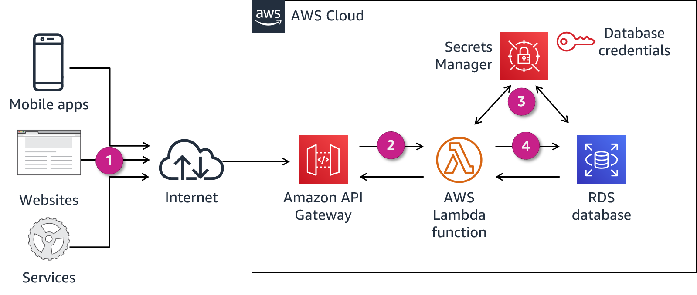

> **Нотатки:**
>
> This diagram shows how to use Secrets Manager to secure database credentials. The approach uses an AWS Lambda function, which uses credentials from Secrets Manager to connect to and query the backend Amazon Relational Database Service (Amazon RDS) database. This is done without hardcoding the secrets in code or passing them through environment variables. This approach helps you secure last-mile secrets and protect your backend databases.  
>
> The steps in this workflow are as follows:  
> Clients call the RESTful API hosted on Amazon API Gateway.  
> API Gateway runs the Lambda function.  
> The Lambda function retrieves the database secrets using the Secrets Manager API. Secrets Manager retrieves the secret, decrypts the protected secret text, and returns it to the function over a secured channel.  
> The Lambda function connects to the Amazon RDS database by using database secrets from Secrets Manager and returns the query results.  
>
> For more information, see How to Securely Provide Database Credentials to Lambda Functions by Using AWS Secrets Manager in the AWS Security Blog at https://aws.amazon.com/blogs/security/how-to-securely-provide-database-credentials-to-lambda-functions-by-using-aws-secrets-manager.

---

## Слайд 50: Rotating secrets

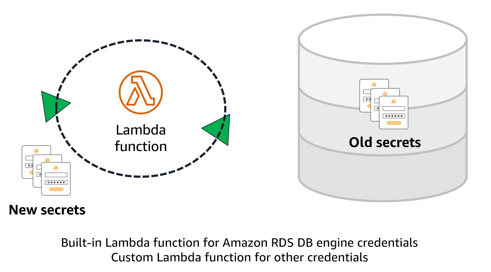

> **Нотатки:**
>
> With Secrets Manager, you can automatically rotate passwords for Amazon Aurora, MySQL, MariaDB, PostgreSQL, and Oracle databases that are hosted on AWS. To turn on automatic rotation, you need administrator permissions. This rotation is done without human intervention through a Lambda function, either on a schedule that you specify or as needed. For Amazon RDS DB engine credentials, this Lambda function already exists, but if you have other credentials with an expiration, such as a SAML login, you might want to create a custom function for use with Secrets Manager.  
>
> The rotation function does the work of rotating the secret. The process to rotate a secret has four steps, which correspond to four steps in the Lambda rotation function. Secrets Manager uses staging labels to label secret versions during rotation:  
> The function contacts the DB for new credentials.  
> Secrets Manager stores the new credentials with the AWSPENDING label.  
> The new credentials are tested.  
> The new credentials are made the default with the AWSCURRENT label.

---

## Слайд 51: Amazon Macie

- Recognizes sensitive data such as personally identifiable information (PII), financial information, encryption keys, and credentials
- Allows for custom-defined data types
- Protects data stored in Amazon S3 by monitoring resource policies and ACLs
- Provides full API coverage for management
- Integrates with AWS Organizations

Amazon Macie

> **Нотатки:**
>
> Amazon Macie is a security service that uses machine learning to automatically discover, classify, and protect sensitive data in AWS. Macie recognizes personally identifiable information (PII) such as passport numbers, medical ID numbers, and tax ID numbers. Macie also recognizes financial information, encryption keys, and credentials. Macie also provides you the ability to add custom-defined data types using regular expressions to enable Macie to discover proprietary or unique sensitive data for your business.  
>
> Currently, Macie protects data stored in Amazon S3 only and is available in most AWS Regions. Macie has dashboards and alerts that give visibility into data access by analyzing Amazon S3 resource-based policies and ACLs during sensitive data recovery.  The service continuously monitors data and generates detailed alerts when it detects risk of unauthorized access or inadvertent data leaks.  
>
> With Macie, you have full control of the service through the Macie API set, and you can centrally manage Macie for multiple accounts. Macie integrates with AWS Organizations, which means that you can manage as many as 5,000 Macie accounts for a single AWS organization. You can also continue to use native Macie features for managing multiple accounts, which enables you to manage as many as 1,000 member accounts with a single Macie administrator account.

---

## Слайд 52: Classify data and monitor its access permissions

- Macie scans and evaluates bucket objects for policy violations and sensitive data.
- Macie generates findings in real-time for the following:
  - Buckets that are public
  - Buckets that are not encrypted
  - Buckets that are shared or replicated

> **Нотатки:**
>
> Macie can help you classify your sensitive and business-critical data at the S3 bucket level. Macie scans all supported objects found and evaluates them for sensitive data that meets the job criteria. You can further configure these sensitive data discovery jobs; for example, only classify PDF documents or classify all objects except those with a particular prefix.  
>
> By default, Macie will continuously monitor all buckets in any account in which it is enabled. Findings are generated for any bucket that is public, not encrypted, or shared or replicated with AWS accounts outside of a customer’s organization. These findings are reported in near-real time.

---

## Слайд 53: Macie summary

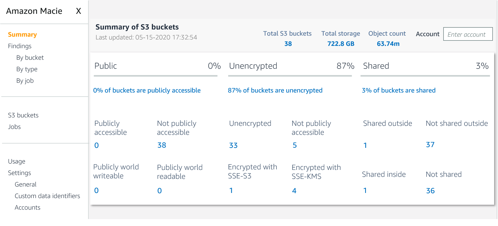

> **Нотатки:**
>
> The Macie summary page in the console provides an overview of the buckets that have been through the Macie discovery process. As mentioned, buckets are monitored for allowing public access, not being encrypted, and being shared or replicated outside of your account.

---

## Слайд 54: Macie findings

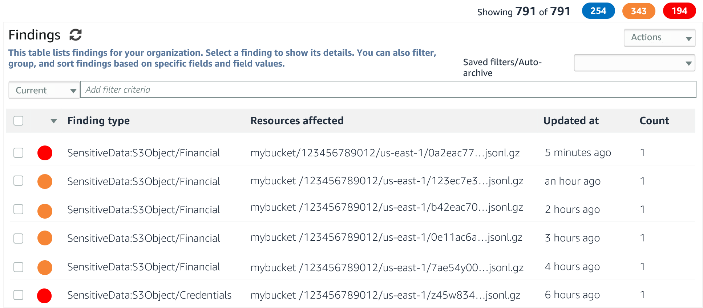

> **Нотатки:**
>
> A Macie job analyzes data in specific S3 buckets for sensitive data. Each job uses managed data identifiers that Macie provides and, optionally, custom data identifiers that you create. The service provides the ability to run one-time, daily, weekly, or monthly sensitive data discovery jobs for all or a subset of objects in an S3 bucket. For sensitive data discovery jobs, Macie automatically tracks changes to the bucket and only evaluates new or modified objects over time.

---

## Слайд 55: Key takeaways: Additional data protection services

- Secrets Manager helps protect access to applications, services, and IT resources.
- Macie uses machine learning and pattern matching to discover and protect sensitive data in AWS.

> **Нотатки:**
>
> Key takeaways from this section of the module include the following:  
> Secrets Manager helps protect access to applications, services, and IT resources.  
> Macie uses machine learning and pattern matching to discover and protect sensitive data in AWS.

---

## Слайд 56: Module wrap-up

Protecting Data in Your Application

> **Нотатки:**
>
> It’s now time to review the module, and wrap up with a knowledge check and discussion of a practice certification exam question.

---

## Слайд 57: Module summary

In this module, you learned how to do the following:

- Describe how to protect data at rest and in transit.
- Identify Amazon S3 protection features.
- Encrypt data in Amazon S3.
- Differentiate between CSE and SSE.
- Identify AWS services that help protect your data.

> **Нотатки:**
>
> In this module, you learned how to do the following:  
> Describe how to protect data at rest and in transit.  
> Identify Amazon S3 protection features.  
> Encrypt data in Amazon S3.  
> Differentiate between CSE and SSE.  
> Identify AWS services that help protect your data.

---

## Слайд 58: Complete the knowledge check

> **Нотатки:**
>
> It is now time to complete the knowledge check for this module.

---

## Слайд 59: Sample exam question

A company requires that data stored in AWS be encrypted at rest. Which approach would meet this requirement?

Choice

Response

A

When storing data in Amazon EBS, use only EBS-optimized EC2 instances.

B

When storing data in Amazon S3, use S3 Versioning and MFA delete.

C

When storing data in an EC2 instance store, encrypt the volume by using AWS KMS.

D

When storing data in Amazon S3, enable server-side encryption.

> **Нотатки:**
>
> Look at the answer choices, and rule them out based on the keywords.

---

## Слайд 60: Sample exam question answer

A company requires that data stored in AWS be encrypted at rest. Which approach would meet this requirement?

The correct answer is D.

The keywords in the question are **data stored in AWS** and **encryption at rest**.

> **Нотатки:**
>
> The correct answer is D.  
>
> Server-side encryption in Amazon S3 protects data at rest.  
>
> Answer A is incorrect because using EBS-optimized EC2 instances alone does not guarantee protection of instances at rest.  
>
> Answer B is incorrect because this does not encrypt data at rest for Amazon S3 objects.  
>
> Answer C is incorrect because you don’t store data in an instance store.

---

## Слайд 61: Thank you

Corrections, feedback, or other questions?  
Contact us at [https://support.aws.amazon.com/#/contacts/aws-academy](https://support.aws.amazon.com/#/contacts/aws-academy).  
All trademarks are the property of their owners.

> **Нотатки:**
>
> Thank you for completing this module.

---

## Слайд 62: Image source files for development use only

<!-- hidden slide -->

> **Нотатки:**
>
> Image source files for development use only

---

## Слайд 63: Data at rest in Amazon S3

<!-- hidden slide -->

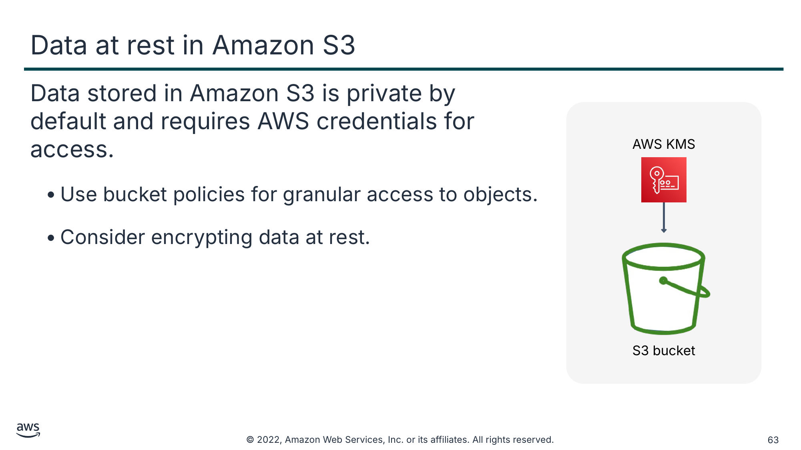

Data stored in Amazon S3 is private by default and requires AWS credentials for access.

- Use bucket policies for granular access to objects.
- Consider encrypting data at rest.

Текст зі схеми

AWS KMS

S3 bucket

> **Нотатки:**
>
> By default, all Amazon S3 resources—buckets, objects, and related subresources (for example, lifecycle configuration and website configuration)—are private. Only the resource owner, the AWS account that created it, can access the resource. The resource owner can grant access permissions to others by writing an access policy.  
>
> You can modify bucket policies to allow additional access, and AWS provides a number of tools to configure buckets for a wide variety of workloads. For example, the S3 Block Public Access feature acts as an additional layer of protection to prevent accidental exposure of data.  
>
> In addition, consider encrypting data at rest in Amazon S3.

---

## Слайд 64: Amazon S3 Versioning

<!-- hidden slide -->

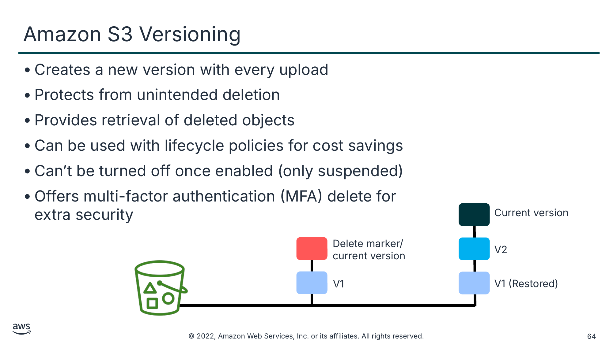

- Creates a new version with every upload
- Protects from unintended deletion
- Provides retrieval of deleted objects
- Can be used with lifecycle policies for cost savings
- Can’t be turned off once enabled (only suspended)
- Offers multi-factor authentication (MFA) delete for extra security

Текст зі схеми

Current version

Delete marker/

current version

V2

V1

V1 (Restored)

> **Нотатки:**
>
> Another security feature to consider is Versioning. It is a method of keeping multiple variants of an object in the same bucket. With this feature, you can preserve, retrieve, and restore every version of every object stored in your buckets. By default, S3 Versioning is disabled on buckets, and you must explicitly enable it.  
>
> Versioning can help you to recover objects from accidental deletion or overwrite. For example, if you delete an object, instead of removing it permanently, Amazon S3 inserts a delete marker, which becomes the current object version. You can always restore the previous version. Overwriting an object results in a new object version in the bucket, but you can always restore the previous version.  
>
> With versioning enabled, the most recently written version will be retrieved by default. You can retrieve older versions of an object by specifying the version in your request.  
>
> To customize your data retention approach and control storage costs, use object versioning with S3 Lifecycle.  
>
> After you enable versioning for a bucket, you can't return it to an unversioned state. You can, however, suspend versioning on a bucket, which stops accruing new versions of the same object in a bucket. You might do this because you only want a single version of an object in a bucket. Or, you might not want to accrue charges for multiple versions. When you suspend versioning, existing objects in your bucket do not change.  
>
> When working with S3 Versioning in Amazon S3 buckets, you can optionally add another layer of security by enabling multi-factor authentication (MFA) delete. When you do this, the bucket owner must include two forms of authentication in any request to delete a version or change the versioning state of the bucket.  
>
> For more information, see Using Versioning in S3 Buckets in the Amazon Simple Storage Service User Guide at https://docs.aws.amazon.com/AmazonS3/latest/userguide/Versioning.html.

---

## Слайд 65: Amazon S3 Object Lock

<!-- hidden slide -->

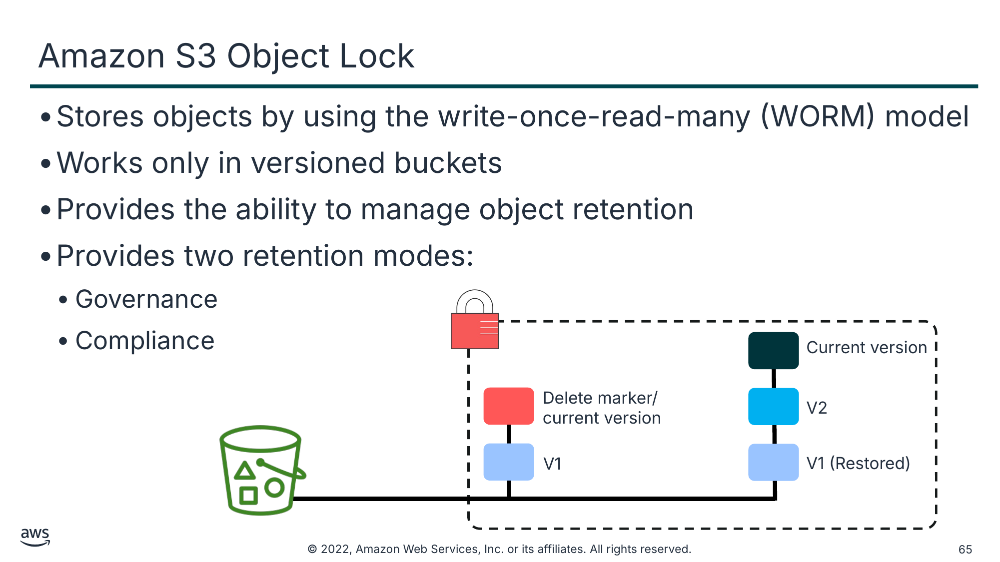

- Stores objects by using the write-once-read-many (WORM) model
- Works only in versioned buckets
- Provides the ability to manage object retention
- Provides two retention modes:
  - Governance
  - Compliance

Текст зі схеми

Current version

Delete marker/

current version

V2

V1

V1 (Restored)

> **Нотатки:**
>
> Finally, with Object Lock, you can store objects by using a write-once-read-many (WORM) model. This feature provides protection for scenarios where it's imperative that data is not changed or deleted. The feature can provide protection for a fixed amount of time or indefinitely. You can use Object Lock to meet regulatory requirements that require WORM storage, or add an extra layer of protection against object changes and deletion.  
>
> Note that Object Lock works only in versioned buckets.  
>
> Object Lock provides two ways to manage object retention: retention periods and legal holds. A retention period specifies a fixed period during which an object remains locked. During this period, your object is WORM-protected and can't be overwritten or deleted. A legal hold provides the same protection as a retention period but has no expiration date. Instead, a legal hold remains in place until you explicitly remove it.  
>
> You can configure Object Lock in one of two modes. In governance mode, users can't overwrite or delete an object version or alter its lock settings unless they have special permissions. If you require stronger immutability to comply with regulations, you can use compliance mode. In compliance mode, a protected object version can't be overwritten or deleted by any user, including the root user in your AWS account.  
>
> For more information, see How S3 Object Lock Works in the Amazon Simple Storage Service User Guide at https://docs.aws.amazon.com/AmazonS3/latest/userguide/object-lock-overview.html.

---

## Слайд 66: Encryption: What, how, and why

<!-- hidden slide -->

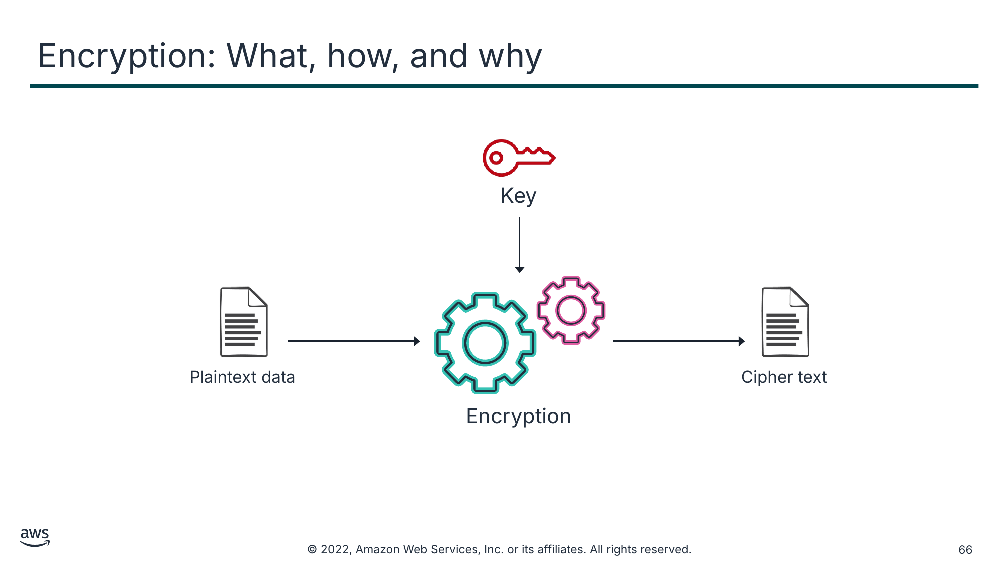

Текст зі схеми

Key

Encryption

Plaintext data

Cipher text

> **Нотатки:**
>
> Encryption works by using an algorithm with a key to convert plaintext data into unreadable data (ciphertext) that can only become readable again with the right key. For example, a simple phrase such as “Hello World!” might look like “1c28df2b595b4e30b7b07500963dc7c” when encrypted.  
>
> Several different encryption algorithms exist, all using different types of keys. A strong encryption algorithm relies on mathematical properties to produce ciphertext that can’t be decrypted by using any practically available amount of computing power without also having the necessary key. Therefore, protecting and managing the keys becomes a critical part of any encryption solution.

---

## Слайд 67: Client-side encryption

<!-- hidden slide -->

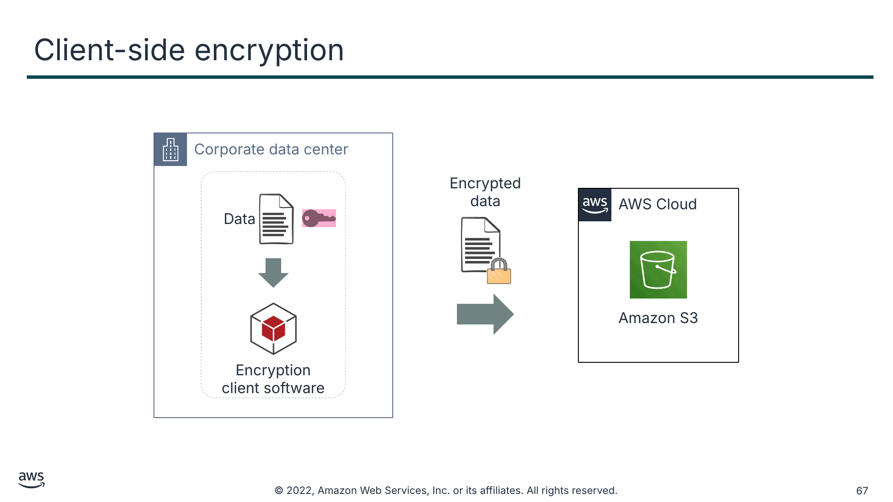

Текст зі схеми

Corporate data center

Data

Encryption

client software

Encrypted data

AWS Cloud

Amazon S3

> **Нотатки:**
>
> Client-side encryption takes place before data is submitted to AWS, and decryption occurs after data is retrieved from AWS. Amazon S3 receives your encrypted data but does not play a role in encrypting or decrypting it.  
>
> To enable client-side encryption, you can use a key stored in AWS KMS or use a key that you store within your application.  
>
> AWS supports client-side encryption libraries such as the AWS Encryption SDK, Amazon DynamoDB Encryption Client, and Amazon S3 encryption clients.

---

## Слайд 68: AWS server-side encryption

<!-- hidden slide -->

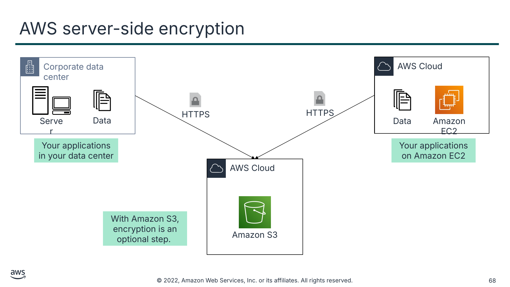

Server

Your applications in your data center

Your applications on Amazon EC2

With Amazon S3, encryption is an optional step.

Текст зі схеми

Corporate data center

Data

AWS Cloud

Data

Amazon EC2

HTTPS

HTTPS

AWS Cloud

Amazon S3

> **Нотатки:**
>
> Server-side encryption is the encryption of data at its destination by the application or service that receives it. With AWS server-side encryption, your source data comes from systems in your data center or an EC2 instance. You can upload that data over an HTTPS connection to any of the AWS services that support automatic server-side encryption. The service endpoint will handle the encryption and key management processes for you.  
>
> With Amazon S3, encryption is an optional step that you specify when you upload your data to the service.

---

## Слайд 69: Encryption overview

<!-- hidden slide -->

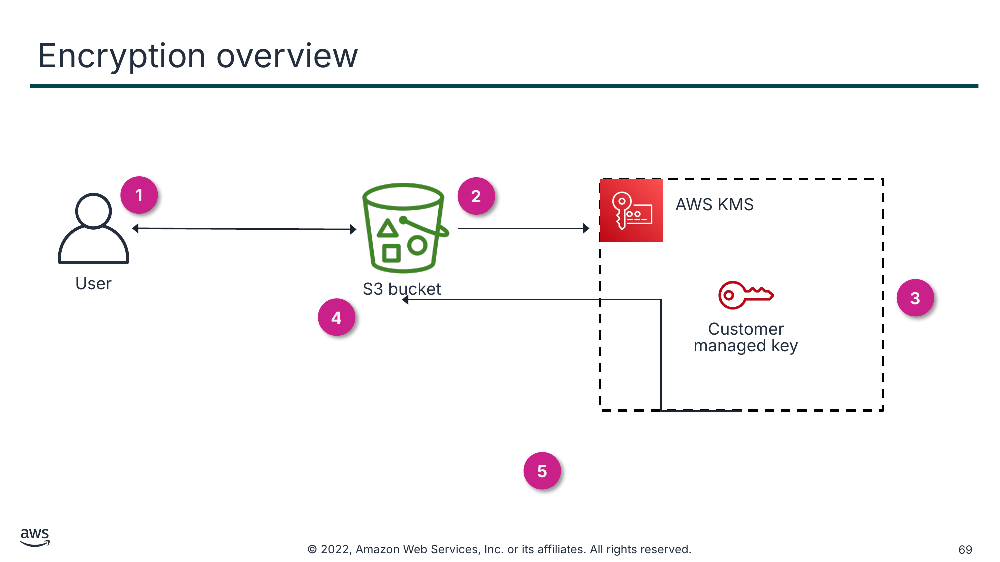

Текст зі схеми

**1**

**2**

AWS KMS

User

**3**

**4**

S3 bucket

Customer

managed key

**5**

> **Нотатки:**
>
> In this scenario, AMS KMS is used to encrypt data at rest (SSE-KMS). The user creates a KMS key and uses it to encrypt objects that are stored in Amazon S3.  
>
> This diagram explains how encryption happens when uploading a file to Amazon S3:  
> You request to upload a file and store it as an encrypted object in an S3 bucket.  
> Amazon S3 requests a data key from AWS KMS to use to encrypt the file.  
> AWS KMS generates a plaintext data key and encrypts the data key by using the customer managed key.  
> AWS KMS sends both copies of the data key to Amazon S3.  
> Amazon S3 encrypts the object by using the plaintext data key, stores the object, and then deletes the plaintext data key. The encrypted key is kept in the object metadata.

---

## Слайд 70: Decryption overview

<!-- hidden slide -->

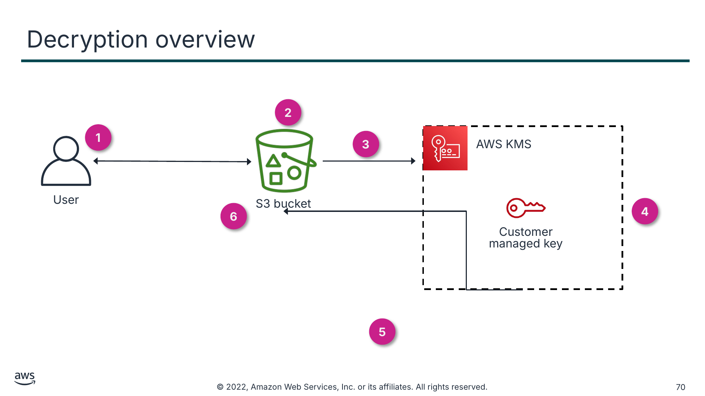

Текст зі схеми

**2**

**1**

**3**

AWS KMS

User

**4**

**6**

S3 bucket

Customer

managed key

**5**

> **Нотатки:**
>
> Now, this diagram explains what happens in the same scenario (SSE-KMS) when the user requests to open an encrypted object that is stored in Amazon S3:  
> You request to open the object.  
> Amazon S3 notices that the requested object is encrypted.  
> Amazon S3 sends the encrypted copy of the data key that the object is encrypted with to AWS KMS.  
> AWS KMS then decrypts the data key by using the customer managed key (which never leaves the AWS KMS service).  
> AWS KMS then sends the plaintext data key back to Amazon S3.  
> Finally, Amazon S3 decrypts the ciphertext of the data object, allows you to open the object, and deletes the plaintext copy of the data key.

---

## Слайд 71: AWS KMS example with Amazon EBS

<!-- hidden slide -->

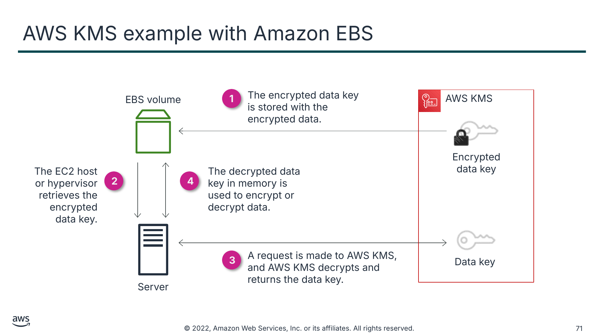

Текст зі схеми

**1**

The encrypted data key is stored with the encrypted data.

EBS volume

AWS KMS

Encrypted data key

The EC2 host or hypervisor retrieves the encrypted data key.

The decrypted data key in memory is used to encrypt or decrypt data.

**2**

**4**

Server

Data key

**3**

A request is made to AWS KMS, and AWS KMS decrypts and returns the data key.

> **Нотатки:**
>
> Amazon Elastic Block Store (Amazon EBS) encryption is a straight-forward encryption solution for EBS resources that are associated with your EC2 instances. With Amazon EBS encryption, you aren't required to build, maintain, and secure your own key management infrastructure.  
>
> Amazon EBS encryption uses KMS keys when creating encrypted volumes and snapshots. Each volume is encrypted using AES-256-XTS. This requires two 256-bit keys, which you can think of as one 512-bit key. The data key is encrypted under a KMS key in your account. For Amazon EBS to encrypt a volume for you, it must have access to a customer managed key in the account. You do this by providing a grant for Amazon EBS to the customer managed key to create data keys, and to encrypt and decrypt these data keys.  
>
> The following are the basic steps to encrypt and decrypt EBS volume data:  
> Amazon EBS obtains an encrypted data key under a customer managed key through AWS KMS and stores the encrypted key with the encrypted data.  
> The servers that host EC2 instances retrieve the encrypted data key from storage.  
> A call is made to AWS KMS over TLS to decrypt the encrypted data key. AWS KMS identifies the KMS key, makes an internal request to an HSM in the fleet to decrypt the data key, and returns the key to the customer over the TLS session.  
> The decrypted data key is stored in memory and used to encrypt and decrypt all data going to and from the attached EBS volume. Amazon EBS retains the encrypted data key for later use in case the data key in memory is no longer available.

---

## Слайд 72: Protecting data in transit

<!-- hidden slide -->

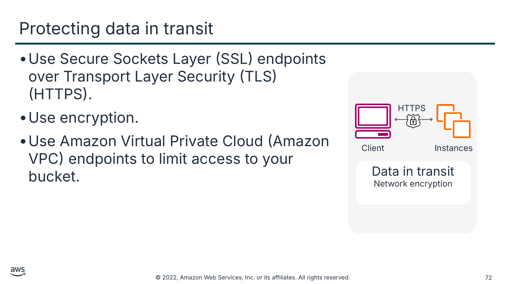

- Use Secure Sockets Layer (SSL) endpoints over Transport Layer Security (TLS) (HTTPS).
- Use encryption.
- Use Amazon Virtual Private Cloud (Amazon VPC) endpoints to limit access to your bucket.

Текст зі схеми

HTTPS

Client

Instances

Data in transit

Network encryption

> **Нотатки:**
>
> You can protect data in transit by using Secure Sockets Layer (SSL) or client-side encryption. You can securely upload your data to or download it from Amazon S3 through SSL endpoints by using the HTTPS protocol. Client-side encryption will protect your data in transit because the data is encrypted before you send it to Amazon S3.  
>
> You can also limit access to an S3 bucket from a specific Amazon Virtual Private Cloud (Amazon VPC) endpoint or a set of endpoints by using S3 bucket policies.  
>
> To protect data in transit, AWS encourages customers to use a multi-level approach. All network traffic between AWS data centers is transparently encrypted at the physical layer. All traffic within a VPC and between peered VPCs across AWS Regions is transparently encrypted at the network layer when using supported EC2 instance types. At the application layer, customers have a choice about whether and how to use encryption by using a protocol such as Transport Layer Security (TLS). All AWS service endpoints support TLS to create a secure HTTPS connection to make API requests.

---

## Слайд 73: AWS Certificate Manager Private Certificate Authority

<!-- hidden slide -->

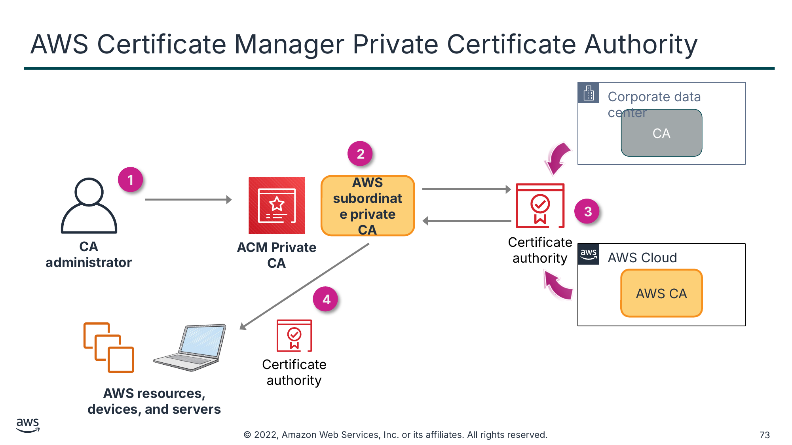

Текст зі схеми

Corporate data center

CA

**2**

**CA administrator**

**1**

**ACM Private CA**

**AWS subordinate private CA**

Certificate

authority

**3**

AWS Cloud

AWS CA

**4**

**AWS resources, devices, and servers**

Certificate

authority

> **Нотатки:**
>
> By using AWS Certificate Manager Private Certificate Authority, you can create private certificate authority (CA) hierarchies, including root and subordinate CAs, without the investment and maintenance costs of operating an on-premises CA. Your private CAs can issue end-entity X.509 certificates, which are useful in scenarios such as the following:  
> Creating encrypted TLS communication channels  
> Authenticating users, computers, API endpoints, and IoT devices  
> Cryptographically signing code  
> Implementing Online Certificate Status Protocol (OCSP) to obtain certificate revocation status  
>
> ACM Private CA is for enterprise customers who are building a public key infrastructure (PKI) inside the AWS Cloud. The service is intended for private use within an organization. With ACM Private CA, you can create your own CA hierarchy and issue certificates with it to authenticate internal users, computers, applications, services, servers, and other devices, and to sign computer code. Certificates that a private CA issues are trusted only within your organization, not on the internet. After creating a private CA, you have the ability to issue certificates directly (that is, without obtaining validation from a third-party CA) and to customize them to meet your organization's internal needs.  
>
> The diagram shows ACM Private CA in action:  
> The CA administrator creates a subordinate CA to issue certificates.  
> The subordinate CA sends the certificate to be signed.  
> The on-premises CA or AWS CA signs the certificate.  
> ACM Private CA issues the signed certificate to resources.

---

## Слайд 74: Using Secrets Manager

<!-- hidden slide -->

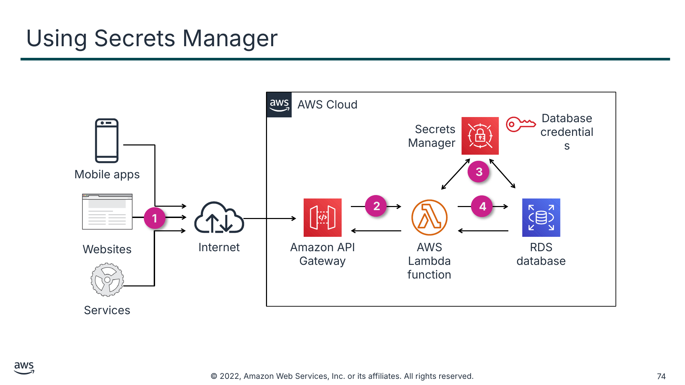

Текст зі схеми

AWS Cloud

Database credentials

Mobile apps

Secrets Manager

**3**

Websites

Internet

Amazon API Gateway

**2**

AWS Lambda function

**4**

RDS

database

**1**

Services

> **Нотатки:**
>
> This diagram shows how to use Secrets Manager to secure database credentials. The approach uses an AWS Lambda function, which uses credentials from Secrets Manager to connect to and query the backend Amazon Relational Database Service (Amazon RDS) database. This is done without hardcoding the secrets in code or passing them through environment variables. This approach helps you secure last-mile secrets and protect your backend databases.  
>
> The steps in this workflow are as follows:  
> Clients call the RESTful API hosted on Amazon API Gateway.  
> API Gateway runs the Lambda function.  
> The Lambda function retrieves the database secrets using the Secrets Manager API. Secrets Manager retrieves the secret, decrypts the protected secret text, and returns it to the function over a secured channel.  
> The Lambda function connects to the Amazon RDS database by using database secrets from Secrets Manager and returns the query results.  
>
> For more information, see How to Securely Provide Database Credentials to Lambda Functions by Using AWS Secrets Manager in the AWS Security Blog at https://aws.amazon.com/blogs/security/how-to-securely-provide-database-credentials-to-lambda-functions-by-using-aws-secrets-manager.

---

## Слайд 75: Rotating secrets

<!-- hidden slide -->

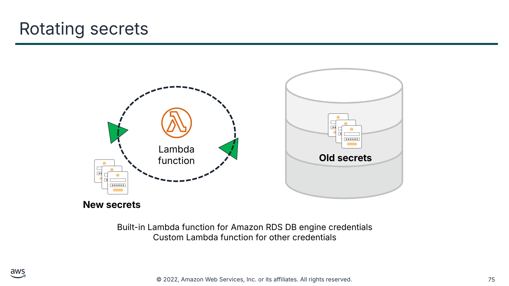

Built-in Lambda function for Amazon RDS DB engine credentials

Custom Lambda function for other credentials

Текст зі схеми

Lambda function

**Old secrets**

**New secrets**

> **Нотатки:**
>
> With Secrets Manager, you can automatically rotate passwords for Amazon Aurora, MySQL, MariaDB, PostgreSQL, and Oracle databases that are hosted on AWS. To turn on automatic rotation, you need administrator permissions. This rotation is done without human intervention through a Lambda function, either on a schedule that you specify or as needed. For Amazon RDS DB engine credentials, this Lambda function already exists, but if you have other credentials with an expiration, such as a SAML login, you might want to create a custom function for use with Secrets Manager.  
>
> The rotation function does the work of rotating the secret. The process to rotate a secret has four steps, which correspond to four steps in the Lambda rotation function. Secrets Manager uses staging labels to label secret versions during rotation:  
> The function contacts the DB for new credentials.  
> Secrets Manager stores the new credentials with the AWSPENDING label.  
> The new credentials are tested.  
> The new credentials are made the default with the AWSCURRENT label.
