## Слайд 1: Захист даних у вашому застосунку (Protecting Data in Your Application)

AWS Academy Cloud Security Foundations

> **Нотатки:**
>
> Вітаємо в модулі «Захист даних у вашому застосунку» (Protecting Data in Your Application).

---

## Слайд 2: Вступ

Захист даних у вашому застосунку

> **Нотатки:**
>
> Цей розділ надає вступ до модуля.

---

## Слайд 3: Цілі модуля

Наприкінці цього модуля ви повинні вміти:

- Описувати, як захищати дані в стані спокою (data at rest) та під час передавання (in transit).
- Визначати функції захисту Amazon Simple Storage Service (Amazon S3).
- Шифрувати дані в Amazon S3.
- Розрізняти шифрування на стороні клієнта (client-side encryption, CSE) і серверне шифрування (server-side encryption, SSE).
- Визначати сервіси Amazon Web Services (AWS), що допомагають захищати ваші дані.

> **Нотатки:**
>
> Наприкінці цього модуля ви повинні вміти:  
> Описувати, як захищати дані в стані спокою та під час передавання.  
> Визначати функції захисту Amazon Simple Storage Service (Amazon S3).  
> Шифрувати дані в Amazon S3.  
> Розрізняти шифрування на стороні клієнта (CSE) і серверне шифрування (SSE).  
> Визначати сервіси Amazon Web Services (AWS), що допомагають захищати ваші дані.

---

## Слайд 4: Огляд модуля

**Розділи**

- Захист даних у стані спокою
- Функції захисту Amazon S3
- Захист за допомогою шифрування
- Захист даних під час передавання
- Найкращі практики захисту даних в Amazon S3
- Додаткові сервіси захисту даних

**Лабораторна робота**

- Шифрування даних у стані спокою за допомогою AWS KMS (Encrypting Data at Rest by Using AWS KMS)

**Перевірка знань**

> **Нотатки:**
>
> Цей модуль містить такі розділи:  
> Захист даних у стані спокою  
> Функції захисту Amazon S3  
> Захист за допомогою шифрування  
> Захист даних під час передавання  
> Найкращі практики захисту даних в Amazon S3  
> Додаткові сервіси захисту даних  
>
> Також цей модуль містить лабораторну роботу, у якій ви потренуєтеся впроваджувати шифрування даних у стані спокою за допомогою AWS KMS.  
>
> Наприкінці вам буде запропоновано пройти перевірку знань, що перевіряє ваше розуміння ключових концепцій, розглянутих у цьому модулі.

---

## Слайд 5: Банківський бізнес-сценарій (1 із 4)

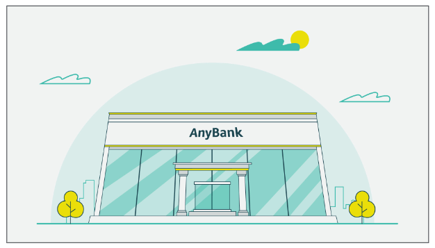

> **Нотатки:**
>
> Обговорімо, як концепції цього модуля застосовуються до банківського бізнес-сценарію.

---

## Слайд 6: Банківський бізнес-сценарій (2 із 4)

> **Нотатки:**
>
> Джон (John) прихильно сприйняв презентацію Марії (María) і, схоже, підтримує її план захисту активів банку від зовнішніх атак.  
>
> Однак Марія помітила, що Джон досі не впевнений у можливостях безпеки, властивих AWS.

---

## Слайд 7: Банківський бізнес-сценарій (3 із 4)

> **Нотатки:**
>
> Джон пояснив, що в його попереднього роботодавця незадоволений співробітник неналежним чином отримав доступ до недостатньо захищених даних користувачів.  
>
> Це виявили лише після того, як співробітник залишив компанію. Цей витік коштував компанії великих сум у вигляді штрафів і виплат за мировими угодами.

---

## Слайд 8: Банківський бізнес-сценарій (4 із 4)

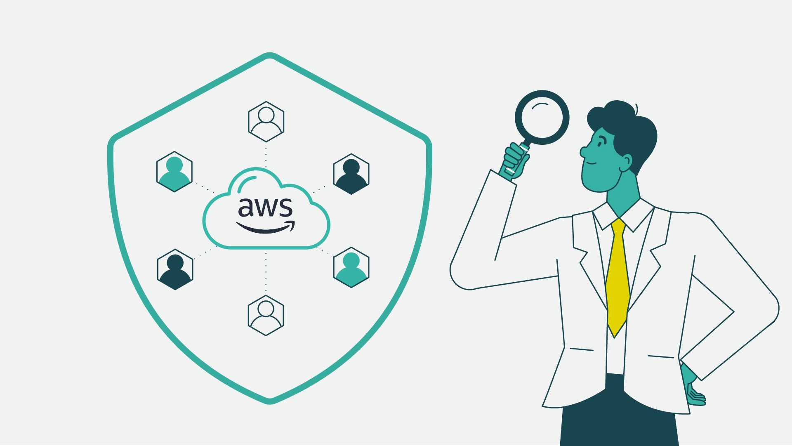

> **Нотатки:**
>
> Щоб Джон був упевнений у міграції в хмару, йому потрібно розуміти, як будуть захищені дані користувачів у хмарі AWS.  
>
> До наступної зустрічі Марія хоче пояснити, як можна захистити дані користувачів, що зберігаються в хмарі.

---

## Слайд 9: Модель спільної відповідальності (shared responsibility model)

> **Нотатки:**
>
> Для доступності: модель спільної відповідальності з переліком обов’язків клієнта й AWS. Клієнт відповідає за безпеку в хмарі. Це включає дані клієнта; платформу, застосунки, керування ідентичністю та доступом; конфігурацію операційної системи, мережі та брандмауера; шифрування даних на стороні клієнта та цілісність даних, автентифікацію; серверне шифрування файлової системи та даних; захист мережевого трафіку, що включає шифрування, цілісність і ідентичність. AWS відповідає за безпеку самої хмари. Це включає базові сервіси AWS для обчислень, зберігання, баз даних і мереж, а також глобальну інфраструктуру AWS, що включає регіони, зони доступності та периферійні локації. Кінець опису для доступності.  
>
> Цей модуль охоплює дві частини моделі спільної відповідальності: шифрування на стороні клієнта та цілісність даних, зокрема автентифікацію, і серверне шифрування (файлова система та дані). Клієнт відповідає за захист цих частин.

---

## Слайд 10: Захист даних у стані спокою

Захист даних у вашому застосунку

> **Нотатки:**
>
> Цей розділ розглядає, як захищати дані в стані спокою.

---

## Слайд 11: Навіщо захищати дані в стані спокою?

- Поширені сценарії
  - Розкриття інформації
  - Порушення цілісності даних
  - Випадкове або зловмисне видалення
  - Доступність системи, апаратного та програмного забезпечення
- Додатковий рівень захисту, якщо вашу систему скомпрометовано

> **Нотатки:**
>
> Шифрувати дані в стані спокою важливо. Це гарантує безпеку даних, навіть якщо до них отримає доступ неавторизована сторона. Шифрування даних у стані спокою значно ускладнює зловмисникам компрометацію даних, навіть якщо вони можуть скомпрометувати кінцеву точку. Також вам може знадобитися захищати свої дані в стані спокою через бізнес-вимоги чи вимоги відповідності.  
>
> Наведений нижче перелік визначає найпоширеніші проблеми, через які необхідно захищати ваші дані в стані спокою. Перелік також описує, як захищатися від кожної проблеми:  
> Розкриття інформації: обмежте кількість користувачів, що можуть отримати доступ до даних, і використовуйте політики для керування доступом до ресурсів. Використовуйте шифрування для захисту конфіденційних даних.  
> Порушення цілісності даних: використовуйте дозволи на ресурси, щоб обмежити коло користувачів, які можуть змінювати дані. Впровадьте цифровий підпис і шифрування. Відновіть дані з резервної копії або, у випадку Amazon S3, з попередньої версії об’єкта.  
> Випадкове або зловмисне видалення: використовуйте правильні дозволи та принцип найменших привілеїв. Відновіть дані з резервної копії або, у випадку Amazon S3, з попередньої версії об’єкта.  
> Доступність системи, апаратного та програмного забезпечення: у разі збою системи чи стихійного лиха відновіть свої дані з реплік.

---

## Слайд 12: Дані в стані спокою в Amazon S3

Дані, що зберігаються в Amazon S3, за замовчуванням приватні та вимагають облікових даних AWS для доступу.

- Використовуйте політики бакетів (bucket policies) для детального доступу до об’єктів.
- Розгляньте шифрування даних у стані спокою.

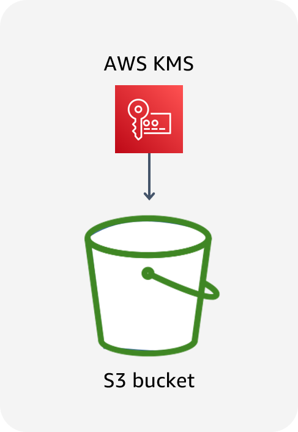

> **Нотатки:**
>
> За замовчуванням усі ресурси Amazon S3 — бакети, об’єкти та пов’язані підресурси (наприклад, конфігурація життєвого циклу та конфігурація вебсайту) — приватні. Доступ до ресурсу може отримати лише його власник, акаунт AWS, що його створив. Власник ресурсу може надати дозволи на доступ іншим, написавши політику доступу.  
>
> Ви можете змінювати політики бакетів, щоб дозволити додатковий доступ, а AWS надає низку інструментів для налаштування бакетів під найрізноманітніші робочі навантаження. Наприклад, функція S3 Block Public Access діє як додатковий рівень захисту для запобігання випадковому розкриттю даних.  
>
> Крім того, розгляньте шифрування даних у стані спокою в Amazon S3.

---

## Слайд 13: Надання дозволів (granting permissions)

**На основі ідентичності (Identity based)**

(Прикріплюється до *принципала IAM*)

**На основі ресурсу (Resource based)**

(Прикріплюється до *ресурсу AWS*)

**Bucket X**

| User (Користувач) | Get | Put | List |
|---|---|---|---|
| Bob | ALLOW | DENY | ALLOW |

**Bob**

| Resource (Ресурс) | Get | Put | List |
|---|---|---|---|
| Bucket X | ALLOW | ALLOW | ALLOW |
| Bucket Y | N/A | N/A | ALLOW |

**Bucket Y**

| User (Користувач) | Get | Put | List |
|---|---|---|---|
| Bob | ALLOW | N/A | ALLOW |

Чи може Боб виконувати GET, PUT або LIST для бакета X?

Чи може Боб виконувати GET або LIST для бакета Y?

> **Нотатки:**
>
> Примітка: у таблицях на слайді N/A означає «не застосовується» (not applicable), оскільки політика не вказує дозволів для цієї конкретної дії.  
>
> Amazon S3 підтримує два типи механізмів контролю доступу: на основі ідентичності (або на основі користувача) і на основі ресурсу.  
>
> Яка різниця між політиками на основі ідентичності та політиками на основі ресурсів? Вони майже ідентичні за виглядом і функціями, але мають деякі незначні синтаксичні відмінності. Найбільша різниця — у тому, до чого вони застосовуються. Дозволи на основі ідентичності прикріплюються до користувача AWS Identity and Access Management (IAM) і вказують, що користувачеві дозволено робити. Дозволи на основі ресурсу прикріплюються до ресурсу й указують, що вказаному користувачеві (або групі користувачів) дозволено робити з ресурсом. Наприклад, політики на основі ресурсів можна прикріплювати до бакетів S3, кінцевих точок віртуальної приватної хмари (VPC) і ключів шифрування AWS Key Management Service (AWS KMS). Політики на основі ресурсів — це спосіб обмежити доступ на рівні ресурсу.  
>
> У прикладі на слайді користувач IAM на ім’я Боб (Bob) має прикріплену політику на основі ідентичності. Політика дозволяє йому використовувати API GET, PUT і LIST для бакета X. Однак політика на основі ресурсу для бакета X дозволяє йому використовувати GET і LIST та забороняє використовувати PUT. Це означає, що Боб не може виконувати PUT об’єктів у бакет X, хоча його політика на основі ідентичності це дозволяє.  
>
> Для бакета Y політика Боба на основі ідентичності дозволяє дію LIST. Політика явно не дозволяє й не забороняє дії GET і PUT для бакета Y. Політика на основі ресурсу для бакета Y дозволяє йому використовувати GET і LIST, але не вказує дію PUT. Тому Боб може читати об’єкти з бакета, хоча його політика на основі ідентичності цього явно не дозволяє.  
>
> Для деяких сервісів AWS можна надати міжакаунтний доступ до ваших ресурсів, розмістивши політику безпосередньо на ресурсі, до якого ви хочете надати спільний доступ, замість використання ролі як проксі. Ресурс, до якого ви хочете надати спільний доступ, має підтримувати політики на основі ресурсів. Політика вказує, хто (як перелік ідентифікаторів акаунтів AWS) може отримати доступ до цього ресурсу.  
>
> Окрім політик IAM і політик бакетів, Amazon S3 підтримує механізм дозволів, відомий як список контролю доступу (access control list, ACL). ACL незалежний від політик і дозволів IAM, але його можна використовувати в поєднанні з ними. Однак більшість сучасних сценаріїв використання в Amazon S3 більше не потребує використання ACL. AWS рекомендує вимкнути ACL, окрім незвичайних випадків, коли потрібно контролювати доступ до кожного об’єкта окремо. Коли ACL вимкнено, політика бакета S3 стає єдиною поверхнею аудиту.

---

## Слайд 14: Ключові висновки: захист даних у стані спокою

- Шифрування даних у стані спокою ускладнює зловмисникам компрометацію даних.
- Дані, що зберігаються в Amazon S3, за замовчуванням приватні та вимагають облікових даних AWS для доступу.
- Amazon S3 підтримує два типи механізмів контролю доступу:
  - На основі ідентичності (або на основі користувача)
  - На основі ресурсу

> **Нотатки:**
>
> Ключові висновки з цього розділу модуля:  
> Шифрування даних у стані спокою ускладнює зловмисникам компрометацію даних.  
> Дані, що зберігаються в Amazon S3, за замовчуванням приватні та вимагають облікових даних AWS для доступу.  
> Amazon S3 підтримує два типи механізмів контролю доступу:  
> На основі ідентичності (або на основі користувача)  
> На основі ресурсу

---

## Слайд 15: Функції захисту Amazon S3

Захист даних у вашому застосунку

> **Нотатки:**
>
> Цей розділ охоплює функції захисту Amazon S3.

---

## Слайд 16: Amazon S3 Block Public Access

- Допомагає керувати публічним доступом до ресурсів Amazon S3
- Має чотири налаштування:
  - **BlockPublicAcls:** блокувати публічний доступ, наданий новими ACL.
  - **IgnorePublicAcls:** блокувати публічний доступ, наданий будь-якими ACL.
  - **BlockPublicPolicy:** блокувати публічний доступ, наданий новими публічними політиками бакетів.
  - **RestrictPublicBuckets:** блокувати публічний і міжакаунтний доступ за будь-якими публічними політиками бакетів.

Бакет із налаштуваннями блокування публічного доступу

> **Нотатки:**
>
> Amazon S3 надає низку функцій безпеки, які слід враховувати під час розробки та впровадження власних політик безпеки. Amazon S3 надає функцію Block Public Access, щоб допомогти керувати публічним доступом до ресурсів S3. За замовчуванням нові бакети й об’єкти не дозволяють публічного доступу, але користувачі можуть змінювати політики бакетів або дозволи об’єктів, щоб дозволити публічний доступ. S3 Block Public Access надає налаштування, що перевизначають ці політики та дозволи, щоб ви могли обмежити публічний доступ до цих ресурсів.  
>
> Ця функція надає чотири налаштування:  
> BlockPublicAcls: запобігає будь-яким новим операціям, що роблять бакети чи об’єкти публічними через ACL бакетів або об’єктів. Наявні політики та ACL для бакетів і об’єктів не змінюються.  
> IgnorePublicAcls: ігнорує всі публічні ACL на бакеті та будь-яких об’єктах, які він містить.  
> BlockPublicPolicy: відхиляє виклики PUT політики бакета, якщо вказана політика бакета дозволяє публічний доступ. (Ввімкнення цього налаштування не впливає на наявні політики бакетів.)  
> RestrictPublicBuckets: обмежує доступ до бакета з публічною політикою лише сервісами AWS та авторизованими користувачами в акаунті власника бакета.  
>
> Ці налаштування незалежні й можуть використовуватися в будь-якій комбінації. Кожне налаштування можна застосувати до точки доступу (access point), бакета або всього акаунта AWS. Ці налаштування не можна застосовувати для окремих об’єктів. Якщо налаштування блокування публічного доступу для точки доступу, бакета чи акаунта відрізняються, Amazon S3 застосовує найсуворішу комбінацію налаштувань точки доступу, бакета й акаунта.  
>
> Коли Amazon S3 отримує запит на доступ до бакета чи об’єкта, сервіс визначає, чи застосовано до бакета або до акаунта власника бакета налаштування блокування публічного доступу. Якщо наявне налаштування блокування публічного доступу забороняє запитаний доступ, Amazon S3 відхиляє запит.  
>
> Окрім цих налаштувань, консоль Amazon S3 виділяє ваші публічно доступні бакети, вказує джерело публічної доступності, а також попереджає, якщо зміни ваших політик бакетів чи ACL бакетів зроблять ваш бакет публічно доступним.  
>
> Докладніше див. «Блокування публічного доступу до вашого сховища Amazon S3» (Blocking Public Access to Your Amazon S3 Storage) у посібнику користувача Amazon Simple Storage Service за адресою https://docs.aws.amazon.com/AmazonS3/latest/userguide/access-control-block-public-access.html.

---

## Слайд 17: Керування версіями Amazon S3 (Amazon S3 Versioning)

- Створює нову версію під час кожного завантаження
- Захищає від ненавмисного видалення
- Забезпечує відновлення видалених об’єктів
- Можна використовувати з політиками життєвого циклу для економії коштів
- Не можна вимкнути після ввімкнення (можна лише призупинити)
- Пропонує видалення із багатофакторною автентифікацією (MFA delete) для додаткової безпеки

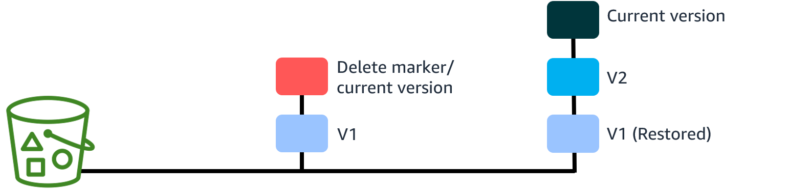

> **Нотатки:**
>
> Ще одна функція безпеки, яку варто розглянути, — керування версіями (Versioning). Це метод зберігання кількох варіантів об’єкта в тому самому бакеті. З цією функцією ви можете зберігати, отримувати й відновлювати кожну версію кожного об’єкта, що зберігається у ваших бакетах. За замовчуванням керування версіями S3 у бакетах вимкнено, і його потрібно явно ввімкнути.  
>
> Керування версіями може допомогти відновити об’єкти після випадкового видалення чи перезапису. Наприклад, якщо ви видаляєте об’єкт, замість остаточного вилучення Amazon S3 вставляє маркер видалення (delete marker), що стає поточною версією об’єкта. Ви завжди можете відновити попередню версію. Перезапис об’єкта призводить до нової версії об’єкта в бакеті, але ви завжди можете відновити попередню версію.  
>
> Коли керування версіями ввімкнено, за замовчуванням буде отримано останню записану версію. Старіші версії об’єкта можна отримати, вказавши версію у вашому запиті.  
>
> Щоб налаштувати свій підхід до зберігання даних і контролювати витрати на зберігання, використовуйте керування версіями об’єктів разом із S3 Lifecycle.  
>
> Після ввімкнення керування версіями для бакета повернути його до стану без версій не можна. Однак ви можете призупинити керування версіями на бакеті, що припиняє накопичення нових версій того самого об’єкта в бакеті. Ви можете це зробити, бо хочете мати в бакеті лише одну версію об’єкта. Або ж не хочете нести витрати на кілька версій. Коли ви призупиняєте керування версіями, наявні об’єкти у вашому бакеті не змінюються.  
>
> Працюючи з керуванням версіями S3 у бакетах Amazon S3, ви можете за бажанням додати ще один рівень безпеки, ввімкнувши видалення з багатофакторною автентифікацією (MFA delete). Коли ви це робите, власник бакета має включити дві форми автентифікації в будь-який запит на видалення версії або зміну стану керування версіями бакета.  
>
> Докладніше див. «Використання керування версіями в бакетах S3» (Using Versioning in S3 Buckets) у посібнику користувача Amazon Simple Storage Service за адресою https://docs.aws.amazon.com/AmazonS3/latest/userguide/Versioning.html.

---

## Слайд 18: Amazon S3 Object Lock

- Зберігає об’єкти за моделлю «одноразовий запис — багаторазове читання» (write-once-read-many, WORM)
- Працює лише у бакетах із керуванням версіями
- Надає можливість керувати збереженням об’єктів (object retention)
- Надає два режими збереження:
  - Управління (Governance)
  - Відповідність вимогам (Compliance)

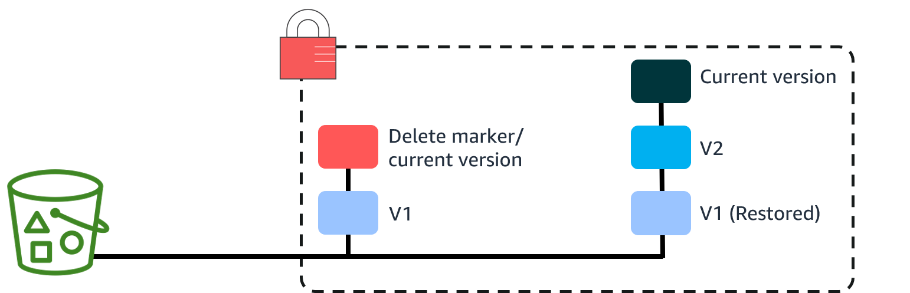

> **Нотатки:**
>
> Нарешті, за допомогою Object Lock ви можете зберігати об’єкти за моделлю «одноразовий запис — багаторазове читання» (WORM). Ця функція забезпечує захист у сценаріях, де критично важливо, щоб дані не змінювались і не видалялись. Функція може забезпечувати захист на фіксований проміжок часу або безстроково. Object Lock можна використовувати, щоб виконати регуляторні вимоги, що потребують сховища WORM, або додати додатковий рівень захисту від змін і видалення об’єктів.  
>
> Зверніть увагу, що Object Lock працює лише у бакетах із керуванням версіями.  
>
> Object Lock надає два способи керування збереженням об’єктів: періоди збереження (retention periods) і юридичні утримання (legal holds). Період збереження вказує фіксований період, протягом якого об’єкт залишається заблокованим. Протягом цього періоду ваш об’єкт захищений за моделлю WORM і не може бути перезаписаний чи видалений. Юридичне утримання забезпечує такий самий захист, як і період збереження, але не має терміну дії. Натомість юридичне утримання діє, доки ви явно його не знімете.  
>
> Object Lock можна налаштувати в одному з двох режимів. У режимі управління (governance mode) користувачі не можуть перезаписати чи видалити версію об’єкта або змінити її налаштування блокування, якщо не мають спеціальних дозволів. Якщо вам потрібна сильніша незмінність для відповідності регуляціям, можна використати режим відповідності вимогам (compliance mode). У режимі відповідності захищену версію об’єкта не може перезаписати чи видалити жоден користувач, включно з кореневим акаунтом (root user) у вашому акаунті AWS.  
>
> Докладніше див. «Як працює S3 Object Lock» (How S3 Object Lock Works) у посібнику користувача Amazon Simple Storage Service за адресою https://docs.aws.amazon.com/AmazonS3/latest/userguide/object-lock-overview.html.

---

## Слайд 19: Ключові висновки: функції захисту Amazon S3

- Block Public Access гарантує, що об’єкти ніколи не мають публічного доступу — ні зараз, ні в майбутньому.
- Керування версіями зберігає, отримує та відновлює кожну версію кожного об’єкта, що зберігається в бакеті S3.
- Object Lock запобігає видаленню чи перезапису версії об’єкта протягом фіксованого проміжку часу або безстроково.

> **Нотатки:**
>
> Ключові висновки з цього розділу модуля:  
> Block Public Access гарантує, що об’єкти ніколи не мають публічного доступу — ні зараз, ні в майбутньому.  
> Керування версіями зберігає, отримує та відновлює кожну версію кожного об’єкта, що зберігається в бакеті S3.  
> Object Lock запобігає видаленню чи перезапису версії об’єкта протягом фіксованого проміжку часу або безстроково.

---

## Слайд 20: Захист за допомогою шифрування

Захист даних у вашому застосунку

> **Нотатки:**
>
> Цей розділ охоплює захист за допомогою шифрування.

---

## Слайд 21: Шифрування: що, як і навіщо

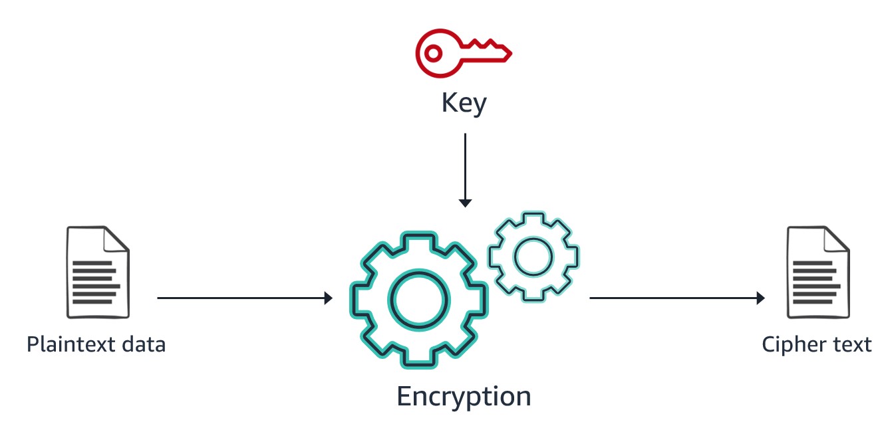

> **Нотатки:**
>
> Шифрування працює за допомогою алгоритму з ключем, що перетворює дані у відкритому вигляді (відкритий текст, plaintext) на нечитабельні дані (шифротекст, ciphertext), які знову стають читабельними лише з правильним ключем. Наприклад, проста фраза «Hello World!» у зашифрованому вигляді може виглядати як «1c28df2b595b4e30b7b07500963dc7c».  
>
> Існує кілька різних алгоритмів шифрування, і всі вони використовують різні типи ключів. Надійний алгоритм шифрування спирається на математичні властивості, щоб створювати шифротекст, який неможливо розшифрувати за допомогою будь-якого практично доступного обсягу обчислювальної потужності без наявності необхідного ключа. Тому захист і керування ключами стають критично важливою частиною будь-якого рішення для шифрування.

---

## Слайд 22: Порівняння шифрування на стороні клієнта та серверного шифрування

Шифрування на стороні клієнта (client-side encryption, CSE)

Серверне шифрування (server-side encryption, SSE)

- Ваш застосунок шифрує дані перед надсиланням їх до AWS.
- Дані зберігаються в зашифрованому стані.
- Ключі та алгоритми відомі лише вам.

- AWS шифрує дані від вашого імені після їх отримання.
- Процес прозорий для користувача.

> **Нотатки:**
>
> Залежно від ваших вимог до безпеки, для шифрування даних можна використовувати шифрування на стороні клієнта (CSE) або серверне шифрування (SSE). Підходи відрізняються тим, коли, де та хто шифрує й розшифровує дані. Підхід не обов’язково визначає, як саме шифруються дані. Крім того, підходи не є взаємовиключними — часто можна використовувати CSE і SSE для одних і тих самих даних для підвищеного профілю безпеки. Кожен підхід має переваги.  
>
> З шифруванням на стороні клієнта (CSE) ваші застосунки шифрують дані локально перед відправленням їх до AWS і розшифровують дані після отримання з AWS. Ви створюєте власні ключі шифрування та керуєте ними. Дані зберігаються в зашифрованому вигляді, з ключами й алгоритмами, відомими лише вам.  
>
> З серверним шифруванням (SSE) дані шифруються в місці призначення застосунком чи сервісом, що їх отримує. Наприклад, якщо ви використовуєте SSE з Amazon S3, сервіс шифрує ваші дані на рівні об’єктів під час запису на диски в центрах обробки даних AWS і розшифровує дані для вас, коли ви до них звертаєтеся. Процес шифрування прозорий для користувача.  
>
> AWS підтримує і CSE, і SSE. Більшість сервісів AWS, що зберігають чи обробляють дані клієнтів, пропонують варіант SSE або виконують SSE ваших даних за замовчуванням. Ці сервіси прозоро шифрують ваші дані перед записом на диск і прозоро розшифровують їх, коли ви до них звертаєтеся. Більшість сервісів AWS, що підтримують SSE, інтегровано з AWS KMS для захисту ключів шифрування, які захищають ваші дані. Про AWS KMS ви дізнаєтеся більше пізніше в цьому модулі.  
>
> Докладніше див. «Захист даних за допомогою шифрування» (Protecting Data Using Encryption) у посібнику користувача Amazon Simple Storage Service за адресою https://docs.aws.amazon.com/AmazonS3/latest/userguide/UsingEncryption.html.

---

## Слайд 23: Шифрування на стороні клієнта (client-side encryption)

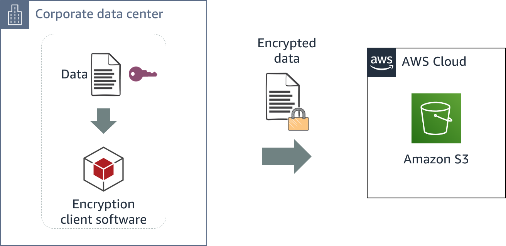

> **Нотатки:**
>
> Шифрування на стороні клієнта відбувається до надсилання даних до AWS, а розшифрування — після отримання даних з AWS. Amazon S3 отримує ваші зашифровані дані, але не бере участі в їх шифруванні чи розшифруванні.  
>
> Щоб увімкнути шифрування на стороні клієнта, можна використовувати ключ, що зберігається в AWS KMS, або ключ, який ви зберігаєте у своєму застосунку.  
>
> AWS підтримує бібліотеки шифрування на стороні клієнта, як-от AWS Encryption SDK, Amazon DynamoDB Encryption Client та клієнти шифрування Amazon S3.

---

## Слайд 24: Серверне шифрування AWS (AWS server-side encryption)

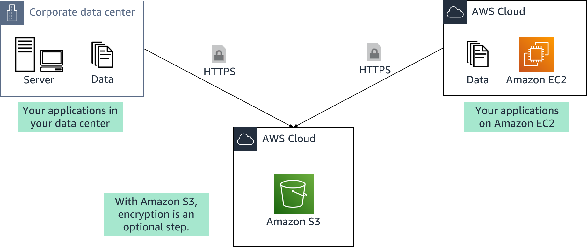

> **Нотатки:**
>
> Серверне шифрування — це шифрування даних у місці призначення застосунком чи сервісом, що їх отримує. З серверним шифруванням AWS ваші вихідні дані надходять із систем у вашому центрі обробки даних або з екземпляра EC2. Ви можете завантажити ці дані через з’єднання HTTPS до будь-якого із сервісів AWS, що підтримують автоматичне серверне шифрування. Кінцева точка сервісу виконає процеси шифрування та керування ключами за вас.  
>
> В Amazon S3 шифрування — це необов’язковий крок, який ви вказуєте під час завантаження даних до сервісу.

---

## Слайд 25: Типи серверного шифрування Amazon S3

SSE-C

SSE-S3

SSE-KMS

- Ви зберігаєте контроль над ключами.
- Amazon S3 не зберігає ключі шифрування, які ви надаєте.

- Ключами керує AWS.
- Зашифровані дані та ключі зберігаються на окремих хостах.

- Ключами керує AWS.
- Для додаткового захисту використовується конвертний ключ (envelope key).

> **Нотатки:**
>
> Для серверного шифрування в Amazon S3 у вас є три взаємовиключні варіанти залежно від того, як ви вирішите керувати ключами шифрування:  
>
> SSE з наданими клієнтом ключами (SSE-C)  
> З серверним шифруванням із наданими клієнтом ключами (SSE-C) ви керуєте ключами шифрування. За допомогою ключа шифрування, який ви надаєте як частину запиту, Amazon S3 керує шифруванням (під час запису на диски) і розшифруванням (коли ви звертаєтеся до своїх об’єктів). Вам не потрібно підтримувати код для виконання шифрування й розшифрування даних — ви підтримуєте лише ключі.  
>
> Amazon S3 не зберігає ключ шифрування, який ви надаєте. Натомість зберігається значення коду автентифікації повідомлення на основі хешу (HMAC) ключа шифрування з випадковою сіллю (randomly salted), щоб перевіряти майбутні запити. Значення HMAC із сіллю не можна використати, щоб вивести значення ключа шифрування чи розшифрувати вміст зашифрованого об’єкта. Тож якщо ви втратите ключ шифрування, ви втратите об’єкт.  
>
> SSE з ключами, керованими Amazon S3 (SSE-S3)  
> Коли ви використовуєте серверне шифрування з ключами, керованими Amazon S3 (SSE-S3), кожен об’єкт шифрується унікальним ключем. Як додатковий захід безпеки Amazon S3 шифрує сам ключ ключем, який сервіс регулярно змінює (ротація). SSE-S3 використовує один із найсильніших доступних блокових шифрів — 256-бітний Advanced Encryption Standard (AES-256) — для шифрування ваших даних.  
>
> SSE з ключами AWS KMS (SSE-KMS)  
> Серверне шифрування з ключами AWS KMS (SSE-KMS) подібне до SSE-S3, але з деякими додатковими перевагами та платою за використання сервісу. Існують окремі дозволи на використання ключа KMS, що забезпечують додатковий захист від неавторизованого доступу до ваших об’єктів в Amazon S3. SSE-KMS також надає вам журнал аудиту, що показує, коли й ким використовувався ваш ключ KMS. Крім того, ви можете створювати ключі KMS, якими керує клієнт, та керувати ними або використовувати ключі KMS, якими керує AWS і які унікальні для вас, вашого сервісу та вашого регіону. AWS KMS використовує конвертне шифрування (envelope encryption) для додаткового захисту ваших даних. Конвертне шифрування — це практика шифрування ваших даних у відкритому вигляді ключем даних (data key), а потім шифрування цього ключа даних кореневим ключем (root key).  
>
> Докладніше про варіанти серверного шифрування в Amazon S3 див. «Захист даних за допомогою серверного шифрування» (Protecting Data Using Server-Side Encryption) у посібнику користувача Amazon Simple Storage Service за адресою https://docs.aws.amazon.com/AmazonS3/latest/userguide/serv-side-encryption.html.

---

## Слайд 26: Огляд шифрування (encryption overview)

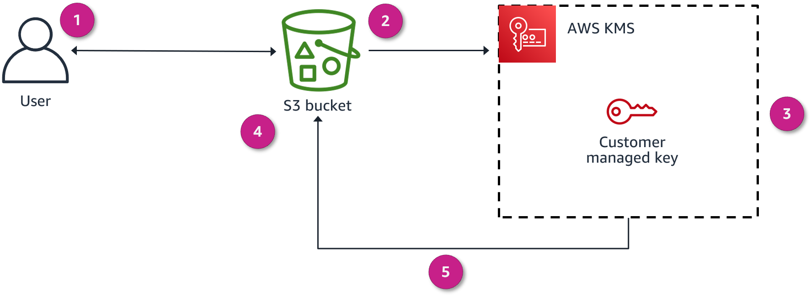

> **Нотатки:**
>
> У цьому сценарії AWS KMS використовується для шифрування даних у стані спокою (SSE-KMS). Користувач створює ключ KMS і використовує його для шифрування об’єктів, що зберігаються в Amazon S3.  
>
> Ця схема пояснює, як відбувається шифрування під час завантаження файлу в Amazon S3:  
> Ви надсилаєте запит на завантаження файлу та збереження його як зашифрованого об’єкта в бакеті S3.  
> Amazon S3 запитує в AWS KMS ключ даних для шифрування файлу.  
> AWS KMS генерує ключ даних у відкритому вигляді (plaintext) і шифрує ключ даних за допомогою ключа, яким керує клієнт (customer managed key).  
> AWS KMS надсилає обидві копії ключа даних в Amazon S3.  
> Amazon S3 шифрує об’єкт за допомогою ключа даних у відкритому вигляді, зберігає об’єкт, а потім видаляє ключ даних у відкритому вигляді. Зашифрований ключ зберігається в метаданих об’єкта.

---

## Слайд 27: Огляд розшифрування (decryption overview)

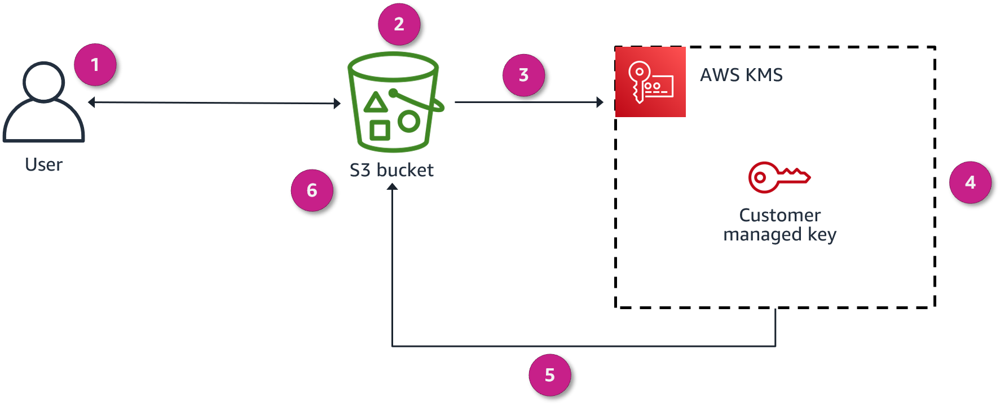

> **Нотатки:**
>
> Тепер ця схема пояснює, що відбувається в тому самому сценарії (SSE-KMS), коли користувач запитує відкрити зашифрований об’єкт, що зберігається в Amazon S3:  
> Ви запитуєте відкриття об’єкта.  
> Amazon S3 помічає, що запитаний об’єкт зашифровано.  
> Amazon S3 надсилає в AWS KMS зашифровану копію ключа даних, яким зашифровано об’єкт.  
> Потім AWS KMS розшифровує ключ даних за допомогою ключа, яким керує клієнт (який ніколи не залишає сервіс AWS KMS).  
> Далі AWS KMS надсилає ключ даних у відкритому вигляді назад в Amazon S3.  
> Нарешті, Amazon S3 розшифровує шифротекст об’єкта даних, дозволяє вам відкрити об’єкт і видаляє копію ключа даних у відкритому вигляді.

---

## Слайд 28: AWS Key Management Service (AWS KMS)

- Надає можливість створювати криптографічні ключі й керувати ними
- Використовує апаратні модулі безпеки (hardware security modules, HSM) для захисту ваших ключів
- Інтегрований з іншими сервісами AWS
- Надає можливість встановлювати політики використання, що визначають, які користувачі можуть використовувати ключі

AWS Key Management Service (AWS KMS)

> **Нотатки:**
>
> AWS KMS — це кероване обслуговування, що надає можливість створювати ключі, які використовуються для шифрування ваших даних, і контролювати їх. Ви можете створювати ключі даних з унікальними псевдонімами й описами для кращого керування, автоматично змінювати ключі (ротація) за розкладом і вимикати чи видаляти ключі, щоб ніхто не міг ними користуватися. Також можна імпортувати власні ключі замість використання ключів, згенерованих AWS.  
>
> Сервіс використовує апаратні модулі безпеки (HSM), перевірені за стандартом FIPS 140-2, для захисту ключів. AWS KMS інтегровано з іншими сервісами AWS, щоб допомогти захищати дані, які ви зберігаєте за допомогою цих сервісів. Інтегровані сервіси AWS використовують конвертне шифрування, щоб допомогти захистити ваші ключі шифрування.  
>
> З AWS KMS ви можете централізовано керувати своїми ключами та безпечно їх зберігати. Ви можете використовувати ключі у своїх застосунках і підтримуваних хмарних сервісах AWS для захисту даних, але ключі ніколи не залишають AWS KMS. Це зменшує ризик компрометації вашого ключа даних. Ви надсилаєте дані в AWS KMS для шифрування чи розшифрування за допомогою ключів, які ви контролюєте.  
>
> Для цих ключів можна встановити політики використання, що визначають, які користувачі можуть ними користуватися. Усі запити на використання цих ключів журналюються в AWS CloudTrail, щоб ви могли зрозуміти, хто використовував який ключ і коли. CloudTrail журналює всі операції AWS KMS, зокрема операції лише на читання; операції керування ключами KMS; і криптографічні операції.  
>
> Докладніше див. такі ресурси:  
> AWS Key Management Service (AWS KMS) за адресою https://aws.amazon.com/kms/  
> Як сервіси AWS використовують AWS KMS (How AWS Services Use AWS KMS) у посібнику розробника AWS Key Management Service за адресою https://docs.aws.amazon.com/kms/latest/developerguide/service-integration.html

---

## Слайд 29: Приклад AWS KMS з Amazon EBS

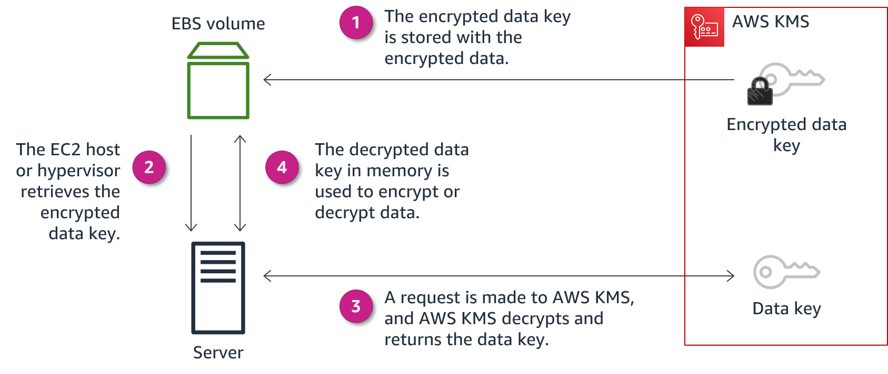

> **Нотатки:**
>
> Шифрування Amazon Elastic Block Store (Amazon EBS) — це зрозуміле рішення для шифрування ресурсів EBS, пов’язаних з вашими екземплярами EC2. З шифруванням Amazon EBS вам не потрібно будувати, підтримувати й захищати власну інфраструктуру керування ключами.  
>
> Шифрування Amazon EBS використовує ключі KMS під час створення зашифрованих томів і знімків. Кожен том шифрується за допомогою AES-256-XTS. Для цього потрібні два 256-бітні ключі, які можна розглядати як один 512-бітний ключ. Ключ даних шифрується ключем KMS у вашому акаунті. Щоб Amazon EBS міг зашифрувати том для вас, він повинен мати доступ до ключа, яким керує клієнт, в акаунті. Це робиться шляхом надання Amazon EBS гранту (grant) на ключ, яким керує клієнт, щоб створювати ключі даних та шифрувати й розшифровувати ці ключі даних.  
>
> Нижче наведено основні кроки шифрування та розшифрування даних тому EBS:  
> Amazon EBS отримує зашифрований ключ даних під ключем, яким керує клієнт, через AWS KMS і зберігає зашифрований ключ разом із зашифрованими даними.  
> Сервери, що розміщують екземпляри EC2, отримують зашифрований ключ даних зі сховища.  
> Виконується виклик AWS KMS через TLS для розшифрування зашифрованого ключа даних. AWS KMS визначає ключ KMS, робить внутрішній запит до HSM у парку, щоб розшифрувати ключ даних, і повертає ключ клієнтові через сеанс TLS.  
> Розшифрований ключ даних зберігається в пам’яті й використовується для шифрування та розшифрування всіх даних, що надходять до приєднаного тому EBS і з нього. Amazon EBS зберігає зашифрований ключ даних для подальшого використання на випадок, якщо ключ даних у пам’яті більше недоступний.

---

## Слайд 30: Ключові висновки: захист за допомогою шифрування

- AWS підтримує як шифрування на стороні клієнта, так і серверне шифрування.
  - CSE: ви шифруєте свої дані перед надсиланням їх до AWS.
  - SSE: AWS шифрує дані від вашого імені після їх отримання.
- AWS надає три типи SSE:
  - SSE з наданими клієнтом ключами (SSE-C)
  - SSE з ключами, керованими Amazon S3 (SSE-S3)
  - SSE з ключами AWS KMS (SSE-KMS)
- AWS KMS може створювати ключі, що використовуються для шифрування ваших даних, і контролювати їх.

> **Нотатки:**
>
> Ключові висновки з цього розділу модуля:  
> AWS підтримує як шифрування на стороні клієнта, так і серверне шифрування.  
> CSE: ви шифруєте свої дані перед надсиланням їх до AWS.  
> SSE: AWS шифрує дані від вашого імені після їх отримання.  
> AWS надає три типи SSE:  
> SSE з наданими клієнтом ключами (SSE-C)  
> SSE з ключами, керованими Amazon S3 (SSE-S3)  
> SSE з ключами AWS KMS (SSE-KMS)  
> AWS KMS може створювати ключі, що використовуються для шифрування ваших даних, і контролювати їх.

---

## Слайд 31: Лабораторна робота: шифрування даних у стані спокою за допомогою AWS KMS (Encrypting Data at Rest by Using AWS KMS)

> **Нотатки:**
>
> У цій лабораторній роботі ви використаєте AWS KMS для шифрування даних у стані спокою. Ви створите ключ KMS, використаєте його для шифрування об’єктів, що зберігаються в Amazon S3, і для шифрування томів EBS. Також ви побачите, як CloudTrail надає журнал аудиту використання ключа KMS і як вимкнення ключа впливає на доступ до даних.

---

## Слайд 32: Лабораторна робота: завдання

1. Створення ключа AWS KMS
2. Збереження зашифрованого об’єкта в бакеті S3
3. Спроба публічного доступу до зашифрованого об’єкта
4. Спроба підписаного доступу до зашифрованого об’єкта
5. Моніторинг активності AWS KMS за допомогою CloudTrail
6. Шифрування кореневого тому наявного екземпляра EC2
7. Вимкнення ключа шифрування та спостереження за наслідками

> **Нотатки:**
>
> У цій лабораторній роботі ви виконаєте такі завдання:  
> Створення ключа AWS KMS  
> Збереження зашифрованого об’єкта в бакеті S3  
> Спроба публічного доступу до зашифрованого об’єкта  
> Спроба підписаного доступу до зашифрованого об’єкта  
> Моніторинг активності AWS KMS за допомогою CloudTrail  
> Шифрування кореневого тому наявного екземпляра EC2  
> Вимкнення ключа шифрування та спостереження за наслідками

---

## Слайд 33: Початок лабораторної роботи: шифрування даних у стані спокою за допомогою AWS KMS

Тривалість: 90 хвилин

> **Нотатки:**
>
> Настав час розпочати лабораторну роботу.

---

## Слайд 34: Підсумки лабораторної роботи: ключові висновки

> **Нотатки:**
>
> Після завершення лабораторної роботи ваш викладач може вирішити провести обговорення ключових висновків із лабораторної роботи.

---

## Слайд 35: Захист даних під час передавання

Захист даних у вашому застосунку

> **Нотатки:**
>
> Цей розділ охоплює, як захищати дані під час передавання.

---

## Слайд 36: Навіщо захищати дані під час передавання?

- Ваш обмін даними може проходити через публічний інтернет.
- Яким ризикам піддаються дані під час передавання?
  - Випадкове розкриття інформації
  - Порушення цілісності даних
  - Компрометація ідентичності
    - Атаки «людина посередині» (man-in-the-middle, MITM)
    - Підміна ідентичності (identity spoofing)

> **Нотатки:**
>
> Дані під час передавання (data in transit) — це дані, що активно переміщуються з одного місця в інше, наприклад через інтернет або приватну мережу. Щоб захистити дані під час передавання, ви захищаєте дані, поки вони рухаються від мережі до мережі або передаються з локального пристрою зберігання на пристрій хмарного зберігання. Де б не рухалися дані, заходи захисту критично важливі, оскільки дані часто вважаються менш захищеними під час руху.  
>
> Хмарні застосунки часто обмінюються даними через публічні канали, як-от інтернет, тому важливо захищати дані під час передавання, коли ви запускаєте застосунки в хмарі. Це включає захист мережевого трафіку між клієнтами та серверами й мережевого трафіку між серверами.  
>
> Під час передавання через різні застосунки й мережі дані піддаються таким ризикам:  
> Випадкове розкриття інформації  
> Порушення цілісності даних  
> Компрометація ідентичності  
> Атаки «людина посередині» (MITM)  
> Підміна ідентичності  
>
> Атака «людина посередині» (MITM) — це форма кібератаки, під час якої зловмисники використовують слабкі вебпротоколи, щоб вставити себе між сторонами в каналі зв’язку й викрасти дані. Зловмисник перебуває посередині поточного обміну даними між двома сторонами. Цей тип атаки робить мережу вразливою до перехоплення пакетів (packet sniffing) і їх зміни.

---

## Слайд 37: Захист даних під час передавання

- Використовуйте кінцеві точки Secure Sockets Layer (SSL) поверх Transport Layer Security (TLS) (HTTPS).
- Використовуйте шифрування.
- Використовуйте кінцеві точки Amazon Virtual Private Cloud (Amazon VPC), щоб обмежити доступ до вашого бакета.

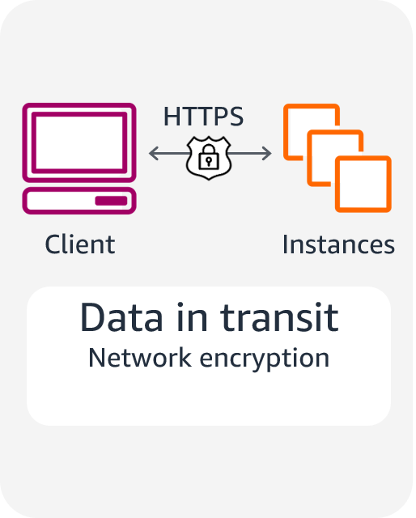

> **Нотатки:**
>
> Ви можете захищати дані під час передавання за допомогою Secure Sockets Layer (SSL) або шифрування на стороні клієнта. Ви можете безпечно завантажувати свої дані в Amazon S3 або з нього через кінцеві точки SSL за допомогою протоколу HTTPS. Шифрування на стороні клієнта захищатиме ваші дані під час передавання, оскільки дані шифруються до їх надсилання в Amazon S3.  
>
> Також можна обмежити доступ до бакета S3 з певної кінцевої точки Amazon Virtual Private Cloud (Amazon VPC) або набору кінцевих точок за допомогою політик бакетів S3.  
>
> Щоб захистити дані під час передавання, AWS заохочує клієнтів використовувати багаторівневий підхід. Увесь мережевий трафік між центрами обробки даних AWS прозоро шифрується на фізичному рівні. Увесь трафік усередині VPC і між пірингованими VPC у регіонах AWS прозоро шифрується на мережевому рівні за використання підтримуваних типів екземплярів EC2. На рівні застосунку клієнти мають вибір, чи використовувати шифрування та як саме, за допомогою протоколу на кшталт Transport Layer Security (TLS). Усі кінцеві точки сервісів AWS підтримують TLS для створення захищеного з’єднання HTTPS для виконання запитів API.

---

## Слайд 38: Захист віддалених підключень до серверів

- Протокол віддаленого робочого стола (Remote Desktop Protocol, RDP) зазвичай використовується для серверів Windows.
  - RDP встановлює базове з’єднання SSL/TLS.
  - Для кращої безпеки випускайте довірений сертифікат X.509.
  - Не використовуйте самопідписані сертифікати за замовчуванням.
- Secure Shell (SSH) зазвичай використовується для серверів Linux.
  - SSH встановлює захищений канал зв’язку.
  - Використовуйте тунелювання (tunneling), щоб захистити сеанс застосунку під час передавання.
  - Не дозволяйте кореневому акаунту (root user) використовувати термінал SSH.
  - Переконайтеся, що всі користувачі входять за допомогою пари ключів SSH, а потім деактивуйте автентифікацію за паролем.

> **Нотатки:**
>
> Користувачі, які отримують доступ до Windows Terminal Services у публічній хмарі, зазвичай використовують Microsoft Remote Desktop Protocol (RDP). За замовчуванням з’єднання RDP встановлюють базове з’єднання SSL/TLS. Для оптимального захисту сервер Windows, до якого здійснюється доступ, має отримати довірений сертифікат X.509 для захисту від підміни ідентичності чи атак «людина посередині». За замовчуванням сервери Windows RDP використовують самопідписані сертифікати, які не є довіреними й яких слід уникати.  
>
> Secure Shell (SSH) — це бажаний підхід для встановлення адміністративних з’єднань із серверами Linux. SSH — це протокол, що, як і SSL, забезпечує захищений канал зв’язку між клієнтом і сервером. SSH підтримує тунелювання, яке слід використовувати для запуску застосунків, як-от X-Windows, поверх SSH та для захисту сеансу застосунку під час передавання. За замовчуванням образи Amazon Machine Images (AMI), що їх надають AWS і більшість постачальників з AWS Marketplace, не дозволяють кореневому акаунту входити з термінала SSH. Конфігурація за замовчуванням для AMI, наданих AWS, — вхід за допомогою пари ключів SSH із деактивованою автентифікацією за паролем.

---

## Слайд 39: AWS Certificate Manager (ACM)

- Надає єдиний інтерфейс для керування як публічними, так і приватними сертифікатами
- Полегшує розгортання сертифікатів
- Захищає та зберігає приватні сертифікати
- Мінімізує простій і збої завдяки автоматичному поновленню

AWS Certificate Manager (ACM)

> **Нотатки:**
>
> Полегшуючи ввімкнення SSL/TLS, AWS Certificate Manager (ACM) допомагає організаціям виконувати регуляторні вимоги та вимоги відповідності щодо шифрування даних під час передавання. ACM бере на себе складність створення публічних сертифікатів SSL/TLS і керування ними для ваших вебсайтів і застосунків на основі AWS. Також можна використовувати ACM для випуску приватних сертифікатів SSL/TLS X.509, що ідентифікують користувачів, комп’ютери, застосунки, сервіси, сервери та інші пристрої всередині організації.  
>
> ACM надає єдиний інтерфейс для керування як публічними, так і приватними сертифікатами. З ACM можна легко створювати та розгортати публічні й приватні сертифікати для ваших локальних (on-premises) ресурсів, як-от внутрішні сервери та пристрої Інтернету речей (IoT). Також можна розгортати приватні чи публічні сертифікати на ресурсах AWS, як-от балансувальники навантаження, дистрибутиви Amazon CloudFront і кінцеві точки Amazon API Gateway, за допомогою AWS Management Console або API ACM.  
>
> ACM також розроблено для захисту приватних сертифікатів і керування ними. Сервіс також може допомогти мінімізувати простій через неправильно налаштовані чи прострочені сертифікати. ACM допомагає впоратися з труднощами підтримки сертифікатів, зокрема з поновленням сертифікатів, щоб вам не потрібно було турбуватися про збої, спричинені закінченням терміну дії сертифікатів. Поновлені сертифікати розгортаються на ресурсах AWS автоматично.

---

## Слайд 40: AWS Certificate Manager Private Certificate Authority

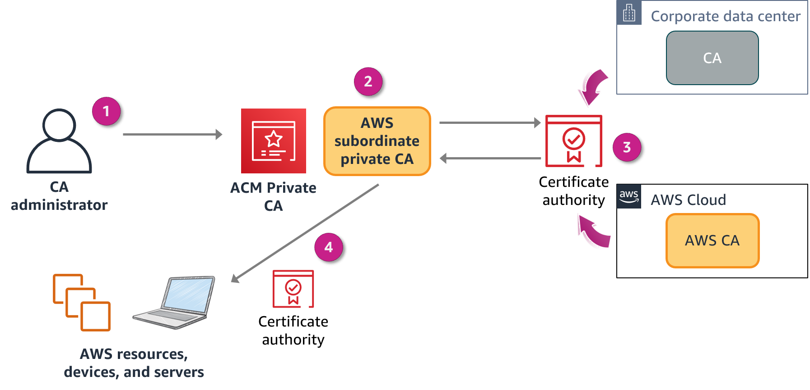

> **Нотатки:**
>
> За допомогою AWS Certificate Manager Private Certificate Authority можна створювати ієрархії приватних центрів сертифікації (certificate authority, CA), зокрема кореневі та підпорядковані (subordinate) CA, без інвестицій і витрат на обслуговування, пов’язаних з експлуатацією локального CA. Ваші приватні CA можуть випускати сертифікати кінцевих сутностей X.509, які корисні в таких сценаріях:  
> Створення зашифрованих каналів зв’язку TLS  
> Автентифікація користувачів, комп’ютерів, кінцевих точок API та пристроїв IoT  
> Криптографічний підпис коду  
> Впровадження Online Certificate Status Protocol (OCSP) для отримання статусу відкликання сертифіката  
>
> ACM Private CA призначений для корпоративних клієнтів, що будують інфраструктуру відкритих ключів (public key infrastructure, PKI) усередині хмари AWS. Сервіс призначений для приватного використання всередині організації. З ACM Private CA можна створити власну ієрархію CA та випускати за її допомогою сертифікати для автентифікації внутрішніх користувачів, комп’ютерів, застосунків, сервісів, серверів та інших пристроїв, а також для підпису комп’ютерного коду. Сертифікати, що їх випускає приватний CA, є довіреними лише всередині вашої організації, а не в інтернеті. Після створення приватного CA ви можете випускати сертифікати безпосередньо (тобто без отримання валідації від стороннього CA) та налаштовувати їх відповідно до внутрішніх потреб вашої організації.  
>
> Схема показує ACM Private CA в дії:  
> Адміністратор CA створює підпорядкований CA для випуску сертифікатів.  
> Підпорядкований CA надсилає сертифікат на підписання.  
> Локальний CA або CA AWS підписує сертифікат.  
> ACM Private CA випускає підписаний сертифікат для ресурсів.

---

## Слайд 41: Міркування щодо ACM Private CA

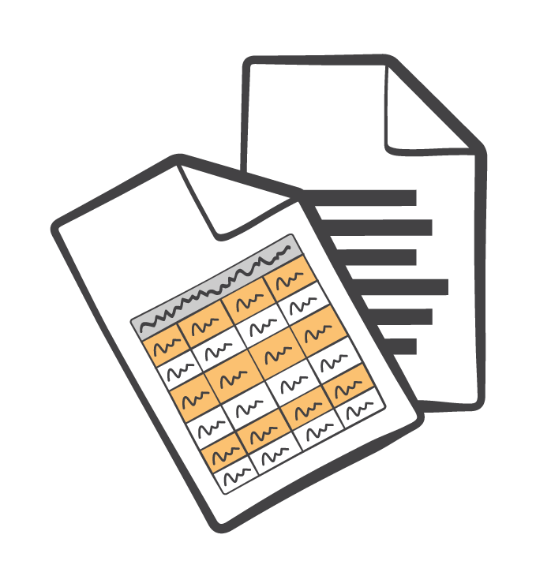

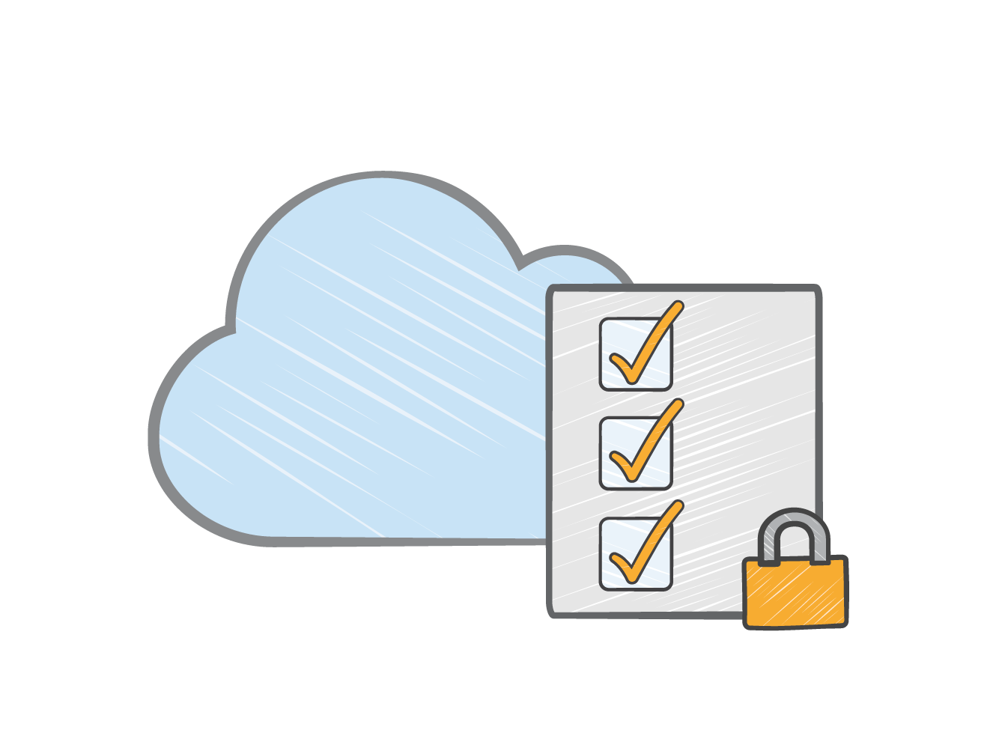

Апаратні модулі безпеки (HSM)

Політики IAM для контролю доступу

Certificate revocation

list (Список відкликаних сертифікатів)

Generated audit

reports (Згенеровані звіти аудиту)

> **Нотатки:**
>
> ACM Private CA захищено за допомогою HSM. Ці HSM відповідають стандартам безпеки FIPS 140-2 Level 3, щоб допомогти захистити ваш приватний CA від компрометації ключів. Адміністратори CA також можуть контролювати доступ до сервісу за допомогою політик IAM. ACM Private CA автоматично публікує та оновлює списки відкликаних сертифікатів у бакеті S3, щоб допомогти запобігти використанню відкликаних сертифікатів. Наприклад, застосунок IoT може перевірити, чи дійсний приватний сертифікат для сенсора, перш ніж приймати дані від сенсора. ACM Private CA також створює ще один бакет S3, що надає можливість генерувати звіти аудиту.  
>
> Захист внутрішніх сервісів — поширений сценарій використання ACM Private CA. Наприклад, приватний сертифікат корисний для захисту з’єднань із вашими балансувальниками навантаження, кінцевими точками API, застосунками та внутрішнім Wi-Fi. Цей сервіс також є інфраструктурним компонентом ACM, що має широкий спектр власних застосувань. Приклади включають керування приватними сертифікатами з перевагою керованого поновлення та прив’язки сертифікатів і випуск приватних сертифікатів для ідентифікації ресурсів AWS, як-от екземпляри EC2, повідомлення Amazon Simple Notification Service (Amazon SNS) або пристрої IoT. ACM Private CA також добре підходить для клієнтів, які хочуть замінник самопідписаних сертифікатів та автоматизацію через API.

---

## Слайд 42: Ключові висновки: захист даних під час передавання

- Захищайте дані під час передавання за допомогою SSL або шифрування на стороні клієнта, коли запускаєте застосунки в хмарі.
- Використовуйте кінцеві точки VPC, щоб обмежити доступ до бакетів S3.
- Сервіс ACM бере на себе складність створення публічних сертифікатів SSL/TLS і керування ними для ваших вебсайтів і застосунків на основі AWS.
- ACM Private CA може керувати життєвим циклом ваших приватних сертифікатів централізовано та високодоступним способом.

> **Нотатки:**
>
> Ключові висновки з цього розділу модуля:  
> Захищайте дані під час передавання за допомогою SSL або шифрування на стороні клієнта, коли запускаєте застосунки в хмарі.  
> Використовуйте кінцеві точки VPC, щоб обмежити доступ до бакетів S3.  
> Сервіс ACM бере на себе складність створення публічних сертифікатів SSL/TLS і керування ними для ваших вебсайтів і застосунків на основі AWS.  
> ACM Private CA може керувати життєвим циклом ваших приватних сертифікатів централізовано та високодоступним способом.

---

## Слайд 43: Найкращі практики захисту даних в Amazon S3

Захист даних у вашому застосунку

> **Нотатки:**
>
> Цей розділ охоплює найкращі практики захисту даних в Amazon S3.

---

## Слайд 44: Попередньо підписані URL-адреси (presigned URLs)

- Згенеруйте попередньо підписану URL-адресу S3 (S3 Presigned URL) і використовуйте її для завантаження файлів (об’єктів).
- Попередньо підписана URL-адреса використовує три параметри для обмеження доступу користувача:
  - Bucket: бакет, у якому розташований об’єкт (або буде розташований)
  - Key: назва об’єкта
  - Expires: проміжок часу, протягом якого дійсна URL-адреса

> **Нотатки:**
>
> Усі об’єкти в бакеті S3 за замовчуванням приватні. Лише власник об’єкта має дозволи на доступ до цих об’єктів. Однак власник об’єкта може за бажанням ділитися об’єктами з іншими, створивши попередньо підписану URL-адресу за допомогою власних облікових даних безпеки, щоб надати обмежені в часі дозволи на завантаження чи скачування об’єктів.  
>
> Попередньо підписана URL-адреса надає тимчасовий доступ до конкретного об’єкта S3. За допомогою URL-адреси користувач може читати, записувати чи оновлювати об’єкт. Наприклад, якщо у вашому бакеті є відео, а і бакет, і відео приватні, ви можете поділитися відео з іншими, згенерувавши попередньо підписану URL-адресу.  
>
> Аналогічно, якщо ви хочете отримати об’єкт від користувача без акаунта AWS, він може завантажити об’єкт за допомогою попередньо підписаної URL-адреси, якою ви з ним ділитеся.  
>
> Докладніше див. «Генерування попередньо підписаної URL-адреси для завантаження об’єкта» (Generating a Presigned URL to Upload an Object) у посібнику користувача Amazon Simple Storage Service за адресою https://docs.aws.amazon.com/AmazonS3/latest/userguide/PresignedUrlUploadObject.html.

---

## Слайд 45: Міркування щодо безпеки та найкращі практики (1 із 2)

- Розгляньте шифрування даних у стані спокою та примусово застосовуйте шифрування даних під час передавання.
- Переконайтеся, що ваші бакети S3 використовують правильні політики й не є публічно доступними.
- Використовуйте принцип найменших привілеїв.
- Увімкніть MFA delete для бакетів.
- Примусово застосовуйте шифрування для кожного запиту PUT.
- Використовуйте попередньо підписані URL-адреси для застосунків, що посилаються на об’єкти Amazon S3.

> **Нотатки:**
>
> Щоб забезпечити правильний баланс безпеки та операційної гнучкості, AWS рекомендує такі найкращі практики під час використання Amazon S3:  
> Використовуйте шифрування як додатковий засіб контролю доступу, що доповнює вже описані засоби контролю доступу на основі ідентичності, ресурсів і мережі. AWS надає низку функцій, що можуть допомогти вам легко шифрувати дані та керувати ключами. Усі сервіси AWS пропонують можливість шифрувати дані в стані спокою та під час передавання.  
> Використовуйте політики бакетів разом з політиками IAM, щоб захистити ресурси від неавторизованого доступу та запобігти розкриттю інформації, порушенню цілісності даних чи видаленню.  
> Встановлюйте політики IAM і бакетів з найменшими привілеями. Наприклад, якщо очікується, що застосунок завантажуватиме об’єкти, то відповідна роль IAM не повинна мати дозволів на читання об’єкта чи будь-яких інших дозволів.  
> Увімкніть MFA delete для бакетів із керуванням версіями, щоб гарантувати, що файли не можна видалити чи змінити.  
> Примусово застосовуйте SSE для кожного запиту PUT. Це призведе до відмови в тих випадках, коли кінцевий користувач не запитує SSE.  
> Використовуйте попередньо підписані URL-адреси для застосунків, що посилаються на об’єкти S3 з анонімним доступом; наприклад, для завантаження обмеженого вмісту. Автентифікація та авторизація мають виконуватися в застосунку.

---

## Слайд 46: Міркування щодо безпеки та найкращі практики (2 із 2)

- Щоб зашифрувати всі об’єкти, встановіть шифрування за замовчуванням (default encryption) для бакета.
- Якщо використовуєте S3 Object Lock, використовуйте відповідний режим збереження.
- Використовуйте S3 Block Public Access.
- Завантажуйте дані в Amazon S3 за протоколом SSH File Transfer Protocol (SFTP) через AWS Transfer for SFTP.
- Увімкніть керування версіями S3 (S3 Versioning).

> **Нотатки:**
>
> Ось додаткові найкращі практики під час використання Amazon S3:  
> Установіть шифрування за замовчуванням для бакета, якщо хочете, щоб усі об’єкти шифрувалися після збереження в бакеті.  
> Використовуючи S3 Object Lock, застосовуйте відповідний режим збереження (режим управління або режим відповідності). Ці режими збереження застосовують різні рівні захисту до ваших об’єктів. Можна застосувати будь-який режим збереження до будь-якої версії об’єкта, захищеної S3 Object Lock.  
> Використовуйте налаштування S3 Block Public Access, щоб примусово забезпечити, що бакети не дозволяють публічного доступу до даних.  
> Завантажуйте дані в Amazon S3 за протоколом SSH File Transfer Protocol (SFTP) за допомогою AWS Transfer for SFTP. Цей повністю кероване обслуговування забезпечує передавання файлів за SFTP безпосередньо в Amazon S3 і з нього. Використання цього сервісу усуває потребу керувати інфраструктурою, пов’язаною з SFTP. Маючи дані в Amazon S3, їх можна легко інтегрувати в робочі навантаження, що використовують широкий спектр сервісів AWS.  
> Використовуйте керування версіями S3, щоб зберігати, отримувати й відновлювати кожну версію кожного об’єкта, що зберігається у вашому бакеті S3.

---

## Слайд 47: Додаткові сервіси захисту даних

Захист даних у вашому застосунку

> **Нотатки:**
>
> Цей розділ надає інформацію про додаткові сервіси, що можуть допомогти вам захищати ваші дані.

---

## Слайд 48: AWS Secrets Manager

- Захищений і масштабований метод керування доступом до секретів (secrets)
- Спосіб виконати регуляторні вимоги та вимоги відповідності
- Безпечно змінює секрети (ротація), не порушуючи роботи застосунків
- Виконує аудит і моніторинг життєвого циклу секретів
- Допомагає уникнути розміщення секретів у коді чи конфігураційних файлах

AWS Secrets Manager

> **Нотатки:**
>
> AWS Secrets Manager — це сервіс, що полегшує вам керування секретами. Секретами можуть бути облікові дані баз даних, паролі, ключі API сторонніх розробників і навіть довільний текст. Ви можете централізовано зберігати ці секрети й контролювати доступ до них за допомогою консолі, AWS CLI, API та SDK.  
>
> З Secrets Manager ви можете прибрати жорстко закодовані облікові дані (зокрема паролі) із вихідного коду й уникнути зберігання облікових даних у конфігураційному файлі. Натомість ви використовуєте виклик API до Secrets Manager для програмного отримання секрету. Це допомагає гарантувати, що секрет не може бути скомпрометований тим, хто вивчає ваш код, адже секрету там просто немає. Також можна налаштувати Secrets Manager на автоматичну ротацію секрету за вказаним вами розкладом. Тому довгострокові секрети можна замінити короткостроковими, що допомагає значно зменшити ризик компрометації.

---

## Слайд 49: Використання Secrets Manager

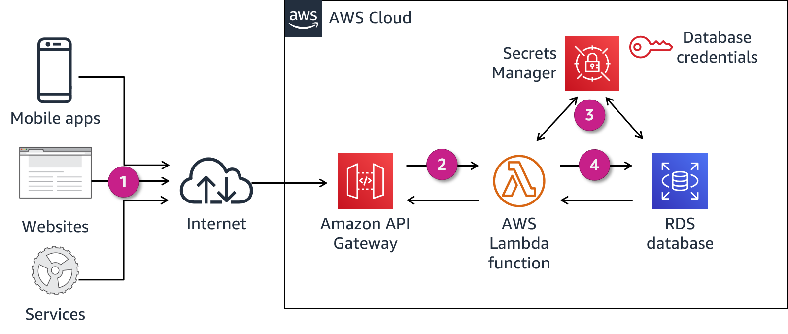

> **Нотатки:**
>
> Ця схема показує, як використовувати Secrets Manager для захисту облікових даних бази даних. Підхід використовує функцію AWS Lambda, що використовує облікові дані з Secrets Manager для підключення до бекенд-бази даних Amazon Relational Database Service (Amazon RDS) і виконання запитів до неї. Це робиться без жорсткого кодування секретів у коді чи передавання їх через змінні середовища. Цей підхід допомагає захистити секрети «останньої милі» (last-mile secrets) і ваші бекенд-бази даних.  
>
> Кроки цього робочого процесу такі:  
> Клієнти викликають RESTful API, що розміщений в Amazon API Gateway.  
> API Gateway запускає функцію Lambda.  
> Функція Lambda отримує секрети бази даних за допомогою API Secrets Manager. Secrets Manager отримує секрет, розшифровує захищений текст секрету та повертає його функції через захищений канал.  
> Функція Lambda підключається до бази даних Amazon RDS за допомогою секретів бази даних із Secrets Manager і повертає результати запиту.  
>
> Докладніше див. «Як безпечно надавати облікові дані бази даних функціям Lambda за допомогою AWS Secrets Manager» (How to Securely Provide Database Credentials to Lambda Functions by Using AWS Secrets Manager) у блозі AWS Security Blog за адресою https://aws.amazon.com/blogs/security/how-to-securely-provide-database-credentials-to-lambda-functions-by-using-aws-secrets-manager.

---

## Слайд 50: Ротація секретів (rotating secrets)

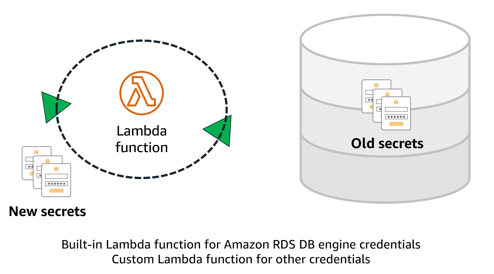

> **Нотатки:**
>
> З Secrets Manager ви можете автоматично змінювати (ротація) паролі для баз даних Amazon Aurora, MySQL, MariaDB, PostgreSQL та Oracle, розміщених в AWS. Щоб увімкнути автоматичну ротацію, потрібні дозволи адміністратора. Ця ротація виконується без втручання людини через функцію Lambda — за розкладом, який ви вказуєте, або за потреби. Для облікових даних рушія БД Amazon RDS ця функція Lambda вже існує, але якщо у вас є інші облікові дані з терміном дії, як-от вхід SAML, можливо, ви захочете створити власну функцію для використання з Secrets Manager.  
>
> Функція ротації виконує роботу зі зміни секрету. Процес ротації секрету складається з чотирьох кроків, що відповідають чотирьом крокам у функції ротації Lambda. Secrets Manager використовує проміжні мітки (staging labels), щоб позначати версії секрету під час ротації:  
> Функція звертається до БД за новими обліковими даними.  
> Secrets Manager зберігає нові облікові дані з міткою AWSPENDING.  
> Нові облікові дані тестуються.  
> Нові облікові дані робляться типовими з міткою AWSCURRENT.

---

## Слайд 51: Amazon Macie

- Розпізнає чутливі дані, як-от персональні ідентифікаційні дані (personally identifiable information, PII), фінансову інформацію, ключі шифрування та облікові дані
- Дозволяє користувацькі визначені типи даних
- Захищає дані, що зберігаються в Amazon S3, відстежуючи політики ресурсів і ACL
- Надає повне покриття API для керування
- Інтегрується з AWS Organizations

Amazon Macie

> **Нотатки:**
>
> Amazon Macie — це сервіс безпеки, що використовує машинне навчання для автоматичного виявлення, класифікації та захисту чутливих даних в AWS. Macie розпізнає персональні ідентифікаційні дані (PII), як-от номери паспортів, номери медичних посвідчень і податкові ідентифікаційні номери. Macie також розпізнає фінансову інформацію, ключі шифрування та облікові дані. Також Macie дає змогу додавати користувацькі визначені типи даних за допомогою регулярних виразів, щоб Macie міг виявляти пропрієтарні чи унікальні чутливі дані вашого бізнесу.  
>
> Наразі Macie захищає лише дані, що зберігаються в Amazon S3, і доступний у більшості регіонів AWS. Macie має панелі та сповіщення, що дають прозорість доступу до даних, аналізуючи політики на основі ресурсів Amazon S3 та ACL під час відновлення чутливих даних.  Сервіс безперервно відстежує дані та генерує детальні сповіщення, коли виявляє ризик неавторизованого доступу чи ненавмисного витоку даних.  
>
> З Macie ви маєте повний контроль над сервісом через набір API Macie і можете централізовано керувати Macie для кількох акаунтів. Macie інтегрується з AWS Organizations, що означає, що ви можете керувати до 5000 акаунтів Macie для однієї організації AWS. Ви також можете й надалі використовувати вбудовані функції Macie для керування кількома акаунтами, що дає змогу керувати до 1000 акаунтів-членів за допомогою єдиного акаунта адміністратора Macie.

---

## Слайд 52: Класифікація даних і моніторинг дозволів доступу до них

- Macie сканує й оцінює об’єкти бакета на порушення політик і чутливі дані.
- Macie генерує результати (findings) у реальному часі для таких випадків:
  - Бакети, що є публічними
  - Бакети, що не зашифровані
  - Бакети, до яких надано спільний доступ або які реплікуються

> **Нотатки:**
>
> Macie може допомогти класифікувати ваші чутливі та критично важливі для бізнесу дані на рівні бакетів S3. Macie сканує всі знайдені підтримувані об’єкти й оцінює їх на чутливі дані, що відповідають критеріям завдання (job). Ці завдання виявлення чутливих даних можна додатково налаштувати; наприклад, класифікувати лише документи PDF або класифікувати всі об’єкти, крім тих, що мають певний префікс.  
>
> За замовчуванням Macie безперервно відстежуватиме всі бакети в будь-якому акаунті, де його ввімкнено. Результати генеруються для будь-якого бакета, що є публічним, не зашифрованим або до якого надано спільний доступ чи який реплікується в акаунти AWS поза організацією клієнта. Ці результати повідомляються майже в реальному часі.

---

## Слайд 53: Зведення Macie (Macie summary)

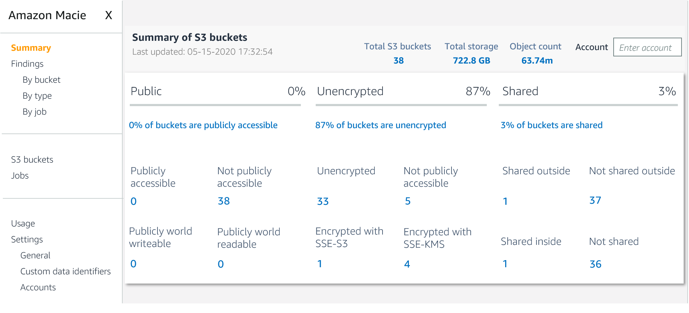

> **Нотатки:**
>
> Сторінка зведення Macie в консолі надає огляд бакетів, що пройшли процес виявлення Macie. Як зазначалося, бакети відстежуються на предмет дозволу публічного доступу, відсутності шифрування та спільного використання чи реплікації за межами вашого акаунта.

---

## Слайд 54: Результати Macie (Macie findings)

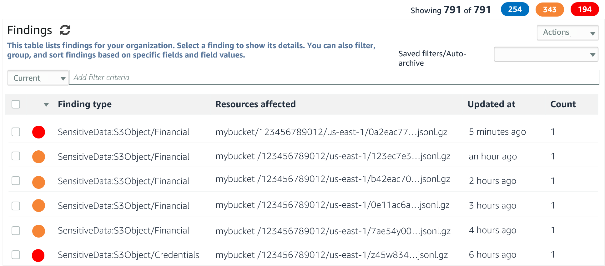

> **Нотатки:**
>
> Завдання Macie аналізує дані в певних бакетах S3 на чутливі дані. Кожне завдання використовує керовані ідентифікатори даних, які надає Macie, та, за бажанням, користувацькі ідентифікатори даних, які ви створюєте. Сервіс надає можливість запускати одноразові, щоденні, щотижневі чи щомісячні завдання виявлення чутливих даних для всіх або підмножини об’єктів у бакеті S3. Для завдань виявлення чутливих даних Macie автоматично відстежує зміни в бакеті й з часом оцінює лише нові чи змінені об’єкти.

---

## Слайд 55: Ключові висновки: додаткові сервіси захисту даних

- Secrets Manager допомагає захищати доступ до застосунків, сервісів і ІТ-ресурсів.
- Macie використовує машинне навчання та зіставлення зі зразками (pattern matching), щоб виявляти й захищати чутливі дані в AWS.

> **Нотатки:**
>
> Ключові висновки з цього розділу модуля:  
> Secrets Manager допомагає захищати доступ до застосунків, сервісів і ІТ-ресурсів.  
> Macie використовує машинне навчання та зіставлення зі зразками, щоб виявляти й захищати чутливі дані в AWS.

---

## Слайд 56: Підсумки модуля

Захист даних у вашому застосунку

> **Нотатки:**
>
> Настав час повторити матеріал модуля та завершити його перевіркою знань і розбором запитання практичного сертифікаційного іспиту.

---

## Слайд 57: Резюме модуля

У цьому модулі ви навчилися:

- Описувати, як захищати дані в стані спокою та під час передавання.
- Визначати функції захисту Amazon S3.
- Шифрувати дані в Amazon S3.
- Розрізняти CSE і SSE.
- Визначати сервіси AWS, що допомагають захищати ваші дані.

> **Нотатки:**
>
> У цьому модулі ви навчилися:  
> Описувати, як захищати дані в стані спокою та під час передавання.  
> Визначати функції захисту Amazon S3.  
> Шифрувати дані в Amazon S3.  
> Розрізняти CSE і SSE.  
> Визначати сервіси AWS, що допомагають захищати ваші дані.

---

## Слайд 58: Пройдіть перевірку знань

> **Нотатки:**
>
> Настав час пройти перевірку знань для цього модуля.

---

## Слайд 59: Приклад запитання іспиту

Компанія вимагає, щоб дані, що зберігаються в AWS, були зашифровані в стані спокою. Який підхід задовольнить цю вимогу?

Варіант

Відповідь

A

Під час зберігання даних в Amazon EBS використовувати лише екземпляри EC2, оптимізовані для EBS.

B

Під час зберігання даних в Amazon S3 використовувати S3 Versioning і MFA delete.

C

Під час зберігання даних у сховищі екземпляра EC2 (instance store) шифрувати том за допомогою AWS KMS.

D

Під час зберігання даних в Amazon S3 увімкнути серверне шифрування.

> **Нотатки:**
>
> Розгляньте варіанти відповідей і відсійте їх за ключовими словами.

---

## Слайд 60: Відповідь на приклад запитання іспиту

Компанія вимагає, щоб дані, що зберігаються в AWS, були зашифровані в стані спокою. Який підхід задовольнить цю вимогу?

Правильна відповідь — D.

Ключові слова в запитанні: **дані, що зберігаються в AWS** та **шифрування в стані спокою**.

> **Нотатки:**
>
> Правильна відповідь — D.  
>
> Серверне шифрування в Amazon S3 захищає дані в стані спокою.  
>
> Відповідь A неправильна, оскільки використання лише екземплярів EC2, оптимізованих для EBS, не гарантує захисту екземплярів у стані спокою.  
>
> Відповідь B неправильна, оскільки це не шифрує дані в стані спокою для об’єктів Amazon S3.  
>
> Відповідь C неправильна, оскільки дані не зберігаються в сховищі екземпляра (instance store).

---

## Слайд 61: Дякуємо

Виправлення, відгуки чи інші запитання?  
Зв’яжіться з нами за адресою [https://support.aws.amazon.com/#/contacts/aws-academy](https://support.aws.amazon.com/#/contacts/aws-academy).  
Усі торговельні марки є власністю їхніх власників.

> **Нотатки:**
>
> Дякуємо, що пройшли цей модуль.

---

## Слайд 62: Вихідні файли зображень лише для розробки

<!-- hidden slide -->

> **Нотатки:**
>
> Вихідні файли зображень лише для розробки (Image source files for development use only)

---

## Слайд 63: Дані в стані спокою в Amazon S3

<!-- hidden slide -->

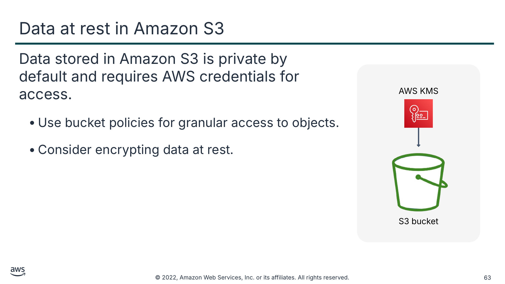

Дані, що зберігаються в Amazon S3, за замовчуванням приватні та вимагають облікових даних AWS для доступу.

- Використовуйте політики бакетів (bucket policies) для детального доступу до об’єктів.
- Розгляньте шифрування даних у стані спокою.

Текст зі схеми

AWS KMS

S3 bucket (Бакет S3)

> **Нотатки:**
>
> За замовчуванням усі ресурси Amazon S3 — бакети, об’єкти та пов’язані підресурси (наприклад, конфігурація життєвого циклу та конфігурація вебсайту) — приватні. Доступ до ресурсу може отримати лише його власник, акаунт AWS, що його створив. Власник ресурсу може надати дозволи на доступ іншим, написавши політику доступу.  
>
> Ви можете змінювати політики бакетів, щоб дозволити додатковий доступ, а AWS надає низку інструментів для налаштування бакетів під найрізноманітніші робочі навантаження. Наприклад, функція S3 Block Public Access діє як додатковий рівень захисту для запобігання випадковому розкриттю даних.  
>
> Крім того, розгляньте шифрування даних у стані спокою в Amazon S3.

---

## Слайд 64: Керування версіями Amazon S3 (Amazon S3 Versioning)

<!-- hidden slide -->

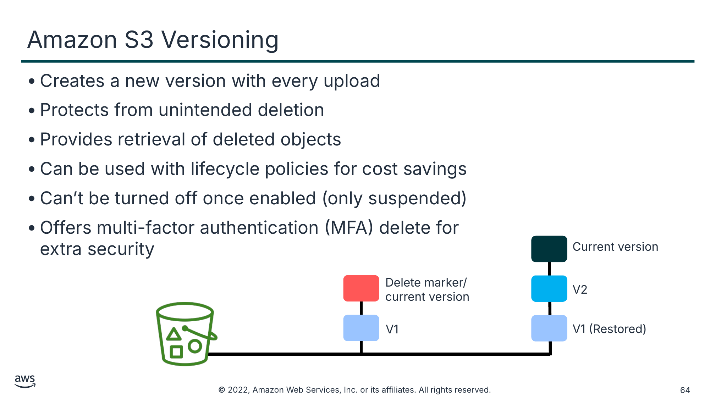

- Створює нову версію під час кожного завантаження
- Захищає від ненавмисного видалення
- Забезпечує відновлення видалених об’єктів
- Можна використовувати з політиками життєвого циклу для економії коштів
- Не можна вимкнути після ввімкнення (можна лише призупинити)
- Пропонує видалення із багатофакторною автентифікацією (MFA delete) для додаткової безпеки

Текст зі схеми

Current version (Поточна версія)

Delete marker/

current version (Маркер видалення / поточна версія)

V2

V1

V1 (Restored) (V1 (відновлена))

> **Нотатки:**
>
> Ще одна функція безпеки, яку варто розглянути, — керування версіями (Versioning). Це метод зберігання кількох варіантів об’єкта в тому самому бакеті. З цією функцією ви можете зберігати, отримувати й відновлювати кожну версію кожного об’єкта, що зберігається у ваших бакетах. За замовчуванням керування версіями S3 у бакетах вимкнено, і його потрібно явно ввімкнути.  
>
> Керування версіями може допомогти відновити об’єкти після випадкового видалення чи перезапису. Наприклад, якщо ви видаляєте об’єкт, замість остаточного вилучення Amazon S3 вставляє маркер видалення (delete marker), що стає поточною версією об’єкта. Ви завжди можете відновити попередню версію. Перезапис об’єкта призводить до нової версії об’єкта в бакеті, але ви завжди можете відновити попередню версію.  
>
> Коли керування версіями ввімкнено, за замовчуванням буде отримано останню записану версію. Старіші версії об’єкта можна отримати, вказавши версію у вашому запиті.  
>
> Щоб налаштувати свій підхід до зберігання даних і контролювати витрати на зберігання, використовуйте керування версіями об’єктів разом із S3 Lifecycle.  
>
> Після ввімкнення керування версіями для бакета повернути його до стану без версій не можна. Однак ви можете призупинити керування версіями на бакеті, що припиняє накопичення нових версій того самого об’єкта в бакеті. Ви можете це зробити, бо хочете мати в бакеті лише одну версію об’єкта. Або ж не хочете нести витрати на кілька версій. Коли ви призупиняєте керування версіями, наявні об’єкти у вашому бакеті не змінюються.  
>
> Працюючи з керуванням версіями S3 у бакетах Amazon S3, ви можете за бажанням додати ще один рівень безпеки, ввімкнувши видалення з багатофакторною автентифікацією (MFA delete). Коли ви це робите, власник бакета має включити дві форми автентифікації в будь-який запит на видалення версії або зміну стану керування версіями бакета.  
>
> Докладніше див. «Використання керування версіями в бакетах S3» (Using Versioning in S3 Buckets) у посібнику користувача Amazon Simple Storage Service за адресою https://docs.aws.amazon.com/AmazonS3/latest/userguide/Versioning.html.

---

## Слайд 65: Amazon S3 Object Lock

<!-- hidden slide -->

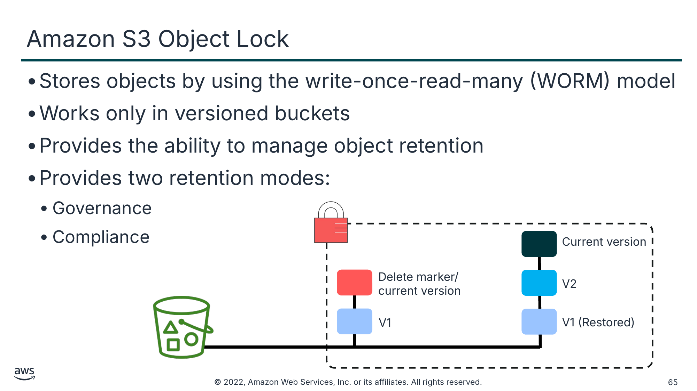

- Зберігає об’єкти за моделлю «одноразовий запис — багаторазове читання» (write-once-read-many, WORM)
- Працює лише у бакетах із керуванням версіями
- Надає можливість керувати збереженням об’єктів (object retention)
- Надає два режими збереження:
  - Управління (Governance)
  - Відповідність вимогам (Compliance)

Текст зі схеми

Current version (Поточна версія)

Delete marker/

current version (Маркер видалення / поточна версія)

V2

V1

V1 (Restored) (V1 (відновлена))

> **Нотатки:**
>
> Нарешті, за допомогою Object Lock ви можете зберігати об’єкти за моделлю «одноразовий запис — багаторазове читання» (WORM). Ця функція забезпечує захист у сценаріях, де критично важливо, щоб дані не змінювались і не видалялись. Функція може забезпечувати захист на фіксований проміжок часу або безстроково. Object Lock можна використовувати, щоб виконати регуляторні вимоги, що потребують сховища WORM, або додати додатковий рівень захисту від змін і видалення об’єктів.  
>
> Зверніть увагу, що Object Lock працює лише у бакетах із керуванням версіями.  
>
> Object Lock надає два способи керування збереженням об’єктів: періоди збереження (retention periods) і юридичні утримання (legal holds). Період збереження вказує фіксований період, протягом якого об’єкт залишається заблокованим. Протягом цього періоду ваш об’єкт захищений за моделлю WORM і не може бути перезаписаний чи видалений. Юридичне утримання забезпечує такий самий захист, як і період збереження, але не має терміну дії. Натомість юридичне утримання діє, доки ви явно його не знімете.  
>
> Object Lock можна налаштувати в одному з двох режимів. У режимі управління (governance mode) користувачі не можуть перезаписати чи видалити версію об’єкта або змінити її налаштування блокування, якщо не мають спеціальних дозволів. Якщо вам потрібна сильніша незмінність для відповідності регуляціям, можна використати режим відповідності вимогам (compliance mode). У режимі відповідності захищену версію об’єкта не може перезаписати чи видалити жоден користувач, включно з кореневим акаунтом (root user) у вашому акаунті AWS.  
>
> Докладніше див. «Як працює S3 Object Lock» (How S3 Object Lock Works) у посібнику користувача Amazon Simple Storage Service за адресою https://docs.aws.amazon.com/AmazonS3/latest/userguide/object-lock-overview.html.

---

## Слайд 66: Шифрування: що, як і навіщо

<!-- hidden slide -->

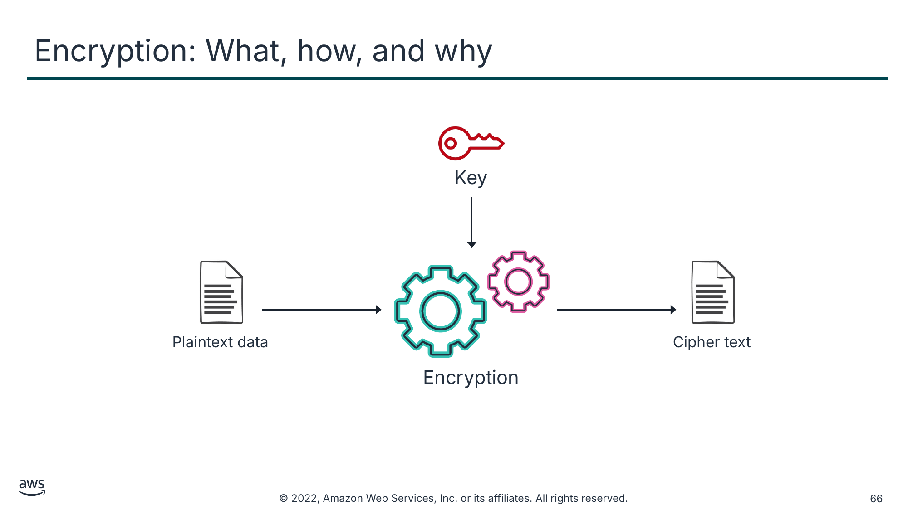

Текст зі схеми

Key (Ключ)

Encryption (Шифрування)

Plaintext data (Дані у відкритому вигляді)

Cipher text (Шифротекст)

> **Нотатки:**
>
> Шифрування працює за допомогою алгоритму з ключем, що перетворює дані у відкритому вигляді (відкритий текст, plaintext) на нечитабельні дані (шифротекст, ciphertext), які знову стають читабельними лише з правильним ключем. Наприклад, проста фраза «Hello World!» у зашифрованому вигляді може виглядати як «1c28df2b595b4e30b7b07500963dc7c».  
>
> Існує кілька різних алгоритмів шифрування, і всі вони використовують різні типи ключів. Надійний алгоритм шифрування спирається на математичні властивості, щоб створювати шифротекст, який неможливо розшифрувати за допомогою будь-якого практично доступного обсягу обчислювальної потужності без наявності необхідного ключа. Тому захист і керування ключами стають критично важливою частиною будь-якого рішення для шифрування.

---

## Слайд 67: Шифрування на стороні клієнта

<!-- hidden slide -->

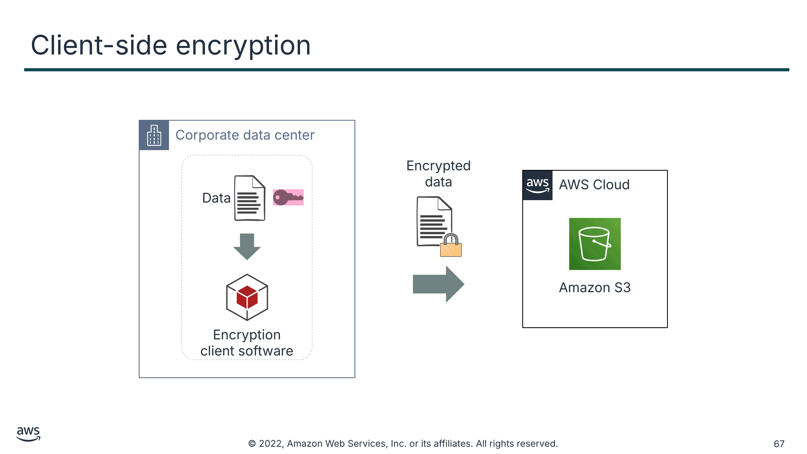

Текст зі схеми

Corporate data center (Корпоративний центр обробки даних)

Data (Дані)

Encryption

client software (Клієнтське програмне забезпечення шифрування)

Encrypted data (Зашифровані дані)

AWS Cloud

Amazon S3

> **Нотатки:**
>
> Шифрування на стороні клієнта відбувається до надсилання даних до AWS, а розшифрування — після отримання даних з AWS. Amazon S3 отримує ваші зашифровані дані, але не бере участі в їх шифруванні чи розшифруванні.  
>
> Щоб увімкнути шифрування на стороні клієнта, можна використовувати ключ, що зберігається в AWS KMS, або ключ, який ви зберігаєте у своєму застосунку.  
>
> AWS підтримує бібліотеки шифрування на стороні клієнта, як-от AWS Encryption SDK, Amazon DynamoDB Encryption Client та клієнти шифрування Amazon S3.

---

## Слайд 68: Серверне шифрування AWS

<!-- hidden slide -->

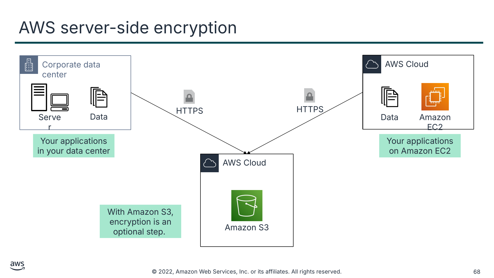

Server (Сервер)

Your applications in your data center (Ваші застосунки у вашому центрі обробки даних)

Your applications on Amazon EC2 (Ваші застосунки на Amazon EC2)

With Amazon S3, encryption is an optional step. (В Amazon S3 шифрування — необов’язковий крок.)

Текст зі схеми

Corporate data center (Корпоративний центр обробки даних)

Data (Дані)

AWS Cloud

Data

Amazon EC2

HTTPS

HTTPS

AWS Cloud

Amazon S3

> **Нотатки:**
>
> Серверне шифрування — це шифрування даних у місці призначення застосунком чи сервісом, що їх отримує. З серверним шифруванням AWS ваші вихідні дані надходять із систем у вашому центрі обробки даних або з екземпляра EC2. Ви можете завантажити ці дані через з’єднання HTTPS до будь-якого із сервісів AWS, що підтримують автоматичне серверне шифрування. Кінцева точка сервісу виконає процеси шифрування та керування ключами за вас.  
>
> В Amazon S3 шифрування — це необов’язковий крок, який ви вказуєте під час завантаження даних до сервісу.

---

## Слайд 69: Огляд шифрування

<!-- hidden slide -->

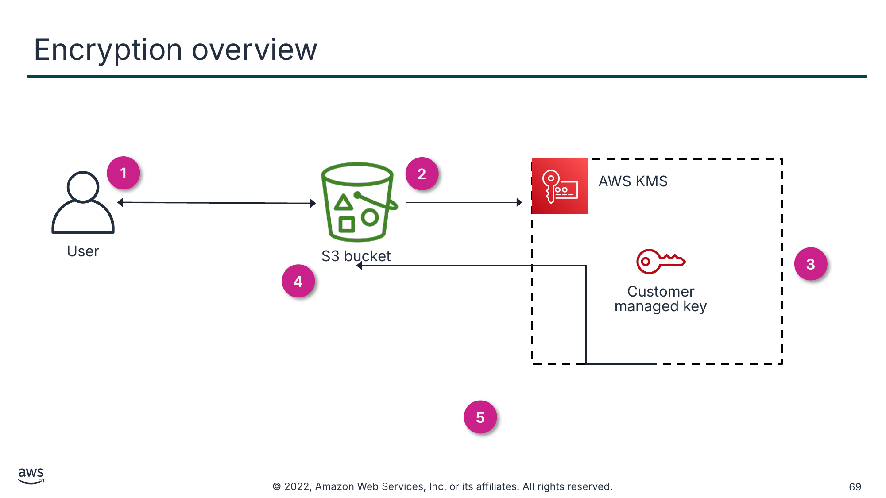

Текст зі схеми

**1**

**2**

AWS KMS

User (Користувач)

**3**

**4**

S3 bucket (Бакет S3)

Customer

managed key (Ключ, яким керує клієнт)

**5**

> **Нотатки:**
>
> У цьому сценарії AWS KMS використовується для шифрування даних у стані спокою (SSE-KMS). Користувач створює ключ KMS і використовує його для шифрування об’єктів, що зберігаються в Amazon S3.  
>
> Ця схема пояснює, як відбувається шифрування під час завантаження файлу в Amazon S3:  
> Ви надсилаєте запит на завантаження файлу та збереження його як зашифрованого об’єкта в бакеті S3.  
> Amazon S3 запитує в AWS KMS ключ даних для шифрування файлу.  
> AWS KMS генерує ключ даних у відкритому вигляді (plaintext) і шифрує ключ даних за допомогою ключа, яким керує клієнт (customer managed key).  
> AWS KMS надсилає обидві копії ключа даних в Amazon S3.  
> Amazon S3 шифрує об’єкт за допомогою ключа даних у відкритому вигляді, зберігає об’єкт, а потім видаляє ключ даних у відкритому вигляді. Зашифрований ключ зберігається в метаданих об’єкта.

---

## Слайд 70: Огляд розшифрування

<!-- hidden slide -->

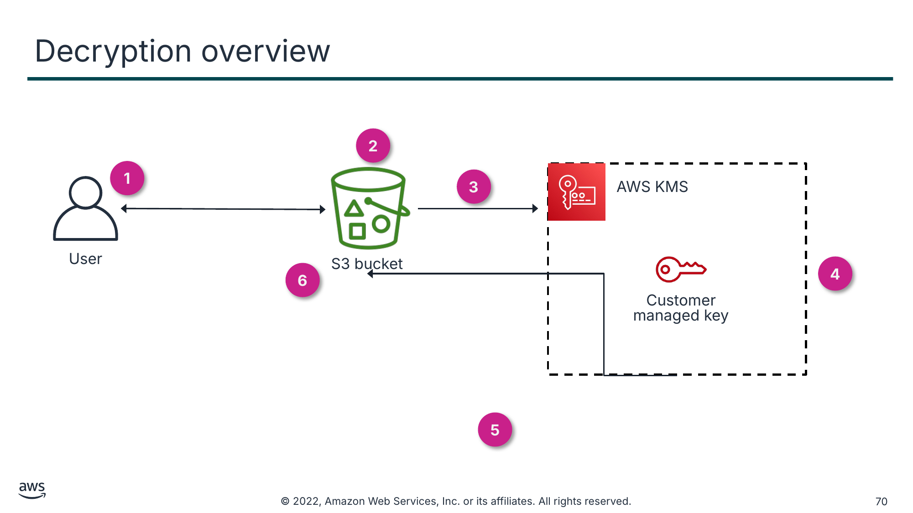

Текст зі схеми

**2**

**1**

**3**

AWS KMS

User (Користувач)

**4**

**6**

S3 bucket (Бакет S3)

Customer

managed key (Ключ, яким керує клієнт)

**5**

> **Нотатки:**
>
> Тепер ця схема пояснює, що відбувається в тому самому сценарії (SSE-KMS), коли користувач запитує відкрити зашифрований об’єкт, що зберігається в Amazon S3:  
> Ви запитуєте відкриття об’єкта.  
> Amazon S3 помічає, що запитаний об’єкт зашифровано.  
> Amazon S3 надсилає в AWS KMS зашифровану копію ключа даних, яким зашифровано об’єкт.  
> Потім AWS KMS розшифровує ключ даних за допомогою ключа, яким керує клієнт (який ніколи не залишає сервіс AWS KMS).  
> Далі AWS KMS надсилає ключ даних у відкритому вигляді назад в Amazon S3.  
> Нарешті, Amazon S3 розшифровує шифротекст об’єкта даних, дозволяє вам відкрити об’єкт і видаляє копію ключа даних у відкритому вигляді.

---

## Слайд 71: Приклад AWS KMS з Amazon EBS

<!-- hidden slide -->

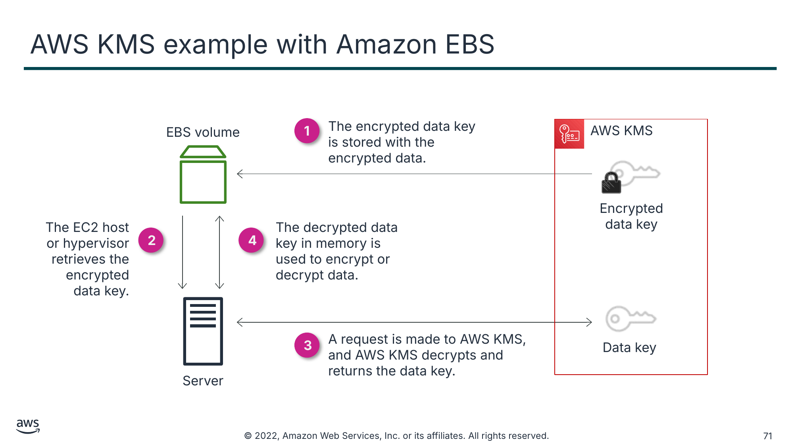

Текст зі схеми

**1**

The encrypted data key is stored with the encrypted data. (Зашифрований ключ даних зберігається разом із зашифрованими даними.)

EBS volume (Том EBS)

AWS KMS

Encrypted data key (Зашифрований ключ даних)

The EC2 host or hypervisor retrieves the encrypted data key. (Хост EC2 або гіпервізор отримує зашифрований ключ даних.)

The decrypted data key in memory is used to encrypt or decrypt data. (Розшифрований ключ даних у пам’яті використовується для шифрування або розшифрування даних.)

**2**

**4**

Server (Сервер)

Data key (Ключ даних)

**3**

A request is made to AWS KMS, and AWS KMS decrypts and returns the data key. (Виконується запит до AWS KMS, і AWS KMS розшифровує та повертає ключ даних.)

> **Нотатки:**
>
> Шифрування Amazon Elastic Block Store (Amazon EBS) — це зрозуміле рішення для шифрування ресурсів EBS, пов’язаних з вашими екземплярами EC2. З шифруванням Amazon EBS вам не потрібно будувати, підтримувати й захищати власну інфраструктуру керування ключами.  
>
> Шифрування Amazon EBS використовує ключі KMS під час створення зашифрованих томів і знімків. Кожен том шифрується за допомогою AES-256-XTS. Для цього потрібні два 256-бітні ключі, які можна розглядати як один 512-бітний ключ. Ключ даних шифрується ключем KMS у вашому акаунті. Щоб Amazon EBS міг зашифрувати том для вас, він повинен мати доступ до ключа, яким керує клієнт, в акаунті. Це робиться шляхом надання Amazon EBS гранту (grant) на ключ, яким керує клієнт, щоб створювати ключі даних та шифрувати й розшифровувати ці ключі даних.  
>
> Нижче наведено основні кроки шифрування та розшифрування даних тому EBS:  
> Amazon EBS отримує зашифрований ключ даних під ключем, яким керує клієнт, через AWS KMS і зберігає зашифрований ключ разом із зашифрованими даними.  
> Сервери, що розміщують екземпляри EC2, отримують зашифрований ключ даних зі сховища.  
> Виконується виклик AWS KMS через TLS для розшифрування зашифрованого ключа даних. AWS KMS визначає ключ KMS, робить внутрішній запит до HSM у парку, щоб розшифрувати ключ даних, і повертає ключ клієнтові через сеанс TLS.  
> Розшифрований ключ даних зберігається в пам’яті й використовується для шифрування та розшифрування всіх даних, що надходять до приєднаного тому EBS і з нього. Amazon EBS зберігає зашифрований ключ даних для подальшого використання на випадок, якщо ключ даних у пам’яті більше недоступний.

---

## Слайд 72: Захист даних під час передавання

<!-- hidden slide -->

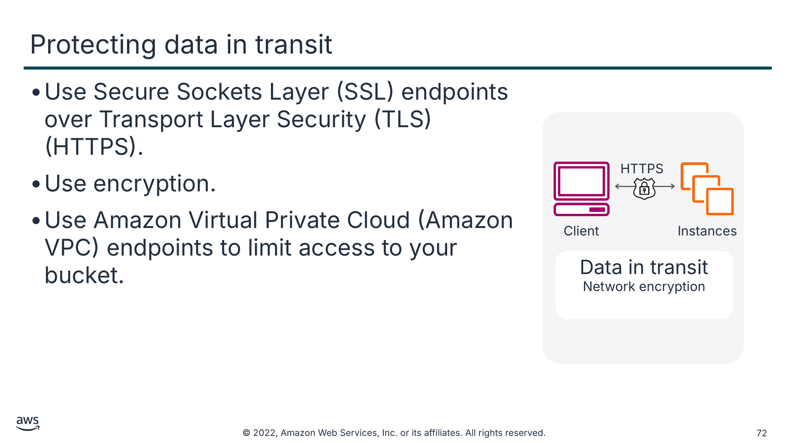

- Використовуйте кінцеві точки Secure Sockets Layer (SSL) поверх Transport Layer Security (TLS) (HTTPS).
- Використовуйте шифрування.
- Використовуйте кінцеві точки Amazon Virtual Private Cloud (Amazon VPC), щоб обмежити доступ до вашого бакета.

Текст зі схеми

HTTPS

Client (Клієнт)

Instances (Екземпляри)

Data in transit (Дані під час передавання)

Network encryption (Шифрування мережі)

> **Нотатки:**
>
> Ви можете захищати дані під час передавання за допомогою Secure Sockets Layer (SSL) або шифрування на стороні клієнта. Ви можете безпечно завантажувати свої дані в Amazon S3 або з нього через кінцеві точки SSL за допомогою протоколу HTTPS. Шифрування на стороні клієнта захищатиме ваші дані під час передавання, оскільки дані шифруються до їх надсилання в Amazon S3.  
>
> Також можна обмежити доступ до бакета S3 з певної кінцевої точки Amazon Virtual Private Cloud (Amazon VPC) або набору кінцевих точок за допомогою політик бакетів S3.  
>
> Щоб захистити дані під час передавання, AWS заохочує клієнтів використовувати багаторівневий підхід. Увесь мережевий трафік між центрами обробки даних AWS прозоро шифрується на фізичному рівні. Увесь трафік усередині VPC і між пірингованими VPC у регіонах AWS прозоро шифрується на мережевому рівні за використання підтримуваних типів екземплярів EC2. На рівні застосунку клієнти мають вибір, чи використовувати шифрування та як саме, за допомогою протоколу на кшталт Transport Layer Security (TLS). Усі кінцеві точки сервісів AWS підтримують TLS для створення захищеного з’єднання HTTPS для виконання запитів API.

---

## Слайд 73: AWS Certificate Manager Private Certificate Authority

<!-- hidden slide -->

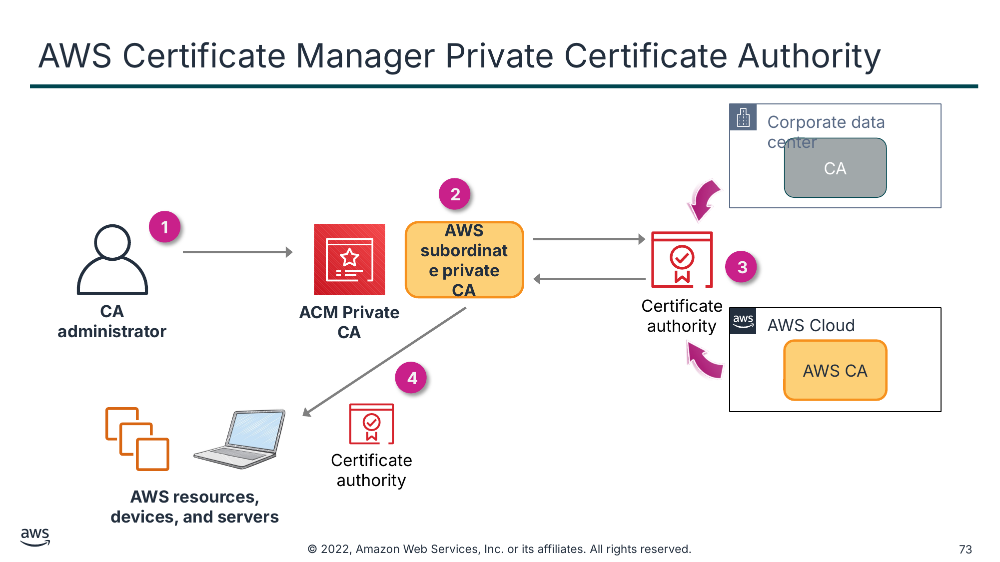

Текст зі схеми

Corporate data center (Корпоративний центр обробки даних)

CA

**2**

**CA administrator (Адміністратор CA)**

**1**

**ACM Private CA**

**AWS subordinate private CA (Підпорядкований приватний CA AWS)**

Certificate

authority (Центр сертифікації)

**3**

AWS Cloud

AWS CA

**4**

**AWS resources, devices, and servers (Ресурси, пристрої та сервери AWS)**

Certificate

authority

> **Нотатки:**
>
> За допомогою AWS Certificate Manager Private Certificate Authority можна створювати ієрархії приватних центрів сертифікації (certificate authority, CA), зокрема кореневі та підпорядковані (subordinate) CA, без інвестицій і витрат на обслуговування, пов’язаних з експлуатацією локального CA. Ваші приватні CA можуть випускати сертифікати кінцевих сутностей X.509, які корисні в таких сценаріях:  
> Створення зашифрованих каналів зв’язку TLS  
> Автентифікація користувачів, комп’ютерів, кінцевих точок API та пристроїв IoT  
> Криптографічний підпис коду  
> Впровадження Online Certificate Status Protocol (OCSP) для отримання статусу відкликання сертифіката  
>
> ACM Private CA призначений для корпоративних клієнтів, що будують інфраструктуру відкритих ключів (public key infrastructure, PKI) усередині хмари AWS. Сервіс призначений для приватного використання всередині організації. З ACM Private CA можна створити власну ієрархію CA та випускати за її допомогою сертифікати для автентифікації внутрішніх користувачів, комп’ютерів, застосунків, сервісів, серверів та інших пристроїв, а також для підпису комп’ютерного коду. Сертифікати, що їх випускає приватний CA, є довіреними лише всередині вашої організації, а не в інтернеті. Після створення приватного CA ви можете випускати сертифікати безпосередньо (тобто без отримання валідації від стороннього CA) та налаштовувати їх відповідно до внутрішніх потреб вашої організації.  
>
> Схема показує ACM Private CA в дії:  
> Адміністратор CA створює підпорядкований CA для випуску сертифікатів.  
> Підпорядкований CA надсилає сертифікат на підписання.  
> Локальний CA або CA AWS підписує сертифікат.  
> ACM Private CA випускає підписаний сертифікат для ресурсів.

---

## Слайд 74: Використання Secrets Manager

<!-- hidden slide -->

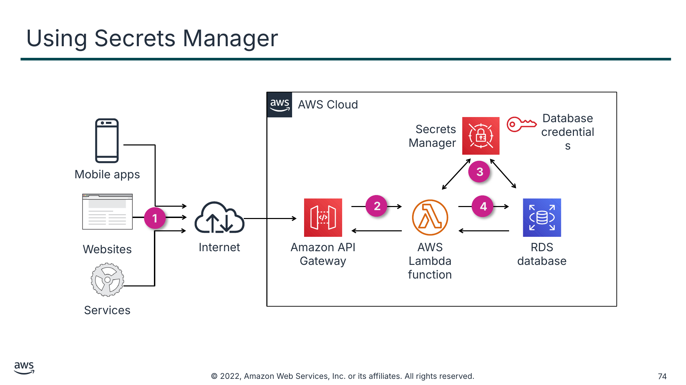

Текст зі схеми

AWS Cloud

Database credentials (Облікові дані бази даних)

Mobile apps (Мобільні застосунки)

Secrets Manager

**3**

Websites (Вебсайти)

Internet (Інтернет)

Amazon API Gateway

**2**

AWS Lambda function (Функція AWS Lambda)

**4**

RDS

database (База даних RDS)

**1**

Services (Сервіси)

> **Нотатки:**
>
> Ця схема показує, як використовувати Secrets Manager для захисту облікових даних бази даних. Підхід використовує функцію AWS Lambda, що використовує облікові дані з Secrets Manager для підключення до бекенд-бази даних Amazon Relational Database Service (Amazon RDS) і виконання запитів до неї. Це робиться без жорсткого кодування секретів у коді чи передавання їх через змінні середовища. Цей підхід допомагає захистити секрети «останньої милі» (last-mile secrets) і ваші бекенд-бази даних.  
>
> Кроки цього робочого процесу такі:  
> Клієнти викликають RESTful API, що розміщений в Amazon API Gateway.  
> API Gateway запускає функцію Lambda.  
> Функція Lambda отримує секрети бази даних за допомогою API Secrets Manager. Secrets Manager отримує секрет, розшифровує захищений текст секрету та повертає його функції через захищений канал.  
> Функція Lambda підключається до бази даних Amazon RDS за допомогою секретів бази даних із Secrets Manager і повертає результати запиту.  
>
> Докладніше див. «Як безпечно надавати облікові дані бази даних функціям Lambda за допомогою AWS Secrets Manager» (How to Securely Provide Database Credentials to Lambda Functions by Using AWS Secrets Manager) у блозі AWS Security Blog за адресою https://aws.amazon.com/blogs/security/how-to-securely-provide-database-credentials-to-lambda-functions-by-using-aws-secrets-manager.

---

## Слайд 75: Ротація секретів

<!-- hidden slide -->

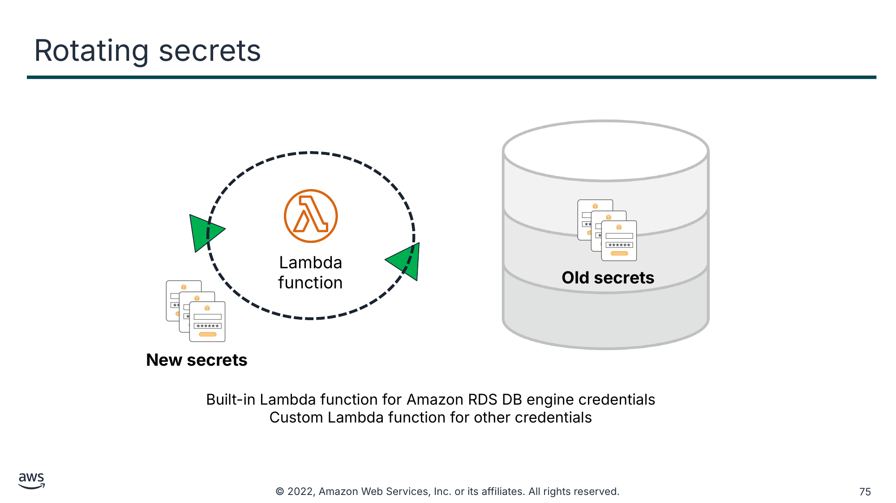

Built-in Lambda function for Amazon RDS DB engine credentials (Вбудована функція Lambda для облікових даних рушія БД Amazon RDS)

Custom Lambda function for other credentials (Власна функція Lambda для інших облікових даних)

Текст зі схеми

Lambda function (Функція Lambda)

**Old secrets (Старі секрети)**

**New secrets (Нові секрети)**

> **Нотатки:**
>
> З Secrets Manager ви можете автоматично змінювати (ротація) паролі для баз даних Amazon Aurora, MySQL, MariaDB, PostgreSQL та Oracle, розміщених в AWS. Щоб увімкнути автоматичну ротацію, потрібні дозволи адміністратора. Ця ротація виконується без втручання людини через функцію Lambda — за розкладом, який ви вказуєте, або за потреби. Для облікових даних рушія БД Amazon RDS ця функція Lambda вже існує, але якщо у вас є інші облікові дані з терміном дії, як-от вхід SAML, можливо, ви захочете створити власну функцію для використання з Secrets Manager.  
>
> Функція ротації виконує роботу зі зміни секрету. Процес ротації секрету складається з чотирьох кроків, що відповідають чотирьом крокам у функції ротації Lambda. Secrets Manager використовує проміжні мітки (staging labels), щоб позначати версії секрету під час ротації:  
> Функція звертається до БД за новими обліковими даними.  
> Secrets Manager зберігає нові облікові дані з міткою AWSPENDING.  
> Нові облікові дані тестуються.  
> Нові облікові дані робляться типовими з міткою AWSCURRENT.
