## Слайд 1: Responding to and Managing an Incident

AWS Academy Cloud Security Foundations

> **Нотатки:**
>
> Welcome to the Responding to and Managing an Incident module.

---

## Слайд 2: Introduction

Responding to and Managing an Incident

> **Нотатки:**
>
> This first section provides an introduction to the module.

---

## Слайд 3: Module objectives

At the end of this module, you should be able to do the following:

- Identify an incident.
- Describe Amazon Web Services (AWS) services that are used for incident recognition and remediation.
- Identify best practices for incident response.

> **Нотатки:**
>
> At the end of this module, you should be able to do the following:  
> Identify an incident.  
> Describe Amazon Web Services (AWS) services that are used for incident recognition and remediation.  
> Identify best practices for incident response.

---

## Слайд 4: Module overview

**Sections**

- Identifying an incident
- AWS services that support the discovery and recognition phase
- AWS services that support the resolution and recovery phase
- Best practices for handling an incident

**Lab**

- Remediating an Incident by Using AWS Config and Lambda

**Knowledge check**

> **Нотатки:**
>
> This module includes the following sections:  
> Identifying an incident  
> AWS services that support the discovery and recognition phase  
> AWS services that support the resolution and recovery phase  
> Best practices for handling an incident  
>
> This module also includes a lab about remediating an incident by using AWS Config and AWS Lambda.  
>
> Finally, you will be asked to complete a knowledge check that will test your understanding of key concepts covered in this module.

---

## Слайд 5: Bank business scenario (1 of 3)

> **Нотатки:**
>
> Let’s discuss how the concepts in this module are applicable to the bank business scenario.

---

## Слайд 6: Bank business scenario (2 of 3)

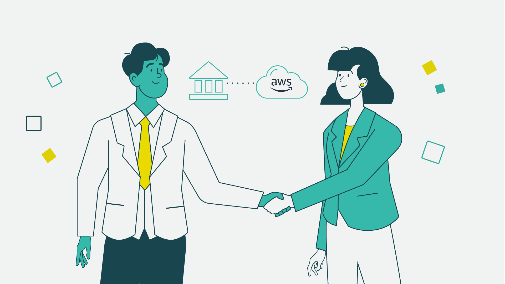

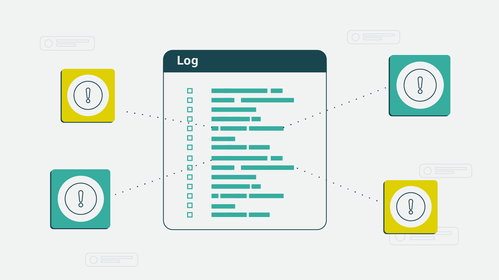

> **Нотатки:**
>
> After discussing the various services that can be used to address threats, John announced to María that he’s on board. She has his full support and the support of the board to begin preparing for migration to the AWS Cloud. María is delighted, but she knows there’s something else that needs to be addressed so they can be fully prepared.  
>
> María knows that securing resources in the cloud is a job that’s never fully complete.

---

## Слайд 7: Bank business scenario (3 of 3)

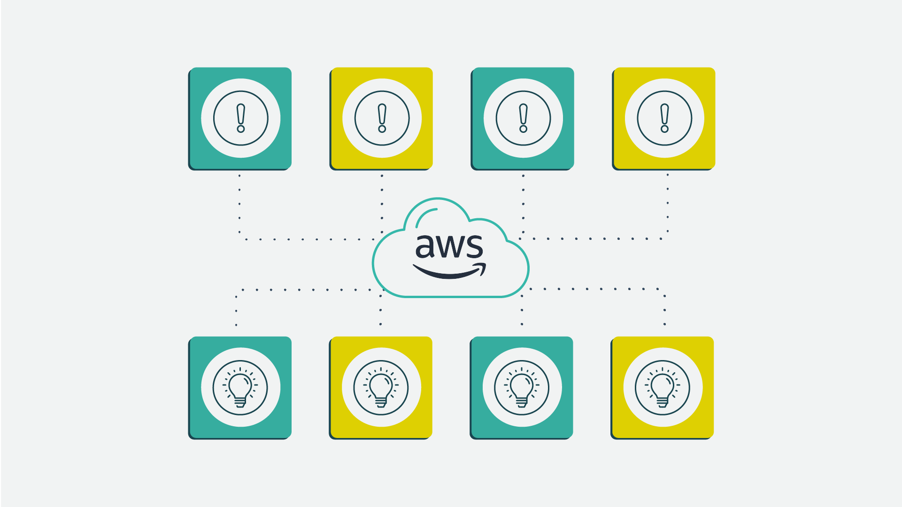

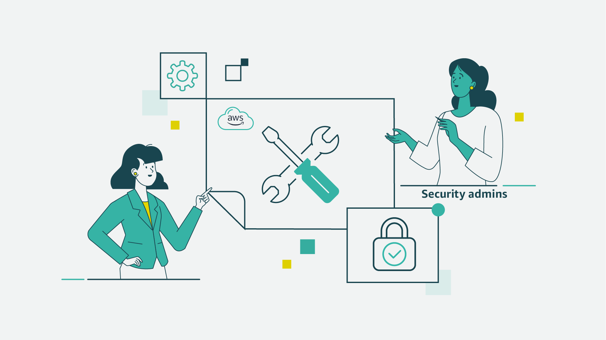

> **Нотатки:**
>
> Because of the migration, the bank’s incident response plan needs to be reviewed and updated.  
>
> The plan needs to include the new tools and methods that their security administrators will use. And that’s María’s next project!

---

## Слайд 8: Shared responsibility model

> **Нотатки:**
>
> For accessibility: Shared responsibility model listing customer and AWS responsibilities. Customer is responsible for security in the cloud. This includes customer data. Platform, applications, identity and access management. Operating system, network, and firewall configuration. Client-side data encryption and data integrity, authentication. Server-side encryption of file system and data. Networking traffic protection, to include encryption, integrity, and identity. AWS is responsible for security of the cloud. This includes the AWS foundation services for compute, storage, databases, and networking. And the AWS Global Infrastructure, to include Regions, Availability Zones, and Edge Locations. End of accessibility description.  
>
> Now that we’ve covered the tools that AWS provides to help you log and monitor access, let’s take a look at how to respond to a security incident.

---

## Слайд 9: Identifying an incident

Responding to and Managing an Incident

> **Нотатки:**
>
> This section covers how to identify an incident.

---

## Слайд 10: Incident recognition and response

- Is a set of information security policies and procedures that you can use to identify, contain, and eliminate cyberattacks
- Enables an organization to quickly detect and halt attacks
- Helps you to minimize damage and prevent future attacks

> **Нотатки:**
>
> Incident response is a set of information security policies and procedures that you can use to identify, contain, and eliminate cyberattacks.  
>
> The goal of incident response is to enable an organization to quickly detect and halt attacks, which helps to minimize damage and prevent future attacks of the same type.

---

## Слайд 11: Recognizing incidents

**Not all events are incidents in need of immediate remedy.**

- Logging in from a remote location
- Failing hard drive that is still fully operational
- Employee trying to access resources that they shouldn't access

> **Нотатки:**
>
> How would an enterprise know if abuse was taking place? How would they differentiate between abnormal events that need their attention, and incidents that need immediate analysis and remediation?  
>   
> Not all events are incidents in need of immediate remedy. Let’s take a look at a few examples of such events:  
> Logging in from a remote location: An employee might be traveling or using an approved virtual private network (VPN).  
> Failing hard drive that is still fully operational: Knowing this information allows an enterprise to timely schedule a cycling of the drives without panicking and hot swapping when it's too late and has already failed. Hot swapping is the act of removing components from or plugging them into a computer system while the power remains switched on.  
> Employee trying to access resources that they shouldn't access: Although this might not constitute a breach if the access was denied, it's still a behavioral insight that you should monitor.

---

## Слайд 12: Phase 1: Discovery and recognition

- Incident identification, logging, and categorization
- Incident notification and escalation
- Investigation and diagnosis

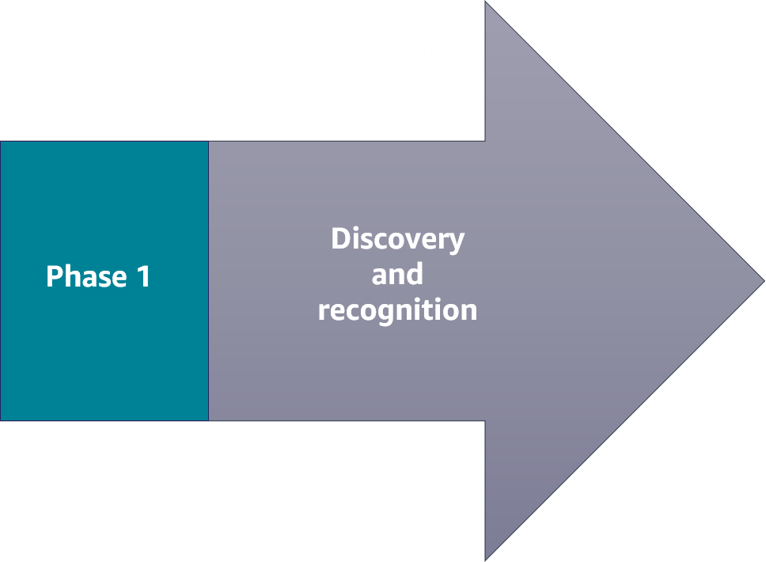

> **Нотатки:**
>
> Incident response has two phases. The first phase is the discovery and recognition phase. Here is where incident identification, logging, and categorization of the incident takes place. Once an incident is identified through user reports, solution analyses, or manual identification, the incident is logged and an investigation and categorization can begin.  
>
> During this phase, a notification is received. Notifications are set up by the user and initiated by specified alerts to send an email, SMS text, or push notification through a mobile app. Incident escalation is what happens when an employee can’t resolve an incident themselves and needs to hand off the task to a more experienced or specialized employee.  
>
> Investigation and diagnosis includes conducting an incident investigation to gather answers and develop strategies to resolve any threats.  
>
> AWS offers a range of services and products that help companies discover and identify events that could lead to, or have already become, an incident.

---

## Слайд 13: Phase 2: Resolution and recovery

- Forensic isolation (if software, reproduce the bug)
- Stage a fix
- Deploy the fix
- Incident closure

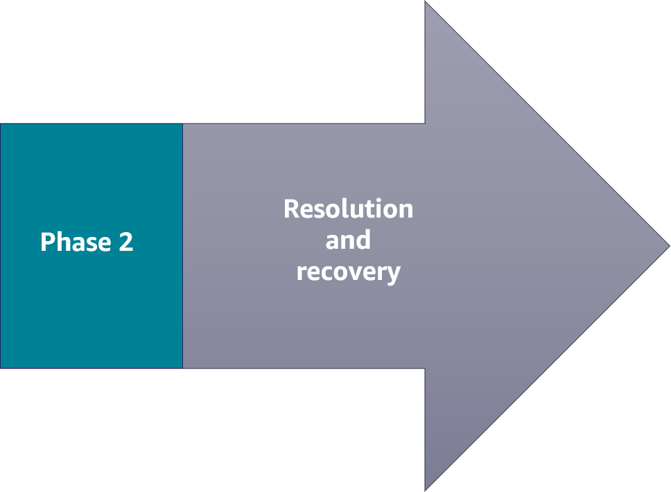

Automate theses processes wherever possible, and run game days in staging (safe) environments to fine-tune your corporate-wide incident response process.

> **Нотатки:**
>
> When an enterprise has identified the failure of a component, a reduction in quality of service, or an exploit in need of remedy, they move into the resolution and recovery phase of incident response.  
>   
> This second phase consists of the following:  
> Forensic isolation: Isolate the incident, and perform a deep dive to discover the issue. Forensics often requires capturing the disk image or as-is configuration of an operating system. The problem might be a bug in the code base. If so, then you need to reproduce the error. Without being able to reproduce the error that the customer experienced, you won't be able to fix it.  
> Staging a fix: Reproduce the issue, apply a fix, and test.  
> Deploying the fix: Push any new infrastructure, as code, or any new application code to production.  
> Incident closure: Resolve the incident.  
>
> AWS offers a range of services and products that help companies remediate an incident.

---

## Слайд 14: Key takeaways: Identifying an incident

- Incident response is a set of information security policies and procedures that you can use to identify, contain, and eliminate cyberattacks.
- Not all events are incidents in need of immediate remedy.
- The first phase of an incident is the discovery and recognition phase.
- The second phase of an incident is the resolution and recovery phase.

> **Нотатки:**
>
> Key takeaways from this section of the module include the following:  
> Incident response is a set of information security policies and procedures that you can use to identify, contain, and eliminate cyberattacks.  
> Not all events are incidents in need of immediate remedy.  
> The first phase of an incident is the discovery and recognition phase.  
> The second phase of an incident is the resolution and recovery phase.

---

## Слайд 15: AWS services that support the discovery and recognition phase

Responding to and Managing an Incident

> **Нотатки:**
>
> This section highlights a few AWS services that support the discovery and recognition phase. Note that these are not all the AWS services available.

---

## Слайд 16: Discovery and recognition phase

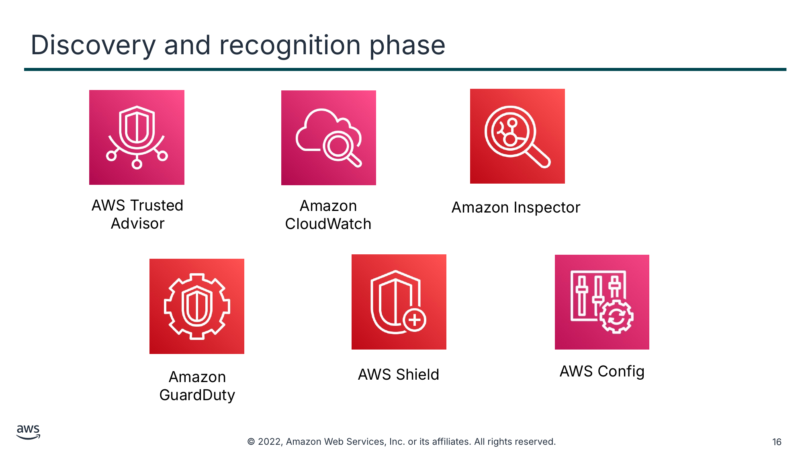

Текст зі схеми

AWS Trusted Advisor

Amazon Inspector

Amazon CloudWatch

AWS Shield

AWS Config

Amazon GuardDuty

> **Нотатки:**
>
> AWS offers several services that support incident discovery and recognition. These services help an enterprise to identify an attack.  
>
> This section will describe the following services in more detail and how they support this phase of incident response:  
> AWS Trusted Advisor  
> Amazon CloudWatch  
> Amazon Inspector  
> Amazon GuardDuty  
> AWS Shield  
> AWS Config

---

## Слайд 17: AWS Trusted Advisor

- Draws upon best practices learned from serving hundreds of thousands of AWS customers
- Inspects your AWS environment, and then makes recommendations when opportunities exist to improve performance and help close security gaps

AWS Trusted Advisor

> **Нотатки:**
>
> The AWS Trusted Advisor service draws upon best practices learned from serving hundreds of thousands of AWS customers. Trusted Advisor inspects your AWS environment, and then makes recommendations when opportunities exist to improve performance and help close security gaps.  
>
> If you have an AWS Basic Support or Developer Support plan, you can use the AWS Management Console to access core security checks and all checks for service quotas. If you have a Business, Enterprise On-Ramp, or Enterprise Support plan, you can use the console, AWS Support API, and AWS Command Line Interface (AWS CLI) to access all checks, including cost optimization, security, fault tolerance, performance, and service quotas.  
>
> You also can use Amazon EventBridge to monitor the status of Trusted Advisor checks.  
>
> For more information, see AWS Trusted Advisor in the AWS Support User Guide at https://docs.aws.amazon.com/awssupport/latest/user/trusted-advisor.html.

---

## Слайд 18: Amazon CloudWatch

- Provides a reliable, scalable, and flexible monitoring solution that you can start using within minutes
- Automatically displays metrics about every AWS service that you use
- Provides the ability to create alarms that watch metrics and send notifications

Amazon CloudWatch

> **Нотатки:**
>
> Amazon CloudWatch provides a reliable, scalable, and flexible monitoring solution that you can start using within minutes. By using this service, you don't need to set up, manage, and scale your own monitoring systems and infrastructure.  
>
> The CloudWatch console home page automatically displays metrics about every AWS service that you use. You can additionally create custom dashboards to display metrics about your custom applications and display custom collections of metrics that you choose.  
>
> You can create alarms that watch metrics and send notifications or automatically make changes to the resources you are monitoring when a threshold is breached.  
>
> With CloudWatch, you gain system-wide visibility into resource utilization, application performance, and operational health.  
>
> For more information, see the Amazon CloudWatch User Guide at https://docs.aws.amazon.com/AmazonCloudWatch/latest/monitoring/WhatIsCloudWatch.html.

---

## Слайд 19: Amazon Inspector

- Is a vulnerability management service that continuously scans your AWS workloads for vulnerabilities
- Automatically discovers and scans Amazon Elastic Compute Cloud (Amazon EC2) instances and container images that reside in Amazon Elastic Container Registry (Amazon ECR)
- Creates a finding when it discovers a vulnerability or network issue

Amazon Inspector

> **Нотатки:**
>
> Amazon Inspector is a vulnerability management service that continuously scans your AWS workloads for vulnerabilities. Amazon Inspector automatically discovers and scans Amazon Elastic Compute Cloud (Amazon EC2) instances and container images that reside in Amazon Elastic Container Registry (Amazon ECR) for software vulnerabilities and unintended network exposure.  
>
> When Amazon Inspector discovers a software vulnerability or network issue, the service creates a finding. A finding describes the vulnerability, identifies the affected resource, rates the severity of the vulnerability, and provides remediation guidance.  
>
> For more information, see the Amazon Inspector User Guide at https://docs.aws.amazon.com/inspector/latest/user/what-is-inspector.html.

---

## Слайд 20: Amazon GuardDuty

- Is a continuous security monitoring service
- Identifies unexpected and potentially unauthorized or malicious activity
- Uses threat intelligence feeds

Amazon GuardDuty

> **Нотатки:**
>
> Amazon GuardDuty is a continuous security monitoring service. It can help to identify unexpected and potentially unauthorized or malicious activity in your AWS environment.  
>
> The service uses threat intelligence feeds, such as lists of malicious IP addresses and domains, and machine learning to identify unexpected and potentially unauthorized and malicious activity within your AWS environment. This can include issues such as escalations of privileges, use of exposed credentials, or communication with malicious IP addresses or domains. For example, GuardDuty can detect compromised EC2 instances serving malware or mining bitcoin. The service also monitors AWS account access behavior for signs of compromise, such as unauthorized infrastructure deployments (for example, instances being deployed in a Region that has never been used) and unusual API calls (for example, a password policy change to reduce password strength).  
>
> For more information, see the Amazon GuardDuty User Guide at https://docs.aws.amazon.com/guardduty/latest/ug/what-is-guardduty.html.

---

## Слайд 21: AWS Shield

- Automatically protects an enterprise network from a distributed denial of service (DDoS) attack
- Offers the AWS Shield Advanced managed threat protection service to improve your security posture with additional DDoS detection, mitigation, and response capabilities

AWS Shield

> **Нотатки:**
>
> AWS Shield helps protect an enterprise network against a distributed denial of service (DDoS) attack. A DDoS attack is a malicious attempt to disrupt the normal traffic of a targeted server, service, or network by overwhelming the target or its surrounding infrastructure with a flood of internet traffic. From a high level, a DDoS attack is like an unexpected traffic jam clogging up the highway, preventing regular traffic from arriving at its destination.  
>
> When you build your application on AWS, you receive automatic protection against common DDoS attacks. Additionally, you can use the AWS Shield Advanced managed threat protection service to improve your security posture with additional DDoS detection, mitigation, and response capabilities.  
>
> For more information, see AWS Shield in the AWS WAF, AWS Firewall Manager, and AWS Shield Advanced Developer Guide at https://docs.aws.amazon.com/waf/latest/developerguide/shield-chapter.html.

---

## Слайд 22: AWS Config

- Is a continuous monitoring and assessment service
- Provides the ability to view current and historic configurations of a resource and use this information to troubleshoot outages
- Sends notifications when changes occur
- Integrates with other AWS services to remediate issues

AWS Config

> **Нотатки:**
>
> AWS Config is a continuous monitoring and assessment service that provides you with an inventory of your AWS resources and records changes to the configuration of those resources. You can view current and historic configurations of a resource, and use this information to troubleshoot outages and conduct security attack analyses. You can also view the configuration at any point in time and use that information to reconfigure your resources and bring them into a steady state during an outage situation.  
>
> AWS Config sends notifications when changes occur, and integrates with other AWS services to remediate issues.  
>
> For more information, see the AWS Config User Guide at https://docs.aws.amazon.com/config/latest/developerguide/WhatIsConfig.html.

---

## Слайд 23: Evaluating rules

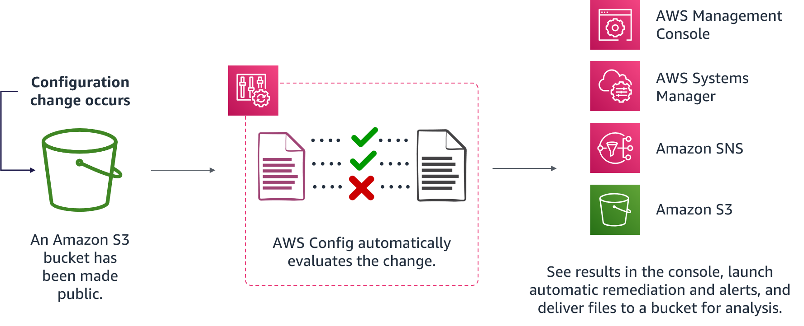

> **Нотатки:**
>
> For accessibility: Diagram of evaluating AWS Config rules. A configuration change occurs. In this example, an S3 bucket has been made public. AWS Config automatically evaluates the change. Results can be viewed in the console. Systems Manager and Amazon SNS are used to invoke automatic remediation and alerts. Files are delivered to an S3 bucket for analysis. End of accessibility description.  
>
> As configuration changes occur in your AWS resources, AWS Config records and normalizes the changes into a consistent format. AWS Config automatically evaluates the recorded changes against the rules that you have set. You can then access the change history and compliance results by using the console or API. You can configure Systems Manager or Amazon SNS to be invoked, and remediate or alert you when changes happen. You can also deliver the change history and snapshot files of the monitored resources to an S3 bucket for analysis.

---

## Слайд 24: Key takeaways: AWS services that support the discovery and recognition phase

AWS offers several services that support the discovery and recognition phase, including the following:

- Trusted Advisor
- CloudWatch
- AWS Config
- Amazon Inspector
- Shield
- GuardDuty

> **Нотатки:**
>
> A key takeaway from this section of the module is that AWS offers several services that support the discovery and recognition phase, including the following:  
> Trusted Advisor inspects your AWS environment, and then makes recommendations when opportunities exist to save money, improve system availability and performance, or help close security gaps.  
> CloudWatch provides a reliable, scalable, and flexible monitoring solution.  
> AWS Config is a continuous monitoring and assessment service that provides you with an inventory of your AWS resources and records changes to the configuration of those resources.  
> Amazon Inspector is a vulnerability management service that continuously scans your AWS workloads for vulnerabilities.  
> Shield offers protection against DDoS attacks.  
> GuardDuty is a continuous security monitoring service that can help to identify unexpected and potentially unauthorized or malicious activity in your AWS environment.

---

## Слайд 25: AWS services that support the resolution and recovery phase

Responding to and Managing an Incident

> **Нотатки:**
>
> This section highlights a few services that support the resolution and recovery phase. Note that these are not all the AWS services available.

---

## Слайд 26: Resolution and recovery

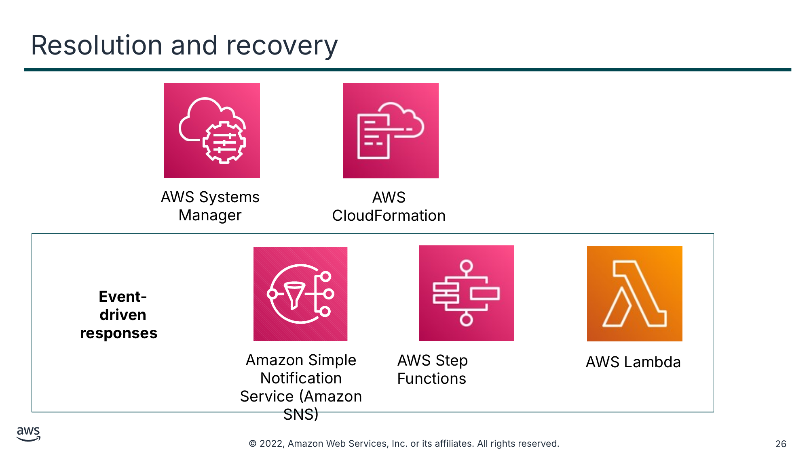

Текст зі схеми

AWS Systems Manager

AWS CloudFormation

**Event-driven responses**

Amazon Simple Notification Service (Amazon SNS)

AWS Step Functions

AWS Lambda

> **Нотатки:**
>
> AWS offers several different services that help with resolution and recovery.  
>
> This section will describe the following services in more detail and how they support this phase of incident response:  
> AWS Systems Manager  
> AWS CloudFormation  
> Amazon Simple Notification Service (Amazon SNS)  
> AWS Step Functions  
> AWS Lambda  
>
> Lambda, Amazon SNS, and Step Functions are all event-driven response services. An event-driven response is a computer program that is written to respond to actions generated by the user or the system.

---

## Слайд 27: AWS Systems Manager

- Gives you visibility and control of your infrastructure on AWS
- Provides a unified user interface so that you can view operational data from multiple AWS services
- Provides the ability to group resources by application and view operational data for monitoring and troubleshooting
- Helps you to keep your instances in their defined state and perform on-demand changes, such as updating applications or running shell scripts

AWS Systems Manager

> **Нотатки:**
>
> AWS Systems Manager gives you visibility and control of your infrastructure on AWS. Systems Manager provides a unified user interface so you can view operational data from multiple AWS services and automate operational tasks across your AWS resources. With Systems Manager, you can group resources by application, view operational data for monitoring and troubleshooting, and take action on your groups of resources. Systems Manager can help you to keep your instances in their defined state and perform on-demand changes, such as updating applications or running shell scripts. The service can also help you to perform other automation and patching tasks.  
>
> For more information, see the AWS Systems Manager User Guide at https://docs.aws.amazon.com/systems-manager/latest/userguide/what-is-systems-manager.html.

---

## Слайд 28: AWS CloudFormation

- Helps you model and set up your AWS resources so that you can spend less time managing those resources and more time focusing on your applications that run in AWS
- Provides the ability to create a template that describes all the AWS resources that you want
- Can be used to re-create a staging environment inside an isolated, or forensic, virtual private cloud (VPC)

AWS CloudFormation

> **Нотатки:**
>
> AWS CloudFormation is a service that helps you model and set up your AWS resources so that you can spend less time managing those resources and more time focusing on your applications that run in AWS. You create a template that describes all the AWS resources that you want, and CloudFormation takes care of provisioning and configuring those resources for you. You don't need to individually create and configure AWS resources and figure out what's dependent on what; CloudFormation handles that.  
>
> An enterprise can use CloudFormation to recreate a staging environment inside an isolated, or forensic, virtual private cloud (VPC). Once the system is isolated, the team can deep dive and discover the issue, possibly reproduce the issue, apply a fix, and test. Then, the team can push any new infrastructure, as code, or any new application code to production.  
>
> For more information, see the AWS CloudFormation User Guide at https://docs.aws.amazon.com/AWSCloudFormation/latest/UserGuide/Welcome.html.

---

## Слайд 29: Amazon Simple Notification Service (Amazon SNS)

- Is an event-driven web service that provides the ability for applications, end users, and devices to instantly send and receive notifications from the cloud

Amazon Simple Notification Service (Amazon SNS)

> **Нотатки:**
>
> Amazon Simple Notification Service (Amazon SNS) is an event-driven web service that provides the ability for applications, end users, and devices to instantly send and receive notifications from the cloud.  
>
> Amazon SNS and Lambda are integrated, so you can invoke Lambda functions with Amazon SNS notifications. When a message is published to an Amazon SNS topic that has a Lambda function subscribed to it, the Lambda function is invoked with the payload of the published message. The Lambda function receives the message payload as an input parameter and can manipulate the information in the message, publish the message to other SNS topics, or send the message to other AWS services.  
>
> An enterprise can use Amazon SNS to receive notifications of potential exploits.  
>
> For more information, see the Amazon Simple Notification Service Developer Guide at https://docs.aws.amazon.com/sns/latest/dg/welcome.html.

---

## Слайд 30: AWS Step Functions

- Is a visual workflow service that developers use to build distributed applications, and automate IT and business processes
- Provides the ability to create event-driven workflows to manage failures, retries, parallelization, service integrations, and observability so that developers can focus on higher value business logic

AWS Step Functions

> **Нотатки:**
>
> AWS Step Functions is a low-code, visual workflow service that developers use to build distributed applications, automate IT and business processes, and build data and machine learning pipelines using AWS services. Event-driven workflows manage failures, retries, parallelization, service integrations, and observability so that developers can focus on higher value business logic.  
>
> When an enterprise experiences abnormalities, implementing Step Functions can help you to create complex business logic in event-driven workflows that connect services, systems, or people within minutes.  
>
> For more information, see the AWS Step Functions Developer Guide at https://docs.aws.amazon.com/step-functions/latest/dg/welcome.html.

---

## Слайд 31: AWS Lambda

- Is a serverless, event-driven compute service that provides the ability to run code on demand without provisioning or managing servers
- Lambda functions are stateless

AWS Lambda

> **Нотатки:**
>
> AWS Lambda is a serverless, event-driven compute service that provides the ability to run code on demand without provisioning or managing servers. You pay only for the compute time that you consume, and you aren't charged when your code is not running. With Lambda, you can run code for virtually any type of application or backend service, all with no administration. Just upload your code, and Lambda takes care of everything required to run and scale your code with high availability. You can set up your code to be automatically invoked from other AWS services or call it directly from any web or mobile app.  
>
> Lambda functions are stateless, with no affinity to the underlying infrastructure. This means that Lambda can rapidly launch as many copies of the function as needed to scale to the rate of incoming events. After you upload your code to Lambda, you can associate your function with specific AWS resources, such as a particular Amazon Simple Storage Service (Amazon S3) bucket or SNS topic. Then, when the resource changes, Lambda runs your function and manages the compute resources as needed to keep up with incoming requests.  
>
> If you need to store secrets to access external services, you can use the AWS Key Management Service (AWS KMS) to store and retrieve the secrets within your Lambda function.  
>
> How a Lambda function is invoked depends on the event source that you use with it:  
> For event-based invocation, some event sources can publish events to Lambda and directly invoke your Lambda function. This is called the push model, where the event sources invoke your Lambda function.  
> Some event sources publish events, but Lambda must poll the event source and invoke your Lambda function when events occur. This is called the pull model.  
> Request-response invocation causes Lambda to run the function synchronously and return the response immediately to the calling application. This invocation type is available for custom applications.  
>
> For more information, see the AWS Lambda Developer Guide at https://docs.aws.amazon.com/lambda/latest/dg/welcome.html.

---

## Слайд 32: Lambda for incident response

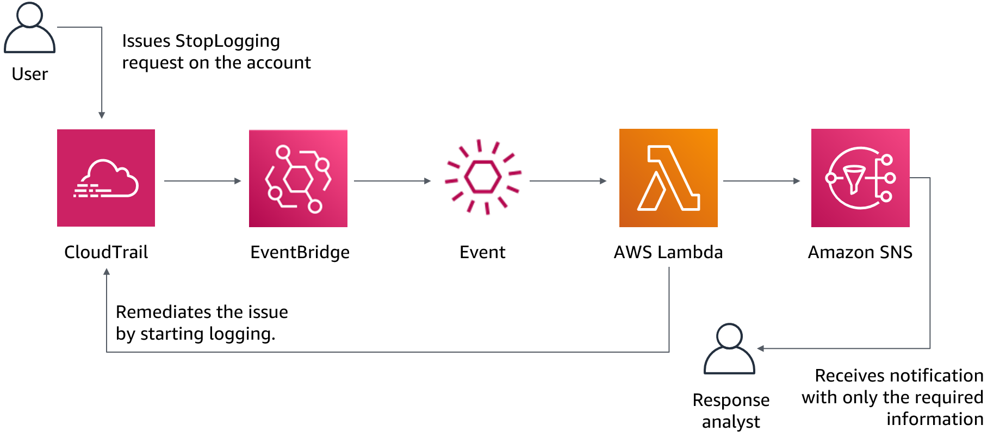

> **Нотатки:**
>
> For accessibility: Diagram of using Lambda for incident response. User issues a StopLogging request to CloudTrail. CloudTrail and EventBridge invoke a Lambda function to automatically remediate the event. Processed information is sent as an SNS notification to a response analyst. Another Lambda function is invoked automatically to restart the logging. End of accessibility description.  
>
> With an event-driven response system, a detective mechanism invokes a responsive mechanism to automatically remediate the event. You can use event-driven response capabilities to reduce the time-to-value between detective mechanisms and responsive mechanisms. To create this event-driven architecture, you can use Lambda.  
>
> For example, assume that you have an AWS account with the AWS CloudTrail service enabled. If CloudTrail is ever disabled, the response procedure is to enable the service again and investigate the user who disabled the CloudTrail logging. You can use EventBridge to monitor for the specific “cloudtrail:StopLogging” event and invoke the function if it occurs. When EventBridge invokes this Lambda function, the function collects the details of the specific event. The details include information such as the identity of the principal that disabled CloudTrail, when it was disabled, and the specific resource that was affected. This processed information could then be sent as a notification through Amazon SNS. You can use this information to essentially perform a log dive and then generate a notification or alert with only the specific values that a response analyst would require. Another Lambda function could also be invoked to automatically restart the logging.

---

## Слайд 33: Working together for incident response

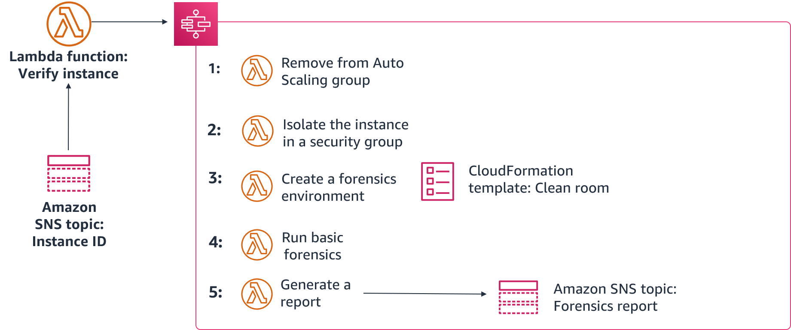

> **Нотатки:**
>
> This slide provides an example of how to use Step Functions, Lambda, CloudFormation, and Amazon SNS to remediate a compromised instance. First, a script or third-party tool pushes an instance ID to an SNS topic. Then, a Lambda function verifies the ID and, if compromised, initiates the following Step Functions workflow:  
> The instance is removed from its Auto Scaling group, and a snapshot is created of any attached Amazon Elastic Block Store (Amazon EBS) volumes.  
> The instance is isolated by removing all its previously associated security groups. Then, a new forensics security group is assigned to the instance with no inbound or outbound permissions.  
> A CloudFormation template is used to create a new environment, including a new VPC that contains a forensics instance with prebuilt tools attached to a copy of any volumes from the snapshots.  
> A basic forensics investigation is performed on the attached volumes.  
> A report is then generated with the results from the investigation and sent to the team through an SNS topic.

---

## Слайд 34: Key takeaways: AWS services that support the resolution and recovery phase

AWS offers several services that support the resolution and recovery phase, including the following:

- Systems Manager
- CloudFormation
- Lambda
- Amazon SNS
- Step Functions

> **Нотатки:**
>
> A key takeaway from this section of the module is that AWS offers several services that support the resolution and recovery phase, including the following:  
> Systems Manager gives you visibility and control of your infrastructure on AWS.  
> With CloudFormation, you can create and provision AWS infrastructure deployments predictably and repeatedly.  
> Lambda is an event-driven response service that provides the ability to run code without provisioning or managing servers.  
> Amazon SNS is an event-driven response web service that coordinates and manages delivering or sending messages to subscribing endpoints or clients.  
> Step Functions is an event-driven response service that makes it easy to coordinate the components of distributed applications as a series of steps in a visual workflow.

---

## Слайд 35: Best practices for handling an incident

Responding to and Managing an Incident

> **Нотатки:**
>
> This section covers best practices in responding to and managing an incident.

---

## Слайд 36: Industry best practices for handling incidents

- Identify key personnel, external resources, and tooling.
- Automate containment capabilities.
- Develop incident response plans.
- Pre-provision access and tools.
- Run incident response game days.

> **Нотатки:**
>
> Let’s look at some industry best practices for handling incidents.  
>
> To improve incident response, start by identifying key personnel in your organization. Maintain a contact list of personnel within your organization who you would need to involve when responding to and recovering from an incident. Engage with external partners, if necessary, to help you respond to and recover from an incident. Also, research and test tools that would help your organization respond to and recover from an incident. Automated containment of an incident can reduce response times and organizational impact.  
>
> Preparation is critical to minimize disruption from an incident. Create easy-to-follow runbooks that detail the steps to take to respond to and recover from an incident. Ensure that your escalation and communications plans include personnel in your organization and external parties that you must notify at each stage during an incident. Have a process to identify and document the root cause of an event so that you can develop mitigation strategies to limit or prevent recurrence, and develop procedures for prompt and effective responses. As part of your planning, ensure that security personnel have the right tools pre-deployed into AWS. Also, ensure that security personnel have the correct access pre-provisioned into AWS so that they can appropriately respond to an incident.  
>
> Rehearse incident response and recovery frequently. Run simulated incident response events, or game days, that involve key staff and management for different threats. Use lessons learned from running game days as part of a feedback loop to improve your processes.

---

## Слайд 37: Lab: Remediating an Incident by Using AWS Config and Lambda

> **Нотатки:**
>
> You will now complete the Remediating an Incident by Using AWS Config and Lambda lab.

---

## Слайд 38: Lab: Tasks

1. Examining and updating IAM roles
2. Setting up AWS Config to monitor resources
3. Modifying a security group that AWS Config monitors
4. Creating and running an AWS Config rule that calls a Lambda function
5. Revisiting the security group configuration
6. Using CloudWatch logs for verification

> **Нотатки:**
>
> In this lab, you will complete the following tasks:  
> Examining and updating IAM roles  
> Setting up AWS Config to monitor resources  
> Modifying a security group that AWS Config monitors  
> Creating and running an AWS Config rule that calls a Lambda function  
> Revisiting the security group configuration  
> Using CloudWatch logs for verification

---

## Слайд 39: Begin Lab: Remediating an Incident by Using AWS Config and Lambda

Duration: 90 minutes

> **Нотатки:**
>
> It's now time to start the lab.

---

## Слайд 40: Lab debrief: Key takeaways

> **Нотатки:**
>
> After you complete the lab, your educator might choose to lead a conversation about the key takeaways from the lab.

---

## Слайд 41: Module wrap-up

Responding to and Managing an Incident

> **Нотатки:**
>
> It’s now time to review the module, and wrap up with a knowledge check and discussion of a practice certification exam question.

---

## Слайд 42: Module summary

In this module, you learned how to do the following:

- Identify an incident.
- Describe AWS services that are used for incident recognition and remediation.
- Identify best practices for incident response.

> **Нотатки:**
>
> In this module, you learned how to do the following:  
> Identify an incident.  
> Describe AWS services that are used for incident recognition and remediation.  
> Identify best practices for incident response.

---

## Слайд 43: Complete the knowledge check

> **Нотатки:**
>
> It is now time to complete the knowledge check for this module.

---

## Слайд 44: Sample exam question

An administrator would like to use a continuous monitoring and assessment service that provides an inventory of AWS resources. Which AWS service would meet their need?

Choice

Response

A

AWS Lambda

B

AWS CloudTrail

C

AWS Config

D

AWS Fargate

> **Нотатки:**
>
> Look at the answer choices and rule them out based on the keywords.

---

## Слайд 45: Sample exam question answer

An administrator would like to use a continuous monitoring and assessment service that provides an inventory of AWS resources. Which AWS service would meet their need?

The correct answer is C.

The keywords in the question are **continuous monitoring**, **assessment service**, and **inventory**.

> **Нотатки:**
>
> The keywords to focus on are continuous monitoring, assessment service, and inventory.  
>
> The correct answer is C. AWS Config continuously captures configuration changes that are associated with your resources. The service can send notifications when changes occur, can be used to invoke a Lambda function, and integrates with other AWS services to remediate issues.  
>
> Incorrect answers:  
> Answer A: Lambda is a serverless, event-driven compute service that provides the ability to run code without provisioning or managing servers. The service does not monitor your environment.  
> Answer B: CloudTrail captures API calls made by or on behalf of your AWS account. The service does not provide an inventory of AWS resources.  
> Answer D: Fargate is a serverless compute service for containers. The service does not monitor your environment.

---

## Слайд 46: Thank you

Corrections, feedback, or other questions?  
Contact us at [https://support.aws.amazon.com/#/contacts/aws-academy](https://support.aws.amazon.com/#/contacts/aws-academy).  
All trademarks are the property of their owners.

> **Нотатки:**
>
> Thank you for completing this module.

---

## Слайд 47: Image source files for development use only

<!-- hidden slide -->

> **Нотатки:**
>
> Image source files for development use only

---

## Слайд 48: Evaluating rules

<!-- hidden slide -->

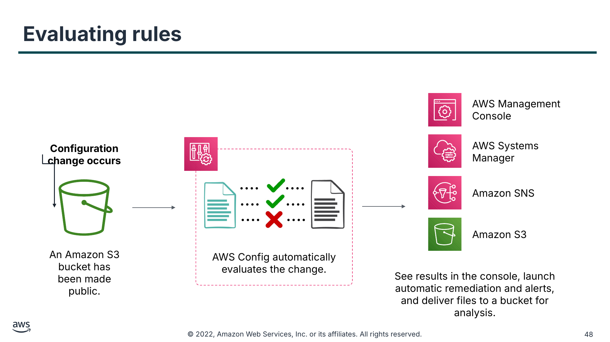

AWS Management Console

**Configuration change occurs**

AWS Systems Manager

….

….

….

….

Amazon SNS

….

….

Amazon S3

An Amazon S3 bucket has been made public.

AWS Config automatically evaluates the change.

See results in the console, launch automatic remediation and alerts, and deliver files to a bucket for analysis.

> **Нотатки:**
>
> As configuration changes occur in your AWS resources, AWS Config records and normalizes the changes into a consistent format. AWS Config automatically evaluates the recorded changes against the rules you have set. The results can then be accessed via the change history and compliance results using the AWS Management Console or APIs. You can configure AWS Systems Manager or Amazon Simple Notification Service (Amazon SNS) to be triggered and remediate or alert you when changes happen. You can also deliver the change history and snapshot files of the monitored resources to an Amazon S3 bucket for analysis.

---

## Слайд 49: AWS Lambda for incident response

<!-- hidden slide -->

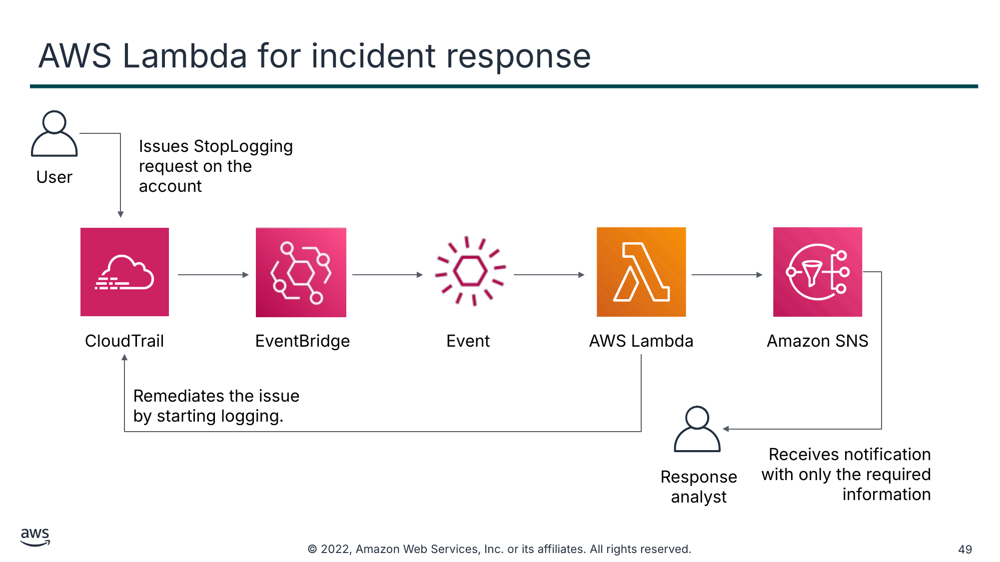

Issues StopLogging request on the account

User

CloudTrail

EventBridge

Event

AWS Lambda

Amazon SNS

Remediates the issue by starting logging.

Receives notification with only the required information

Response analyst

> **Нотатки:**
>
> With an event-driven response system, a detective mechanism triggers a responsive mechanism to automatically remediate the event. You can use event-driven response capabilities to reduce the time-to-value between detective mechanisms and responsive mechanisms. To create this event-driven architecture, you can use AWS Lambda. For example, assume that you have an AWS account with the CloudTrail service enabled. If CloudTrail is ever disabled, the response procedure is to enable the service again and investigate the user who disabled the CloudTrail logging.  
>
> You can use Amazon CloudWatch Events to monitor for the specific cloudtrail:StopLogging event and invoke the function if it occurs. When CloudWatch Events invokes this Lambda function, the function collects the details of the specific event with the information of the principal that disabled CloudTrail, when it was disabled, the specific resource that was affected, and other relevant information. This processed information could then be sent as an Amazon SNS notification. You can use this information to essentially perform a log dive and then generate a notification or alert with only the specific values that a response analyst would require. Another Lambda function can also be invoked to automatically start the logging.

---

## Слайд 50: Working together for incident response

<!-- hidden slide -->

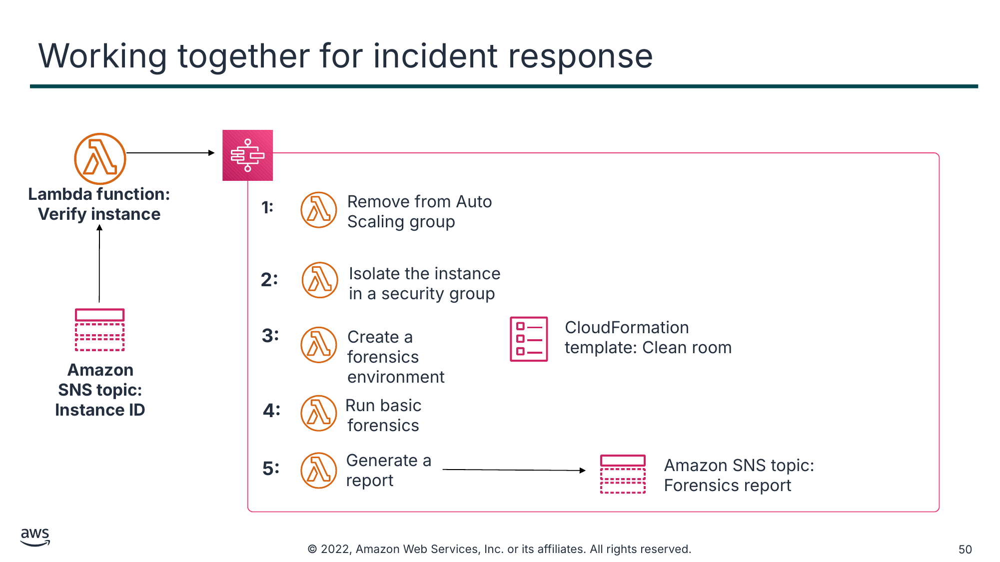

**Lambda function: Verify instance**

**Amazon SNS topic:**  
**Instance ID**

Текст зі схеми

**1:**

Remove from Auto Scaling group

**2:**

Isolate the instance in a security group

**3:**

CloudFormation

template: Clean room

Create a forensics environment

**4:**

Run basic forensics

**5:**

Generate a report

Amazon SNS topic: Forensics report

> **Нотатки:**
>
> Here is an example of how to respond to a compromised instance using Step Functions, Lambda, AWS CloudFormation, and Amazon SNS. It starts with a script, or third-party tool, pushing instance IDs to an Amazon SNS topic. Then, a Lambda function verifies the IDs and, if they compromised, initiates a Step Functions workflow:  
>
> 1. The instance is removed from its Auto Scaling group, a snapshot is created of any attached Amazon EBS volumes, instance metadata (like IP, AMI ID, subnets etc.) is recorded, a quarantine resource tag is applied to the instance, and the team is notified.  
> 2. The instance is isolated by removing all its previously associated security groups. Then, a new forensics security group is assigned to the instance with no inbound or outbound permissions.  
> 3. An AWS CloudFormation template is used to create a brand new environment, including a new VPC containing a forensics instance with prebuilt tools attached to a copy of any volumes from the snapshots.  
> 4. A basic forensics investigation is performed on the attached volumes.  
> 5. Reports are then generated with the results from the investigation and sent to the team via an Amazon SNS topic.
