## Слайд 1: Реагування на інцидент і керування ним (Responding to and Managing an Incident)

AWS Academy Cloud Security Foundations

> **Нотатки:**
>
> Вітаємо в модулі «Реагування на інцидент і керування ним» (Responding to and Managing an Incident).

---

## Слайд 2: Вступ

Реагування на інцидент і керування ним

> **Нотатки:**
>
> Цей перший розділ надає вступ до модуля.

---

## Слайд 3: Цілі модуля

Наприкінці цього модуля ви повинні вміти:

- Визначати інцидент.
- Описувати сервіси Amazon Web Services (AWS), що використовуються для розпізнавання інцидентів і їх усунення (remediation).
- Визначати найкращі практики реагування на інциденти.

> **Нотатки:**
>
> Наприкінці цього модуля ви повинні вміти:  
> Визначати інцидент.  
> Описувати сервіси Amazon Web Services (AWS), що використовуються для розпізнавання інцидентів і їх усунення.  
> Визначати найкращі практики реагування на інциденти.

---

## Слайд 4: Огляд модуля

**Розділи**

- Визначення інциденту
- Сервіси AWS, що підтримують фазу виявлення та розпізнавання
- Сервіси AWS, що підтримують фазу усунення та відновлення
- Найкращі практики обробки інциденту

**Лабораторна робота**

- Усунення інциденту за допомогою AWS Config та Lambda (Remediating an Incident by Using AWS Config and Lambda)

**Перевірка знань**

> **Нотатки:**
>
> Цей модуль містить такі розділи:  
> Визначення інциденту  
> Сервіси AWS, що підтримують фазу виявлення та розпізнавання  
> Сервіси AWS, що підтримують фазу усунення та відновлення  
> Найкращі практики обробки інциденту  
>
> Також цей модуль містить лабораторну роботу про усунення інциденту за допомогою AWS Config та AWS Lambda.  
>
> Наприкінці вам буде запропоновано пройти перевірку знань, що перевіряє ваше розуміння ключових концепцій, розглянутих у цьому модулі.

---

## Слайд 5: Банківський бізнес-сценарій (1 із 3)

> **Нотатки:**
>
> Обговорімо, як концепції цього модуля застосовуються до банківського бізнес-сценарію.

---

## Слайд 6: Банківський бізнес-сценарій (2 із 3)

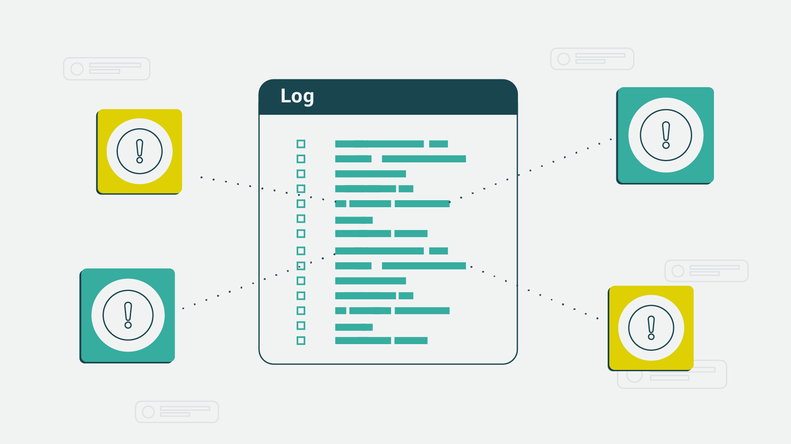

> **Нотатки:**
>
> Після обговорення різних сервісів, які можна використати для протидії загрозам, Джон (John) повідомив Марії (María), що він за. Вона має його повну підтримку та підтримку ради директорів, щоб розпочати підготовку до міграції в хмару AWS. Марія в захваті, але знає, що є ще дещо, що потрібно вирішити, щоб бути повністю підготовленими.  
>
> Марія знає, що захист ресурсів у хмарі — це робота, яка ніколи не буває повністю завершена.

---

## Слайд 7: Банківський бізнес-сценарій (3 із 3)

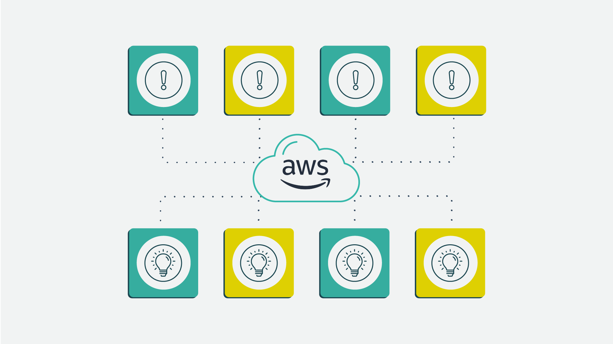

> **Нотатки:**
>
> Через міграцію план реагування на інциденти банку потрібно переглянути й оновити.  
>
> План має включати нові інструменти та методи, які використовуватимуть їхні адміністратори безпеки. І це наступний проєкт Марії!

---

## Слайд 8: Модель спільної відповідальності (shared responsibility model)

> **Нотатки:**
>
> Для доступності: модель спільної відповідальності з переліком обов’язків клієнта й AWS. Клієнт відповідає за безпеку в хмарі. Це включає дані клієнта; платформу, застосунки, керування ідентичністю та доступом; конфігурацію операційної системи, мережі та брандмауера; шифрування даних на стороні клієнта та цілісність даних, автентифікацію; серверне шифрування файлової системи та даних; захист мережевого трафіку, що включає шифрування, цілісність і ідентичність. AWS відповідає за безпеку самої хмари. Це включає базові сервіси AWS для обчислень, зберігання, баз даних і мереж, а також глобальну інфраструктуру AWS, що включає регіони, зони доступності та периферійні локації. Кінець опису для доступності.  
>
> Тепер, коли ми розглянули інструменти, що їх надає AWS, щоб допомогти журналювати та відстежувати доступ, подивімося, як реагувати на інцидент безпеки.

---

## Слайд 9: Визначення інциденту

Реагування на інцидент і керування ним

> **Нотатки:**
>
> Цей розділ охоплює, як визначити інцидент.

---

## Слайд 10: Розпізнавання інциденту та реагування на нього

- Набір політик і процедур інформаційної безпеки, які можна використовувати для виявлення, стримування та усунення кібератак
- Дає організації змогу швидко виявляти та зупиняти атаки
- Допомагає мінімізувати шкоду та запобігати майбутнім атакам

> **Нотатки:**
>
> Реагування на інциденти (incident response) — це набір політик і процедур інформаційної безпеки, які можна використовувати для виявлення, стримування та усунення кібератак.  
>
> Мета реагування на інциденти — дати організації змогу швидко виявляти та зупиняти атаки, що допомагає мінімізувати шкоду та запобігати майбутнім атакам того самого типу.

---

## Слайд 11: Розпізнавання інцидентів

**Не всі події є інцидентами, що потребують негайного усунення.**

- Вхід із віддаленого розташування
- Диск, що виходить з ладу, але все ще повністю працездатний
- Працівник, який намагається отримати доступ до ресурсів, до яких не повинен мати доступу

> **Нотатки:**
>
> Як підприємство дізнається, що відбувається зловживання? Як воно відрізнить аномальні події, що потребують його уваги, від інцидентів, що потребують негайного аналізу та усунення?  
>   
> Не всі події є інцидентами, що потребують негайного усунення. Розгляньмо кілька прикладів таких подій:  
> Вхід із віддаленого розташування: працівник може подорожувати або використовувати схвалену віртуальну приватну мережу (VPN).  
> Диск, що виходить з ладу, але все ще повністю працездатний: знання цієї інформації дає підприємству змогу вчасно запланувати циклічну заміну дисків, не панікуючи та не виконуючи «гарячу заміну» (hot swapping), коли вже надто пізно й диск уже вийшов з ладу. «Гаряча заміна» — це вилучення компонентів із комп’ютерної системи або підключення їх до неї, поки живлення залишається ввімкненим.  
> Працівник, який намагається отримати доступ до ресурсів, до яких не повинен мати доступу: хоча це може не становити порушення, якщо в доступі було відмовлено, це все одно поведінкова інформація, яку слід відстежувати.

---

## Слайд 12: Фаза 1: виявлення та розпізнавання (discovery and recognition)

- Ідентифікація, журналювання та категоризація інциденту
- Сповіщення про інцидент і ескалація
- Розслідування та діагностика

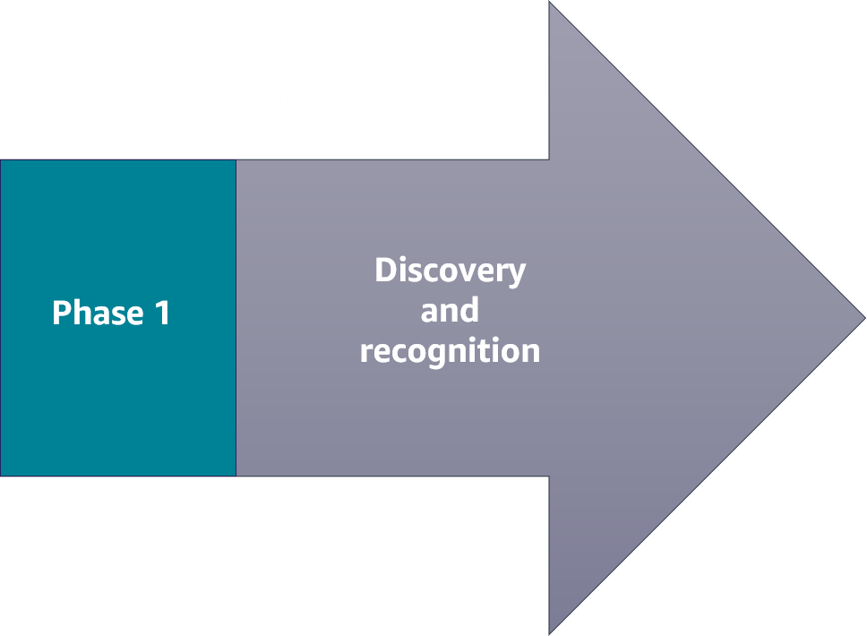

> **Нотатки:**
>
> Реагування на інцидент має дві фази. Перша фаза — виявлення та розпізнавання. Саме тут відбувається ідентифікація, журналювання та категоризація інциденту. Щойно інцидент визначено за повідомленнями користувачів, аналізом рішень або ручною ідентифікацією, інцидент журналюється й може розпочатися розслідування та категоризація.  
>
> Протягом цієї фази надходить сповіщення. Сповіщення налаштовує користувач, і вони запускаються вказаними сигналами для надсилання електронного листа, SMS-повідомлення або push-сповіщення через мобільний застосунок. Ескалація інциденту (incident escalation) відбувається, коли працівник не може розв’язати інцидент самостійно й має передати завдання досвідченішому чи більш спеціалізованому працівнику.  
>
> Розслідування та діагностика включають проведення розслідування інциденту, щоб отримати відповіді та розробити стратегії усунення будь-яких загроз.  
>
> AWS пропонує низку сервісів і продуктів, що допомагають компаніям виявляти та ідентифікувати події, які можуть призвести до інциденту або вже стали ним.

---

## Слайд 13: Фаза 2: усунення та відновлення (resolution and recovery)

- Криміналістична ізоляція (forensic isolation; якщо це програмне забезпечення — відтворити помилку)
- Підготовка виправлення (stage a fix)
- Розгортання виправлення
- Закриття інциденту

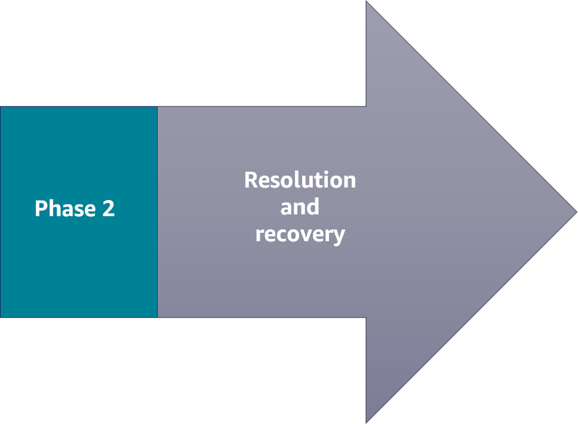

Автоматизуйте ці процеси, де це можливо, і проводьте навчання (game days) у проміжних (безпечних) середовищах, щоб удосконалити загальнокорпоративний процес реагування на інциденти.

> **Нотатки:**
>
> Коли підприємство визначило відмову компонента, зниження якості сервісу чи експлойт, що потребує усунення, воно переходить до фази усунення та відновлення в реагуванні на інциденти.  
>   
> Ця друга фаза складається з такого:  
> Криміналістична ізоляція: ізолюйте інцидент і проведіть глибокий аналіз, щоб виявити проблему. Криміналістика часто вимагає зняття образу диска або конфігурації операційної системи «як є» (as-is). Проблемою може бути помилка в кодовій базі. Якщо так, потрібно відтворити помилку. Без можливості відтворити помилку, з якою зіткнувся клієнт, ви не зможете її виправити.  
> Підготовка виправлення: відтворіть проблему, застосуйте виправлення та протестуйте.  
> Розгортання виправлення: передайте будь-яку нову інфраструктуру (як код) або будь-який новий код застосунку в продуктивне середовище.  
> Закриття інциденту: розв’яжіть інцидент.  
>
> AWS пропонує низку сервісів і продуктів, що допомагають компаніям усувати інцидент.

---

## Слайд 14: Ключові висновки: визначення інциденту

- Реагування на інциденти — це набір політик і процедур інформаційної безпеки, які можна використовувати для виявлення, стримування та усунення кібератак.
- Не всі події є інцидентами, що потребують негайного усунення.
- Перша фаза інциденту — фаза виявлення та розпізнавання.
- Друга фаза інциденту — фаза усунення та відновлення.

> **Нотатки:**
>
> Ключові висновки з цього розділу модуля:  
> Реагування на інциденти — це набір політик і процедур інформаційної безпеки, які можна використовувати для виявлення, стримування та усунення кібератак.  
> Не всі події є інцидентами, що потребують негайного усунення.  
> Перша фаза інциденту — фаза виявлення та розпізнавання.  
> Друга фаза інциденту — фаза усунення та відновлення.

---

## Слайд 15: Сервіси AWS, що підтримують фазу виявлення та розпізнавання

Реагування на інцидент і керування ним

> **Нотатки:**
>
> Цей розділ виділяє кілька сервісів AWS, що підтримують фазу виявлення та розпізнавання. Зверніть увагу, що це не всі доступні сервіси AWS.

---

## Слайд 16: Фаза виявлення та розпізнавання

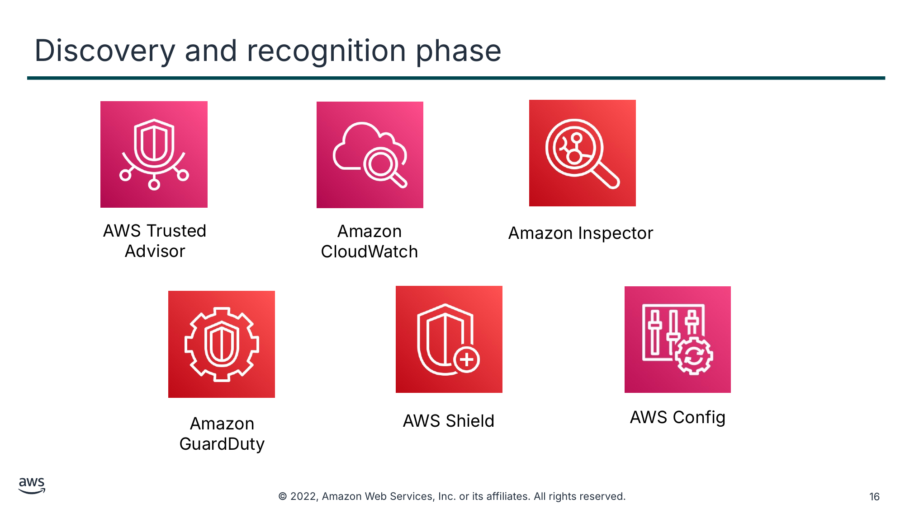

Текст зі схеми

AWS Trusted Advisor

Amazon Inspector

Amazon CloudWatch

AWS Shield

AWS Config

Amazon GuardDuty

> **Нотатки:**
>
> AWS пропонує кілька сервісів, що підтримують виявлення та розпізнавання інцидентів. Ці сервіси допомагають підприємству ідентифікувати атаку.  
>
> У цьому розділі докладніше описано такі сервіси та те, як вони підтримують цю фазу реагування на інциденти:  
> AWS Trusted Advisor  
> Amazon CloudWatch  
> Amazon Inspector  
> Amazon GuardDuty  
> AWS Shield  
> AWS Config

---

## Слайд 17: AWS Trusted Advisor

- Спирається на найкращі практики, засвоєні під час обслуговування сотень тисяч клієнтів AWS
- Перевіряє ваше середовище AWS, а потім надає рекомендації, коли є можливості покращити продуктивність і допомогти закрити прогалини в безпеці

AWS Trusted Advisor

> **Нотатки:**
>
> Сервіс AWS Trusted Advisor спирається на найкращі практики, засвоєні під час обслуговування сотень тисяч клієнтів AWS. Trusted Advisor перевіряє ваше середовище AWS, а потім надає рекомендації, коли є можливості покращити продуктивність і допомогти закрити прогалини в безпеці.  
>
> Якщо у вас план AWS Basic Support або Developer Support, ви можете використовувати AWS Management Console для доступу до основних перевірок безпеки та всіх перевірок квот сервісів. Якщо у вас план Business, Enterprise On-Ramp або Enterprise Support, ви можете використовувати консоль, AWS Support API і AWS Command Line Interface (AWS CLI) для доступу до всіх перевірок, зокрема оптимізації витрат, безпеки, відмовостійкості, продуктивності й квот сервісів.  
>
> Також можна використовувати Amazon EventBridge для моніторингу стану перевірок Trusted Advisor.  
>
> Докладніше див. AWS Trusted Advisor у посібнику користувача AWS Support за адресою https://docs.aws.amazon.com/awssupport/latest/user/trusted-advisor.html.

---

## Слайд 18: Amazon CloudWatch

- Надає надійне, масштабоване та гнучке рішення для моніторингу, яким можна почати користуватися за лічені хвилини
- Автоматично відображає метрики про кожен сервіс AWS, який ви використовуєте
- Надає можливість створювати сигнали (alarms), що стежать за метриками й надсилають сповіщення

Amazon CloudWatch

> **Нотатки:**
>
> Amazon CloudWatch надає надійне, масштабоване та гнучке рішення для моніторингу, яким можна почати користуватися за лічені хвилини. Користуючись цим сервісом, вам не потрібно налаштовувати, обслуговувати й масштабувати власні системи та інфраструктуру моніторингу.  
>
> Головна сторінка консолі CloudWatch автоматично відображає метрики про кожен сервіс AWS, який ви використовуєте. Додатково можна створювати власні панелі для відображення метрик про ваші власні застосунки та відображення власних наборів метрик, які ви обираєте.  
>
> Можна створювати сигнали, що стежать за метриками й надсилають сповіщення або автоматично вносять зміни до ресурсів, які ви відстежуєте, коли порушується порогове значення.  
>
> З CloudWatch ви отримуєте загальносистемну видимість використання ресурсів, продуктивності застосунків і операційного стану.  
>
> Докладніше див. посібник користувача Amazon CloudWatch за адресою https://docs.aws.amazon.com/AmazonCloudWatch/latest/monitoring/WhatIsCloudWatch.html.

---

## Слайд 19: Amazon Inspector

- Сервіс керування вразливостями, що безперервно сканує ваші робочі навантаження AWS на вразливості
- Автоматично виявляє та сканує екземпляри Amazon Elastic Compute Cloud (Amazon EC2) і образи контейнерів, що розміщені в Amazon Elastic Container Registry (Amazon ECR)
- Створює результат (finding), коли виявляє вразливість або мережеву проблему

Amazon Inspector

> **Нотатки:**
>
> Amazon Inspector — це сервіс керування вразливостями, що безперервно сканує ваші робочі навантаження AWS на вразливості. Amazon Inspector автоматично виявляє та сканує екземпляри Amazon Elastic Compute Cloud (Amazon EC2) і образи контейнерів, що розміщені в Amazon Elastic Container Registry (Amazon ECR), на вразливості програмного забезпечення та ненавмисну мережеву вразливість до впливу.  
>
> Коли Amazon Inspector виявляє вразливість програмного забезпечення чи мережеву проблему, сервіс створює результат (finding). Результат описує вразливість, визначає постраждалий ресурс, оцінює серйозність вразливості та надає вказівки щодо усунення.  
>
> Докладніше див. посібник користувача Amazon Inspector за адресою https://docs.aws.amazon.com/inspector/latest/user/what-is-inspector.html.

---

## Слайд 20: Amazon GuardDuty

- Сервіс безперервного моніторингу безпеки
- Виявляє несподівану та потенційно неавторизовану чи зловмисну активність
- Використовує потоки розвідки загроз (threat intelligence feeds)

Amazon GuardDuty

> **Нотатки:**
>
> Amazon GuardDuty — це сервіс безперервного моніторингу безпеки. Він може допомогти виявляти несподівану та потенційно неавторизовану чи зловмисну активність у вашому середовищі AWS.  
>
> Сервіс використовує потоки розвідки загроз, як-от списки зловмисних IP-адрес і доменів, та машинне навчання, щоб виявляти несподівану та потенційно неавторизовану й зловмисну активність у вашому середовищі AWS. Це може включати такі проблеми, як ескалація привілеїв, використання розкритих облікових даних або обмін даними із зловмисними IP-адресами чи доменами. Наприклад, GuardDuty може виявляти скомпрометовані екземпляри EC2, що поширюють шкідливе програмне забезпечення чи майнять біткоїни. Сервіс також відстежує поведінку доступу до акаунта AWS на ознаки компрометації, як-от неавторизовані розгортання інфраструктури (наприклад, розгортання екземплярів у регіоні, який ніколи не використовувався) та незвичайні виклики API (наприклад, зміна політики паролів для зниження міцності паролів).  
>
> Докладніше див. посібник користувача Amazon GuardDuty за адресою https://docs.aws.amazon.com/guardduty/latest/ug/what-is-guardduty.html.

---

## Слайд 21: AWS Shield

- Автоматично захищає корпоративну мережу від розподіленої атаки «відмова в обслуговуванні» (DDoS)
- Пропонує кероване обслуговування захисту від загроз AWS Shield Advanced, щоб покращити ваш стан безпеки (security posture) за допомогою додаткових можливостей виявлення, пом’якшення та реагування на DDoS

AWS Shield

> **Нотатки:**
>
> AWS Shield допомагає захищати корпоративну мережу від розподіленої атаки «відмова в обслуговуванні» (DDoS). DDoS-атака — це зловмисна спроба порушити нормальний трафік цільового сервера, сервісу чи мережі, перевантаживши ціль або її навколишню інфраструктуру потоком інтернет-трафіку. На високому рівні DDoS-атака схожа на несподіваний затор, що блокує автостраду й не дає звичайному трафіку дістатися до місця призначення.  
>
> Коли ви будуєте свій застосунок в AWS, ви отримуєте автоматичний захист від поширених DDoS-атак. Крім того, ви можете використовувати кероване обслуговування захисту від загроз AWS Shield Advanced, щоб покращити ваш стан безпеки за допомогою додаткових можливостей виявлення, пом’якшення та реагування на DDoS.  
>
> Докладніше див. AWS Shield у посібнику розробника AWS WAF, AWS Firewall Manager та AWS Shield Advanced за адресою https://docs.aws.amazon.com/waf/latest/developerguide/shield-chapter.html.

---

## Слайд 22: AWS Config

- Сервіс безперервного моніторингу та оцінювання
- Надає можливість переглядати поточні та історичні конфігурації ресурсу й використовувати цю інформацію для усунення збоїв
- Надсилає сповіщення, коли відбуваються зміни
- Інтегрується з іншими сервісами AWS для усунення проблем

AWS Config

> **Нотатки:**
>
> AWS Config — це сервіс безперервного моніторингу та оцінювання, що надає вам інвентар ваших ресурсів AWS і записує зміни конфігурації цих ресурсів. Ви можете переглядати поточні та історичні конфігурації ресурсу й використовувати цю інформацію для усунення збоїв і проведення аналізу атак на безпеку. Також можна переглядати конфігурацію в будь-який момент часу й використовувати цю інформацію, щоб переналаштувати ваші ресурси та повернути їх до сталого стану під час збою.  
>
> AWS Config надсилає сповіщення, коли відбуваються зміни, та інтегрується з іншими сервісами AWS для усунення проблем.  
>
> Докладніше див. посібник користувача AWS Config за адресою https://docs.aws.amazon.com/config/latest/developerguide/WhatIsConfig.html.

---

## Слайд 23: Оцінювання правил (evaluating rules)

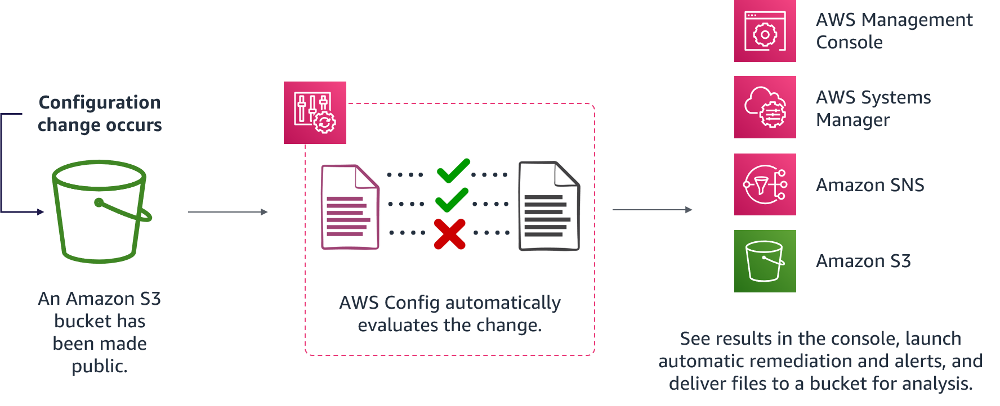

> **Нотатки:**
>
> Для доступності: схема оцінювання правил AWS Config. Відбувається зміна конфігурації. У цьому прикладі бакет S3 було зроблено публічним. AWS Config автоматично оцінює зміну. Результати можна переглянути в консолі. Systems Manager і Amazon SNS використовуються для виклику автоматичного усунення та сповіщень. Файли доставляються в бакет S3 для аналізу. Кінець опису для доступності.  
>
> Коли в ваших ресурсах AWS відбуваються зміни конфігурації, AWS Config записує та нормалізує зміни до узгодженого формату. AWS Config автоматично оцінює записані зміни відносно правил, які ви встановили. Потім ви можете отримати доступ до історії змін і результатів відповідності за допомогою консолі чи API. Можна налаштувати виклик Systems Manager або Amazon SNS, щоб усунути проблему чи сповістити вас, коли відбуваються зміни. Також можна доставляти історію змін і файли знімків відстежуваних ресурсів у бакет S3 для аналізу.

---

## Слайд 24: Ключові висновки: сервіси AWS, що підтримують фазу виявлення та розпізнавання

AWS пропонує кілька сервісів, що підтримують фазу виявлення та розпізнавання, зокрема такі:

- Trusted Advisor
- CloudWatch
- AWS Config
- Amazon Inspector
- Shield
- GuardDuty

> **Нотатки:**
>
> Ключовий висновок з цього розділу модуля: AWS пропонує кілька сервісів, що підтримують фазу виявлення та розпізнавання, зокрема такі:  
> Trusted Advisor перевіряє ваше середовище AWS, а потім надає рекомендації, коли є можливості заощадити кошти, покращити доступність і продуктивність системи або допомогти закрити прогалини в безпеці.  
> CloudWatch надає надійне, масштабоване та гнучке рішення для моніторингу.  
> AWS Config — це сервіс безперервного моніторингу та оцінювання, що надає вам інвентар ваших ресурсів AWS і записує зміни конфігурації цих ресурсів.  
> Amazon Inspector — це сервіс керування вразливостями, що безперервно сканує ваші робочі навантаження AWS на вразливості.  
> Shield пропонує захист від DDoS-атак.  
> GuardDuty — це сервіс безперервного моніторингу безпеки, що може допомогти виявляти несподівану та потенційно неавторизовану чи зловмисну активність у вашому середовищі AWS.

---

## Слайд 25: Сервіси AWS, що підтримують фазу усунення та відновлення

Реагування на інцидент і керування ним

> **Нотатки:**
>
> Цей розділ виділяє кілька сервісів, що підтримують фазу усунення та відновлення. Зверніть увагу, що це не всі доступні сервіси AWS.

---

## Слайд 26: Усунення та відновлення

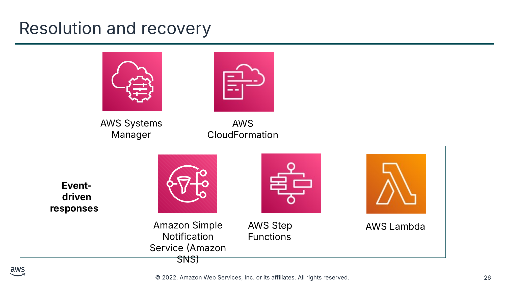

Текст зі схеми

AWS Systems Manager

AWS CloudFormation

**Event-driven responses (Реагування, кероване подіями)**

Amazon Simple Notification Service (Amazon SNS)

AWS Step Functions

AWS Lambda

> **Нотатки:**
>
> AWS пропонує кілька різних сервісів, що допомагають в усуненні та відновленні.  
>
> У цьому розділі докладніше описано такі сервіси та те, як вони підтримують цю фазу реагування на інциденти:  
> AWS Systems Manager  
> AWS CloudFormation  
> Amazon Simple Notification Service (Amazon SNS)  
> AWS Step Functions  
> AWS Lambda  
>
> Lambda, Amazon SNS і Step Functions — усі є сервісами реагування, керованими подіями (event-driven response). Реагування, кероване подіями, — це комп’ютерна програма, написана для реагування на дії, згенеровані користувачем або системою.

---

## Слайд 27: AWS Systems Manager

- Надає вам видимість і контроль вашої інфраструктури в AWS
- Надає єдиний користувацький інтерфейс, щоб ви могли переглядати операційні дані з кількох сервісів AWS
- Надає можливість групувати ресурси за застосунками й переглядати операційні дані для моніторингу та усунення несправностей
- Допомагає підтримувати ваші екземпляри у визначеному стані та виконувати зміни на вимогу, як-от оновлення застосунків або запуск скриптів оболонки

AWS Systems Manager

> **Нотатки:**
>
> AWS Systems Manager надає вам видимість і контроль вашої інфраструктури в AWS. Systems Manager надає єдиний користувацький інтерфейс, щоб ви могли переглядати операційні дані з кількох сервісів AWS і автоматизувати операційні завдання у ваших ресурсах AWS. З Systems Manager можна групувати ресурси за застосунками, переглядати операційні дані для моніторингу та усунення несправностей і виконувати дії над вашими групами ресурсів. Systems Manager може допомогти підтримувати ваші екземпляри у визначеному стані та виконувати зміни на вимогу, як-от оновлення застосунків або запуск скриптів оболонки. Сервіс також може допомогти виконувати інші завдання автоматизації та встановлення виправлень (patching).  
>
> Докладніше див. посібник користувача AWS Systems Manager за адресою https://docs.aws.amazon.com/systems-manager/latest/userguide/what-is-systems-manager.html.

---

## Слайд 28: AWS CloudFormation

- Допомагає моделювати та налаштовувати ресурси AWS, щоб ви витрачали менше часу на керування цими ресурсами та більше — на застосунки, що працюють в AWS
- Надає можливість створити шаблон, що описує всі потрібні вам ресурси AWS
- Можна використати для відтворення проміжного (staging) середовища всередині ізольованої, або криміналістичної, віртуальної приватної хмари (VPC)

AWS CloudFormation

> **Нотатки:**
>
> AWS CloudFormation — це сервіс, що допомагає моделювати та налаштовувати ресурси AWS, щоб ви витрачали менше часу на керування цими ресурсами та більше — на застосунки, що працюють в AWS. Ви створюєте шаблон, що описує всі потрібні вам ресурси AWS, а CloudFormation подбає про розгортання та налаштування цих ресурсів за вас. Вам не потрібно окремо створювати й налаштовувати ресурси AWS і з’ясовувати, що від чого залежить; CloudFormation впорається з цим.  
>
> Підприємство може використати CloudFormation, щоб відтворити проміжне середовище всередині ізольованої, або криміналістичної, віртуальної приватної хмари (VPC). Щойно систему ізольовано, команда може провести глибокий аналіз і виявити проблему, імовірно відтворити її, застосувати виправлення та протестувати. Потім команда може передати будь-яку нову інфраструктуру (як код) або будь-який новий код застосунку в продуктивне середовище.  
>
> Докладніше див. посібник користувача AWS CloudFormation за адресою https://docs.aws.amazon.com/AWSCloudFormation/latest/UserGuide/Welcome.html.

---

## Слайд 29: Amazon Simple Notification Service (Amazon SNS)

- Вебсервіс, керований подіями, що дає змогу застосункам, кінцевим користувачам і пристроям миттєво надсилати й отримувати сповіщення з хмари

Amazon Simple Notification Service (Amazon SNS)

> **Нотатки:**
>
> Amazon Simple Notification Service (Amazon SNS) — це вебсервіс, керований подіями, що дає змогу застосункам, кінцевим користувачам і пристроям миттєво надсилати й отримувати сповіщення з хмари.  
>
> Amazon SNS і Lambda інтегровані, тож можна викликати функції Lambda за допомогою сповіщень Amazon SNS. Коли повідомлення публікується в темі Amazon SNS, на яку підписано функцію Lambda, функція Lambda викликається з корисним навантаженням (payload) опублікованого повідомлення. Функція Lambda отримує корисне навантаження повідомлення як вхідний параметр і може обробляти інформацію в повідомленні, публікувати повідомлення в інші теми SNS або надсилати повідомлення до інших сервісів AWS.  
>
> Підприємство може використовувати Amazon SNS для отримання сповіщень про потенційні експлойти.  
>
> Докладніше див. посібник розробника Amazon Simple Notification Service за адресою https://docs.aws.amazon.com/sns/latest/dg/welcome.html.

---

## Слайд 30: AWS Step Functions

- Візуальний сервіс робочих процесів, що його розробники використовують для побудови розподілених застосунків і автоматизації ІТ- та бізнес-процесів
- Надає можливість створювати робочі процеси, керовані подіями, для керування збоями, повторними спробами, розпаралелюванням, інтеграціями сервісів і спостережуваністю, щоб розробники могли зосередитися на бізнес-логіці вищої цінності

AWS Step Functions

> **Нотатки:**
>
> AWS Step Functions — це візуальний сервіс робочих процесів із низьким рівнем коду (low-code), що його розробники використовують для побудови розподілених застосунків, автоматизації ІТ- та бізнес-процесів і побудови конвеєрів даних і машинного навчання за допомогою сервісів AWS. Робочі процеси, керовані подіями, керують збоями, повторними спробами, розпаралелюванням, інтеграціями сервісів і спостережуваністю, щоб розробники могли зосередитися на бізнес-логіці вищої цінності.  
>
> Коли підприємство стикається з аномаліями, впровадження Step Functions може допомогти створити складну бізнес-логіку в робочих процесах, керованих подіями, що з’єднують сервіси, системи чи людей за лічені хвилини.  
>
> Докладніше див. посібник розробника AWS Step Functions за адресою https://docs.aws.amazon.com/step-functions/latest/dg/welcome.html.

---

## Слайд 31: AWS Lambda

- Безсерверний (serverless) обчислювальний сервіс, керований подіями, що дає змогу запускати код на вимогу без розгортання чи керування серверами
- Функції Lambda не зберігають стану (stateless)

AWS Lambda

> **Нотатки:**
>
> AWS Lambda — це безсерверний обчислювальний сервіс, керований подіями, що дає змогу запускати код на вимогу без розгортання чи керування серверами. Ви платите лише за спожитий обчислювальний час, а плата не стягується, коли ваш код не виконується. З Lambda можна запускати код практично для будь-якого типу застосунку чи бекенд-сервісу, і все це без адміністрування. Просто завантажте свій код, а Lambda подбає про все, що потрібно для запуску й масштабування вашого коду з високою доступністю. Можна налаштувати автоматичний виклик вашого коду з інших сервісів AWS або викликати його безпосередньо з будь-якого вебзастосунку чи мобільного застосунку.  
>
> Функції Lambda не зберігають стану, без прив’язки до базової інфраструктури. Це означає, що Lambda може швидко запускати стільки копій функції, скільки потрібно для масштабування до швидкості вхідних подій. Після завантаження коду в Lambda ви можете пов’язати свою функцію з певними ресурсами AWS, як-от конкретний бакет Amazon Simple Storage Service (Amazon S3) або тема SNS. Потім, коли ресурс змінюється, Lambda запускає вашу функцію та за потреби керує обчислювальними ресурсами, щоб встигати за вхідними запитами.  
>
> Якщо вам потрібно зберігати секрети для доступу до зовнішніх сервісів, можна використати AWS Key Management Service (AWS KMS) для зберігання й отримання секретів у вашій функції Lambda.  
>
> Те, як викликається функція Lambda, залежить від джерела подій, яке ви з нею використовуєте:  
> Для виклику на основі подій деякі джерела подій можуть публікувати події в Lambda й безпосередньо викликати вашу функцію Lambda. Це називається моделлю надсилання (push model), за якої джерела подій викликають вашу функцію Lambda.  
> Деякі джерела подій публікують події, але Lambda має опитувати (poll) джерело подій і викликати вашу функцію Lambda, коли події відбуваються. Це називається моделлю отримання (pull model).  
> Виклик «запит—відповідь» (request-response) змушує Lambda виконувати функцію синхронно й негайно повертати відповідь застосунку, що викликає. Цей тип виклику доступний для користувацьких застосунків.  
>
> Докладніше див. посібник розробника AWS Lambda за адресою https://docs.aws.amazon.com/lambda/latest/dg/welcome.html.

---

## Слайд 32: Lambda для реагування на інциденти

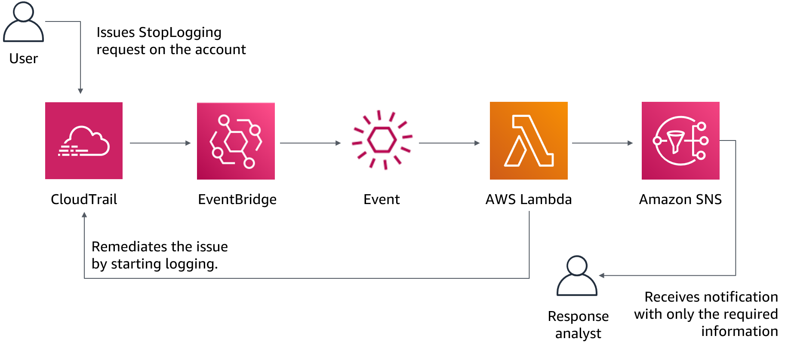

> **Нотатки:**
>
> Для доступності: схема використання Lambda для реагування на інциденти. Користувач надсилає запит StopLogging до CloudTrail. CloudTrail і EventBridge викликають функцію Lambda для автоматичного усунення події. Оброблена інформація надсилається як сповіщення SNS аналітику реагування. Автоматично викликається ще одна функція Lambda, щоб перезапустити журналювання. Кінець опису для доступності.  
>
> У системі реагування, керованій подіями, детективний механізм (detective mechanism) викликає механізм реагування для автоматичного усунення події. Можливості реагування, керовані подіями, можна використовувати для скорочення часу до отримання цінності між детективними механізмами та механізмами реагування. Для створення цієї архітектури, керованої подіями, можна використати Lambda.  
>
> Наприклад, припустімо, що у вас є акаунт AWS із увімкненим сервісом AWS CloudTrail. Якщо CloudTrail колись буде вимкнено, процедура реагування полягає в повторному ввімкненні сервісу та розслідуванні дій користувача, який вимкнув журналювання CloudTrail. Можна використати EventBridge для відстеження конкретної події «cloudtrail:StopLogging» і виклику функції, якщо вона відбудеться. Коли EventBridge викликає цю функцію Lambda, функція збирає відомості про конкретну подію. Відомості включають таку інформацію, як ідентичність принципала, який вимкнув CloudTrail, коли його було вимкнено та який конкретний ресурс постраждав. Цю оброблену інформацію потім можна надіслати як сповіщення через Amazon SNS. Цю інформацію можна використати, щоб по суті виконати «занурення в журнал» (log dive) і згенерувати сповіщення чи оповіщення лише з тими конкретними значеннями, які потрібні аналітику реагування. Також можна викликати ще одну функцію Lambda для автоматичного перезапуску журналювання.

---

## Слайд 33: Спільна робота для реагування на інциденти

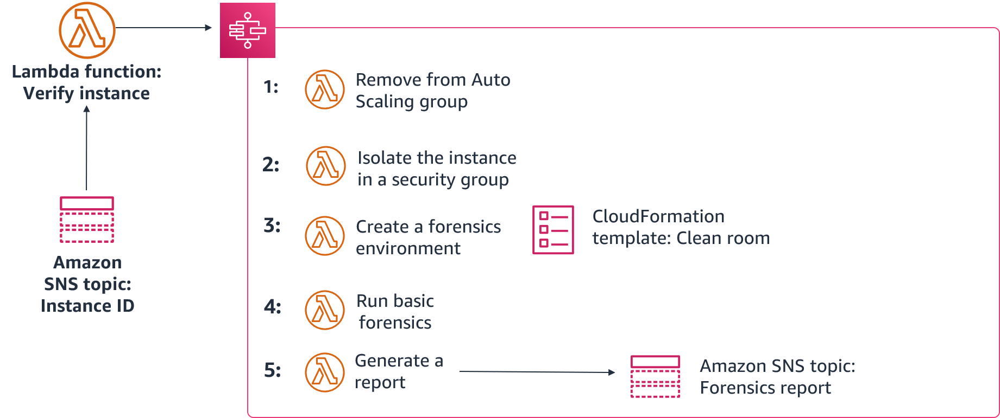

> **Нотатки:**
>
> Цей слайд надає приклад того, як використовувати Step Functions, Lambda, CloudFormation та Amazon SNS для усунення наслідків компрометації екземпляра. Спочатку скрипт або інструмент стороннього розробника надсилає ідентифікатор екземпляра в тему SNS. Потім функція Lambda перевіряє ідентифікатор і, якщо екземпляр скомпрометовано, запускає такий робочий процес Step Functions:  
> Екземпляр вилучають зі своєї групи Auto Scaling і створюють знімок будь-яких приєднаних томів Amazon Elastic Block Store (Amazon EBS).  
> Екземпляр ізолюють, вилучивши всі раніше пов’язані з ним групи безпеки. Потім екземпляру призначають нову криміналістичну групу безпеки без вхідних і вихідних дозволів.  
> Шаблон CloudFormation використовують для створення нового середовища, зокрема нової VPC, що містить криміналістичний екземпляр із попередньо встановленими інструментами, приєднаний до копії будь-яких томів зі знімків.  
> На приєднаних томах виконують базове криміналістичне розслідування.  
> Потім генерують звіт із результатами розслідування й надсилають його команді через тему SNS.

---

## Слайд 34: Ключові висновки: сервіси AWS, що підтримують фазу усунення та відновлення

AWS пропонує кілька сервісів, що підтримують фазу усунення та відновлення, зокрема такі:

- Systems Manager
- CloudFormation
- Lambda
- Amazon SNS
- Step Functions

> **Нотатки:**
>
> Ключовий висновок з цього розділу модуля: AWS пропонує кілька сервісів, що підтримують фазу усунення та відновлення, зокрема такі:  
> Systems Manager надає вам видимість і контроль вашої інфраструктури в AWS.  
> З CloudFormation можна передбачувано та багаторазово створювати й розгортати інфраструктуру AWS.  
> Lambda — це сервіс реагування, керований подіями, що дає змогу запускати код без розгортання чи керування серверами.  
> Amazon SNS — це вебсервіс реагування, керований подіями, що координує та керує доставкою або надсиланням повідомлень підписаним кінцевим точкам чи клієнтам.  
> Step Functions — це сервіс реагування, керований подіями, що полегшує координацію компонентів розподілених застосунків у вигляді послідовності кроків у візуальному робочому процесі.

---

## Слайд 35: Найкращі практики обробки інциденту

Реагування на інцидент і керування ним

> **Нотатки:**
>
> Цей розділ охоплює найкращі практики реагування на інцидент і керування ним.

---

## Слайд 36: Галузеві найкращі практики обробки інцидентів

- Визначте ключовий персонал, зовнішні ресурси та інструментарій.
- Автоматизуйте можливості стримування (containment).
- Розробіть плани реагування на інциденти.
- Заздалегідь надайте доступ і розгорніть інструменти (pre-provision).
- Проводьте навчання з реагування на інциденти (game days).

> **Нотатки:**
>
> Розгляньмо деякі галузеві найкращі практики обробки інцидентів.  
>
> Щоб покращити реагування на інциденти, почніть із визначення ключового персоналу у вашій організації. Підтримуйте список контактів персоналу у вашій організації, якого потрібно буде залучати під час реагування на інцидент і відновлення після нього. За потреби залучайте зовнішніх партнерів, щоб допомогти вам реагувати на інцидент і відновлюватися. Також досліджуйте й тестуйте інструменти, що допомогли б вашій організації реагувати на інцидент і відновлюватися. Автоматизоване стримування інциденту може скоротити час реагування та вплив на організацію.  
>
> Підготовка критично важлива для мінімізації порушень через інцидент. Створіть прості для виконання посібники (runbooks), що детально описують кроки, які потрібно виконати для реагування на інцидент і відновлення після нього. Переконайтеся, що ваші плани ескалації та комунікацій включають персонал у вашій організації та зовнішні сторони, яких потрібно сповістити на кожному етапі під час інциденту. Майте процес визначення та документування першопричини (root cause) події, щоб ви могли розробити стратегії пом’якшення для обмеження чи запобігання повторенню та розробити процедури для швидкого й ефективного реагування. У межах планування переконайтеся, що персонал безпеки має правильні інструменти, заздалегідь розгорнуті в AWS. Також переконайтеся, що персонал безпеки має правильний доступ, заздалегідь наданий в AWS, щоб він міг належним чином реагувати на інцидент.  
>
> Часто відпрацьовуйте реагування на інциденти та відновлення. Проводьте змодельовані події реагування на інциденти, або навчання (game days), за участі ключового персоналу та керівництва для різних загроз. Використовуйте уроки, отримані під час навчань, як частину циклу зворотного зв’язку для вдосконалення ваших процесів.

---

## Слайд 37: Лабораторна робота: усунення інциденту за допомогою AWS Config та Lambda (Remediating an Incident by Using AWS Config and Lambda)

> **Нотатки:**
>
> Зараз ви виконаєте лабораторну роботу «Усунення інциденту за допомогою AWS Config та Lambda» (Remediating an Incident by Using AWS Config and Lambda).

---

## Слайд 38: Лабораторна робота: завдання

1. Вивчення та оновлення ролей IAM
2. Налаштування AWS Config для моніторингу ресурсів
3. Зміна групи безпеки, яку відстежує AWS Config
4. Створення та запуск правила AWS Config, що викликає функцію Lambda
5. Повторний перегляд конфігурації групи безпеки
6. Використання журналів CloudWatch для перевірки

> **Нотатки:**
>
> У цій лабораторній роботі ви виконаєте такі завдання:  
> Вивчення та оновлення ролей IAM  
> Налаштування AWS Config для моніторингу ресурсів  
> Зміна групи безпеки, яку відстежує AWS Config  
> Створення та запуск правила AWS Config, що викликає функцію Lambda  
> Повторний перегляд конфігурації групи безпеки  
> Використання журналів CloudWatch для перевірки

---

## Слайд 39: Початок лабораторної роботи: усунення інциденту за допомогою AWS Config та Lambda

Тривалість: 90 хвилин

> **Нотатки:**
>
> Настав час розпочати лабораторну роботу.

---

## Слайд 40: Підсумки лабораторної роботи: ключові висновки

> **Нотатки:**
>
> Після завершення лабораторної роботи ваш викладач може вирішити провести обговорення ключових висновків із лабораторної роботи.

---

## Слайд 41: Підсумки модуля

Реагування на інцидент і керування ним

> **Нотатки:**
>
> Настав час повторити матеріал модуля та завершити його перевіркою знань і розбором запитання практичного сертифікаційного іспиту.

---

## Слайд 42: Резюме модуля

У цьому модулі ви навчилися:

- Визначати інцидент.
- Описувати сервіси AWS, що використовуються для розпізнавання інцидентів і їх усунення.
- Визначати найкращі практики реагування на інциденти.

> **Нотатки:**
>
> У цьому модулі ви навчилися:  
> Визначати інцидент.  
> Описувати сервіси AWS, що використовуються для розпізнавання інцидентів і їх усунення.  
> Визначати найкращі практики реагування на інциденти.

---

## Слайд 43: Пройдіть перевірку знань

> **Нотатки:**
>
> Настав час пройти перевірку знань для цього модуля.

---

## Слайд 44: Приклад запитання іспиту

Адміністратор хоче використовувати сервіс безперервного моніторингу та оцінювання, що надає інвентар ресурсів AWS. Який сервіс AWS задовольнить його потребу?

Варіант

Відповідь

A

AWS Lambda

B

AWS CloudTrail

C

AWS Config

D

AWS Fargate

> **Нотатки:**
>
> Розгляньте варіанти відповідей і відсійте їх за ключовими словами.

---

## Слайд 45: Відповідь на приклад запитання іспиту

Адміністратор хоче використовувати сервіс безперервного моніторингу та оцінювання, що надає інвентар ресурсів AWS. Який сервіс AWS задовольнить його потребу?

Правильна відповідь — C.

Ключові слова в запитанні: **безперервного моніторингу**, **сервіс оцінювання** та **інвентар**.

> **Нотатки:**
>
> Ключові слова, на яких слід зосередитися: безперервний моніторинг, сервіс оцінювання та інвентар.  
>
> Правильна відповідь — C. AWS Config безперервно фіксує зміни конфігурації, пов’язані з вашими ресурсами. Сервіс може надсилати сповіщення, коли відбуваються зміни, може використовуватися для виклику функції Lambda та інтегрується з іншими сервісами AWS для усунення проблем.  
>
> Неправильні відповіді:  
> Відповідь A: Lambda — це безсерверний обчислювальний сервіс, керований подіями, що дає змогу запускати код без розгортання чи керування серверами. Сервіс не відстежує ваше середовище.  
> Відповідь B: CloudTrail фіксує виклики API, зроблені акаунтом AWS або від його імені. Сервіс не надає інвентар ресурсів AWS.  
> Відповідь D: Fargate — це безсерверний обчислювальний сервіс для контейнерів. Сервіс не відстежує ваше середовище.

---

## Слайд 46: Дякуємо

Виправлення, відгуки чи інші запитання?  
Зв’яжіться з нами за адресою [https://support.aws.amazon.com/#/contacts/aws-academy](https://support.aws.amazon.com/#/contacts/aws-academy).  
Усі торговельні марки є власністю їхніх власників.

> **Нотатки:**
>
> Дякуємо, що пройшли цей модуль.

---

## Слайд 47: Вихідні файли зображень лише для розробки

<!-- hidden slide -->

> **Нотатки:**
>
> Вихідні файли зображень лише для розробки (Image source files for development use only)

---

## Слайд 48: Оцінювання правил

<!-- hidden slide -->

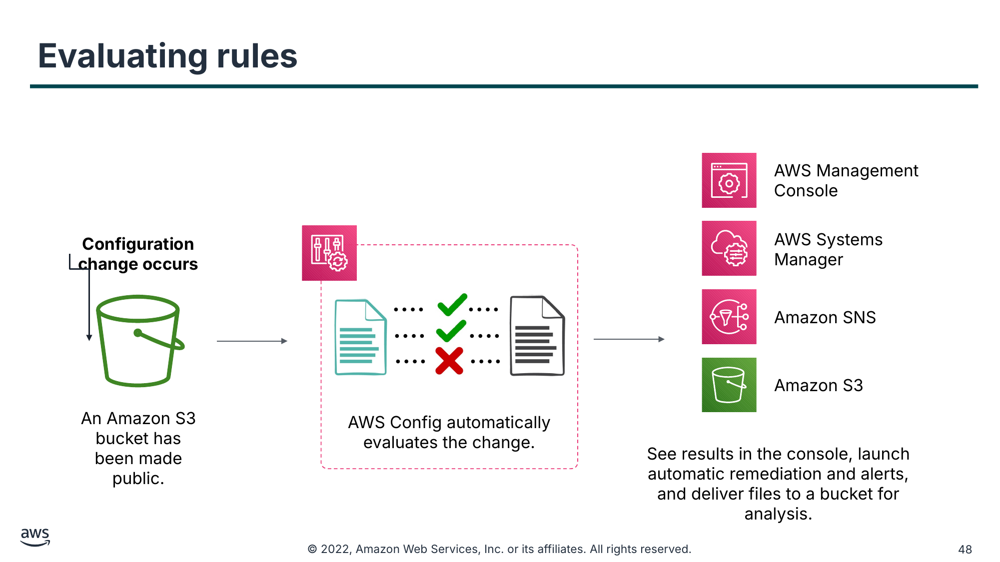

AWS Management Console

**Configuration change occurs (Відбувається зміна конфігурації)**

AWS Systems Manager

….

….

….

….

Amazon SNS

….

….

Amazon S3

An Amazon S3 bucket has been made public. (Бакет Amazon S3 було зроблено публічним.)

AWS Config automatically evaluates the change. (AWS Config автоматично оцінює зміну.)

See results in the console, launch automatic remediation and alerts, and deliver files to a bucket for analysis. (Перегляньте результати в консолі, запустіть автоматичне усунення й сповіщення та доставте файли в бакет для аналізу.)

> **Нотатки:**
>
> Коли в ваших ресурсах AWS відбуваються зміни конфігурації, AWS Config записує та нормалізує зміни до узгодженого формату. AWS Config автоматично оцінює записані зміни відносно правил, які ви встановили. Потім результати можна отримати через історію змін і результати відповідності за допомогою AWS Management Console або API. Можна налаштувати запуск AWS Systems Manager або Amazon Simple Notification Service (Amazon SNS), щоб усунути проблему чи сповістити вас, коли відбуваються зміни. Також можна доставляти історію змін і файли знімків відстежуваних ресурсів у бакет Amazon S3 для аналізу.

---

## Слайд 49: AWS Lambda для реагування на інциденти

<!-- hidden slide -->

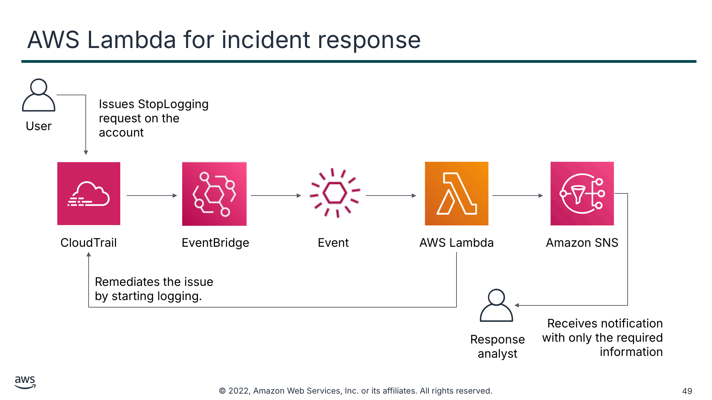

Issues StopLogging request on the account (Надсилає запит StopLogging в акаунті)

User (Користувач)

CloudTrail

EventBridge

Event (Подія)

AWS Lambda

Amazon SNS

Remediates the issue by starting logging. (Усуває проблему, запускаючи журналювання.)

Receives notification with only the required information (Отримує сповіщення лише з потрібною інформацією)

Response analyst (Аналітик реагування)

> **Нотатки:**
>
> У системі реагування, керованій подіями, детективний механізм запускає механізм реагування для автоматичного усунення події. Можливості реагування, керовані подіями, можна використовувати для скорочення часу до отримання цінності між детективними механізмами та механізмами реагування. Для створення цієї архітектури, керованої подіями, можна використати AWS Lambda. Наприклад, припустімо, що у вас є акаунт AWS із увімкненим сервісом CloudTrail. Якщо CloudTrail колись буде вимкнено, процедура реагування полягає в повторному ввімкненні сервісу та розслідуванні дій користувача, який вимкнув журналювання CloudTrail.  
>
> Можна використати Amazon CloudWatch Events для відстеження конкретної події cloudtrail:StopLogging і виклику функції, якщо вона відбудеться. Коли CloudWatch Events викликає цю функцію Lambda, функція збирає відомості про конкретну подію з інформацією про принципала, який вимкнув CloudTrail, коли його було вимкнено, який конкретний ресурс постраждав, та іншу відповідну інформацію. Цю оброблену інформацію потім можна надіслати як сповіщення Amazon SNS. Цю інформацію можна використати, щоб по суті виконати «занурення в журнал» (log dive) і згенерувати сповіщення чи оповіщення лише з тими конкретними значеннями, які потрібні аналітику реагування. Також можна викликати ще одну функцію Lambda для автоматичного запуску журналювання.

---

## Слайд 50: Спільна робота для реагування на інциденти

<!-- hidden slide -->

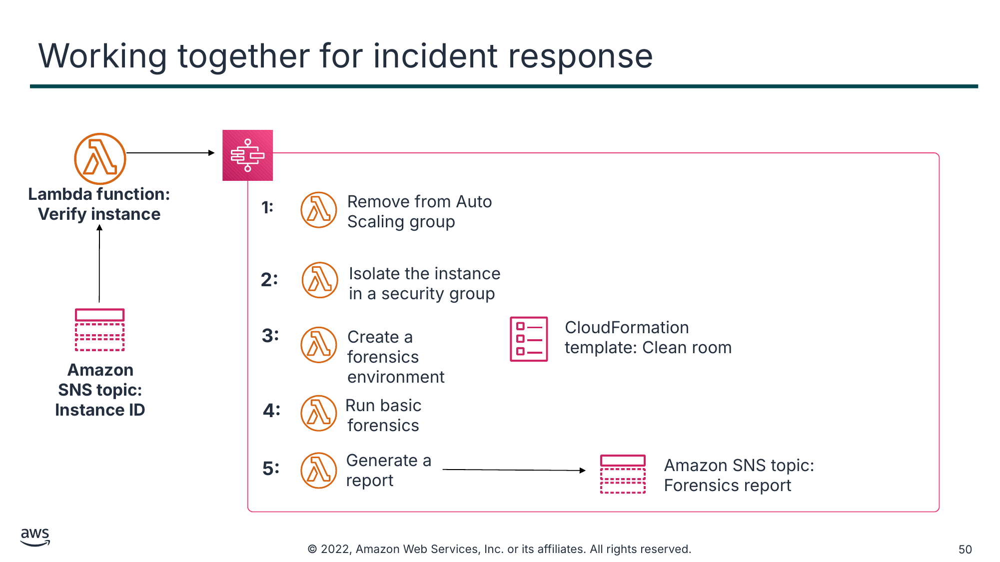

**Lambda function: Verify instance (Функція Lambda: перевірка екземпляра)**

**Amazon SNS topic:**  
**Instance ID (Тема Amazon SNS: ідентифікатор екземпляра)**

Текст зі схеми

**1:**

Remove from Auto Scaling group (Вилучити з групи Auto Scaling)

**2:**

Isolate the instance in a security group (Ізолювати екземпляр у групі безпеки)

**3:**

CloudFormation

template: Clean room (шаблон CloudFormation: «чиста кімната»)

Create a forensics environment (Створити криміналістичне середовище)

**4:**

Run basic forensics (Виконати базову криміналістику)

**5:**

Generate a report (Згенерувати звіт)

Amazon SNS topic: Forensics report (Тема Amazon SNS: криміналістичний звіт)

> **Нотатки:**
>
> Ось приклад того, як реагувати на скомпрометований екземпляр за допомогою Step Functions, Lambda, AWS CloudFormation та Amazon SNS. Усе починається зі скрипта або інструмента стороннього розробника, що надсилає ідентифікатори екземплярів у тему Amazon SNS. Потім функція Lambda перевіряє ідентифікатори й, якщо вони скомпрометовані, запускає робочий процес Step Functions:  
>
> 1. Екземпляр вилучають зі своєї групи Auto Scaling, створюють знімок будь-яких приєднаних томів Amazon EBS, записують метадані екземпляра (як-от IP, ідентифікатор AMI, підмережі тощо), до екземпляра застосовують тег ресурсу карантину (quarantine) і сповіщають команду.  
> 2. Екземпляр ізолюють, вилучивши всі раніше пов’язані з ним групи безпеки. Потім екземпляру призначають нову криміналістичну групу безпеки без вхідних і вихідних дозволів.  
> 3. Шаблон AWS CloudFormation використовують для створення абсолютно нового середовища, зокрема нової VPC, що містить криміналістичний екземпляр із попередньо встановленими інструментами, приєднаний до копії будь-яких томів зі знімків.  
> 4. На приєднаних томах виконують базове криміналістичне розслідування.  
> 5. Потім генерують звіти з результатами розслідування й надсилають їх команді через тему Amazon SNS.
